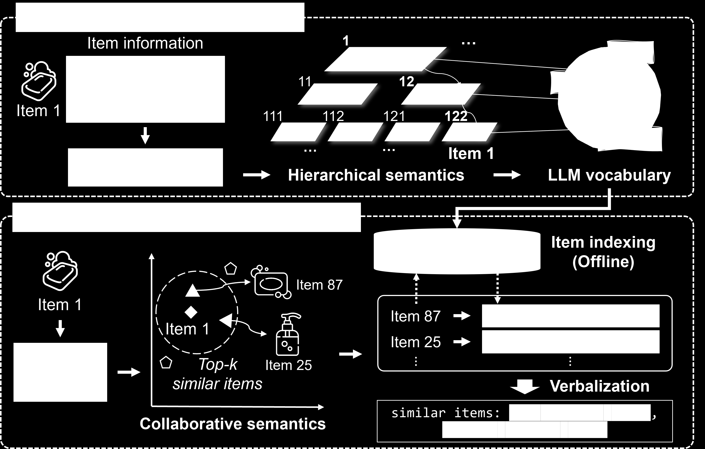

# GRAM

*Generative recommendation via semantic-aware multi-granular late fusion* — Lee et al., ACL’25

[arXiv](https://arxiv.org/abs/2506.01673) · [Record](../../data/papers/gram.yaml) · [← Catalog](../../README.md#i--tokenization)

> Abstract: "(i) incorporating implicit item relationships and (ii) utilizing rich yet lengthy item information".

| Problem it fixes | Stage it changes |
| :-- | :-- |
| **I. Informativeness**: Do the SIDs, or the model reading them, carry the collaborative and multimodal signals recommendation needs? | **Tokenization** |

## Pipeline

| Representation | Tokenization | Backbone | Training | Inference |
| :-: | :-: | :-: | :-: | :-: |
| `Text+CF` | **`H-KM`** | `Enc-Dec` | `Fixed / NTP` | `C-Beam` |

- `H-KM`: Hierarchical k-means.
- `Enc-Dec`: Encoder-decoder.
- `Fixed`: SIDs are built first and not changed while the generator trains.
- `NTP`: Next-token prediction loss only; continuing from a pretrained LLM (SFT) also counts as NTP.
- `C-Beam`: Constrained beam search.

## Architecture

## Evidence

- **`problem`** (arXiv abstract): Abstract: "(i) incorporating implicit item relationships and (ii) utilizing rich yet lengthy item information".
- **`tokenizer`** (p2): Location from the 10-26 'Training split' table in the appendix.
- **`objective`** (p2): Location from the 10-26 'Training split' table in the appendix.

## 旧卡片说明

迁自 `d61aa6c:papers/gram.md`。保留方法说明、实验叙述与局限；本轮只对照现有记录处理明确冲突，未重新逐句核查原论文。分类和规格以页面上方由记录生成的表格为准。

### GRAM：语义感知多粒度后融合生成推荐

> GRAM 在层次化语义与协同语义之间进行多粒度后融合，由生成模型直接输出物品标识。

### 研究动机与问题定义

早期融合容易让不同来源的信息相互干扰，单一粒度的语义标识又难以兼顾概括性和区分性。GRAM 延迟融合多层语义，以改善生成推荐的表达与决策。

### TL;DR（核心摘要）

`物品内容与交互 → 层次化语义/协同信息 → 多粒度编码 → 后融合解码 → 推荐物品`

模型构造层次化语义标识，并将协同语义 verbalize 为可被语言模型处理的 token。多粒度编码器分别建模局部和整体语义，解码端进行 late fusion，直接生成目标物品标识。

### 输入与使用场景

| 方面 | 说明 |
|---|---|
| 使用信息 | 用户行为、物品文本语义和协同语义 |
| 信息融入位置 | 多粒度编码与解码端后融合 |
| 语义标识结构 | 层次化多粒度序列 |
| 适用场景 | 语义增强序列推荐 |

### 方法设计

#### 3.1 语义到词汇的转换
GRAM 先建立层次化语义索引，将物品整体语义拆成多个粒度，再把协同表示转换为可被语言模型处理的协同语义 token。这样既保留语义结构，也让用户行为信号进入文本生成空间。

#### 3.2 多粒度编码器
多粒度编码器分别处理粗粒度类别、细粒度属性和协同语义。编码结果保留各层级的位置信息和语义差异，为后续生成提供互补条件。

#### 3.3 后融合解码器
与输入端早期融合不同，GRAM 在解码端延迟组合多源表示。解码器在生成不同 SID 位置时选择对应粒度的语义信息，从而减少模态间相互干扰。

#### 3.4 训练与推理
模型以用户历史到目标 SID 的生成损失训练，推理时自回归生成完整标识并映射到物品。实验重点比较多粒度、融合位置和语义来源。

### 实验结论

- 多粒度后融合优于单粒度或早期融合设置。
- 语义和协同信息的联合使用带来互补收益。

### 局限性与研究定位

#### 局限性
- 多路编码和融合增加模型与推理开销。
- 动态物品加入和大规模线上服务仍未充分评估。

#### 研究定位
GRAM 的关键贡献是将多粒度语义融合位置推迟到解码阶段，适合放在“多源语义融合”章节。

### 相关资源

- [论文原文](https://arxiv.org/abs/2506.01673)
- 代码公开情况未报告。

### 标签

`多粒度融合` · `语义标识` · `后融合` · `生成式推荐`

### 架构图来源

*图源：原论文，图4。图片使用许可待核实。*

---

### 旧总表补充

来源：`d61aa6c:tables/all-methods.md`。

- 核心贡献：多粒度语义后融合。
- 使用场景：语义增强推荐。

## Same cell: I × Tokenization (33 more)

| Paper | Venue | Pipeline |
| :-- | :-- | :-- |
| [CoST](cost.md) | RecSys’24 | `Text` → **`C-RQ`** → `Enc-Dec` → `Fixed / NTP` → `Beam` |
| [LETTER](letter.md) | CIKM’24 | `Text+CF` → **`Learn. RQ`** → `Enc-Dec` → `Fixed / NTP + Rank` → `C-Beam` |
| [LMIndexer](lmindexer.md) | ICML’24 | `Text` → **`Self-Sup. ID`** → `Enc-Dec` → `Fixed / NTP` → `C-Beam` |
| [ActionPiece](actionpiece.md) | ICML’25 | `Text` → **`OPQ`** → `Enc-Dec` → `Fixed / NTP` → `Ensemble` |
| [ADC-SID](adc-sid.md) | arXiv’25 | `Text+Img+CF` → **`MoE-VQ`** → `Enc-Dec` → `Fixed† / NTP` → `–` |
| [DAS](das.md) | CIKM’25 | `Text+CF` → **`Dual RQ`** → `Enc-Dec` → `Fixed / NTP` → `Beam` |
| [EAGER-LLM](eager-llm.md) | WWW’25 | `Text+CF` → **`Dual H-KM`** → `Dec-Only` → `Fixed / Multi-task NTP` → `Beam` |
| [FlexCode](flexcode.md) | arXiv’25 | `Text+CF` → **`Dual RQ-VAE`** → `–` → `Joint / NTP` → `–` |
| [GenSAR](gensar.md) | RecSys’25 | `Text+CF` → **`Shared/Spec. RQ`** → `Enc-Dec` → `Fixed / Multi-task NTP` → `C-Beam` |
| [GNPR-SID](gnpr-sid.md) | KDD’25 | `Attr+Geo+CF` → **`RQ-VAE`** → `Dec-Only` → `Fixed / NTP` → `–` |
| [KGTB](kgtb.md) | arXiv’25 | `Attr+Geo+CF` → **`KG-RQ`** → `Dec-Only` → `Fixed / Multi-task NTP` → `–` |
| [MME-SID](mme-sid.md) | CIKM’25 | `Text+Img+CF` → **`MM-RQ`** → `Dec-Only` → `Fixed / NTP` → `Scoring` |
| [MQL4GRec](mql4grec.md) | ICLR’25 | `Text+Img` → **`Dual RQ`** → `Enc-Dec` → `Fixed / Multi-task NTP` → `Beam` |
| [PSRQ](psrq.md) | CIKM’25 | `Text+Img` → **`Prog. RQ`** → `Encoder` → `Fixed / Discrim.` → `Scoring` |
| [QT-Mob](qt-mob.md) | KDD’25 | `Text+Geo` → **`RQ-VAE`** → `Dec-Only` → `Fixed / Multi-task NTP` → `C-Beam` |
| [TokenRec](tokenrec.md) | TKDE’25 | `CF` → **`Masked VQ`** → `Encoder` → `Fixed / Discrim.` → `Scoring` |
| [CapsID](capsid.md) | arXiv’26 | `Text+CF` → **`Soft-RQ`** → `Dec-Only` → `Fixed / NTP` → `C-Beam` |
| [ChronoID](chronoid.md) | arXiv’26 | `Text+Time` → **`RQ-VAE / Par. VQ`** → `Dec-Only†` → `Fixed / NTP` → `Beam†` |
| [GrIS (RecDMoN / RQ-GAE)](gris-recdmon-rq-gae.md) | CIKM’26 | `Text+CF` → **`RecDMoN / RQ-VAE`** → `Enc-Dec` → `Fixed / –` → `–` |
| [MACRec](macrec.md) | AAAI’26 | `Text+Img` → **`Cross RQ`** → `Enc-Dec` → `Fixed / NTP + Ctr.` → `C-Beam` |
| [MMGRec](mmgrec.md) | TOMM’26 | `Text+Img+CF` → **`Graph RQ-VAE`** → `Enc-Dec` → `Fixed / NTP` → `C-Beam` |
| [MMQ](mmq.md) | WSDM’26 | `Text+Img` → **`MoE-VQ`** → `HeterRec` → `Joint / MTP` → `–` |
| [MSCGRec](mscgrec.md) | arXiv’26 | `Text+Img+CF` → **`RQ-VAE+DINO`** → `Enc-Dec` → `Fixed† / NTP` → `Trie/C-Beam` |
| [PCR-CA](pcr-ca.md) | KDD’26 | `Text+CF` → **`PC-AE`** → `Disc.` → `Joint / Discrim.` → `Scoring` |
| [Pctx](pctx.md) | CIKM’26 | `Text+CF` → **`RQ`** → `Enc-Dec` → `Fixed / NTP` → `Beam+Agg.` |
| [ProGEO](progeo.md) | arXiv’26 | `Text+Geo` → **`R-KM+Geo-CB`** → `Dec-Only` → `Fixed / NTP` → `Beam+Geo-Filter` |
| [RoFiGR](rofigr.md) | arXiv’26 | `Text+Img+CF` → **`CF-Aligned MM RQ`** → `Enc-Dec` → `Fixed / NTP + Aux.` → `C-Beam` |
| [ROS](ros.md) | ACL’26 | `Text+Geo` → **`Geo-Prefix+RQ-VAE`** → `Dec-Only` → `Fixed / NTP → RL` → `CoT+C-Beam` |
| [SPRIG](sprig.md) | CIKM’26 Short | `Text / Audio` → **`R-KM`** → `Dec-Only` → `Fixed / NTP` → `Div. Beam` |
| [Tlow](tlow.md) | CIKM’26 Applied | `Text` → **`Flow+PQ`** → `Non-AR` → `Fixed / MTP + Rel.MSE` → `Scoring` |
| [UniRec](unirec.md) | arXiv’26 | `Text+CF` → **`RQ`** → `Dec-Only` → `Fixed / NTP → DPO` → `C-Beam` |
| [UniSID](unisid.md) | arXiv’26 | `Text+Img+Attr` → **`Direct SID Heads`** → `–` → `– / –` → `–` |
| [VarLenRec (TIGER)](varlenrec-tiger.md) | arXiv’26 | `Text` → **`HARQ`** → `Enc-Dec` → `Fixed / NTP + Aux.` → `C-Beam` |
