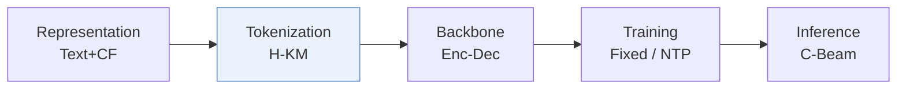
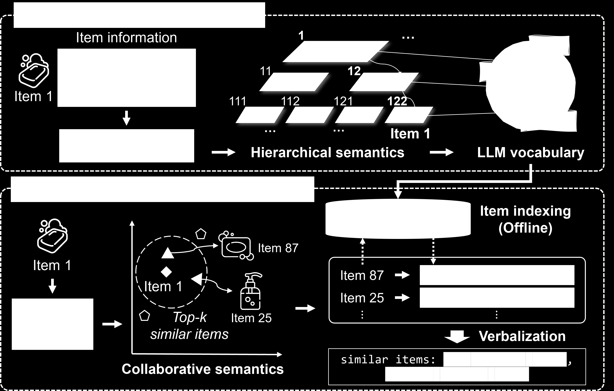
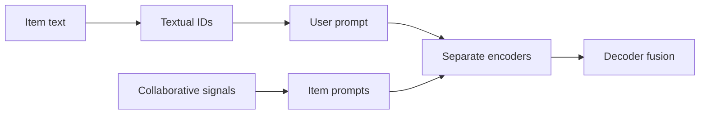
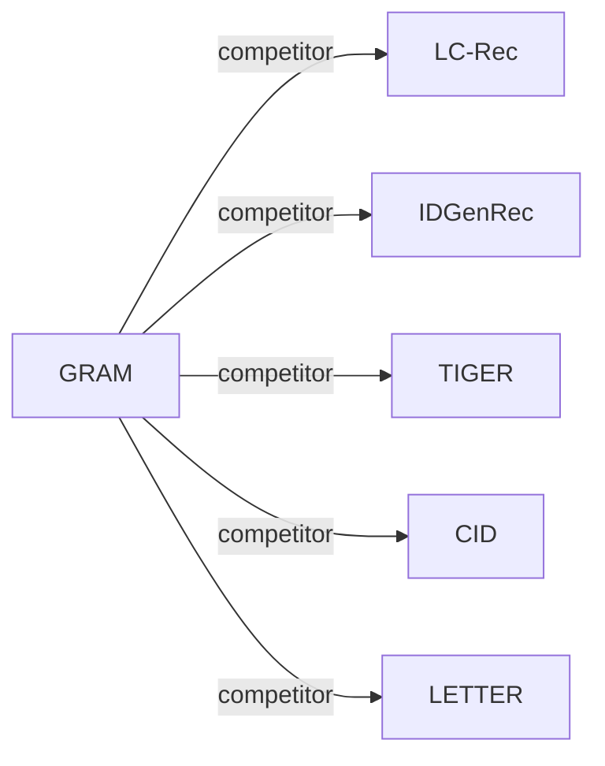

# GRAM

*Generative recommendation via semantic-aware multi-granular late fusion* — Lee et al. · ACL’25

`I. Informativeness` · `Tokenization` · [Paper](https://arxiv.org/abs/2506.01673) · [Code](https://github.com/skleee/GRAM) · [Matrix](../../README.md#i--tokenization) · [中文](../zh/papers/gram.md)

Reading level: Reading Notes (Level 2) · On this page: [TL;DR](#tldr) · [At a Glance](#at-a-glance) · [1. Why It Matters](#1-why-this-paper-matters) · [2. Method](#2-how-it-works) · [3. Experiments](#3-experimental-findings) · [4. Limitations](#4-limitations--critical-analysis) · [5. Related Work](#5-connections-to-related-work)

- `H-KM`: Hierarchical k-means.
- `Enc-Dec`: Encoder-decoder.
- `Fixed`: SIDs are built first and not changed while the generator trains.
- `NTP`: Next-token prediction loss only; continuing from a pretrained LLM (SFT) also counts as NTP.
- `C-Beam`: Constrained beam search.

### TL;DR

> [!NOTE]

> GRAM translates hierarchical and collaborative item relationships into LLM vocabulary words and encodes multi-granular prompts separately, fusing them only at decoding, to use lengthy item text efficiently.

### At a Glance

| Aspect | Summary |
| :-- | :-- |
| Research Problem | I. Informativeness: Do the SIDs, or the model reading them, carry the collaborative and multimodal signals recommendation needs? |
| Key Contribution | GRAM translates hierarchical and collaborative item relationships into LLM vocabulary words and encodes multi-granular prompts separately, fusing them only at decoding, to use lengthy item text efficiently. |
| Modified Stage | Tokenization |
| Key Findings | On four benchmark datasets, GRAM reports improvements of 11.5–16.0% in Recall@5 and 5.3–13.6% in NDCG@5 over eight generative recommendation models (Abstract). |
| Limitation | The authors name the TF-IDF selection of vocabulary words and the small T5 models as limitations (Sec. 7). |

### 1. Why This Paper Matters

Generative recommenders built on large language models (LLMs) struggle to incorporate implicit item relationships and to use rich but lengthy item information (Abstract). GRAM addresses the first with textual IDs and the second with late fusion.

> "It employs separate encoders for multi-granular prompts, delaying the fusion until the decoding stage." (Abstract)

Based on arXiv v1.

### 2. How It Works

#### Semantic-to-Lexical Translation

The hierarchical IDs are textual, for example "soap-mild-mango", with words chosen by TF-IDF from the LLM vocabulary (Sec. 7).

> "To bridge collaborative semantics to LLMs, we extract collaborative signals and convert them as an additional item attribute." (Sec. 3.2.2)

#### Multi-Granular Prompts

A coarse-grained user prompt concatenates the item IDs of the history, and fine-grained item prompts carry item attributes and collaborative semantics (Sec. 3.3.1).

#### Late Fusion

The decoder uses the combined encoder outputs as the key-value matrix in cross-attention at every step (Sec. 3.3.2, Eq. 8-9).

### 3. Experimental Findings

Experimental setup

- **Datasets**: Amazon Beauty, Toys and Games, Sports and Outdoors, and Yelp, with 5-core filtering of users and items (following Hua et al. 2023). Sizes (users / items / interactions): Beauty 22,363 / 12,101 / 198,502; Toys 19,412 / 11,924 / 167,597; Sports 35,598 / 18,357 / 296,337; Yelp 30,431 / 20,033 / 316,354.
  - Source: Datasets and 5-core: [S4.p1](https://arxiv.org/html/2506.01673v1#S4.p1); statistics: [A7.T10](https://arxiv.org/html/2506.01673v1#A7.T10).
- **Split**: Per-user leave-one-out: last item for test, second last for validation, the rest for training; sequences capped at 20 items. Three seeds.
  - Source: Leave-one-out allocation and history cap: [S4.p2](https://arxiv.org/html/2506.01673v1#S4.p2) and [S4.p4](https://arxiv.org/html/2506.01673v1#S4.p4).
- **Candidates**: full catalog (full-ranking evaluation on all items rather than sampled items).
  - Source: Full ranking on all items: [S4.p2](https://arxiv.org/html/2506.01673v1#S4.p2).
- **Visibility**: warm; no unseen-item protocol is defined. A head/tail analysis splits test users by target-item popularity (top 20% versus bottom 80%).
  - Source: Standard split with no unseen-item protocol: [S4.p2](https://arxiv.org/html/2506.01673v1#S4.p2); head/tail by target popularity: [S5.SS3.p2](https://arxiv.org/html/2506.01673v1#S5.SS3.p2).
- **SID**: Hierarchical textual IDs: recursive k-means over item text embeddings, stopping when a cluster has fewer than c items or depth reaches l; each cluster index is mapped to an existing LLM vocabulary token chosen by TF-IDF. Final (l, k, c): Beauty (7, 128, 128); Toys (5, 32, 32); Sports and Yelp (7 or 9, 32, 32). Duplicate IDs receive an appended digit for uniqueness.
  - Source: Hierarchical k-means textual IDs: [S3.SS2.SSS1.p2](https://arxiv.org/html/2506.01673v1#S3.SS2.SSS1.p2) and [S3.SS2.SSS1.p3](https://arxiv.org/html/2506.01673v1#S3.SS2.SSS1.p3); final settings: [A7.T12](https://arxiv.org/html/2506.01673v1#A7.T12); duplicate-ID digit: [S3.SS2.SSS1.p3](https://arxiv.org/html/2506.01673v1#S3.SS2.SSS1.p3).
- **Inference budget**: Constrained beam search with beam size 50 and a Trie over valid IDs; T5-small on OpenP5. Table 7: average inference time per user sequence with all user sequences in a single batch on one NVIDIA A6000 GPU (Beauty 0.2008 s, Toys 0.1605 s; LC-Rec 1.8312 s and 1.8125 s).
  - Source: Constrained beam 50 with Trie: [S4.p4](https://arxiv.org/html/2506.01673v1#S4.p4) and [S3.SS4.p2](https://arxiv.org/html/2506.01673v1#S3.SS4.p2); timing: [A3.T7](https://arxiv.org/html/2506.01673v1#A3.T7).
- **Results from**: Table 2 (four datasets versus six sequential and eight generative baselines; three seeds); Table 3 (ablations); Table 4 (ID types); Figures 6-8 (head/tail, ID length, similar items); Tables 6-7 (preprocessing and inference time); Tables 8-9 (baseline reproduction fixes for ELMRec and IDGenRec).
  - Source: Main: [S4.T2](https://arxiv.org/html/2506.01673v1#S4.T2); ablation: [S5.T3](https://arxiv.org/html/2506.01673v1#S5.T3); ID types: [S5.T4](https://arxiv.org/html/2506.01673v1#S5.T4); reproducibility: [A3.T8](https://arxiv.org/html/2506.01673v1#A3.T8) and [A4.T9](https://arxiv.org/html/2506.01673v1#A4.T9).

- Efficiency: the authors analyze preprocessing and inference time in Appendix C.

### 4. Limitations & Critical Analysis

**Stated by the authors.** The authors state that the TF-IDF-based choice of vocabulary words and the use of T5-small and T5-base limit the study (Sec. 7).

**Our analysis.**

- The IDs reuse vocabulary words instead of new tokens. This suggests that the words carry pretrained meanings, which can match or conflict with the item.
- LC-Rec maps `RQ-VAE` codes to new tokens in a `Dec-Only` LLM; GRAM uses `H-KM` textual IDs in an `Enc-Dec` model.

### 5. Connections to Related Work

- **同期对比** · [LC-Rec](lc-rec.md): LC-Rec maps RQ-VAE codes to new out-of-vocabulary tokens; GRAM builds hierarchical IDs from existing vocabulary tokens and verbalizes collaborative signals in item prompts.
  - Source: GRAM v1, Section 3.2.1 contrasts the token choice: https://arxiv.org/html/2506.01673v1#S3.SS2.SSS1.p3; baselines and Table 2: https://arxiv.org/html/2506.01673v1#S4.p3 and https://arxiv.org/html/2506.01673v1#S4.T2; inference time in Table 7: https://arxiv.org/html/2506.01673v1#A3.T7.
- **同期对比** · [IDGenRec](idgenrec.md): IDGenRec generates textual IDs with a learned ID generator; GRAM derives hierarchical textual IDs by clustering, and the authors rerun IDGenRec without user IDs that leak test items.
  - Source: GRAM v1, baselines and Table 2: https://arxiv.org/html/2506.01673v1#S4.p3 and https://arxiv.org/html/2506.01673v1#S4.T2; reproduction in Table 9 and Appendix E: https://arxiv.org/html/2506.01673v1#A4.T9 and https://arxiv.org/html/2506.01673v1#A5.p3.
- **同期对比** · [TIGER](tiger.md): TIGER uses RQ-VAE codes as new tokens; GRAM's ID-type study also tests RQ-VAE IDs inside GRAM against hierarchical textual IDs.
  - Source: GRAM v1, baselines and Table 2: https://arxiv.org/html/2506.01673v1#S4.p3 and https://arxiv.org/html/2506.01673v1#S4.T2; Table 4 ID types: https://arxiv.org/html/2506.01673v1#S5.T4 and https://arxiv.org/html/2506.01673v1#S5.SS3.p1.
- **同期对比** · [CID](cid.md): P5-CID, P5-SID, and P5-SemID are fixed indexing schemes for P5; GRAM adds hierarchical semantic text IDs and collaborative prompts.
  - Source: GRAM v1, baselines and Table 2: https://arxiv.org/html/2506.01673v1#S4.p3 and https://arxiv.org/html/2506.01673v1#S4.T2; 5-core setting follows Hua et al. (2023): https://arxiv.org/html/2506.01673v1#S4.p1.
- **同期对比** · [LETTER](letter.md): LETTER learns a regularized RQ-VAE tokenizer; GRAM avoids learned codebooks and uses text clustering mapped to vocabulary tokens.
  - Source: GRAM v1, baselines and Table 2: https://arxiv.org/html/2506.01673v1#S4.p3 and https://arxiv.org/html/2506.01673v1#S4.T2.

[查看同格全部论文](../../README.md#i--tokenization)
