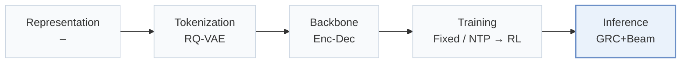
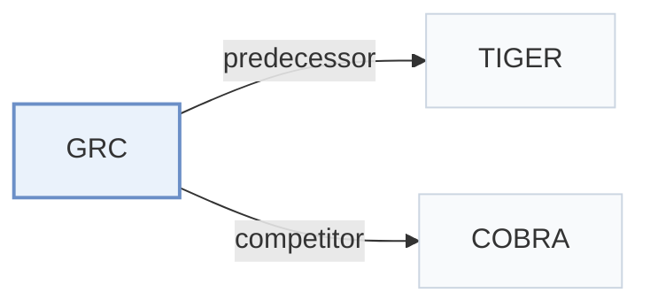

# GRC

[← Problem × Stage Matrix](../../README.md#iii--inference) · [Papers by Stage](../index/stages.md) · [Papers by Modality](../index/modality.md) · English | [中文](../zh/papers/grc.md)

| **Title** | *Learning to Reflect and Correct: Towards Better Decoding Trajectories for Large-Scale Generative Recommendation* |
| :-- | :-- |
| **Authors** | Xing et al. |
| **Venue** | CIKM’26 |
| **Problem × Stage** | `III. SID–Model Alignment` · `Inference` |
| **Links** | [Paper](https://arxiv.org/abs/2602.23639) |
| **Reading level** | Overview (Level 1) |

**On this page**: [TL;DR](#tldr) · [At a Glance](#at-a-glance) · [3. Experiments](#3-experimental-findings) · [5. Related Work](#5-connections-to-related-work)

- `RQ-VAE`: Residual-Quantized Variational AutoEncoder.
- `Enc-Dec`: Encoder-decoder.
- `Fixed`: SIDs are built first and not changed while the generator trains.
- `NTP → RL`: NTP, then reinforcement learning (GRPO, GBPO, etc.).
- `GRC+Beam`: Generation, reflection and correction combined with beam search.

### TL;DR

> [!NOTE]
> GRC extends single-pass decoding into generation, reflection, and correction in the semantic token space, trains the trajectory with GRPO, and allocates correction budget by entropy during beam search.

---

### At a Glance

| Aspect | Summary |
| :-- | :-- |
| Research Problem | III. SID–Model Alignment: Can the generator read, write, and reason over SIDs, and do the tokenizer and generator work toward the same goal? |
| Key Contribution | GRC extends single-pass decoding into generation, reflection, and correction in the semantic token space, trains the trajectory with GRPO, and allocates correction budget by entropy during beam search. |
| Modified Stage | Inference |

---

### 3. Experimental Findings

Experimental setup

- **Datasets**: Amazon Arts and Musical Instruments; industrial e-commerce advertising logs spanning March-August 2025 (over 1B interactions, 19M users, 25M advertisements). Filtering rules not reported.
  - Source: Section 5.1: [S5.SS1.p1](https://arxiv.org/html/2602.23639v1#S5.SS1.p1)
- **Split**: Amazon: per-user last interaction test, penultimate validation, remaining interactions training. Industrial offline split not reported. Online A/B: January 2-12, 2026, with control/treatment each containing 15% randomly sampled users.
  - Source: Sections 5.1 and 6: [S5.SS1.p1](https://arxiv.org/html/2602.23639v1#S5.SS1.p1) and [S6.p1](https://arxiv.org/html/2602.23639v1#S6.p1)
- **Candidates**: not reported
  - Source: Sections 5.1 and 3.2 specify metrics and beam search, not evaluation negatives: [S5.SS1.p3](https://arxiv.org/html/2602.23639v1#S5.SS1.p3) and [S3.SS2.p3](https://arxiv.org/html/2602.23639v1#S3.SS2.p3)
- **Visibility**: warm; no unseen-item protocol is defined. Tokenizer exposure to test items not reported; all GR models share a frozen dataset-specific RQ-VAE codebook.
  - Source: Section 5.1 defines no item holdout: [S5.SS1.p1](https://arxiv.org/html/2602.23639v1#S5.SS1.p1) and [S5.SS1.p4](https://arxiv.org/html/2602.23639v1#S5.SS1.p4)
- **SID**: RQ-VAE: 4 levels x 300 codes, fitted to Qwen3-8B item embeddings and then frozen. Deterministic SID-to-item lookup defined; collision disambiguation not reported.
  - Source: Sections 3.1 and 5.1: [S3.SS1.p1](https://arxiv.org/html/2602.23639v1#S3.SS1.p1) and [S5.SS1.p4](https://arxiv.org/html/2602.23639v1#S5.SS1.p4)
- **Inference budget**: Beam 200 offline/online; reflection and correction use entropy-guided pruning with alpha_e=0.2; paths judged correct skip regeneration. K=5/10, plus Recall@100/200 ablations. Online P99 latency 31 ms versus TIGER 27 ms, both using FlashAttention. Inference hardware and batch size not reported.
  - Source: Sections 4.3, 5.1 and 6: [S4.SS3.p2](https://arxiv.org/html/2602.23639v1#S4.SS3.p2) and [S4.SS3.p4](https://arxiv.org/html/2602.23639v1#S4.SS3.p4) and [S5.SS1.p4](https://arxiv.org/html/2602.23639v1#S5.SS1.p4) and [S6.p1](https://arxiv.org/html/2602.23639v1#S6.p1)
- **Results from**: Original Table 1: offline comparisons; Table 2: reflection accuracy; Table 3: ablations; Section 6: online A/B against in-house TIGER.
  - Source: Section 5 Tables 1-3 and Section 6: [S5.T1](https://arxiv.org/html/2602.23639v1#S5.T1) and [S5.T2](https://arxiv.org/html/2602.23639v1#S5.T2) and [S5.T3](https://arxiv.org/html/2602.23639v1#S5.T3) and [S6.p1](https://arxiv.org/html/2602.23639v1#S6.p1)

---

### 5. Connections to Related Work

- **Predecessor** · [TIGER](tiger.md): GRC augments TIGER with structured reflection-correction supervision, followed by GRPO optimization.
  - Source: GRC v1, Section 5.2 and Table 1: [S5.SS2.p1](https://arxiv.org/html/2602.23639v1#S5.SS2.p1); [S5.T1](https://arxiv.org/html/2602.23639v1#S5.T1).
- **Competitor** · [COBRA](cobra.md): COBRA supplements token generation with dense retrieval; GRC explicitly detects and corrects token trajectories.
  - Source: GRC v1, Sections 2.1/5.1 and Table 1: [S2.SS1.p1](https://arxiv.org/html/2602.23639v1#S2.SS1.p1); [S5.SS1.p2](https://arxiv.org/html/2602.23639v1#S5.SS1.p2); [S5.T1](https://arxiv.org/html/2602.23639v1#S5.T1).

[View all papers in this cell](../../README.md#iii--inference)
