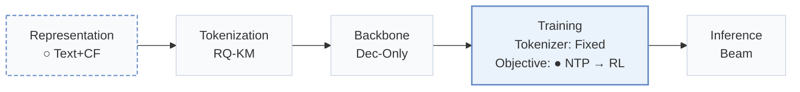
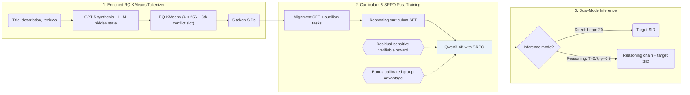
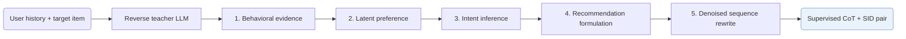
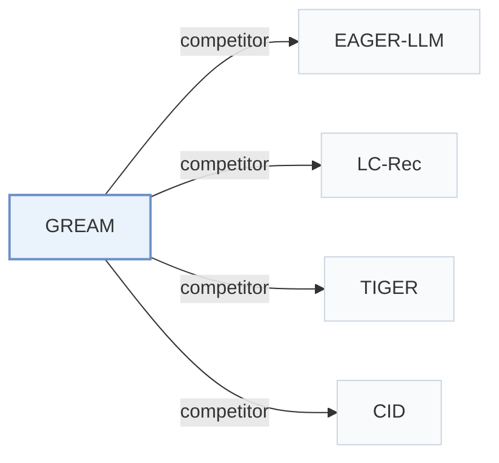

# GREAM

[← Problem × Stage Matrix](../../README.md#iii--training) · [Papers by Stage](../index/stages.md) · [Papers by Modality](../index/modality.md) · [Papers by Domain](../index/domain.md) · English | [中文](../zh/papers/gream.md)

| **Title** | *Generative Reasoning Recommendation via LLMs* |
| :-- | :-- |
| **Authors** | Hong et al. |
| **Venue** | arXiv’25 |
| **Problem × Stage** | `III. SID–Model Alignment` · `Training` |
| **Changes** | ○ Representation · ● Objective |
| **SID inputs** | `Text` |
| **Domain** | `E-commerce` |
| **Links** | [Paper](https://arxiv.org/abs/2510.20815) · [Code](https://github.com/Indolent-Kawhi/GRRM) |
| **Reading level** | Reading Notes (Level 2) |

**On this page**: [TL;DR](#tldr) · [At a Glance](#at-a-glance) · [1. Why It Matters](#1-why-this-paper-matters) · [2. Method](#2-how-it-works) · [3. Experiments](#3-experimental-findings) · [4. Limitations](#4-limitations--critical-analysis) · [5. Related Work](#5-connections-to-related-work)

- `Text+CF`: Text representations combined with collaborative signals.
- `RQ-KM`: Residual k-means quantization.
- `Dec-Only`: Decoder-only.
- `Fixed`: SIDs are built first and not changed while the generator trains.
- `NTP → RL`: NTP, then reinforcement learning (GRPO, GBPO, etc.).
- `Beam`: Autoregressive beam search over Semantic ID tokens.

### TL;DR

> [!NOTE]
> GREAM adapts an LLM into a reasoning recommender with collaborative-semantic item indices, a chain-of-thought curriculum, and SRPO post-training, and supports direct and reasoning-first inference modes.

---

### At a Glance

| Aspect | Summary |
| :-- | :-- |
| Key Findings | Across Amazon Beauty, Sports and Outdoors, and Musical Instruments, GREAM outperforms generative and LLM baselines in both direct and reasoning modes while cutting RQ-KMeans index collisions by about 50% (Abstract, Sec. 4.1, Table 2). |
| Limitation | The item indices depend on descriptions rewritten by GPT-5, and the reasoning data comes from an external LLM, so reproduction depends on access to those models (Sec. 4.1, Sec. 4.2). |

---

### 1. Why This Paper Matters

Large language models (LLMs) used as generative reasoning recommenders face a gap between textual semantics and collaborative filtering signals, alongside sparse and stochastic user feedback (Abstract). GREAM bridges both obstacles through enriched Semantic IDs (SIDs), a synthetic reasoning curriculum, and sparse-regularized reinforcement post-training while retaining a low-latency direct mode alongside explicit chain-of-thought generation.

> "GREAM natively supports two complementary inference modes: Direct Sequence Recommendation for high-throughput, low-latency deployment, and Sequential Reasoning Recommendation that first emits an interpretable reasoning chain for causal transparency." (Abstract)

---

### 2. How It Works

#### Collaborative-Semantic Alignment

For each item, GPT-5 synthesizes the title, official description, and selected user reviews into a unified description, and RQ-KMeans quantizes its LLM last-hidden-state embedding into a 5-token SID (4 layers of 256 codewords plus a 5th conflict-resolution slot) (Sec. 4.1, Eq. 4–5). Auxiliary alignment tasks ground the LLM token representations in interaction semantics (Abstract).

#### Reasoning Curriculum Activation

An external teacher LLM synthesizes training trajectories by reverse reasoning from the known ground-truth target item back to the user history, supervising Qwen3-4B before reinforcement learning (Sec. 4.2).

> "This process guides the model through a structured, five-stage logical chain—behavioral evidence extraction, latent preference modeling, intent inference, recommendation formulation, and denoised sequence rewriting" (Sec. 1)

#### SRPO

Sparse-Regularized Group Policy Optimization (SRPO) combines a prefix-aware Residual-Sensitive Verifiable Reward with Bonus-Calibrated Group Advantage Estimation so policy gradients remain informative even when exact full-SID hits are rare (Abstract, Sec. 5.2).

> "In the early stages of generative recommendation, exactly correct generations are typically rare." (Sec. 5.2)

---

### 3. Experimental Findings

Experimental setup

- **Datasets**: Amazon Beauty, Sports and Outdoors, Musical Instruments, with 5-core filtering of users and items. Sizes (users / items / interactions): 22,363 / 12,101 / 198,360; 35,598 / 18,357 / 296,175; 24,733 / 9,923 / 206,153. Alignment and reasoning text is synthesized by Qwen3, GPT-5, Llama-3.1, and Gemini.
  - Source: Datasets and 5-core: [S6.SS1.SSS1.p1](https://arxiv.org/html/2510.20815v1#S6.SS1.SSS1.p1); statistics: [S6.T1](https://arxiv.org/html/2510.20815v1#S6.T1).
- **Split**: Leave-one-out; the exact validation/test position allocation is not reported beyond the leave-one-out label.
  - Source: Leave-one-out named only: [S6.SS1.SSS2.p1](https://arxiv.org/html/2510.20815v1#S6.SS1.SSS2.p1).
- **Candidates**: not reported (full catalog versus sampled evaluation candidates); direct mode reports Recall and NDCG at 5 and 10, reasoning mode reports Pass@1, 5, 10.
  - Source: Metrics only: [S6.SS1.SSS2.p1](https://arxiv.org/html/2510.20815v1#S6.SS1.SSS2.p1).
- **Visibility**: warm; no unseen-item protocol is defined.
  - Source: Standard split with no unseen-item protocol: [S6.SS1.SSS2.p1](https://arxiv.org/html/2510.20815v1#S6.SS1.SSS2.p1).
- **SID**: RQ-KMeans indices over LLM last-hidden-state embeddings of GPT-5-enriched item text; fixed length 5 with 256 values per layer, where the fifth position is a conflict-resolution slot.
  - Source: Length 5 with a conflict-resolution slot, 256 values per layer: [S6.SS1.SSS3.p1](https://arxiv.org/html/2510.20815v1#S6.SS1.SSS3.p1); RQ-KMeans over LLM embeddings of GPT-5-enriched text: [S3.SS1.SSS2.p1](https://arxiv.org/html/2510.20815v1#S3.SS1.SSS2.p1) and [S4.SS1.p1](https://arxiv.org/html/2510.20815v1#S4.SS1.p1).
- **Inference budget**: Direct mode: beam size 20 for all generative methods. Reasoning mode: sampling with temperature 0.7 and top-p 0.9. Backbone Qwen3-4B-Instruct; experiments on a cluster of 24 NVIDIA A100 GPUs; inference batch size and latency: not reported.
  - Source: Beam 20 and sampling settings: [S6.SS1.SSS2.p1](https://arxiv.org/html/2510.20815v1#S6.SS1.SSS2.p1); hardware: [S6.SS1.SSS3.p1](https://arxiv.org/html/2510.20815v1#S6.SS1.SSS3.p1).
- **Results from**: Table 2 (direct and reasoning modes on Beauty, Sports, Instruments versus traditional, Transformer, generative, and LLM baselines); Table 3 (alignment and RL ablations); Table 4 (data composition); Figure 3 (RL regimes on Instruments).
  - Source: Main: [S6.T2](https://arxiv.org/html/2510.20815v1#S6.T2); ablations: [S6.T3](https://arxiv.org/html/2510.20815v1#S6.T3) and [S6.T4](https://arxiv.org/html/2510.20815v1#S6.T4); RL regimes: [S6.SS5.p2](https://arxiv.org/html/2510.20815v1#S6.SS5.p2).

- Main comparison: across Amazon Beauty, Sports and Outdoors, and Musical Instruments, GREAM outperforms traditional, Transformer, generative, and LLM baselines on Recall@5/10 and NDCG@5/10 in direct mode and Pass@1/5/10 in reasoning mode (Abstract, Table 2).
- Index quality and ablations: running RQ-KMeans on GPT-5-enriched embeddings lowers index collision rates by about 50% (Sec. 4.1), and Tables 3–4 verify the gains from collaborative-semantic alignment, reasoning activation, and SRPO.
- Reasoning scaling: expanding synthetic chain-of-thought data during Reasoning Activation raises Pass@Avg almost linearly across $`10^{16}`$–$`10^{19}`$ training FLOPs (Sec. 6.4, Fig. 1).

---

### 4. Limitations & Critical Analysis

**Our analysis.**

- Emitting a five-stage reasoning chain before the target SID suggests higher inference latency and token cost than direct beam-search decoding, though wall-clock latency is not reported.
- LC-Rec and EAGER-LLM train decoder-only LLMs with `Multi-task NTP`; GREAM extends supervised alignment with a reinforcement learning stage (`NTP → RL`).

---

### 5. Connections to Related Work

- **Competitor** · [EAGER-LLM](eager-llm.md): EAGER-LLM injects behavioral and semantic signals into a decoder-only LLM recommender; GREAM adds collaborative-semantic alignment data, reasoning curricula, and RL with a prefix-based verifiable reward.
  - Source: GREAM v1, LLM-based baselines: [A2.I4.i2.p1](https://arxiv.org/html/2510.20815v1#A2.I4.i2.p1); Table 2: [S6.T2](https://arxiv.org/html/2510.20815v1#S6.T2).
- **Competitor** · [LC-Rec](lc-rec.md): LC-Rec aligns LLaMA to VQ indices with language tasks; GREAM adds explicit reasoning chains and RL fine-tuning on Qwen3.
  - Source: GREAM v1, LLM-based baselines: [A2.I4.i1.p1](https://arxiv.org/html/2510.20815v1#A2.I4.i1.p1); Table 2: [S6.T2](https://arxiv.org/html/2510.20815v1#S6.T2).
- **Competitor** · [TIGER](tiger.md): TIGER generates RQ-VAE identifiers with a small T5; GREAM generates RQ-KMeans indices with an LLM that can reason before recommending.
  - Source: GREAM v1, generative baselines: [A2.I3.i2.p1](https://arxiv.org/html/2510.20815v1#A2.I3.i2.p1); Table 2: [S6.T2](https://arxiv.org/html/2510.20815v1#S6.T2).
- **Competitor** · [CID](cid.md): P5-CID uses collaborative IDs for a T5 recommender; GREAM uses semantic RQ-KMeans indices with LLM reasoning.
  - Source: GREAM v1, generative baselines: [A2.I3.i1.p1](https://arxiv.org/html/2510.20815v1#A2.I3.i1.p1); Table 2: [S6.T2](https://arxiv.org/html/2510.20815v1#S6.T2).

[View all papers in this cell](../../README.md#iii--training)
