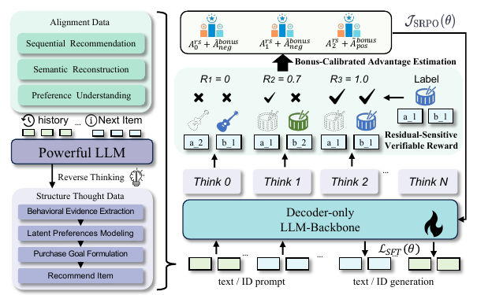

# GREAM

*Generative Reasoning Recommendation via LLMs* — Hong et al. · arXiv’25

`III. SID–Model Alignment` · `Training`

[Paper](https://arxiv.org/abs/2510.20815) · [Matrix](../../README.md#iii--training)

Reading level: Overview (Level 1) · On this page: [At a Glance](#at-a-glance) · [2. How It Works](#2-how-it-works) · [5. Connections to Related Work](#5-connections-to-related-work)

| Representation | Tokenization | Backbone | Training | Inference |
| :-: | :-: | :-: | :-: | :-: |
| `Text+CF` | `RQ-KM` | `Dec-Only` | **`Fixed / NTP → RL`** | `Beam` |

- `Dec-Only`: Decoder-only.
- `Fixed`: SIDs are built first and not changed while the generator trains.
- `NTP → RL`: NTP, then reinforcement learning (GRPO, GBPO, etc.).

### At a Glance

| Aspect | Summary |
| :-- | :-- |
| Research Problem | III. SID–Model Alignment: Can the generator read, write, and reason over SIDs, and do the tokenizer and generator work toward the same goal? |
| Modified Stage | Training |

### 2. How It Works

## 旧卡片说明

迁自 `d61aa6c:papers/gream.md`。保留方法说明、实验叙述与局限；本轮只对照现有记录处理明确冲突，未重新逐句核查原论文。分类和规格以页面上方由记录生成的表格为准。

### GREAM：基于大语言模型的生成式推理推荐

> GREAM 将协同-语义对齐、推理课程学习和稀疏反馈强化学习结合，在生成物品标识的同时提供可解释推理。

### 研究动机与问题定义

已有推理式推荐常把推理与最终物品选择分离，依赖外部检索器或黑盒评分器。GREAM 试图让模型端到端完成推理和物品标识生成，并处理推荐反馈稀疏、偏置强的问题。

### TL;DR（核心摘要）

`用户历史与物品文本 → 协同-语义对齐 → 推理课程学习 → SRPO → 完整物品标识`

模型用标题、描述和评论构造离散物品索引，并加入行为对齐任务。随后通过五阶段合成推理数据训练证据提取、偏好建模、意图推断、推荐形成和序列重写；SRPO 使用可验证奖励与稀疏正则优化。论文提供直接序列推荐和先推理后推荐两种模式，最终标识直接确定物品。

### 输入与使用场景

| 方面 | 说明 |
|---|---|
| 使用信息 | 用户交互、物品文本、评论和稀疏反馈 |
| 信息融入位置 | 索引构建、推理数据和强化学习奖励 |
| 语义标识结构 | 层次化离散序列 |
| 适用场景 | 常规序列推荐与可解释推荐 |

### 方法设计

#### 3.1 生成式推荐与知识丰富索引
GREAM 将目标物品表示为层次化索引序列。物品标题、描述和评论经语言模型编码，再通过 RQ-KMeans 残差量化获得具有前缀共享的离散索引；索引 token 被映射到 LLM 词表。

#### 3.2 可验证奖励强化学习
论文先构造协同-语义对齐任务，让 LLM 学习行为和语言之间的关系；再通过反向推理生成五阶段结构化推理数据，包括行为证据、潜在偏好、意图、购买目标和推荐形成。

#### 3.3 混合 SFT 与课程学习
模型在对齐数据和推理数据上进行混合监督微调，按课程逐步提高推理难度。直接序列模式服务高吞吐推荐，推理模式先生成可解释链再生成目标索引。

#### 3.4 SRPO
Sparse-Regularized Group Policy Optimization 结合残差敏感可验证奖励和校准组优势，针对点击/购买反馈稀疏的问题稳定策略更新。最终生成完整索引并映射物品。

### 实验结论

- GREAM 在三个公开数据集的直接推荐和推理指标上优于比较基线。
- 推理课程学习和 SRPO 均有增益。
- 推理性能随训练计算量增加仍有提升趋势。

### 局限性与研究定位

#### 局限性
- 推理链会增加生成长度和计算成本。
- 推荐反馈的反事实偏差和稀疏性仍难完全消除。
- 论文未充分报告大规模线上服务结果。

#### 研究定位
GREAM 的贡献是把显式推理与直接 SID 生成放进同一推荐模型，适合放在“推理增强与强化学习”章节。

### 相关资源

- [论文原文](https://arxiv.org/abs/2510.20815)

### 标签

`生成式推理` · `协同语义对齐` · `强化学习` · `稀疏反馈`

### 架构图来源

*图源：原论文，图2。图片使用许可待核实。*

---

### 旧总表补充

来源：`d61aa6c:tables/all-methods.md`。

- 核心贡献：将显式推理与可验证强化学习结合。
- 使用场景：可解释推荐。

### 5. Connections to Related Work

[View all papers in this cell](../../README.md#iii--training)
