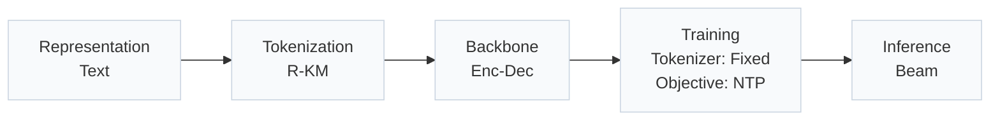
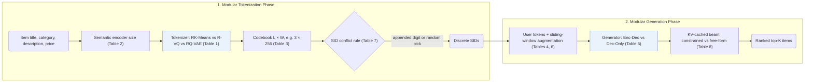
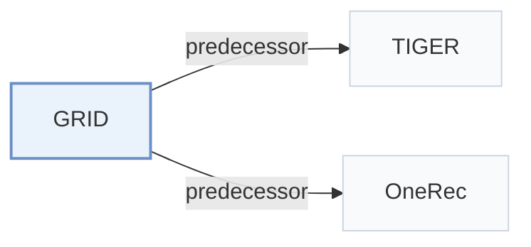

# GRID

[← Problem × Stage Matrix](../../README.md#paradigms-systems-and-benchmarks) · [Papers by Stage](../index/stages.md) · [Papers by Modality](../index/modality.md) · [Papers by Domain](../index/domain.md) · English | [中文](../zh/papers/grid.md)

| **Title** | *Generative Recommendation with Semantic IDs: A Practitioner's Handbook* |
| :-- | :-- |
| **Authors** | Ju et al. |
| **Venue** | CIKM’25 |
| **Problem × Stage** | `Paradigms, Systems and Benchmarks` · `No single stage` |
| **Changes** | – |
| **SID inputs** | `Text` |
| **Domain** | `E-commerce` |
| **Scenario** | `General Item Recommendation`; `Public Benchmarks` |
| **Links** | [Paper](https://arxiv.org/abs/2507.22224) · [Code](https://github.com/snap-research/GRID) |
| **Reading level** | Reading Notes (Level 2) |

**On this page**: [TL;DR](#tldr) · [At a Glance](#at-a-glance) · [1. Why It Matters](#1-why-this-paper-matters) · [2. Method](#2-how-it-works) · [3. Experiments](#3-experimental-findings) · [4. Limitations](#4-limitations--critical-analysis) · [5. Related Work](#5-connections-to-related-work)

- `Text`: Textual item metadata (titles, descriptions, categories, or prompts).
- `R-KM`: Residual k-means.
- `Enc-Dec`: Encoder-decoder.
- `Fixed`: SIDs are built first and not changed while the generator trains.
- `NTP`: Next-token prediction loss only; continuing from a pretrained LLM (SFT) also counts as NTP.
- `Beam`: Autoregressive beam search over Semantic ID tokens.

### TL;DR

> [!NOTE]
> GRID provides an open-source modular framework with swappable Semantic ID tokenizers, backbones, and decoding rules to ablate design choices on public benchmarks.

---

### At a Glance

| Aspect | Summary |
| :-- | :-- |
| Key Findings | Across 5-seed ablations on Amazon Beauty, Sports, and Toys (Tables 1–8), GRID shows that encoder-decoder generators and sliding-window data augmentation drive accuracy while several compute-heavy defaults can be replaced with more efficient alternatives without losing performance (Sec. 5). |
| Limitation | GRID ablates one design choice at a time around a fixed RK-Means $`(3, 256)`$ and Flan-T5-XL default without testing cross-component interactions, and does not report beam width or inference latency (Sec. 4.1). |

---

### 1. Why This Paper Matters

Differences in tokenizers, backbones, hyperparameters, and evaluation splits make published generative recommendation (GR) results hard to compare directly (Abstract). GRID implements Semantic ID (SID) pipelines in one open modular codebase so practitioners can swap and ablate individual components under a single protocol.

> "Our comprehensive experiments with GRID reveal that many overlooked architectural components in GR models with SIDs substantially impact performance." (Abstract)

---

### 2. How It Works

#### Tokenization then Generation

GRID decomposes SID-based generative recommendation into an offline item tokenization phase and an autoregressive sequence generation phase (Sec. 3.1).

#### Tokenization Ablations

In the tokenization phase, GRID varies the quantization algorithm (`RK-Means`, `R-VQ`, and `RQ-VAE`), the pretrained semantic encoder scale, and the codebook depth $`L`$ and width $`W`$ around a fixed reference setup (Sec. 4.1, Tables 1–3).

> "Unless otherwise noted, we use RK-Means with (L,W)=(3,256) and Flan-T5-XL." (Sec. 4.1)

#### Generation Ablations

In the generation phase, GRID ablates the number of hashed user tokens, encoder-decoder versus decoder-only backbones, sliding-window sequence augmentation, appended-digit versus random-pick collision handling, and Trie-constrained versus unconstrained beam search with KV caching (Sec. 4.2, Tables 4–8).

---

### 3. Experimental Findings

Experimental setup

- **Datasets**: 5-core filtered Amazon Beauty, Sports, and Toys; item text from Title, Categories, Description, and Price. Retained corpus sizes: not reported in the body.
  - Source: 5-core Amazon datasets and text features: [S4.p2](https://arxiv.org/html/2507.22224v1#S4.p2).
- **Split**: Per-user leave-last-out: last item for test, second-to-last for validation, the rest for training; sliding-window training samples; averages over 5 seeds.
  - Source: Leave-last-out allocation and 5 seeds: [S4.p2](https://arxiv.org/html/2507.22224v1#S4.p2).
- **Candidates**: not reported (full catalog versus sampled evaluation candidates); top-K lists from beam search.
  - Source: Metrics only: [S4.p2](https://arxiv.org/html/2507.22224v1#S4.p2).
- **Visibility**: warm; no unseen-item protocol is defined.
  - Source: Standard split with no unseen-item protocol: [S4.p2](https://arxiv.org/html/2507.22224v1#S4.p2).
- **SID**: Benchmark default: RK-Means with 3 levels x 256 tokens over mean-pooled Flan-T5-XL embeddings; also R-VQ and RQ-VAE, and L x W variants (e.g. 3 x 128, 3 x 512, 2 x 256). Collisions: Table 7 compares TIGER-style appended-digit de-duplication with randomly selecting one item when SIDs conflict; which one is the default setting is not stated.
  - Source: Default RK-Means (3, 256) with Flan-T5-XL: [S4.SS1.p1](https://arxiv.org/html/2507.22224v1#S4.SS1.p1); dimension study: [S3.T3](https://arxiv.org/html/2507.22224v1#S3.T3); de-duplication strategies: [S4.SS2.p5](https://arxiv.org/html/2507.22224v1#S4.SS2.p5) and [S4.T7](https://arxiv.org/html/2507.22224v1#S4.T7).
- **Inference budget**: Beam search with KV cache; constrained and unconstrained beam compared (Table 8), with unconstrained stated to be cheaper; numerical beam width not reported. Tokenizers trained on 8 GPUs (per-device batch 2,048); generator training batch 256; inference hardware, batch size, and latency: not reported.
  - Source: Beam search with KV cache: [S3.SS1.p3](https://arxiv.org/html/2507.22224v1#S3.SS1.p3); constrained versus free-form beam: [S4.SS2.p6](https://arxiv.org/html/2507.22224v1#S4.SS2.p6) and [S4.T8](https://arxiv.org/html/2507.22224v1#S4.T8); tokenizer GPUs: [S4.p2](https://arxiv.org/html/2507.22224v1#S4.p2).
- **Results from**: Tables 1-3 (tokenizer algorithm, encoder size, codebook dimensions); Tables 4-8 (user tokens, encoder-decoder versus decoder-only, augmentation, SID de-duplication, constrained versus free-form beam). Tables 3 and 4 cover Beauty only; the other tables cover Beauty, Sports, and Toys; results average 5 seeds.
  - Source: Tables 1-8: [S3.T1](https://arxiv.org/html/2507.22224v1#S3.T1), [S3.T2](https://arxiv.org/html/2507.22224v1#S3.T2), [S3.T3](https://arxiv.org/html/2507.22224v1#S3.T3), [S4.T4](https://arxiv.org/html/2507.22224v1#S4.T4), [S4.T5](https://arxiv.org/html/2507.22224v1#S4.T5), [S4.T6](https://arxiv.org/html/2507.22224v1#S4.T6), [S4.T7](https://arxiv.org/html/2507.22224v1#S4.T7), [S4.T8](https://arxiv.org/html/2507.22224v1#S4.T8).

- Main finding: across 5-seed runs on 5-core Amazon Beauty, Sports, and Toys, several compute- or engineering-heavy components—including learned `RQ-VAE` over `RK-Means` and Trie-constrained beam search over unconstrained beam search—can be replaced with cheaper alternatives without hurting ranking metrics (Sec. 4.2, Sec. 5, Tables 1 and 8).
- High-impact components: encoder-decoder backbones outperform decoder-only generators and sliding-window data augmentation consistently lifts Recall and NDCG across benchmarks (Sec. 5, Tables 5 and 6).

  > "Conversely, other, often overlooked design choices prove to be vital, such as encoder-decoder architectures and data augmentation." (Sec. 5)

---

### 4. Limitations & Critical Analysis

**Our analysis.**

- Varying one axis at a time against the fixed `RK-Means` $`(3, 256)`$ and Flan-T5-XL baseline (Sec. 4.1) suggests that interaction effects—such as whether constrained decoding matters more at smaller codebook widths—remain untested.
- TIGER pairs `RQ-VAE` codes with an `Enc-Dec` generator; GRID adopts OneRec's `R-KM` (`RK-Means`) tokenizer as its benchmark default.

---

### 5. Connections to Related Work

- **Predecessor** · [TIGER](tiger.md): TIGER's RQ-VAE tokenizer, user tokens, and appended-digit de-duplication are the components that GRID ablates in one open framework.
  - Source: GRID v1, Section 4.1 on RQ-VAE as the TIGER default: [S4.SS1.p2](https://arxiv.org/html/2507.22224v1#S4.SS1.p2); Table 4 (TIGER-style user tokens): [S4.T4](https://arxiv.org/html/2507.22224v1#S4.T4); Section 4.2 de-duplication: [S4.SS2.p5](https://arxiv.org/html/2507.22224v1#S4.SS2.p5).
- **Predecessor** · [OneRec](onerec.md): GRID's default RK-Means tokenizer is taken from OneRec; GRID compares it with R-VQ and RQ-VAE.
  - Source: GRID v1, Section 4 setup cites Deng et al. (2025) for RK-Means: [S4.p2](https://arxiv.org/html/2507.22224v1#S4.p2); Table 1: [S3.T1](https://arxiv.org/html/2507.22224v1#S3.T1).

[View all papers in this cell](../../README.md#paradigms-systems-and-benchmarks)
