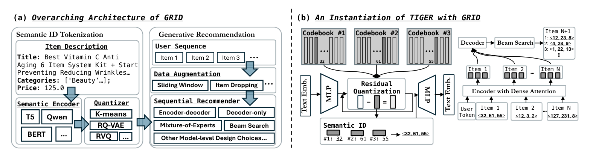

# GRID

*Generative Recommendation with Semantic IDs: A Practitioner's Handbook* — Ju et al. · CIKM’25

`Paradigms, Systems and Benchmarks` · `No single stage`

[Paper](https://arxiv.org/abs/2507.22224) · [Code](https://github.com/snap-research/GRID) · [Matrix](../../README.md#paradigms-systems-and-benchmarks)

Reading level: Overview (Level 1) · On this page: [TL;DR](#tldr) · [At a Glance](#at-a-glance) · [2. How It Works](#2-how-it-works) · [3. Experimental Findings](#3-experimental-findings) · [5. Connections to Related Work](#5-connections-to-related-work)

| Representation | Tokenization | Backbone | Training | Inference |
| :-: | :-: | :-: | :-: | :-: |
| `Text` | `R-KM` | `Enc-Dec` | `Fixed / NTP` | `Beam` |

- `R-KM`: Residual k-means.
- `Enc-Dec`: Encoder-decoder.
- `Fixed`: SIDs are built first and not changed while the generator trains.
- `NTP`: Next-token prediction loss only; continuing from a pretrained LLM (SFT) also counts as NTP.

### TL;DR

GRID is an open-source modular framework, not a new recommender: it makes components of Semantic ID generative recommenders swappable and ablates them on public benchmarks.

### At a Glance

| Aspect | Summary |
| :-- | :-- |
| Research Problem | Paradigms, Systems and Benchmarks: Baseline (TIGER), end-to-end multi-stage paradigms, open-source frameworks, benchmarks, and diagnostic resources. |
| Key Contribution | GRID is an open-source modular framework, not a new recommender: it makes components of Semantic ID generative recommenders swappable and ablates them on public benchmarks. |
| Modified Stage | No single stage |

### 2. How It Works

### 3. Experimental Findings

**Experimental setup**

- **Datasets**: 5-core filtered Amazon Beauty, Sports, and Toys; item text from Title, Categories, Description, and Price. Retained corpus sizes: not reported in the body.
  - Source: 5-core Amazon datasets and text features: https://arxiv.org/html/2507.22224v1#S4.p2.
- **Split**: Per-user leave-last-out: last item for test, second-to-last for validation, the rest for training; sliding-window training samples; averages over 5 seeds.
  - Source: Leave-last-out allocation and 5 seeds: https://arxiv.org/html/2507.22224v1#S4.p2.
- **Candidates**: not reported (full catalog versus sampled evaluation candidates); top-K lists from beam search.
  - Source: Metrics only: https://arxiv.org/html/2507.22224v1#S4.p2.
- **Visibility**: warm; no unseen-item protocol is defined.
  - Source: Standard split with no unseen-item protocol: https://arxiv.org/html/2507.22224v1#S4.p2.
- **SID**: Benchmark default: RK-Means with 3 levels x 256 tokens over mean-pooled Flan-T5-XL embeddings; also R-VQ and RQ-VAE, and L x W variants (e.g. 3 x 128, 3 x 512, 2 x 256). Collisions: Table 7 compares TIGER-style appended-digit de-duplication with randomly selecting one item when SIDs conflict; which one is the default setting is not stated.
  - Source: Default RK-Means (3, 256) with Flan-T5-XL: https://arxiv.org/html/2507.22224v1#S4.SS1.p1; dimension study: https://arxiv.org/html/2507.22224v1#S3.T3; de-duplication strategies: https://arxiv.org/html/2507.22224v1#S4.SS2.p5 and https://arxiv.org/html/2507.22224v1#S4.T7.
- **Inference budget**: Beam search with KV cache; constrained and unconstrained beam compared (Table 8), with unconstrained stated to be cheaper; numerical beam width not reported. Tokenizers trained on 8 GPUs (per-device batch 2,048); generator training batch 256; inference hardware, batch size, and latency: not reported.
  - Source: Beam search with KV cache: https://arxiv.org/html/2507.22224v1#S3.SS1.p3; constrained versus free-form beam: https://arxiv.org/html/2507.22224v1#S4.SS2.p6 and https://arxiv.org/html/2507.22224v1#S4.T8; tokenizer GPUs: https://arxiv.org/html/2507.22224v1#S4.p2.
- **Results from**: Tables 1-3 (tokenizer algorithm, encoder size, codebook dimensions); Tables 4-8 (user tokens, encoder-decoder versus decoder-only, augmentation, SID de-duplication, constrained versus free-form beam). Tables 3 and 4 cover Beauty only; the other tables cover Beauty, Sports, and Toys; results average 5 seeds.
  - Source: Tables 1-8: https://arxiv.org/html/2507.22224v1#S3.T1, https://arxiv.org/html/2507.22224v1#S3.T2, https://arxiv.org/html/2507.22224v1#S3.T3, https://arxiv.org/html/2507.22224v1#S4.T4, https://arxiv.org/html/2507.22224v1#S4.T5, https://arxiv.org/html/2507.22224v1#S4.T6, https://arxiv.org/html/2507.22224v1#S4.T7, https://arxiv.org/html/2507.22224v1#S4.T8.

## 旧卡片说明

迁自 `d61aa6c:papers/grid.md`。保留方法说明、实验叙述与局限；本轮只对照现有记录处理明确冲突，未重新逐句核查原论文。分类和规格以页面上方由记录生成的表格为准。

### GRID：语义标识生成式推荐实践框架

> GRID 将物品分词、生成模型训练、约束解码和评估组织为可复用的 Semantic ID 生成式推荐流程。

### 研究动机与问题定义

语义标识生成式推荐涉及标识学习、数据处理、模型训练和解码部署多个环节，实践中缺少统一流程。GRID 以工程视角整理这些组件，并讨论不同设计的选择。

### TL;DR（核心摘要）

`物品内容/交互 → SID分词器 → 生成模型 → 约束解码 → 推荐物品`

框架先用内容或协同信息学习物品 SID，再把用户历史转为标识序列输入生成模型。模型生成完整 SID 后通过词表或索引映射到物品；手册同时覆盖训练、评估、开放物品和部署注意事项。

### 输入与使用场景

| 方面 | 说明 |
|---|---|
| 使用信息 | 交互、文本、图像和协同信息，依配置而定 |
| 信息融入位置 | SID 构建、模型输入和评估流程 |
| 语义标识结构 | 多级离散序列 |
| 适用场景 | 生成式推荐研究与工程实践 |

### 方法设计

#### 3.1 先分词后生成（Tokenization-then-Generation）
GRID 将 Semantic ID 生成式推荐拆成物品分词和推荐生成两个相对独立的阶段。物品分词器把文本、图像或协同表示转换为离散标识；生成器再根据用户历史标识预测下一标识。

#### 3.2 物品分词实践
手册比较 RQ-VAE、码本设计、标识长度、碰撞、语义一致性和新物品更新等选择。不同分词策略会改变词表规模、前缀共享和生成合法率，因此需要结合数据与服务目标选择。

#### 3.3 生成、评估与部署
生成模型可以使用编码器-解码器或其他自回归骨干，推理通常配合前缀树、束搜索和合法 SID 过滤。GRID 还讨论数据处理、评价协议、开放物品和系统部署，重点是形成可复用实践流程，而非提出单一新模型。

### 实验结论

- 手册系统比较了 SID 构建与生成流程中的常见选择。
- 结果强调标识质量、生成有效性和系统效率需要联合考虑。

### 局限性与研究定位

#### 局限性
- GRID 是实践框架与总结性工作，并非单一新模型。
- 具体性能取决于所选分词器、生成骨干和数据设置。

#### 研究定位
GRID 适合放在“方法全景与工程实践”章节，作为理解 Semantic ID 生成式推荐完整流程的入口。

### 标签

`实践框架` · `Semantic ID` · `生成式推荐` · `工程流程`

### 架构图来源

*图源：原论文，图1（a、b）。图片使用许可待核实。*

---

### 旧总表补充

来源：`d61aa6c:tables/all-methods.md`。

- 核心贡献：统一SID生成推荐实践流程。
- 使用场景：研究与工程实践。

### 5. Connections to Related Work

- **Predecessor** · [TIGER](tiger.md): TIGER's RQ-VAE tokenizer, user tokens, and appended-digit de-duplication are the components that GRID ablates in one open framework.
  - Source: GRID v1, Section 4.1 on RQ-VAE as the TIGER default: https://arxiv.org/html/2507.22224v1#S4.SS1.p2; Table 4 (TIGER-style user tokens): https://arxiv.org/html/2507.22224v1#S4.T4; Section 4.2 de-duplication: https://arxiv.org/html/2507.22224v1#S4.SS2.p5.
- **Predecessor** · [OneRec](onerec.md): GRID's default RK-Means tokenizer is taken from OneRec; GRID compares it with R-VQ and RQ-VAE.
  - Source: GRID v1, Section 4 setup cites Deng et al. (2025) for RK-Means: https://arxiv.org/html/2507.22224v1#S4.p2; Table 1: https://arxiv.org/html/2507.22224v1#S3.T1.

[View all papers in this cell](../../README.md#paradigms-systems-and-benchmarks)
