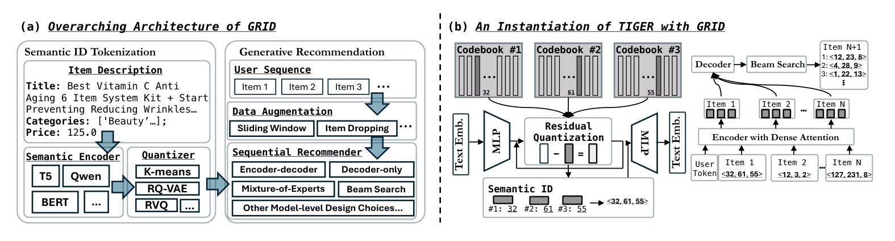

# GRID

*Generative Recommendation with Semantic IDs: A Practitioner's Handbook* — Ju et al., CIKM’25

[arXiv](https://arxiv.org/abs/2507.22224) · [Record](../../data/papers/grid.yaml) · [← Catalog](../../README.md#paradigms-systems-and-benchmarks)

> Abstract: "the absence of an open-source, unified framework hinders systematic benchmarking and extension".

| Group | Stage it changes |
| :-- | :-- |
| **Paradigms, Systems and Benchmarks**: Baseline (TIGER), end-to-end multi-stage paradigms, open-source frameworks, benchmarks, and diagnostic resources. | No single stage |

## Pipeline

| Representation | Tokenization | Backbone | Training | Inference |
| :-: | :-: | :-: | :-: | :-: |
| `Text` | `R-KM` | `Enc-Dec` | `Fixed / NTP` | `Beam` |

- `R-KM`: Residual k-means.
- `Enc-Dec`: Encoder-decoder.
- `Fixed`: SIDs are built first and not changed while the generator trains.
- `NTP`: Next-token prediction loss only; continuing from a pretrained LLM (SFT) also counts as NTP.

## Architecture

## Evidence

- **`problem`** (arXiv abstract): Abstract: "the absence of an open-source, unified framework hinders systematic benchmarking and extension".
- **`stage`** (arXiv abstract): Appendix tentatively places the new design in Backbone.
- **`tokenization`** (§4.1, p3): R-KM is the paper's RK-Means, (L, W) = (3, 256).

## 旧卡片说明

迁自 `d61aa6c:papers/grid.md`。保留方法说明、实验叙述与局限；本轮只对照现有记录处理明确冲突，未重新逐句核查原论文。分类和规格以页面上方由记录生成的表格为准。

### GRID：语义标识生成式推荐实践框架

> GRID 将物品分词、生成模型训练、约束解码和评估组织为可复用的 Semantic ID 生成式推荐流程。

### 研究动机与问题定义

语义标识生成式推荐涉及标识学习、数据处理、模型训练和解码部署多个环节，实践中缺少统一流程。GRID 以工程视角整理这些组件，并讨论不同设计的选择。

### TL;DR（核心摘要）

`物品内容/交互 → SID分词器 → 生成模型 → 约束解码 → 推荐物品`

框架先用内容或协同信息学习物品 SID，再把用户历史转为标识序列输入生成模型。模型生成完整 SID 后通过词表或索引映射到物品；手册同时覆盖训练、评估、开放物品和部署注意事项。

### 输入与使用场景

| 方面 | 说明 |
|---|---|
| 使用信息 | 交互、文本、图像和协同信息，依配置而定 |
| 信息融入位置 | SID 构建、模型输入和评估流程 |
| 语义标识结构 | 多级离散序列 |
| 适用场景 | 生成式推荐研究与工程实践 |

### 方法设计

#### 3.1 先分词后生成（Tokenization-then-Generation）
GRID 将 Semantic ID 生成式推荐拆成物品分词和推荐生成两个相对独立的阶段。物品分词器把文本、图像或协同表示转换为离散标识；生成器再根据用户历史标识预测下一标识。

#### 3.2 物品分词实践
手册比较 RQ-VAE、码本设计、标识长度、碰撞、语义一致性和新物品更新等选择。不同分词策略会改变词表规模、前缀共享和生成合法率，因此需要结合数据与服务目标选择。

#### 3.3 生成、评估与部署
生成模型可以使用编码器-解码器或其他自回归骨干，推理通常配合前缀树、束搜索和合法 SID 过滤。GRID 还讨论数据处理、评价协议、开放物品和系统部署，重点是形成可复用实践流程，而非提出单一新模型。

### 实验结论

- 手册系统比较了 SID 构建与生成流程中的常见选择。
- 结果强调标识质量、生成有效性和系统效率需要联合考虑。

### 局限性与研究定位

#### 局限性
- GRID 是实践框架与总结性工作，并非单一新模型。
- 具体性能取决于所选分词器、生成骨干和数据设置。

#### 研究定位
GRID 适合放在“方法全景与工程实践”章节，作为理解 Semantic ID 生成式推荐完整流程的入口。

### 标签

`实践框架` · `Semantic ID` · `生成式推荐` · `工程流程`

### 架构图来源

*图源：原论文，图1（a、b）。图片使用许可待核实。*

---

### 旧总表补充

来源：`d61aa6c:tables/all-methods.md`。

- 核心贡献：统一SID生成推荐实践流程。
- 使用场景：研究与工程实践。

## Same cell: Paradigms, Systems and Benchmarks (11 more)

| Paper | Venue | Pipeline |
| :-- | :-- | :-- |
| [TIGER](tiger.md) | NeurIPS’23 | `Text` → `RQ-VAE` → `Enc-Dec` → `Fixed / NTP` → `Beam` |
| [FORGE](forge.md) | KDD’26 | `Text+Img` → `RQ-VAE` → `Dec-Only` → `Fixed / NTP` → `Dyn. Beam` |
| [MiniOneRec](minionerec.md) | arXiv’25 | `Text` → `RQ-VAE` → `Dec-Only` → `Fixed / NTP → RL` → `Beam` |
| [OneRec](onerec.md) | arXiv’25 | `Text+CF` → `R-KM` → `Enc-Dec` → `Fixed / NTP → DPO` → `Sess. Beam` |
| [GR-Generalize](gr-generalize.md) | arXiv’26 | `Text+SID` → `RQ-VAE` → `Enc-Dec` → `Fixed† / NTP†` → `Hybrid` |
| [NEO](neo.md) | arXiv’26 | `Text / Audio` → `R-KM` → `Dec-Only` → `Fixed / Multi-task NTP` → `C-Beam` |
| [Netflix-SID-Comparison](netflix-sid-comparison.md) | NeurIPS’26 PALM Workshop | `–` → `RQ-VAE` → `Dec-Only / Non-AR` → `Fixed / Multi-task NTP / (Text NTP + MTP + Rank); Lang. RL after SFT` → `C-Beam / Scoring` |
| [OneMall](onemall.md) | CIKM’26 | `Text+Img+CF` → `R-KM+FSQ` → `Enc-Dec` → `Fixed / (NTP + Ctr.) → RL` → `Beam` |
| [PLUM](plum.md) | WWW’26 | `Text+Img+CF` → `RQ-VAE` → `Dec-Only` → `Fixed / Multi-task NTP` → `Beam` |
| [ReRankID](rerankid.md) | arXiv’26 | `Text` → `R-KM†` → `Dec-Only` → `Fixed / NTP → RL` → `CoT+Greedy` |
| [SIDScope](sidscope.md) | arXiv’26 | `–` → `–` → `–` → `– / –` → `–` |
