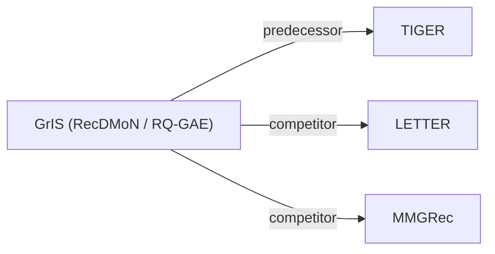

# GrIS (RecDMoN / RQ-GAE)

| **Title** | *Graph-Informed Semantic IDs (RecDMoN / RQ-GAE) for Generative Recommendation* |
| :-- | :-- |
| **Authors** | Medvedev et al. |
| **Venue** | CIKM’26 |
| **Problem × Stage** | `I. Informativeness` · `Tokenization` |
| **Links** | [Paper](https://arxiv.org/abs/2610.01533) · [Code](https://github.com/hirc-airecs/graph-informed-sids) · [Matrix](../../README.md#i--tokenization) · [中文](../zh/papers/gris-recdmon-rq-gae.md) |
| **Reading level** | Overview (Level 1) |

On this page: [TL;DR](#tldr) · [At a Glance](#at-a-glance) · [3. Experiments](#3-experimental-findings) · [5. Related Work](#5-connections-to-related-work)

- `RecDMoN / RQ-GAE`: Recursive DMoN graph partitioning, or residual quantization of graph-propagated representations with a graph reconstruction loss.
- `Enc-Dec`: Encoder-decoder.
- `Fixed`: SIDs are built first and not changed while the generator trains.
- `–`: Not reported in the paper.

### TL;DR

> [!NOTE]
> GrIS (RecDMoN / RQ-GAE) treats Semantic ID construction as hierarchical partition of an item graph with collaborative edges, recovering RQ-VAE and RQ-KMeans as the empty-graph case.

---

### At a Glance

| Aspect | Summary |
| :-- | :-- |
| Research Problem | I. Informativeness: Do the SIDs, or the model reading them, carry the collaborative and multimodal signals recommendation needs? |
| Key Contribution | GrIS (RecDMoN / RQ-GAE) treats Semantic ID construction as hierarchical partition of an item graph with collaborative edges, recovering RQ-VAE and RQ-KMeans as the empty-graph case. |
| Modified Stage | Tokenization |

---

### 3. Experimental Findings

Experimental setup

- **Datasets**: Amazon Reviews 2014 Beauty, Toys, Sports, Books; MIND-Small; Yelp 2018. Iterative 5-core filtering on all datasets.
  - Source: Section 5.1: [S5.SS1.SSS0.Px1.p1](https://arxiv.org/html/2610.01533v1#S5.SS1.SSS0.Px1.p1) and [S5.SS1.SSS0.Px3.p1](https://arxiv.org/html/2610.01533v1#S5.SS1.SSS0.Px3.p1)
- **Split**: Per-user leave-one-out: last interaction test, second-to-last validation; maximum sequence length 20.
  - Source: Section 5.1: [S5.SS1.SSS0.Px3.p1](https://arxiv.org/html/2610.01533v1#S5.SS1.SSS0.Px3.p1)
- **Candidates**: not reported
  - Source: Evaluation protocol in Section 5.1 does not specify candidate enumeration or negative sampling: [S5.SS1](https://arxiv.org/html/2610.01533v1#S5.SS1)
- **Visibility**: warm; no unseen-item protocol is defined. RQ-GAE item-graph edges use adjacent co-occurrences from training sequences.
  - Source: Section 5.1: [S5.SS1.SSS0.Px3.p1](https://arxiv.org/html/2610.01533v1#S5.SS1.SSS0.Px3.p1) and [S5.SS1.SSS0.Px3.p3](https://arxiv.org/html/2610.01533v1#S5.SS1.SSS0.Px3.p3)
- **SID**: RQ-GAE: 4 x 256 codebooks; collision handling not reported. RecDMoN: four recursive levels with branching factor 6 in Table 6, plus a fifth deduplication codebook; Appendix A reports five levels. Deduplication assignment rule not reported.
  - Source: Section 5.1, Section 5.2.4, Table 6, and Appendix A Table 8: [S5.SS1.SSS0.Px3.p2](https://arxiv.org/html/2610.01533v1#S5.SS1.SSS0.Px3.p2) and [S5.SS2.SSS4.p1](https://arxiv.org/html/2610.01533v1#S5.SS2.SSS4.p1) and [S5.T6](https://arxiv.org/html/2610.01533v1#S5.T6) and [A1.T8](https://arxiv.org/html/2610.01533v1#A1.T8)
- **Inference budget**: Hit/NDCG@5/10; decoding beam, hardware, inference batch size, latency not reported.
  - Source: Section 5.1: [S5.SS1.SSS0.Px3.p1](https://arxiv.org/html/2610.01533v1#S5.SS1.SSS0.Px3.p1) and [S5.SS1.SSS0.Px3.p2](https://arxiv.org/html/2610.01533v1#S5.SS1.SSS0.Px3.p2)
- **Results from**: Original Table 3: six-dataset comparison, averages over three seeds. RecDMoN Books unavailable due to GPU memory limits.
  - Source: Table 3 and Section 5.2.1: [S5.T3](https://arxiv.org/html/2610.01533v1#S5.T3) and [S5.SS2.SSS1.p1](https://arxiv.org/html/2610.01533v1#S5.SS2.SSS1.p1) and [S5.SS2.SSS1.p2](https://arxiv.org/html/2610.01533v1#S5.SS2.SSS1.p2)

---

### 5. Connections to Related Work

- **Predecessor** · [TIGER](tiger.md): Uses TIGER's T5 backbone to isolate improvements from graph-informed SID construction.
  - Source: GrIS v1, Section 5.2.1: https://arxiv.org/html/2610.01533v1#S5.SS2.SSS1.p1.
- **Competitor** · [LETTER](letter.md): LETTER aligns codes with pretrained CF embeddings; GrIS explicitly constructs and partitions item graphs.
  - Source: GrIS v1, Sections 2.2/5.1 and Table 3: https://arxiv.org/html/2610.01533v1#S2.SS2.p1; https://arxiv.org/html/2610.01533v1#S5.SS1.SSS0.Px2.p1; https://arxiv.org/html/2610.01533v1#S5.T3.
- **Competitor** · [MMGRec](mmgrec.md): MMGRec supplies a graph-aware tokenizer baseline; GrIS also studies recursive graph pooling and graph-reconstruction quantization.
  - Source: GrIS v1, Sections 2.3/5.1 and Table 3: https://arxiv.org/html/2610.01533v1#S2.SS3.p2; https://arxiv.org/html/2610.01533v1#S5.SS1.SSS0.Px2.p1; https://arxiv.org/html/2610.01533v1#S5.T3.

[View all papers in this cell](../../README.md#i--tokenization)
