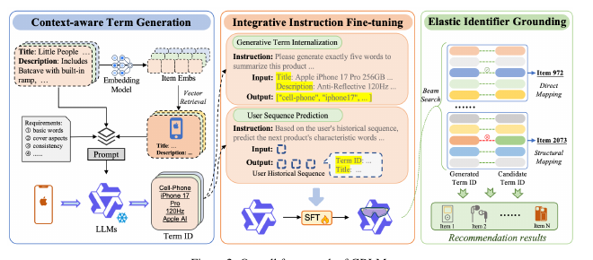

# GRLM: Unleashing the Native Recommendation Potential: LLM-Based Generative Recommendation via Structured Term Identifiers

[Back to Catalog](../../README.md) · [Paper (`https://arxiv.org/abs/2601.06798`)](https://arxiv.org/abs/2601.06798) · [Source Record (`data/papers/grlm.yaml`)](../../data/papers/grlm.yaml)

> **Summary**: Abstract: "Text-based methods introduce LLMs' vast output space, leading to hallucination"; "encounter a semantic gap between SIDs and LLMs' native vocabulary". Candidates: II / III (rule: tie broken by the majority of new designs).

## Taxonomy & Table 1 Specification

| Field | Value | Vocabulary Definition |
| :--- | :--- | :--- |
| **Authors & Year** | Zhang et al. (2026) | Published / posted in `arXiv’26` |
| **Problem Band** | `III. SID–Model Alignment` | Can the generator read, write, and reason over SIDs, and do the tokenizer and generator work toward the same goal? |
| **Primary Stage** | `Tokenization` | The primary design change sits in the Tokenization stage. |
| **Representation** | `Text` |  |
| **Tokenization** | `Term-ID` |  |
| **Backbone** | `Dec-Only` | Decoder-only. |
| **Tokenizer Training** | `Fixed` | SIDs are built first and not changed while the generator trains. |
| **Training Objective** | `Multi-task NTP` | The same NTP loss over several tasks. |
| **Inference Decoding** | `Beam` |  |
| **POI / Local-Life** | `false` | Point-of-interest / geographic recommendation indicator |
| **Code Repository** | Not reported | Official or public implementation link |

## Architecture

## Verbatim Evidence & Rationale

- **`problem`** (arXiv abstract): Abstract: "Text-based methods introduce LLMs' vast output space, leading to hallucination"; "encounter a semantic gap between SIDs and LLMs' native vocabulary". Candidates: II / III (rule: tie broken by the majority of new designs).

## 旧卡片说明

迁自 `d61aa6c:papers/grlm.md`。保留方法说明、实验叙述与局限；本轮只对照现有记录处理明确冲突，未重新逐句核查原论文。分类和规格以页面上方由记录生成的表格为准。

### GRLM：基于结构化术语标识的原生 LLM 生成推荐

> GRLM 用原生语言词表构造结构化 Term IDs，使 LLM 直接生成语义丰富的物品术语标识。

### 研究动机与问题定义

数值 SID 通常需要扩展词表和额外对齐，文本标识又容易出现同义词分裂和幻觉。GRLM 以原生 LLM token 构造 Term IDs，并通过邻域上下文提升一致性与区分性。

### TL;DR（核心摘要）

`物品元信息与相似邻域 → 上下文术语生成 → IIFT → Term ID生成 → EIG落地物品`

上下文术语生成从相似物品邻域中抽取标准化且有区分度的关键词。IIFT 联合训练术语内化和用户行为预测；推理时生成 Term ID。若无法精确匹配，EIG 会对候选库进行结构化匹配评分，因此最终物品仍依赖外部标识落地机制。

### 输入与使用场景

| 方面 | 说明 |
|---|---|
| 使用信息 | 物品元信息、相似邻域和用户交互 |
| 信息融入位置 | 术语生成、LLM 训练和候选落地 |
| 语义标识结构 | 变长术语序列 |
| 适用场景 | 跨域、长尾和文本信息丰富的推荐 |

### 方法设计

#### 3.1 上下文术语生成（CTG）
GRLM 先用嵌入模型检索与目标物品相似的邻域，再把目标元信息和邻域元信息一起交给 LLM。提示要求共享属性使用一致术语，同时保留能区分相似物品的细粒度关键词，得到 Term ID。

#### 3.2 综合指令微调（IIFT）
IIFT 联合训练术语内化和用户行为序列预测。术语内化要求模型从元信息恢复标准 Term ID，行为任务则使用历史 Term ID 与标题预测后续物品，从而让 LLM 同时理解标识结构和用户偏好。

#### 3.3 弹性标识落地（EIG）
推理时先尝试 Term ID 的精确字符串匹配；若失败，再按术语位置和衰减权重对候选库进行结构化匹配评分。该后置步骤负责将生成的术语标识落到候选物品。

#### 3.4 实验分析
论文分别评估域内、跨域、消融、规模扩展和术语幻觉，分析上下文邻域对一致性、区分性和可落地性的影响。

### 实验结论

- GRLM 在域内和跨域设置中报告了较强推荐效果。
- 上下文术语生成降低了标识碎片化与幻觉。
- 论文报告了随模型规模扩大而提升的趋势。

### 局限性与研究定位

#### 局限性
- EIG 的结构化匹配依赖候选库和后置评分，不是纯 SID 直达。
- 术语生成、候选库更新和多级匹配增加工程复杂度。
- 代码公开状态未报告。

#### 研究定位
GRLM 的主要贡献是利用 LLM 原生词表构造可解释 Term ID；它适合放在“文本标识与生成推荐”章节。

### 相关资源

- [论文原文](https://arxiv.org/abs/2601.06798)

### 标签

`术语标识` · `上下文术语生成` · `LLM推荐` · `标识落地`

### 架构图来源

*图源：原论文，图2。图片使用许可待核实。*

---

### 检索方式补充

迁自 `d61aa6c:tables/boundary-and-excluded-methods.md` 的机制说明。

Term ID 无法精确匹配时，仍通过候选库结构化评分完成物品落地。

旧表的“核心／边界／排除”分组已由当前问题与阶段分类取代。

## Peer Methods in `III. SID–Model Alignment` × `Tokenization` (10 peers)

| Method | Venue | Representation | Tokenization | Backbone | Tokenizer | Objective | Inference |
| :--- | :--- | :--- | :--- | :--- | :--- | :--- | :--- |
| [IDGenRec](idgenrec.md) | SIGIR’24 | `Text` | `LLM-Vocab` | `Enc-Dec` | `Altern.` | `NTP` | `C-Beam` |
| [SIIT](siit.md) | arXiv’24 | `Text` | `Self-Imp.` | `Enc-Dec` | `Altern.` | `Multi-task NTP` | `C-Beam` |
| [SemConv](semconv.md) | AAAI’25 | `Text+CF` | `Align. RQ` | `Dec-Only` | `Fixed` | `Multi-task NTP` | `Beam` |
| [Align3GR](align3gr.md) | AAAI’26 | `Text+CF` | `Dual RQ` | `Dec-Only` | `Fixed` | `NTP → DPO` | `Beam` |
| [CogRec](cogrec.md) | arXiv’26 | `Text` | `R-KM+Graph` | `Dec-Only` | `Fixed` | `Multi-task NTP` | `CoT+C-Beam` |
| [DOS](dos.md) | WWW’26 Short | `Text+CF` | `Orth. RQ` | `Dec-Only†` | `Fixed†` | `NTP` | `–` |
| [GR4AD-X](gr4ad-x.md) | arXiv’26 | `–` | `Multi-Path R-KM+Hash` | `Enc-Dec` | `Fixed` | `NTP + PV-RSPO + Rank + Aux.` | `PV-Beam+Rerank` |
| [HoloRec](holorec.md) | arXiv’26 | `–` | `Nested RQ` | `Enc-Dec` | `Fixed` | `NTP + Aux.` | `–` |
| [SST](sst.md) | CIKM’26 | `Text` | `RQ+IST` | `Enc-Dec` | `Fixed` | `NTP` | `C-Beam` |
| [TopoGR](topogr.md) | arXiv’26 | `Text` | `BDQ` | `Non-AR` | `Fixed` | `MTP + Aux.` | `Scoring+Rerank` |
