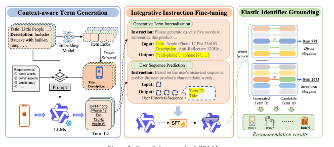

# GRLM

*Unleashing the Native Recommendation Potential: LLM-Based Generative Recommendation via Structured Term Identifiers* — Zhang et al. · arXiv’26

`III. SID–Model Alignment` · `Tokenization`

[Paper](https://arxiv.org/abs/2601.06798) · [Code](https://github.com/ZY0025/GRLM) · [Matrix](../../README.md#iii--tokenization)

Reading level: Reading Notes (Level 2) · On this page: [TL;DR](#tldr) · [At a Glance](#at-a-glance) · [1. Why This Paper Matters](#1-why-this-paper-matters) · [2. How It Works](#2-how-it-works) · [3. Experimental Findings](#3-experimental-findings) · [4. Limitations & Critical Analysis](#4-limitations--critical-analysis) · [5. Connections to Related Work](#5-connections-to-related-work)

| Representation | Tokenization | Backbone | Training | Inference |
| :-: | :-: | :-: | :-: | :-: |
| `Text` | **`Term-ID`** | `Dec-Only` | `Fixed / Multi-task NTP` | `Beam` |

- `Dec-Only`: Decoder-only.
- `Fixed`: SIDs are built first and not changed while the generator trains.
- `Multi-task NTP`: The same NTP loss over several tasks.

### TL;DR

GRLM identifies items by Term IDs, standardized textual keywords generated from metadata, and fine-tunes an LLM on them, avoiding free-text hallucination and the vocabulary expansion of Semantic IDs.

### At a Glance

| Aspect | Summary |
| :-- | :-- |
| Research Problem | III. SID–Model Alignment: Can the generator read, write, and reason over SIDs, and do the tokenizer and generator work toward the same goal? |
| Key Contribution | GRLM identifies items by Term IDs, standardized textual keywords generated from metadata, and fine-tunes an LLM on them, avoiding free-text hallucination and the vocabulary expansion of Semantic IDs. |
| Modified Stage | Tokenization |
| Limitation | A generated Term ID that matches no item is grounded by structural matching, so part of the final ranking comes from the grounding step, not from the generator (Sec. 3.3). |

### 1. Why This Paper Matters

Text-based item identifiers expose the large output space of an LLM, while Semantic IDs (SIDs) need costly vocabulary expansion and alignment training (Abstract). GRLM takes a middle path with standardized keywords.

> "Text-based methods introduce LLMs' vast output space, leading to hallucination, while methods based on Semantic IDs (SIDs) encounter a semantic gap between SIDs and LLMs' native vocabulary, requiring costly vocabulary expansion and alignment training." (Abstract)

Based on arXiv v1.

### 2. How It Works

*Figure source: Fig. 2, original paper.*

#### Context-Aware Term Generation

Context-aware Term Generation converts item metadata into standardized Term IDs (TIDs) (Abstract).

#### Integrative Instruction Fine-Tuning

Integrative Instruction Fine-tuning optimizes term internalization and sequential recommendation together (Abstract).

#### Elastic Identifier Grounding

If no exact match exists, Elastic Identifier Grounding (EIG) scores items by structural matching, where the $`j`$-th generated term has weight $`w_j = \frac{1}{j+1}`$ (Sec. 3.3).

> "By exploiting the decompositional nature of TIDs, EIG combines direct mapping with structural mapping to ground TIDs into actual items efficiently." (Sec. 1)

### 3. Experimental Findings

**Experimental setup**

- **Datasets**: In-domain: Amazon Beauty, Sports, Toys (5-core, following TIGER and OneRec-Think; 22,363 / 12,101, 35,598 / 18,357, 19,412 / 11,924 users / items). Cross-domain pairs Sports-Clothing and Phones-Electronics, built per GenCDR by merging overlapping users' interactions chronologically. Appendix: ten Amazon 2014 categories merged.
  - Source: In-domain and cross-domain datasets: https://arxiv.org/html/2601.06798v1#S4.p3 and https://arxiv.org/html/2601.06798v1#S4.p4; statistics: https://arxiv.org/html/2601.06798v1#S4.T1; ten-dataset appendix: https://arxiv.org/html/2601.06798v1#A1.T6.
- **Split**: Leave-one-out (allocation not restated beyond the label); in the cross-domain setting the last interaction in each domain of the pair is predicted separately.
  - Source: Leave-one-out and cross-domain evaluation: https://arxiv.org/html/2601.06798v1#S4.p3 and https://arxiv.org/html/2601.06798v1#S4.p4.
- **Candidates**: not reported (full catalog versus sampled evaluation candidates); validity of generated Term IDs is measured separately (Table 5).
  - Source: Metrics only: https://arxiv.org/html/2601.06798v1#S4.p5.
- **Visibility**: warm; no unseen-item protocol is defined.
  - Source: Standard split with no unseen-item protocol: https://arxiv.org/html/2601.06798v1#S4.p3.
- **SID**: Term IDs: 5 natural-language terms per item from Qwen3-4B's native vocabulary, produced by context-aware term generation (7 and 10 terms tested). Collision handling: not reported beyond relying on a large term space; an optional K-means compression maps 54,255 raw terms to K core terms (3,000-8,000).
  - Source: Term IDs of length 5 from the LLM vocabulary: https://arxiv.org/html/2601.06798v1#S4.p5; length study: https://arxiv.org/html/2601.06798v1#A2.T8; collision discussion and compression: https://arxiv.org/html/2601.06798v1#A2.p1, https://arxiv.org/html/2601.06798v1#A4.p4, https://arxiv.org/html/2601.06798v1#A4.T9.
- **Inference budget**: Beam search with generation max length 30 tokens; beam width not reported. Qwen3-4B backbone; hardware, inference batch size, and latency: not reported. Valid rate at 10 is 0.989-0.998 (Table 5).
  - Source: Beam search, max length 30: https://arxiv.org/html/2601.06798v1#S4.p5; training batch: https://arxiv.org/html/2601.06798v1#A1.p2; validity: https://arxiv.org/html/2601.06798v1#S5.T5.
- **Results from**: Table 2 (in-domain), Table 3 (cross-domain), Table 4 (ablations), Table 5 (Term ID validity), Appendix Tables 7-9 (ten-dataset results, Term ID length, vocabulary compression).
  - Source: Results: https://arxiv.org/html/2601.06798v1#S5.T2, https://arxiv.org/html/2601.06798v1#S5.T3, https://arxiv.org/html/2601.06798v1#S5.T4, https://arxiv.org/html/2601.06798v1#S5.T5, https://arxiv.org/html/2601.06798v1#A1.T7, https://arxiv.org/html/2601.06798v1#A2.T8, https://arxiv.org/html/2601.06798v1#A4.T9.

- Main comparison: GRLM reports better performance than the baselines in multiple scenarios (Abstract).
- Scaling and hallucination: the authors state that TIDs scale well and reduce hallucination (Sec. 1).

  > "Moreover, through detailed analytical experiments, we provide evidence that our TID-based method exhibits robust scaling properties while significantly mitigating hallucination." (Sec. 1)

### 4. Limitations & Critical Analysis

**Our analysis.**

- TIGER adds `RQ-VAE` codes as new tokens; GRLM uses `Term-ID` words already in the vocabulary.
- IDGenRec also uses vocabulary words (`LLM-Vocab`) but updates its ID generator during training (`Altern.`); GRLM generates its TIDs once.

### 5. Connections to Related Work

- **Competitor** · [OneRec-Think](onerec-think.md): OneRec-Think reasons over numeric SIDs with an LLM; GRLM replaces SIDs with Term IDs drawn from the LLM's own vocabulary.
  - Source: GRLM v1, LLM-based baselines and preprocessing: https://arxiv.org/html/2601.06798v1#S4.I1.i3.p1 and https://arxiv.org/html/2601.06798v1#S4.p3; Table 2: https://arxiv.org/html/2601.06798v1#S5.T2.
- **Competitor** · [IDGenRec](idgenrec.md): IDGenRec generates free textual IDs; GRLM extracts a fixed number of standardized terms with context-aware generation to limit synonym ambiguity.
  - Source: GRLM v1, LLM-based baselines: https://arxiv.org/html/2601.06798v1#S4.I1.i3.p1; Table 2: https://arxiv.org/html/2601.06798v1#S5.T2; case study: https://arxiv.org/html/2601.06798v1#A3.p1.
- **Competitor** · [TIGER](tiger.md): TIGER uses numeric RQ-VAE semantic IDs; GRLM uses natural-language term IDs.
  - Source: GRLM v1, generative baselines: https://arxiv.org/html/2601.06798v1#S4.I1.i2.p1; Tables 2 and 3: https://arxiv.org/html/2601.06798v1#S5.T2 and https://arxiv.org/html/2601.06798v1#S5.T3.
- **Competitor** · [GenCDR](gencdr.md): GenCDR adapts semantic-ID tokenization per domain; GRLM transfers across domains through shared vocabulary terms.
  - Source: GRLM v1, cross-domain baselines and protocol: https://arxiv.org/html/2601.06798v1#S4.I1.i4.p1 and https://arxiv.org/html/2601.06798v1#S4.p4; Table 3: https://arxiv.org/html/2601.06798v1#S5.T3.

[View all papers in this cell](../../README.md#iii--tokenization)
