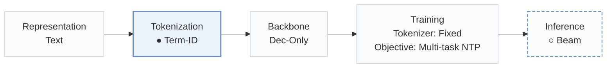
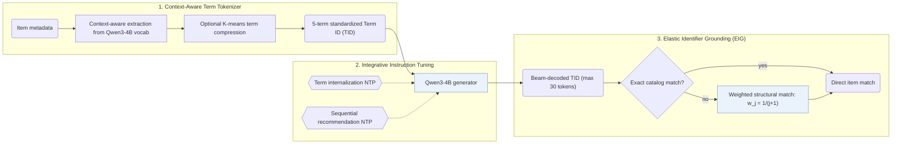
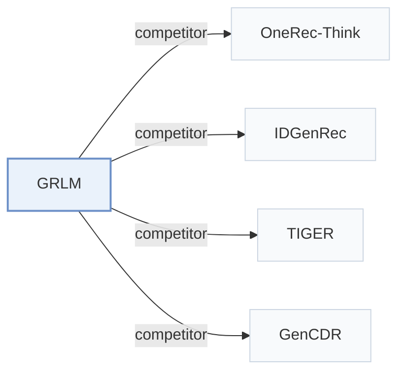

# GRLM

[← Problem × Stage Matrix](../../README.md#iii--tokenization) · [Papers by Stage](../index/stages.md) · [Papers by Modality](../index/modality.md) · [Papers by Domain](../index/domain.md) · English | [中文](../zh/papers/grlm.md)

| **Title** | *Unleashing the Native Recommendation Potential: LLM-Based Generative Recommendation via Structured Term Identifiers* |
| :-- | :-- |
| **Authors** | Zhang et al. |
| **Venue** | arXiv’26 |
| **Problem × Stage** | `III. SID–Model Alignment` · `Tokenization` |
| **Changes** | ● Tokenization · ○ Inference |
| **SID inputs** | `Text` |
| **Domain** | `E-commerce` |
| **Settings** | `cross-domain` |
| **Scenario** | `General Item Recommendation`; `Public Benchmarks` |
| **Links** | [Paper](https://arxiv.org/abs/2601.06798) · [Code](https://github.com/ZY0025/GRLM) |
| **Reading level** | Reading Notes (Level 2) |

**On this page**: [TL;DR](#tldr) · [At a Glance](#at-a-glance) · [1. Why It Matters](#1-why-this-paper-matters) · [2. Method](#2-how-it-works) · [3. Experiments](#3-experimental-findings) · [4. Limitations](#4-limitations--critical-analysis) · [5. Related Work](#5-connections-to-related-work)

- `Text`: Textual item metadata (titles, descriptions, categories, or prompts).
- `Term-ID`: Standardized textual keyword identifiers generated from item metadata.
- `Dec-Only`: Decoder-only.
- `Fixed`: SIDs are built first and not changed while the generator trains.
- `Multi-task NTP`: The same NTP loss over several tasks.
- `Beam`: Autoregressive beam search over Semantic ID tokens.

### TL;DR

> [!NOTE]
> GRLM identifies items by Term IDs, standardized textual keywords generated from metadata, and fine-tunes an LLM on them, avoiding free-text hallucination and the vocabulary expansion of Semantic IDs.

---

### At a Glance

| Aspect | Summary |
| :-- | :-- |
| Key Findings | Across in-domain Amazon benchmarks (Beauty, Sports, and Toys) and cross-domain pairs (Sports-Clothing and Phones-Electronics), GRLM outperforms generative and LLM baselines while achieving a top-10 Term ID valid rate of 0.989–0.998 (Abstract, Tables 2, 3, and 5). |
| Limitation | A generated Term ID that matches no item is grounded by structural matching, so part of the final ranking comes from the grounding step rather than the generator (Sec. 3.3). |

---

### 1. Why This Paper Matters

Free-text item identifiers expose the vast output space of a large language model (LLM), whereas numeric Semantic IDs (SIDs) require out-of-vocabulary token expansion and alignment training (Abstract). GRLM represents each item as a short sequence of standardized keywords drawn directly from the LLM's native vocabulary.

> "Text-based methods introduce LLMs' vast output space, leading to hallucination, while methods based on Semantic IDs (SIDs) encounter a semantic gap between SIDs and LLMs' native vocabulary, requiring costly vocabulary expansion and alignment training." (Abstract)

---

### 2. How It Works

#### Context-Aware Term Generation

Context-aware Term Generation converts item metadata into standardized 5-term Term IDs (TIDs) using words from the Qwen3-4B vocabulary, with an optional K-means compression that maps 54,255 raw terms to 3,000–8,000 core terms (Abstract, Appendix A.4).

#### Integrative Instruction Fine-Tuning

Integrative Instruction Fine-tuning jointly trains Qwen3-4B on term internalization tasks and sequential next-TID prediction under a multi-task next-token prediction objective (Abstract).

#### Elastic Identifier Grounding

At inference, beam search generates candidate TIDs up to 30 tokens; when a generated TID has no exact catalog match, Elastic Identifier Grounding (EIG) scores catalog items by structural term overlap with position weight $`w_j = \frac{1}{j+1}`$ for the $`j`$-th generated term (Sec. 3.3).

> "By exploiting the decompositional nature of TIDs, EIG combines direct mapping with structural mapping to ground TIDs into actual items efficiently." (Sec. 1)

---

### 3. Experimental Findings

Experimental setup

- **Datasets**: In-domain: Amazon Beauty, Sports, Toys (5-core, following TIGER and OneRec-Think; 22,363 / 12,101, 35,598 / 18,357, 19,412 / 11,924 users / items). Cross-domain pairs Sports-Clothing and Phones-Electronics, built per GenCDR by merging overlapping users' interactions chronologically. Appendix: ten Amazon 2014 categories merged.
  - Source: In-domain and cross-domain datasets: [S4.p3](https://arxiv.org/html/2601.06798v1#S4.p3) and [S4.p4](https://arxiv.org/html/2601.06798v1#S4.p4); statistics: [S4.T1](https://arxiv.org/html/2601.06798v1#S4.T1); ten-dataset appendix: [A1.T6](https://arxiv.org/html/2601.06798v1#A1.T6).
- **Split**: Leave-one-out (allocation not restated beyond the label); in the cross-domain setting the last interaction in each domain of the pair is predicted separately.
  - Source: Leave-one-out and cross-domain evaluation: [S4.p3](https://arxiv.org/html/2601.06798v1#S4.p3) and [S4.p4](https://arxiv.org/html/2601.06798v1#S4.p4).
- **Candidates**: not reported (full catalog versus sampled evaluation candidates); validity of generated Term IDs is measured separately (Table 5).
  - Source: Metrics only: [S4.p5](https://arxiv.org/html/2601.06798v1#S4.p5).
- **Visibility**: warm; no unseen-item protocol is defined.
  - Source: Standard split with no unseen-item protocol: [S4.p3](https://arxiv.org/html/2601.06798v1#S4.p3).
- **SID**: Term IDs: 5 natural-language terms per item from Qwen3-4B's native vocabulary, produced by context-aware term generation (7 and 10 terms tested). Collision handling: not reported beyond relying on a large term space; an optional K-means compression maps 54,255 raw terms to K core terms (3,000-8,000).
  - Source: Term IDs of length 5 from the LLM vocabulary: [S4.p5](https://arxiv.org/html/2601.06798v1#S4.p5); length study: [A2.T8](https://arxiv.org/html/2601.06798v1#A2.T8); collision discussion and compression: [A2.p1](https://arxiv.org/html/2601.06798v1#A2.p1), [A4.p4](https://arxiv.org/html/2601.06798v1#A4.p4), [A4.T9](https://arxiv.org/html/2601.06798v1#A4.T9).
- **Inference budget**: Beam search with generation max length 30 tokens; beam width not reported. Qwen3-4B backbone; hardware, inference batch size, and latency: not reported. Valid rate at 10 is 0.989-0.998 (Table 5).
  - Source: Beam search, max length 30: [S4.p5](https://arxiv.org/html/2601.06798v1#S4.p5); training batch: [A1.p2](https://arxiv.org/html/2601.06798v1#A1.p2); validity: [S5.T5](https://arxiv.org/html/2601.06798v1#S5.T5).
- **Results from**: Table 2 (in-domain), Table 3 (cross-domain), Table 4 (ablations), Table 5 (Term ID validity), Appendix Tables 7-9 (ten-dataset results, Term ID length, vocabulary compression).
  - Source: Results: [S5.T2](https://arxiv.org/html/2601.06798v1#S5.T2), [S5.T3](https://arxiv.org/html/2601.06798v1#S5.T3), [S5.T4](https://arxiv.org/html/2601.06798v1#S5.T4), [S5.T5](https://arxiv.org/html/2601.06798v1#S5.T5), [A1.T7](https://arxiv.org/html/2601.06798v1#A1.T7), [A2.T8](https://arxiv.org/html/2601.06798v1#A2.T8), [A4.T9](https://arxiv.org/html/2601.06798v1#A4.T9).

- In-domain and cross-domain accuracy: GRLM outperforms sequential, SID-based, and text-ID baselines on Amazon Beauty, Sports, and Toys (Table 2), on cross-domain pairs Sports-Clothing and Phones-Electronics (Table 3), and on a ten-category merged Amazon corpus (Appendix Table 7) (Abstract).
- Validity, ablations, and scaling: Table 4 confirms the contributions of context-aware term generation, integrative tuning, and EIG; Table 5 reports a top-10 valid TID rate of 0.989–0.998, and Appendix Tables 8–9 evaluate TID lengths (5, 7, and 10 terms) and vocabulary compression.

  > "Moreover, through detailed analytical experiments, we provide evidence that our TID-based method exhibits robust scaling properties while significantly mitigating hallucination." (Sec. 1)

---

### 4. Limitations & Critical Analysis

**Our analysis.**

- TIGER adds numeric `RQ-VAE` codes as out-of-vocabulary tokens; GRLM composes `Term-ID` identifiers from words already in the native LLM vocabulary.
- IDGenRec also uses native vocabulary words (`LLM-Vocab`) but updates its ID generator alongside the recommender (`Altern.`); GRLM extracts its TIDs once offline (`Fixed`).

---

### 5. Connections to Related Work

- **Competitor** · [OneRec-Think](onerec-think.md): OneRec-Think reasons over numeric SIDs with an LLM; GRLM replaces SIDs with Term IDs drawn from the LLM's own vocabulary.
  - Source: GRLM v1, LLM-based baselines and preprocessing: [S4.I1.i3.p1](https://arxiv.org/html/2601.06798v1#S4.I1.i3.p1) and [S4.p3](https://arxiv.org/html/2601.06798v1#S4.p3); Table 2: [S5.T2](https://arxiv.org/html/2601.06798v1#S5.T2).
- **Competitor** · [IDGenRec](idgenrec.md): IDGenRec generates free textual IDs; GRLM extracts a fixed number of standardized terms with context-aware generation to limit synonym ambiguity.
  - Source: GRLM v1, LLM-based baselines: [S4.I1.i3.p1](https://arxiv.org/html/2601.06798v1#S4.I1.i3.p1); Table 2: [S5.T2](https://arxiv.org/html/2601.06798v1#S5.T2); case study: [A3.p1](https://arxiv.org/html/2601.06798v1#A3.p1).
- **Competitor** · [TIGER](tiger.md): TIGER uses numeric RQ-VAE semantic IDs; GRLM uses natural-language term IDs.
  - Source: GRLM v1, generative baselines: [S4.I1.i2.p1](https://arxiv.org/html/2601.06798v1#S4.I1.i2.p1); Tables 2 and 3: [S5.T2](https://arxiv.org/html/2601.06798v1#S5.T2) and [S5.T3](https://arxiv.org/html/2601.06798v1#S5.T3).
- **Competitor** · [GenCDR](gencdr.md): GenCDR adapts semantic-ID tokenization per domain; GRLM transfers across domains through shared vocabulary terms.
  - Source: GRLM v1, cross-domain baselines and protocol: [S4.I1.i4.p1](https://arxiv.org/html/2601.06798v1#S4.I1.i4.p1) and [S4.p4](https://arxiv.org/html/2601.06798v1#S4.p4); Table 3: [S5.T3](https://arxiv.org/html/2601.06798v1#S5.T3).

[View all papers in this cell](../../README.md#iii--tokenization)
