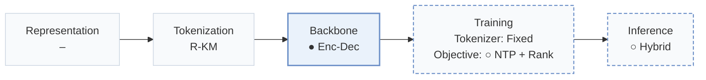
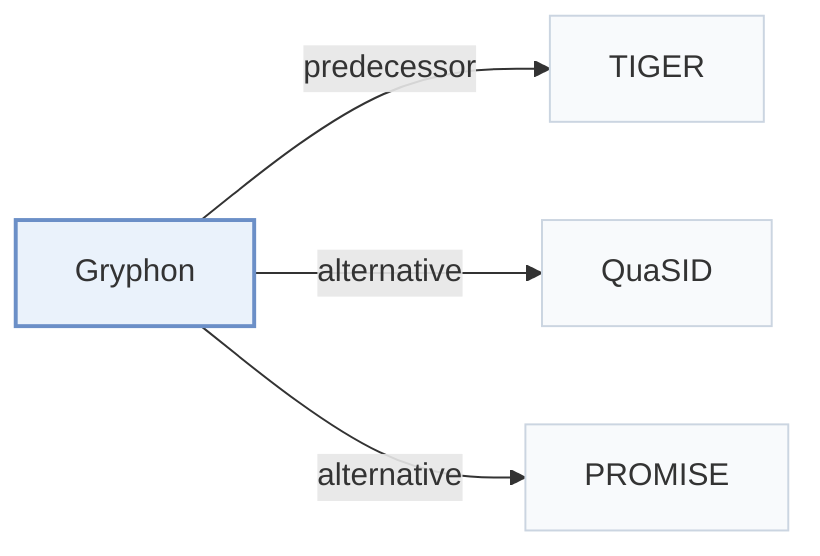

# Gryphon

[← Problem × Stage Matrix](../../README.md#iv--backbone) · [Papers by Stage](../index/stages.md) · [Papers by Modality](../index/modality.md) · [Papers by Domain](../index/domain.md) · English | [中文](../zh/papers/gryphon.md)

| **Title** | *A Unified Architecture for Semantic-ID Generation and Item-Level Scoring in Industrial Recommendations* |
| :-- | :-- |
| **Authors** | Tikhonovich et al. |
| **Venue** | CIKM’26 Short |
| **Problem × Stage** | `IV. Utility` · `Backbone` |
| **Changes** | ● Backbone · ○ Objective · ○ Inference |
| **SID inputs** | `Other` (Residual K-Means SIDs, input unstated) |
| **Domain** | `Music` |
| **Scenario** | `General Item Recommendation`; `Online Experiment or Deployment` |
| **Links** | [Paper](https://arxiv.org/abs/2606.08604) |
| **Reading level** | Overview (Level 1) |

**On this page**: [TL;DR](#tldr) · [3. Experiments](#3-experimental-findings) · [5. Related Work](#5-connections-to-related-work)

- `R-KM`: Residual k-means.
- `Enc-Dec`: Encoder-decoder.
- `Fixed`: SIDs are built first and not changed while the generator trains.
- `NTP + Rank`: NTP plus a ranking loss.
- `Hybrid`: Hybrid retrieval combining generative SID decoding with dense or co-occurrence retrieval.

### TL;DR

> [!NOTE]
> Gryphon adds a jointly trained item-level scoring component to an encoder-decoder generator, resolving each generated Semantic ID to its items and re-scoring them, instead of ranking by token likelihood.

---

### 3. Experimental Findings

Experimental setup

- **Datasets**: One week of industrial music-platform logs; tens of millions of active users and items. Filtering not reported.
  - Source: Section 4.1.1: [S4.SS1.SSS1.p1](https://arxiv.org/html/2606.08604v1#S4.SS1.SSS1.p1)
- **Split**: not reported
  - Source: Section 4.1.1: [S4.SS1.SSS1.p1](https://arxiv.org/html/2606.08604v1#S4.SS1.SSS1.p1)
- **Candidates**: not reported
  - Source: Offline evaluation in Sections 4.1.1/4.1.4 does not specify full-catalog versus sampled-negative evaluation: [S4.SS1.SSS1.p1](https://arxiv.org/html/2606.08604v1#S4.SS1.SSS1.p1) and [S4.SS1.SSS4.p1](https://arxiv.org/html/2606.08604v1#S4.SS1.SSS4.p1)
- **Visibility**: warm; no unseen-item protocol is defined. All items are quantized into SIDs; tokenizer fitting exposure not reported.
  - Source: Sections 4.1.1/4.1.3: [S4.SS1.SSS1.p1](https://arxiv.org/html/2606.08604v1#S4.SS1.SSS1.p1) and [S4.SS1.SSS3.p1](https://arxiv.org/html/2606.08604v1#S4.SS1.SSS3.p1)
- **SID**: Residual K-Means: 3 x 32000; collisions retained, generated SIDs expanded to all matching items and rescored by ILSM.
  - Source: Sections 3.4/4.1.3: [S3.SS4.p2](https://arxiv.org/html/2606.08604v1#S3.SS4.p2) and [S4.SS1.SSS3.p1](https://arxiv.org/html/2606.08604v1#S4.SS1.SSS3.p1)
- **Inference budget**: Beam 2048; Recall@10/1000; online outputs 1000 items. Hardware, inference batch size, absolute latency not reported; parameter count and inference time differ from vanilla GR by <1%.
  - Source: Sections 4.1.3/4.1.4/4.2: [S4.SS1.SSS3.p1](https://arxiv.org/html/2606.08604v1#S4.SS1.SSS3.p1) and [S4.SS1.SSS4.p1](https://arxiv.org/html/2606.08604v1#S4.SS1.SSS4.p1) and [S4.SS2.p1](https://arxiv.org/html/2606.08604v1#S4.SS2.p1)
- **Results from**: Original Table 1: offline comparison; Table 2: same-pool scoring ablation; Table 3: seven-day online A/B test.
  - Source: Tables 1-3: [S4.T1](https://arxiv.org/html/2606.08604v1#S4.T1) and [S4.T2](https://arxiv.org/html/2606.08604v1#S4.T2) and [S4.T3](https://arxiv.org/html/2606.08604v1#S4.T3)

---

### 5. Connections to Related Work

- **Predecessor** · [TIGER](tiger.md): TIGER's extra collision-resolution token motivates the resolved-GR baseline; Gryphon instead scores colliding items separately.
  - Source: Gryphon v1, Sections 2.2/4.1.2: [S2.SS2.p1](https://arxiv.org/html/2606.08604v1#S2.SS2.p1); [S4.SS1.SSS2.p3](https://arxiv.org/html/2606.08604v1#S4.SS1.SSS2.p3).
- **Alternative** · [QuaSID](quasid.md): Cited collision-focused SID-learning work; Gryphon retains shared SIDs and distinguishes their items through ILSM.
  - Source: Gryphon v1, Sections 1/3.2, citing Hu et al. (2026): [S1.SS0.SSS0.Px2.p2](https://arxiv.org/html/2606.08604v1#S1.SS0.SSS0.Px2.p2); [S3.SS2.p2](https://arxiv.org/html/2606.08604v1#S3.SS2.p2).
- **Alternative** · [PROMISE](promise.md): Cited for autoregressive prefix errors; Gryphon addresses candidate ordering with jointly trained item-level scoring.
  - Source: Gryphon v1, Section 2.3, citing Guo et al. (2026): [S2.SS3.p1](https://arxiv.org/html/2606.08604v1#S2.SS3.p1).

[View all papers in this cell](../../README.md#iv--backbone)
