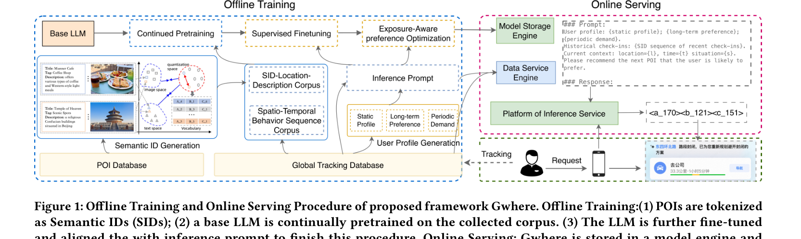

# Gwhere

*Guess Where You Go: Generative Next Point-of-Interest Recommendation in Amap* — Zhai et al. · RecSys’26

`II. Uniqueness and Validity` · `Tokenization` · `POI`

[Paper](https://arxiv.org/abs/2607.26073) · [Code](https://github.com/alibaba/SimCIT) · [Matrix](../../README.md#ii--tokenization)

Reading level: Overview (Level 1) · On this page: [TL;DR](#tldr) · [At a Glance](#at-a-glance) · [2. How It Works](#2-how-it-works) · [3. Experimental Findings](#3-experimental-findings) · [5. Connections to Related Work](#5-connections-to-related-work)

| Representation | Tokenization | Backbone | Training | Inference |
| :-: | :-: | :-: | :-: | :-: |
| `Text+Img+Geo+CF` | **`Contr. RQ`** | `Dec-Only` | `Fixed / NTP → DPO` | `–` |

- `Contr. RQ`: Residual quantization trained with contrastive objectives.
- `Dec-Only`: Decoder-only.
- `Fixed`: SIDs are built first and not changed while the generator trains.
- `NTP → DPO`: NTP, then preference optimization.
- `–`: Not reported in the paper.

### TL;DR

Gwhere learns POI Semantic IDs with a contrastive residual-quantization tokenizer over text, image, spatial, and collaborative signals, then adapts an LLM through continued pretraining, fine-tuning, and exposure-aware KTO.

### At a Glance

| Aspect | Summary |
| :-- | :-- |
| Research Problem | II. Uniqueness and Validity: Does every item get its own SID, every generated SID name a real item, and the codebook get used evenly? |
| Key Contribution | Gwhere learns POI Semantic IDs with a contrastive residual-quantization tokenizer over text, image, spatial, and collaborative signals, then adapts an LLM through continued pretraining, fine-tuning, and exposure-aware KTO. |
| Modified Stage | Tokenization |

### 2. How It Works

### 3. Experimental Findings

**Experimental setup**

- **Datasets**: Foursquare NYC and TKY, Gowalla CA (POIs with fewer than 10 interactions and users with fewer than 10 check-ins removed, following GNPR-SID; 1,083 / 5,135, 2,293 / 7,873, 6,592 / 14,027 users / POIs), and a proprietary AMAP dataset of sampled desensitized users (10,000K users / 83,100K POIs / 380,000K interactions); AMAP filtering not reported.
  - Source: Datasets and GNPR-SID preprocessing: https://arxiv.org/html/2607.26073v1#S4.SS1.SSS1.p1 and https://arxiv.org/html/2607.26073v1#S4.SS1.SSS1.p2; statistics: https://arxiv.org/html/2607.26073v1#S4.T2.
- **Split**: Public: time-sorted 80% / 10% / 10% train/validation/test; within each user's test sequence the last visited POI is the target. AMAP offline split: not reported. Online: one-week and one-month A/B tests on the 'Guess Where You Go' card.
  - Source: Public split: https://arxiv.org/html/2607.26073v1#S4.SS1.SSS1.p2; AMAP split not stated; online tests: https://arxiv.org/html/2607.26073v1#S4.SS4.SSS3.p1 and https://arxiv.org/html/2607.26073v1#S4.SS4.SSS3.p3.
- **Candidates**: not reported (full catalog versus sampled candidates); the metric is top-1 accuracy (Acc@1).
  - Source: Top-1 accuracy only: https://arxiv.org/html/2607.26073v1#S4.T3 and https://arxiv.org/html/2607.26073v1#S4.T4.
- **Visibility**: warm; users and POIs absent from the training set are removed from the test set.
  - Source: Test users and POIs absent from training are removed: https://arxiv.org/html/2607.26073v1#S4.SS1.SSS1.p2.
- **SID**: 3-layer residual quantizer over a 96-dimensional fused latent from text, ALS collaborative, image, and spatial GraphSAGE views, trained contrastively with Gumbel-softmax assignment; 48 codewords per layer on public data, larger (not specified) on AMAP. Collision handling: not reported beyond the contrastive objective that aims to reduce code collision.
  - Source: 3-layer residual quantizer, 96-dimensional latent, 48 codewords on public data: https://arxiv.org/html/2607.26073v1#S4.SS1.SSS2.p2; four modality views: https://arxiv.org/html/2607.26073v1#S4.SS1.SSS2.p1; contrastive Gumbel-softmax quantization: https://arxiv.org/html/2607.26073v1#S3.SS2.SSS2.Px1.p1.
- **Inference budget**: Decoding method and beam width: not reported. Online load test at 50 QPS on 2 NVIDIA H20 GPUs: deployed Gwhere-0.5B at about 30 ms p99 versus about 20 ms for the cascade-ranking system (Figure 4). Training on 200 H20 GPUs with batch 16 per GPU; inputs are the 50 most recent check-ins.
  - Source: Load test: https://arxiv.org/html/2607.26073v1#S4.SS4.SSS2.p1 and https://arxiv.org/html/2607.26073v1#S4.SS4.SSS2.p2; training hardware: https://arxiv.org/html/2607.26073v1#S4.SS1.SSS2.p3; decoding not specified.
- **Results from**: Table 4 (Acc@1 on NYC, TKY, CA; baseline numbers borrowed from LLM4POI and GNPR-SID); Table 3 (AMAP model sizes versus the cascade-ranking system); Table 5 and Figures 2-3 (ablations, modalities, pretraining); Figure 4 (latency); Table 6 (online A/B).
  - Source: Public: https://arxiv.org/html/2607.26073v1#S4.T4; AMAP: https://arxiv.org/html/2607.26073v1#S4.T3; ablations: Table 5 and https://arxiv.org/html/2607.26073v1#S4.F2; online: https://arxiv.org/html/2607.26073v1#S4.T6.

## 旧卡片说明

迁自 `d61aa6c:papers/gwhere.md`。保留方法说明、实验叙述与局限；本轮只对照现有记录处理明确冲突，未重新逐句核查原论文。分类和规格以页面上方由记录生成的表格为准。

### Gwhere：高德生成式下一兴趣点推荐

> Gwhere 融合文本、图像、空间和协同信号学习 POI SID，再通过时空语料、监督微调和暴露感知偏好优化服务高德下一 POI 推荐。

### 研究动机与问题定义

工业下一 POI 推荐需要处理异构 POI 信息、用户移动规律和高并发低延迟服务。随机或碰撞严重的标识会削弱生成模型的泛化，单纯监督训练也难以利用曝光数据中的偏好信号。Gwhere 以端到端 SID 生成和线上服务为目标。

### TL;DR（核心摘要）

`文本/图像/空间/协同 → 对比残差量化 → POI SID → CPT/SFT/EAKTO → 生成下一POI`

Gwhere 先用对比学习残差量化器让多模态和协同表示形成区分度更高的 SID；再用 SID-地点描述语料和时空行为语料持续预训练 LLM，随后进行 SFT 与 Exposure-Aware Kahneman-Tversky Optimization（EAKTO，暴露感知卡尼曼-特沃斯基优化）。线上数据服务将实时上下文转为提示，模型直接生成 SID。

### 输入与使用场景

| 方面 | 说明 |
|---|---|
| 使用信息 | POI 文本、图像、空间、协同、用户轨迹和曝光反馈 |
| 信息融入位置 | SID 量化、持续预训练、监督微调和偏好优化 |
| 语义标识结构 | 多级离散 POI SID |
| 适用场景 | 高德工业级下一 POI 推荐 |

### 方法设计

#### 3.2 对比物品分词
Gwhere 为每个 POI 编码文本、图片和空间信息，并结合协同关系。残差量化器逐层选择 code；对比目标拉近真实相关 POI、分离难负样本，以减少异构信息融合后的标识碰撞。

#### 3.3 时空 LLM 后训练
持续预训练语料包含 SID-地点描述、用户时空行为和 POI 问答，使 LLM 学会非原生 SID token 与地理语义之间的对应。SFT 再把用户画像、近期轨迹、当前时间和位置组织为下一 POI 预测任务。

#### 3.4 EAKTO 偏好对齐
EAKTO 使用曝光数据中的点击/未点击或行为反馈构造偏好信号，并以 Kahneman-Tversky 风格的价值函数处理正负反馈的不对称性。它在生成式目标之外补充行为偏好，使模型不只拟合历史点击。

#### 4.5 工业部署
线上服务通过模型存储引擎和数据服务引擎生成实时提示，模型输出 SID 后映射回可读 POI，并返回客户端。图1同时展示离线构建、训练与在线 serving 的完整链路。

### 实验结论

- 公共数据集和高德工业数据集实验均支持 Gwhere 的有效性。
- 长期线上 A/B 测试相较生产基线报告 P-CTR 提升 5.83%、U-CTR 提升 6.20%。
- 多模态协同、偏好对齐和序列长度分析表明，EAKTO 与异构信号融合是关键设计；模型缩放趋势也被报告。

### 局限性与研究定位

#### 局限性

- 多模态 tokenizer、持续预训练和 EAKTO 组成较长的工程链路，复现成本较高。
- 论文对动态 POI、跨城市迁移和生成无效 SID 的统一处理仍缺少细节。

#### 研究定位

Gwhere 适合放在“工业级 POI 生成推荐与行为偏好对齐”章节，突出从 SID 学习到线上 serving 的完整闭环。

### 相关资源

- [论文原文](https://arxiv.org/abs/2607.26073)
- [开源代码](https://github.com/alibaba/SimCIT)

### 标签

`下一兴趣点推荐` · `多模态SID` · `暴露感知优化` · `工业部署`

### 架构图来源

*图源：原论文，图1（[论文原文](https://arxiv.org/abs/2607.26073)）。图片使用许可待核实。*

---

### 旧总表补充

来源：`d61aa6c:tables/all-methods.md`。

- 核心贡献：融合多模态 SID 与暴露感知偏好优化实现工业部署。
- 使用场景：高德下一 POI 推荐。

### 5. Connections to Related Work

- **Competitor** · [GNPR-SID](gnpr-sid.md): GNPR-SID quantizes POIs with an RQ-VAE plus diversity losses; Gwhere fuses four modalities with a contrastive Gumbel-softmax quantizer and adds continued pretraining and exposure-aware preference alignment.
  - Source: Gwhere v1, follows GNPR-SID preprocessing and baselines: https://arxiv.org/html/2607.26073v1#S4.SS1.SSS1.p2 and https://arxiv.org/html/2607.26073v1#S4.SS1.SSS3.p1; Table 4: https://arxiv.org/html/2607.26073v1#S4.T4.
- **Alternative** · [TIGER](tiger.md): TIGER's reconstruction-trained RQ-VAE is the tokenizer style Gwhere argues against; Gwhere trains the quantizer contrastively for item separability.
  - Source: Gwhere v1, Section 1: https://arxiv.org/html/2607.26073v1#S1.p1; Section 3.2: https://arxiv.org/html/2607.26073v1#S3.SS2.p1; not a baseline in Table 4.

[View all papers in this cell](../../README.md#ii--tokenization)
