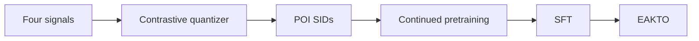

# Gwhere

*Guess Where You Go: Generative Next Point-of-Interest Recommendation in Amap* — Zhai et al. · RecSys’26

`II. Uniqueness and Validity` · `Tokenization` · `POI`

[Paper](https://arxiv.org/abs/2607.26073) · [Code](https://github.com/alibaba/SimCIT) · [Matrix](../../README.md#ii--tokenization)

Reading level: Reading Notes (Level 2) · On this page: [TL;DR](#tldr) · [At a Glance](#at-a-glance) · [1. Why This Paper Matters](#1-why-this-paper-matters) · [2. How It Works](#2-how-it-works) · [3. Experimental Findings](#3-experimental-findings) · [4. Limitations & Critical Analysis](#4-limitations--critical-analysis) · [5. Connections to Related Work](#5-connections-to-related-work)

| Representation | Tokenization | Backbone | Training | Inference |
| :-: | :-: | :-: | :-: | :-: |
| `Text+Img+Geo+CF` | **`Contr. RQ`** | `Dec-Only` | `Fixed / NTP → DPO` | `–` |

- `Contr. RQ`: Residual quantization trained with contrastive objectives.
- `Dec-Only`: Decoder-only.
- `Fixed`: SIDs are built first and not changed while the generator trains.
- `NTP → DPO`: NTP, then preference optimization.
- `–`: Not reported in the paper.

### TL;DR

Gwhere learns POI Semantic IDs with a contrastive residual-quantization tokenizer over text, image, spatial, and collaborative signals, then adapts an LLM through continued pretraining, fine-tuning, and exposure-aware KTO.

### At a Glance

| Aspect | Summary |
| :-- | :-- |
| Research Problem | II. Uniqueness and Validity: Does every item get its own SID, every generated SID name a real item, and the codebook get used evenly? |
| Key Contribution | Gwhere learns POI Semantic IDs with a contrastive residual-quantization tokenizer over text, image, spatial, and collaborative signals, then adapts an LLM through continued pretraining, fine-tuning, and exposure-aware KTO. |
| Modified Stage | Tokenization |
| Key Findings | In long-term online A/B tests on Amap, Gwhere reports improvements of 5.83% in P-CTR and 6.20% in U-CTR over the production baseline (Abstract). |

### 1. Why This Paper Matters

The authors state that scaling generative retrieval to industry is hard because of redundant or colliding token assignments and weak integration of heterogeneous item signals (Abstract). Next point-of-interest (POI) recommendation adds structured spatial entities and mobility patterns (Abstract).

> "Gwhere first learns discriminative POI SIDs through a contrastive residual-quantization tokenizer that aligns textual, visual, spatial, and collaborative signals." (Abstract)

Based on arXiv v1.

### 2. How It Works

*Figure source: Fig. 1, original paper.*

#### Contrastive Item Tokenization

The quantizer assigns codewords by Gumbel-softmax (Sec. 3.2.2). An NT-Xent loss pulls the quantized representation toward the item's own modal representations and away from other items in the batch (Sec. 3.2.2). The tokenizer has no reconstruction loss (Sec. 3.2).

#### Continued Pretraining

Two corpora from desensitized Amap trajectories and POI metadata cover semantic alignment and behavior patterns (Sec. 3.3.1, Table 1).

> "Each entry is a triplet of (SID, Geohash, Text Description), where Geohash is a 6-character string encoding the POI's precise geographical coordinates" (Sec. 3.3.1)

#### EAKTO

Exposure-Aware Kahneman-Tversky Optimization (EAKTO) adapts KTO to the clicks and non-clicks of exposure logs (Sec. 3.4).

> "In contrast, KTO (Ethayarajh et al., 2024) operates on simpler binary signals (desirable / undesirable), aligning with the natural structure of exposure logs (clicks vs. non-clicks)." (Sec. 3.4)

### 3. Experimental Findings

**Experimental setup**

- **Datasets**: Foursquare NYC and TKY, Gowalla CA (POIs with fewer than 10 interactions and users with fewer than 10 check-ins removed, following GNPR-SID; 1,083 / 5,135, 2,293 / 7,873, 6,592 / 14,027 users / POIs), and a proprietary AMAP dataset of sampled desensitized users (10,000K users / 83,100K POIs / 380,000K interactions); AMAP filtering not reported.
  - Source: Datasets and GNPR-SID preprocessing: https://arxiv.org/html/2607.26073v1#S4.SS1.SSS1.p1 and https://arxiv.org/html/2607.26073v1#S4.SS1.SSS1.p2; statistics: https://arxiv.org/html/2607.26073v1#S4.T2.
- **Split**: Public: time-sorted 80% / 10% / 10% train/validation/test; within each user's test sequence the last visited POI is the target. AMAP offline split: not reported. Online: one-week and one-month A/B tests on the 'Guess Where You Go' card.
  - Source: Public split: https://arxiv.org/html/2607.26073v1#S4.SS1.SSS1.p2; AMAP split not stated; online tests: https://arxiv.org/html/2607.26073v1#S4.SS4.SSS3.p1 and https://arxiv.org/html/2607.26073v1#S4.SS4.SSS3.p3.
- **Candidates**: not reported (full catalog versus sampled candidates); the metric is top-1 accuracy (Acc@1).
  - Source: Top-1 accuracy only: https://arxiv.org/html/2607.26073v1#S4.T3 and https://arxiv.org/html/2607.26073v1#S4.T4.
- **Visibility**: warm; users and POIs absent from the training set are removed from the test set.
  - Source: Test users and POIs absent from training are removed: https://arxiv.org/html/2607.26073v1#S4.SS1.SSS1.p2.
- **SID**: 3-layer residual quantizer over a 96-dimensional fused latent from text, ALS collaborative, image, and spatial GraphSAGE views, trained contrastively with Gumbel-softmax assignment; 48 codewords per layer on public data, larger (not specified) on AMAP. Collision handling: not reported beyond the contrastive objective that aims to reduce code collision.
  - Source: 3-layer residual quantizer, 96-dimensional latent, 48 codewords on public data: https://arxiv.org/html/2607.26073v1#S4.SS1.SSS2.p2; four modality views: https://arxiv.org/html/2607.26073v1#S4.SS1.SSS2.p1; contrastive Gumbel-softmax quantization: https://arxiv.org/html/2607.26073v1#S3.SS2.SSS2.Px1.p1.
- **Inference budget**: Decoding method and beam width: not reported. Online load test at 50 QPS on 2 NVIDIA H20 GPUs: deployed Gwhere-0.5B at about 30 ms p99 versus about 20 ms for the cascade-ranking system (Figure 4). Training on 200 H20 GPUs with batch 16 per GPU; inputs are the 50 most recent check-ins.
  - Source: Load test: https://arxiv.org/html/2607.26073v1#S4.SS4.SSS2.p1 and https://arxiv.org/html/2607.26073v1#S4.SS4.SSS2.p2; training hardware: https://arxiv.org/html/2607.26073v1#S4.SS1.SSS2.p3; decoding not specified.
- **Results from**: Table 4 (Acc@1 on NYC, TKY, CA; baseline numbers borrowed from LLM4POI and GNPR-SID); Table 3 (AMAP model sizes versus the cascade-ranking system); Table 5 and Figures 2-3 (ablations, modalities, pretraining); Figure 4 (latency); Table 6 (online A/B).
  - Source: Public: https://arxiv.org/html/2607.26073v1#S4.T4; AMAP: https://arxiv.org/html/2607.26073v1#S4.T3; ablations: Table 5 and https://arxiv.org/html/2607.26073v1#S4.F2; online: https://arxiv.org/html/2607.26073v1#S4.T6.

- Offline: the paper evaluates Gwhere on public datasets and Amap's industrial dataset (Abstract).
- Deployment: Gwhere serves Amap's homepage under high-concurrency and low-latency constraints (Abstract).

### 4. Limitations & Critical Analysis

**Our analysis.**

- Without a reconstruction loss, the quantizer trains only for separability. This suggests that SID prefixes need not form a semantic hierarchy.
- GNPR-SID builds `RQ-VAE` codes and trains with plain `NTP`; Gwhere builds `Contr. RQ` codes and adds preference alignment.

### 5. Connections to Related Work

- **Competitor** · [GNPR-SID](gnpr-sid.md): GNPR-SID quantizes POIs with an RQ-VAE plus diversity losses; Gwhere fuses four modalities with a contrastive Gumbel-softmax quantizer and adds continued pretraining and exposure-aware preference alignment.
  - Source: Gwhere v1, follows GNPR-SID preprocessing and baselines: https://arxiv.org/html/2607.26073v1#S4.SS1.SSS1.p2 and https://arxiv.org/html/2607.26073v1#S4.SS1.SSS3.p1; Table 4: https://arxiv.org/html/2607.26073v1#S4.T4.
- **Alternative** · [TIGER](tiger.md): TIGER's reconstruction-trained RQ-VAE is the tokenizer style Gwhere argues against; Gwhere trains the quantizer contrastively for item separability.
  - Source: Gwhere v1, Section 1: https://arxiv.org/html/2607.26073v1#S1.p1; Section 3.2: https://arxiv.org/html/2607.26073v1#S3.SS2.p1; not a baseline in Table 4.

[View all papers in this cell](../../README.md#ii--tokenization)
