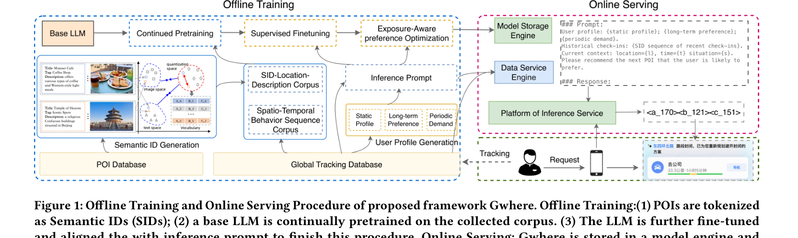

# Gwhere

*Guess Where You Go: Generative Next Point-of-Interest Recommendation in Amap* — Zhai et al., RecSys’26 · `POI`

[arXiv](https://arxiv.org/abs/2607.26073) · [Code](https://github.com/alibaba/SimCIT) · [Record](../../data/papers/gwhere.yaml) · [← Catalog](../../README.md#ii--tokenization)

> Abstract: "redundant or colliding token assignments"; "insufficient integration of heterogeneous item signals". II and I tie; most of the tokenizer design (contrastive instead of reconstruction loss; "alleviate code collision", p8) serves II. Both labelings were unsure (alternative I).

| Problem it fixes | Stage it changes |
| :-- | :-- |
| **II. Uniqueness and Validity**: Does every item get its own SID, every generated SID name a real item, and the codebook get used evenly? | **Tokenization** |

## Pipeline

| Representation | Tokenization | Backbone | Training | Inference |
| :-: | :-: | :-: | :-: | :-: |
| `Text+Img+Geo+CF` | **`Contr. RQ`** | `Dec-Only` | `Fixed / NTP → DPO` | `–` |

- `Contr. RQ`: Fully contrastive residual-quantization tokenizer (Gwhere).
- `Dec-Only`: Decoder-only.
- `Fixed`: SIDs are built first and not changed while the generator trains.
- `NTP → DPO`: NTP, then preference optimization.
- `–`: Not reported in the paper.

## Architecture

## Evidence

- **`problem`** (abstract, p1): Abstract: "redundant or colliding token assignments"; "insufficient integration of heterogeneous item signals". II and I tie; most of the tokenizer design (contrastive instead of reconstruction loss; "alleviate code collision", p8) serves II. Both labelings were unsure (alternative I).
- **`stage`** (§3.2, p3): The designs for both complaints sit in the tokenizer.
- **`tokenizer`** (p1; Fig. 1, p6): "Based on these SIDs, Gwhere adapts LLMs"; SIDs are built offline before LLM training.

## 旧卡片说明

迁自 `d61aa6c:papers/gwhere.md`。保留方法说明、实验叙述与局限；本轮只对照现有记录处理明确冲突，未重新逐句核查原论文。分类和规格以页面上方由记录生成的表格为准。

### Gwhere：高德生成式下一兴趣点推荐

> Gwhere 融合文本、图像、空间和协同信号学习 POI SID，再通过时空语料、监督微调和暴露感知偏好优化服务高德下一 POI 推荐。

### 研究动机与问题定义

工业下一 POI 推荐需要处理异构 POI 信息、用户移动规律和高并发低延迟服务。随机或碰撞严重的标识会削弱生成模型的泛化，单纯监督训练也难以利用曝光数据中的偏好信号。Gwhere 以端到端 SID 生成和线上服务为目标。

### TL;DR（核心摘要）

`文本/图像/空间/协同 → 对比残差量化 → POI SID → CPT/SFT/EAKTO → 生成下一POI`

Gwhere 先用对比学习残差量化器让多模态和协同表示形成区分度更高的 SID；再用 SID-地点描述语料和时空行为语料持续预训练 LLM，随后进行 SFT 与 Exposure-Aware Kahneman-Tversky Optimization（EAKTO，暴露感知卡尼曼-特沃斯基优化）。线上数据服务将实时上下文转为提示，模型直接生成 SID。

### 输入与使用场景

| 方面 | 说明 |
|---|---|
| 使用信息 | POI 文本、图像、空间、协同、用户轨迹和曝光反馈 |
| 信息融入位置 | SID 量化、持续预训练、监督微调和偏好优化 |
| 语义标识结构 | 多级离散 POI SID |
| 适用场景 | 高德工业级下一 POI 推荐 |

### 方法设计

#### 3.2 对比物品分词
Gwhere 为每个 POI 编码文本、图片和空间信息，并结合协同关系。残差量化器逐层选择 code；对比目标拉近真实相关 POI、分离难负样本，以减少异构信息融合后的标识碰撞。

#### 3.3 时空 LLM 后训练
持续预训练语料包含 SID-地点描述、用户时空行为和 POI 问答，使 LLM 学会非原生 SID token 与地理语义之间的对应。SFT 再把用户画像、近期轨迹、当前时间和位置组织为下一 POI 预测任务。

#### 3.4 EAKTO 偏好对齐
EAKTO 使用曝光数据中的点击/未点击或行为反馈构造偏好信号，并以 Kahneman-Tversky 风格的价值函数处理正负反馈的不对称性。它在生成式目标之外补充行为偏好，使模型不只拟合历史点击。

#### 4.5 工业部署
线上服务通过模型存储引擎和数据服务引擎生成实时提示，模型输出 SID 后映射回可读 POI，并返回客户端。图1同时展示离线构建、训练与在线 serving 的完整链路。

### 实验结论

- 公共数据集和高德工业数据集实验均支持 Gwhere 的有效性。
- 长期线上 A/B 测试相较生产基线报告 P-CTR 提升 5.83%、U-CTR 提升 6.20%。
- 多模态协同、偏好对齐和序列长度分析表明，EAKTO 与异构信号融合是关键设计；模型缩放趋势也被报告。

### 局限性与研究定位

#### 局限性

- 多模态 tokenizer、持续预训练和 EAKTO 组成较长的工程链路，复现成本较高。
- 论文对动态 POI、跨城市迁移和生成无效 SID 的统一处理仍缺少细节。

#### 研究定位

Gwhere 适合放在“工业级 POI 生成推荐与行为偏好对齐”章节，突出从 SID 学习到线上 serving 的完整闭环。

### 相关资源

- [论文原文](https://arxiv.org/abs/2607.26073)
- [开源代码](https://github.com/alibaba/SimCIT)

### 标签

`下一兴趣点推荐` · `多模态SID` · `暴露感知优化` · `工业部署`

### 架构图来源

*图源：原论文，图1（[论文原文](https://arxiv.org/abs/2607.26073)）。图片使用许可待核实。*

---

### 旧总表补充

来源：`d61aa6c:tables/all-methods.md`。

- 核心贡献：融合多模态 SID 与暴露感知偏好优化实现工业部署。
- 使用场景：高德下一 POI 推荐。

## Same cell: II × Tokenization (11 more)

| Paper | Venue | Pipeline |
| :-- | :-- | :-- |
| [CID](cid.md) | SIGIR-AP’23 | `CF` → **`Spectral Clus.`** → `Enc-Dec` → `Fixed / NTP` → `C-Beam` |
| [TransRec](transrec.md) | KDD’24 | `Text` → **`Multi-Facet ID`** → `Enc-Dec / Dec-Only` → `Fixed / NTP` → `FM-Index+Agg.` |
| [HiD-VAE](hid-vae.md) | arXiv’25 | `Text` → **`Hier. RQ`** → `Enc-Dec` → `Fixed / NTP` → `C-Beam` |
| [PSI](psi.md) | arXiv’25 | `Text` → **`Post-hoc RQ`** → `Enc-Dec` → `Fixed / NTP` → `Beam` |
| [AdaSID](adasid.md) | arXiv’26 | `Text+Img` → **`RQ`** → `Dec-Only` → `Fixed / NTP` → `C-Beam` |
| [API](api.md) | arXiv’26 | `Text` → **`PID (P-SAE)`** → `Enc-Dec / Dec-Only (AR); Non-AR (PR)` → `Fixed / NTP + Rank + Aux. / MTP + Rank + Aux.` → `C-Beam / Scoring` |
| [CARD](card.md) | arXiv’26 | `Text+Img+CF` → **`NU-RQ`** → `Enc-Dec` → `Fixed / NTP` → `C-Beam` |
| [DIGER](diger.md) | SIGIR’26 | `Text` → **`Learn. RQ`** → `Enc-Dec` → `Joint / NTP` → `Beam†` |
| [QuaSID](quasid.md) | KDD’26 ADS | `Text+CF` → **`QA-RQ`** → `Enc-Dec` → `Fixed / NTP` → `Beam†` |
| [R3-VAE](r3-vae.md) | arXiv’26 | `Text` → **`Ref.-RQ`** → `–` → `Fixed / NTP` → `Beam` |
| [SnapLGR](snaplgr.md) | arXiv’26 | `Text+Img+CF` → **`RQ-VAE+PPR`** → `Dec-Only` → `Fixed / Multi-task NTP` → `Beam` |
