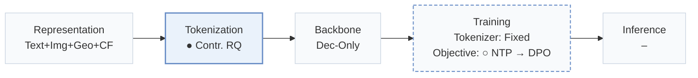
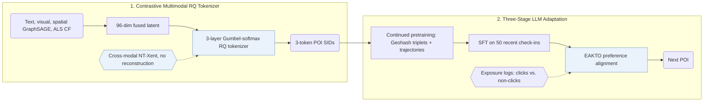
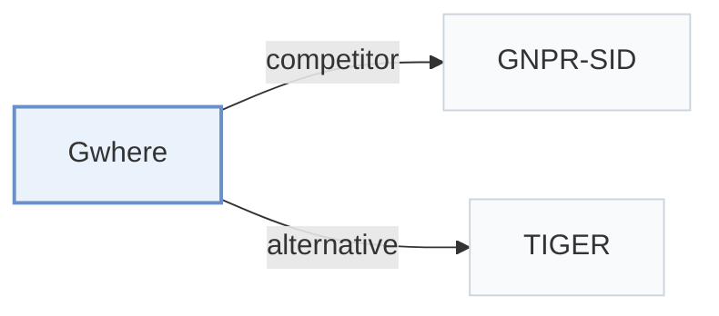

# Gwhere

[← Problem × Stage Matrix](../../README.md#ii--tokenization) · [Papers by Stage](../index/stages.md) · [Papers by Modality](../index/modality.md) · [Papers by Domain](../index/domain.md) · English | [中文](../zh/papers/gwhere.md)

| **Title** | *Guess Where You Go: Generative Next Point-of-Interest Recommendation in Amap* |
| :-- | :-- |
| **Authors** | Zhai et al. |
| **Venue** | RecSys’26 |
| **Problem × Stage** | `II. Uniqueness and Validity` · `Tokenization` · `POI` |
| **Changes** | ● Tokenization · ○ Objective |
| **SID inputs** | `Text` + `Img` + `Geo` + `CF` |
| **Domain** | `POI / Local` |
| **Scenario** | `POI and Local Services`; `Online Experiment or Deployment` |
| **Links** | [Paper](https://arxiv.org/abs/2607.26073) · [Code](https://github.com/alibaba/SimCIT) |
| **Reading level** | Reading Notes (Level 2) |

**On this page**: [TL;DR](#tldr) · [At a Glance](#at-a-glance) · [1. Why It Matters](#1-why-this-paper-matters) · [2. Method](#2-how-it-works) · [3. Experiments](#3-experimental-findings) · [4. Limitations](#4-limitations--critical-analysis) · [5. Related Work](#5-connections-to-related-work)

- `Text+Img+Geo+CF`: Text, image, geographic, and collaborative representations.
- `Contr. RQ`: Residual quantization trained with contrastive objectives.
- `Dec-Only`: Decoder-only.
- `Fixed`: SIDs are built first and not changed while the generator trains.
- `NTP → DPO`: NTP, then preference optimization.

### TL;DR

> [!NOTE]
> Gwhere learns POI Semantic IDs with a contrastive residual-quantization tokenizer over text, image, spatial, and collaborative signals, then adapts an LLM through continued pretraining, fine-tuning, and exposure-aware KTO.

---

### At a Glance

| Aspect | Summary |
| :-- | :-- |
| Key Findings | In long-term online A/B tests on Amap, Gwhere reports improvements of 5.83% in P-CTR and 6.20% in U-CTR over the production baseline (Abstract). |
| Limitation | The paper does not report a post-quantization collision rule, decoding strategy, or Amap codebook size, and deployed Gwhere-0.5B runs at about 30 ms p99 latency versus 20 ms for the cascade-ranking baseline at 50 QPS (Fig. 4). |

---

### 1. Why This Paper Matters

Scaling generative retrieval to industrial next point-of-interest (POI) recommendation is hindered by colliding token assignments, heterogeneous item modalities, and structured spatial mobility patterns (Abstract). Gwhere learns discriminative Semantic IDs (SIDs) via a reconstruction-free contrastive residual tokenizer and aligns an LLM generator across pretraining, supervised fine-tuning, and exposure-log preference optimization.

> "Gwhere first learns discriminative POI SIDs through a contrastive residual-quantization tokenizer that aligns textual, visual, spatial, and collaborative signals." (Abstract)

---

### 2. How It Works

#### Contrastive Item Tokenization

Gwhere fuses textual, visual, spatial GraphSAGE, and ALS collaborative views into a 96-dimensional latent vector and assigns 3-layer residual codewords (48 codewords per layer on public benchmarks) via Gumbel-softmax (Sec. 3.2.2, Sec. 4.1.2). An NT-Xent contrastive objective pulls each POI's quantized vector toward its own modal views and pushes away in-batch negatives without any reconstruction decoder or loss (Sec. 3.2, Sec. 3.2.2).

#### Continued Pretraining

Before supervised fine-tuning on the 50 most recent check-ins, Gwhere runs continued pretraining on two corpora built from desensitized Amap trajectories and POI metadata to inject spatial-semantic alignment and mobility transitions (Sec. 3.3.1, Table 1).

> "Each entry is a triplet of (SID, Geohash, Text Description), where Geohash is a 6-character string encoding the POI's precise geographical coordinates" (Sec. 3.3.1)

#### EAKTO

Exposure-Aware Kahneman-Tversky Optimization (EAKTO) adapts KTO to unpaired binary implicit feedback from real impression logs (Sec. 3.4).

> "In contrast, KTO (Ethayarajh et al., 2024) operates on simpler binary signals (desirable / undesirable), aligning with the natural structure of exposure logs (clicks vs. non-clicks)." (Sec. 3.4)

---

### 3. Experimental Findings

Experimental setup

- **Datasets**: Foursquare NYC and TKY, Gowalla CA (POIs with fewer than 10 interactions and users with fewer than 10 check-ins removed, following GNPR-SID; 1,083 / 5,135, 2,293 / 7,873, 6,592 / 14,027 users / POIs), and a proprietary AMAP dataset of sampled desensitized users (10,000K users / 83,100K POIs / 380,000K interactions); AMAP filtering not reported.
  - Source: Datasets and GNPR-SID preprocessing: [S4.SS1.SSS1.p1](https://arxiv.org/html/2607.26073v1#S4.SS1.SSS1.p1) and [S4.SS1.SSS1.p2](https://arxiv.org/html/2607.26073v1#S4.SS1.SSS1.p2); statistics: [S4.T2](https://arxiv.org/html/2607.26073v1#S4.T2).
- **Split**: Public: time-sorted 80% / 10% / 10% train/validation/test; within each user's test sequence the last visited POI is the target. AMAP offline split: not reported. Online: one-week and one-month A/B tests on the 'Guess Where You Go' card.
  - Source: Public split: [S4.SS1.SSS1.p2](https://arxiv.org/html/2607.26073v1#S4.SS1.SSS1.p2); AMAP split not stated; online tests: [S4.SS4.SSS3.p1](https://arxiv.org/html/2607.26073v1#S4.SS4.SSS3.p1) and [S4.SS4.SSS3.p3](https://arxiv.org/html/2607.26073v1#S4.SS4.SSS3.p3).
- **Candidates**: not reported (full catalog versus sampled candidates); the metric is top-1 accuracy (Acc@1).
  - Source: Top-1 accuracy only: [S4.T3](https://arxiv.org/html/2607.26073v1#S4.T3) and [S4.T4](https://arxiv.org/html/2607.26073v1#S4.T4).
- **Visibility**: warm; users and POIs absent from the training set are removed from the test set.
  - Source: Test users and POIs absent from training are removed: [S4.SS1.SSS1.p2](https://arxiv.org/html/2607.26073v1#S4.SS1.SSS1.p2).
- **SID**: 3-layer residual quantizer over a 96-dimensional fused latent from text, ALS collaborative, image, and spatial GraphSAGE views, trained contrastively with Gumbel-softmax assignment; 48 codewords per layer on public data, larger (not specified) on AMAP. Collision handling: not reported beyond the contrastive objective that aims to reduce code collision.
  - Source: 3-layer residual quantizer, 96-dimensional latent, 48 codewords on public data: [S4.SS1.SSS2.p2](https://arxiv.org/html/2607.26073v1#S4.SS1.SSS2.p2); four modality views: [S4.SS1.SSS2.p1](https://arxiv.org/html/2607.26073v1#S4.SS1.SSS2.p1); contrastive Gumbel-softmax quantization: [S3.SS2.SSS2.Px1.p1](https://arxiv.org/html/2607.26073v1#S3.SS2.SSS2.Px1.p1).
- **Inference budget**: Decoding method and beam width: not reported. Online load test at 50 QPS on 2 NVIDIA H20 GPUs: deployed Gwhere-0.5B at about 30 ms p99 versus about 20 ms for the cascade-ranking system (Figure 4). Training on 200 H20 GPUs with batch 16 per GPU; inputs are the 50 most recent check-ins.
  - Source: Load test: [S4.SS4.SSS2.p1](https://arxiv.org/html/2607.26073v1#S4.SS4.SSS2.p1) and [S4.SS4.SSS2.p2](https://arxiv.org/html/2607.26073v1#S4.SS4.SSS2.p2); training hardware: [S4.SS1.SSS2.p3](https://arxiv.org/html/2607.26073v1#S4.SS1.SSS2.p3); decoding not specified.
- **Results from**: Table 4 (Acc@1 on NYC, TKY, CA; baseline numbers borrowed from LLM4POI and GNPR-SID); Table 3 (AMAP model sizes versus the cascade-ranking system); Table 5 and Figures 2-3 (ablations, modalities, pretraining); Figure 4 (latency); Table 6 (online A/B).
  - Source: Public: [S4.T4](https://arxiv.org/html/2607.26073v1#S4.T4); AMAP: [S4.T3](https://arxiv.org/html/2607.26073v1#S4.T3); ablations: Table 5 and [S4.F2](https://arxiv.org/html/2607.26073v1#S4.F2); online: [S4.T6](https://arxiv.org/html/2607.26073v1#S4.T6).

- Offline public and industrial benchmarks: Gwhere improves top-1 accuracy (Acc@1) over traditional, sequential, and LLM baselines on Foursquare NYC, Foursquare TKY, and Gowalla CA (Table 4), and outperforms Amap's cascade-ranking system across LLM scales on an industrial corpus of 10,000K users and 83,100K POIs (Abstract, Table 3).
- Online A/B and serving latency: in one-week and one-month online A/B tests on Amap's homepage, Gwhere lifts P-CTR by 5.83% and U-CTR by 6.20% (Abstract, Table 6), serving 50 QPS on 2 NVIDIA H20 GPUs at about 30 ms p99 latency for Gwhere-0.5B versus 20 ms for cascade ranking (Fig. 4).

---

### 4. Limitations & Critical Analysis

**Our analysis.**

- Training the residual tokenizer purely for contrastive separability without a reconstruction loss suggests that SID prefixes need not form a coarse-to-fine semantic hierarchy.
- GNPR-SID builds `RQ-VAE` codes with reconstruction plus diversity losses and trains with plain `NTP`; Gwhere builds reconstruction-free `Contr. RQ` codes and adds exposure-aware preference alignment (`NTP → DPO`).

---

### 5. Connections to Related Work

- **Competitor** · [GNPR-SID](gnpr-sid.md): GNPR-SID quantizes POIs with an RQ-VAE plus diversity losses; Gwhere fuses four modalities with a contrastive Gumbel-softmax quantizer and adds continued pretraining and exposure-aware preference alignment.
  - Source: Gwhere v1, follows GNPR-SID preprocessing and baselines: [S4.SS1.SSS1.p2](https://arxiv.org/html/2607.26073v1#S4.SS1.SSS1.p2) and [S4.SS1.SSS3.p1](https://arxiv.org/html/2607.26073v1#S4.SS1.SSS3.p1); Table 4: [S4.T4](https://arxiv.org/html/2607.26073v1#S4.T4).
- **Alternative** · [TIGER](tiger.md): TIGER's reconstruction-trained RQ-VAE is the tokenizer style Gwhere argues against; Gwhere trains the quantizer contrastively for item separability.
  - Source: Gwhere v1, Section 1: [S1.p1](https://arxiv.org/html/2607.26073v1#S1.p1); Section 3.2: [S3.SS2.p1](https://arxiv.org/html/2607.26073v1#S3.SS2.p1); not a baseline in Table 4.

[View all papers in this cell](../../README.md#ii--tokenization)
