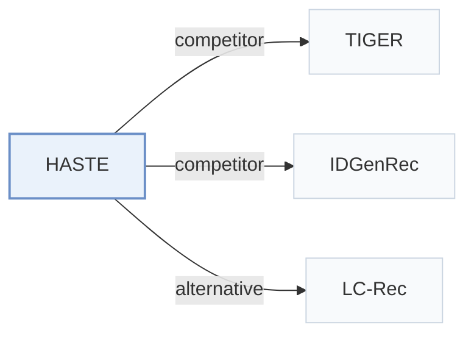

# HASTE

[← Problem × Stage Matrix](../../README.md#iv--training) · [Papers by Stage](../index/stages.md) · [Papers by Modality](../index/modality.md) · English | [中文](../zh/papers/haste.md)

| **Title** | *Hierarchical and Attribute-aware Supervision for Generative Recommendation* |
| :-- | :-- |
| **Authors** | Shukla et al. |
| **Venue** | arXiv’26 |
| **Problem × Stage** | `IV. Utility` · `Training` |
| **Links** | [Paper](https://arxiv.org/abs/2610.17368) |
| **Reading level** | Overview (Level 1) |

**On this page**: [TL;DR](#tldr) · [At a Glance](#at-a-glance) · [3. Experiments](#3-experimental-findings) · [5. Related Work](#5-connections-to-related-work)

- `Text / MM`: Text-only or multimodal representations in different configurations.
- `RQ-VAE`: Residual-Quantized Variational AutoEncoder.
- `Dec-Only`: Decoder-only.
- `Fixed`: SIDs are built first and not changed while the generator trains.
- `NTP + Aux.`: NTP plus another auxiliary loss.

### TL;DR

> [!NOTE]
> HASTE adds a loss at each Semantic ID level and attribute-specific losses to generator training, to speed convergence and improve tail items beyond a standard causal cross-entropy objective.

---

### At a Glance

| Aspect | Summary |
| :-- | :-- |
| Research Problem | IV. Utility: Are training and search aimed at what users and the platform value, rather than at token likelihood? |
| Key Contribution | HASTE adds a loss at each Semantic ID level and attribute-specific losses to generator training, to speed convergence and improve tail items beyond a standard causal cross-entropy objective. |
| Modified Stage | Training |

---

### 3. Experimental Findings

Experimental setup

- **Datasets**: Amazon-2014 Sports/Beauty/Toys: P5 5-core; Fashion-140k: 5-core, minimum sequence length 3, cap 100; internal-fashion: six deliberate engagement types, deduplication, length 3-100, resolved location, single profile; consecutive events with gaps of at least 30 days are discarded.
  - Source: [S9.SS1.SSS1.Px1.p1](https://arxiv.org/html/2610.17368v1#S9.SS1.SSS1.Px1.p1) ; [S9.SS1.SSS2.Px1.p1](https://arxiv.org/html/2610.17368v1#S9.SS1.SSS2.Px1.p1) ; [S9.SS1.SSS3.Px1.p1](https://arxiv.org/html/2610.17368v1#S9.SS1.SSS3.Px1.p1) ; [S9.SS1.SSS3.Px1.p2](https://arxiv.org/html/2610.17368v1#S9.SS1.SSS3.Px1.p2) ; [S9.SS1.SSS3.Px2.p1](https://arxiv.org/html/2610.17368v1#S9.SS1.SSS3.Px2.p1)
- **Split**: Public sequences: last test, penultimate validation. Amazon conversational examples: shuffled 92/5/3%. Internal-fashion: Section 9.1.3 reports 6255087/339950/203971 train/validation/test conversations; Section 9.1.5 separately reports 368482/19482 training/validation conversations for the attribute-loss SFT corpus. The relationship between these internal corpus counts is not explained.
  - Source: [S9.SS1.SSS1.Px2.p1](https://arxiv.org/html/2610.17368v1#S9.SS1.SSS1.Px2.p1) ; [S9.SS1.SSS2.Px2.p1](https://arxiv.org/html/2610.17368v1#S9.SS1.SSS2.Px2.p1) ; [S9.SS1.SSS3.Px3.p1](https://arxiv.org/html/2610.17368v1#S9.SS1.SSS3.Px3.p1) ; [S9.SS1.SSS5.Px2.p4](https://arxiv.org/html/2610.17368v1#S9.SS1.SSS5.Px2.p4)
- **Candidates**: not reported; catalog-valid prefix constraints do not establish full-catalog evaluation.
  - Source: [S6.p4](https://arxiv.org/html/2610.17368v1#S6.p4) ; #S9.SS2.SSS1.Px6.p2
- **Visibility**: warm; no unseen-item protocol is defined. Fashion-140k tokenizer uses the full 799953-item Fashion pool.
  - Source: [S9.SS1.SSS4.p1](https://arxiv.org/html/2610.17368v1#S9.SS1.SSS4.p1)
- **SID**: TIGER-style RQ-VAE: 3 x 256 plus a fourth collision-disambiguation token. Sports/Beauty/Toys use 1024-d text representations; Internal-fashion uses 1024-d multimodal Qwen3-VL embeddings. Section 6 also describes four 256-entry codebooks, inconsistently.
  - Source: [S6.p1](https://arxiv.org/html/2610.17368v1#S6.p1) ; [S6.p2](https://arxiv.org/html/2610.17368v1#S6.p2) ; [S9.SS1.SSS4.p1](https://arxiv.org/html/2610.17368v1#S9.SS1.SSS4.p1) ; [S9.SS1.SSS4.p2](https://arxiv.org/html/2610.17368v1#S9.SS1.SSS4.p2) ; [S9.SS2.SSS1.Px5.p1](https://arxiv.org/html/2610.17368v1#S9.SS2.SSS1.Px5.p1)
- **Inference budget**: K=5/10; prefix tree from up to 100K training sequences, per-position fallback. Experiments: RTX6000 96GB; beam, inference batch/latency not reported.
  - Source: [S6.p1](https://arxiv.org/html/2610.17368v1#S6.p1) ; #S6.p4 ; #S9.SS2.SSS1.Px6.p2
- **Results from**: Original Tables 1-2: sequential/attribute results; Table 3: convergence; Tables 4-5: ablations.
  - Source: [S6.SS1](https://arxiv.org/html/2610.17368v1#S6.SS1)

---

### 5. Connections to Related Work

- **Competitor** · [TIGER](tiger.md): TIGER supplies the SID construction and a baseline.
  - Source: [S6.p3](https://arxiv.org/html/2610.17368v1#S6.p3) ; #S9.SS1.SSS4.p1.
- **Competitor** · [IDGenRec](idgenrec.md): IDGenRec generates textual identifiers; HASTE supervises quantized SIDs.
  - Source: [S2.p2](https://arxiv.org/html/2610.17368v1#S2.p2) ; #S6.p3.
- **Alternative** · [LC-Rec](lc-rec.md): LC-Rec adds alignment tasks; HASTE changes losses.
  - Source: [S2.p2](https://arxiv.org/html/2610.17368v1#S2.p2).

[View all papers in this cell](../../README.md#iv--training)
