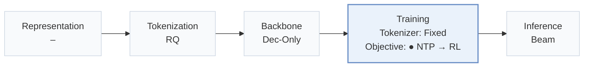
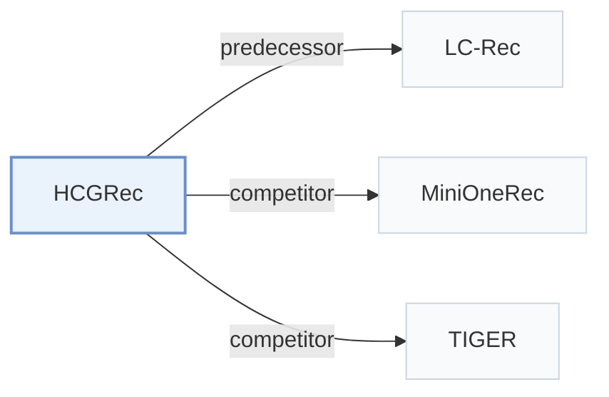

# HCGRec

[← Problem × Stage Matrix](../../README.md#iv--training) · [Papers by Stage](../index/stages.md) · [Papers by Modality](../index/modality.md) · [Papers by Domain](../index/domain.md) · English | [中文](../zh/papers/hcgrec.md)

| **Title** | *Learning from Unreachable Rewards: Hint-Conditioned Reinforcement Learning for Generative Recommendation* |
| :-- | :-- |
| **Authors** | Zhang et al. |
| **Venue** | CIKM’26 |
| **Problem × Stage** | `IV. Utility` · `Training` |
| **Changes** | ● Objective |
| **SID inputs** | `Other` (Four-token SIDs per GenRec pipeline, input unstated) |
| **Domain** | `E-commerce` |
| **Scenario** | `General Item Recommendation`; `Public Benchmarks` |
| **Links** | [Paper](https://arxiv.org/abs/2608.11980) · [Code](https://github.com/WncFht/GRec) |
| **Reading level** | Overview (Level 1) |

**On this page**: [TL;DR](#tldr) · [3. Experiments](#3-experimental-findings) · [5. Related Work](#5-connections-to-related-work)

- `RQ`: Residual quantization.
- `Dec-Only`: Decoder-only.
- `Fixed`: SIDs are built first and not changed while the generator trains.
- `NTP → RL`: NTP, then reinforcement learning (GRPO, GBPO, etc.).
- `Beam`: Autoregressive beam search over Semantic ID tokens.

### TL;DR

> [!NOTE]
> HCGRec gives a minimal target-prefix hint when GRPO rollouts miss the correct item, training hinted tokens with supervised loss and sampled suffixes with GRPO, to recover signal from zero-reward groups.

---

### 3. Experimental Findings

Experimental setup

- **Datasets**: Amazon Musical Instruments, Arts/Crafts/Sewing, Video Games; maximum history 50. Filtering: not reported.
  - Source: Section 4.1.1: [S4.SS1.SSS1.p1](https://arxiv.org/html/2608.11980v2#S4.SS1.SSS1.p1)
- **Split**: Per-user chronological leave-one-out: last item test, penultimate validation, remaining interactions training.
  - Source: Section 4.1.2: [S4.SS1.SSS2.p1](https://arxiv.org/html/2608.11980v2#S4.SS1.SSS2.p1)
- **Candidates**: full catalog
  - Source: Section 4.1.2: [S4.SS1.SSS2.p1](https://arxiv.org/html/2608.11980v2#S4.SS1.SSS2.p1)
- **Visibility**: warm; no unseen-item protocol is defined.
  - Source: Section 4.1 defines no unseen-item evaluation: [S4.SS1](https://arxiv.org/html/2608.11980v2#S4.SS1)
- **SID**: Four-token residual-quantization SIDs, shared across variants; codebook sizes and collision handling: not reported.
  - Source: Sections 3.1 and 4.1.1: [S3.SS1.p1](https://arxiv.org/html/2608.11980v2#S3.SS1.p1) and [S4.SS1.SSS1.p1](https://arxiv.org/html/2608.11980v2#S4.SS1.SSS1.p1)
- **Inference budget**: Beam 50; HR/NDCG@5/10/50; no target-prefix hints at inference. Inference hardware, batch size, latency: not reported.
  - Source: Sections 3.5 and 4.1.2: [S3.SS5.p1](https://arxiv.org/html/2608.11980v2#S3.SS5.p1) and [S4.SS1.SSS2.p1](https://arxiv.org/html/2608.11980v2#S4.SS1.SSS2.p1)
- **Results from**: Original Table 2: main comparison; Figures 2-6 and Sections 4.3-4.5: reachability, hint policy, task/loss ablations, credit weight.
  - Source: Table 2 and Figures 2-6: [S4.T2](https://arxiv.org/html/2608.11980v2#S4.T2) and [S4.F2](https://arxiv.org/html/2608.11980v2#S4.F2) and [S4.F6](https://arxiv.org/html/2608.11980v2#S4.F6)

---

### 5. Connections to Related Work

- **Predecessor** · [LC-Rec](lc-rec.md): LC-Rec provides the supervised semantic-alignment checkpoint in this pipeline.
  - Source: HCGRec v2, Section 4.2: [S4.SS2.p2](https://arxiv.org/html/2608.11980v2#S4.SS2.p2).
- **Competitor** · [MiniOneRec](minionerec.md): MiniOneRec shares the SFT checkpoint and controlled post-training budget.
  - Source: HCGRec v2, Section 4.2 and Table 2: [S4.SS2.p1](https://arxiv.org/html/2608.11980v2#S4.SS2.p1); [S4.T2](https://arxiv.org/html/2608.11980v2#S4.T2).
- **Competitor** · [TIGER](tiger.md): TIGER is the semantic-ID generative baseline in the main comparison.
  - Source: HCGRec v2, Section 4.2 and Table 2: [S4.SS2.p2](https://arxiv.org/html/2608.11980v2#S4.SS2.p2); [S4.T2](https://arxiv.org/html/2608.11980v2#S4.T2).

[View all papers in this cell](../../README.md#iv--training)
