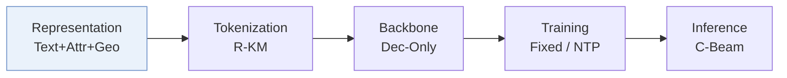
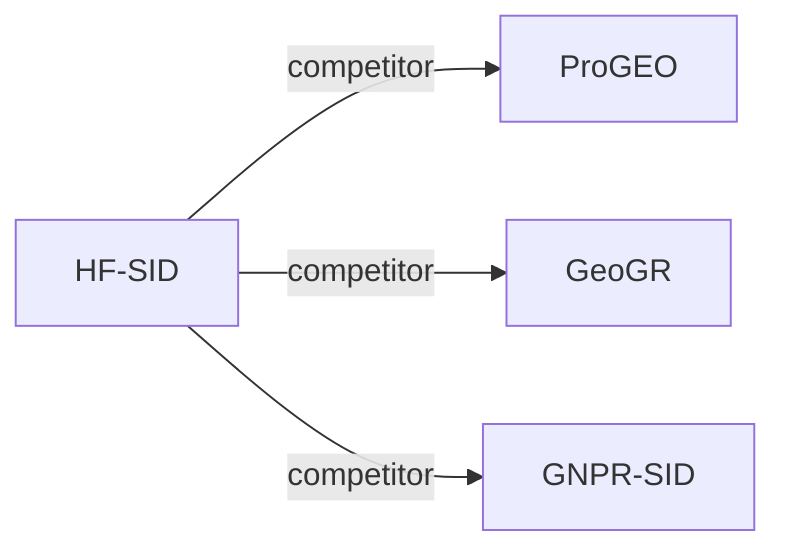

# HF-SID

*High-Fidelity Semantic IDs for Generative Retrieval in Location-Based Services* — Lin et al. · arXiv’26

`I. Informativeness` · `Representation` · `POI` · [Paper](https://arxiv.org/abs/2608.30479) · [Matrix](../../README.md#i--representation) · [中文](../zh/papers/hf-sid.md)

Reading level: Overview (Level 1) · On this page: [TL;DR](#tldr) · [At a Glance](#at-a-glance) · [3. Experiments](#3-experimental-findings) · [5. Related Work](#5-connections-to-related-work)

- `Text+Attr+Geo`: Text, structured attributes, and geographic information.
- `R-KM`: Residual k-means.
- `Dec-Only`: Decoder-only.
- `Fixed`: SIDs are built first and not changed while the generator trains.
- `NTP`: Next-token prediction loss only; continuing from a pretrained LLM (SFT) also counts as NTP.
- `C-Beam`: Constrained beam search.

### TL;DR

> [!NOTE]
> HF-SID restores geographic, numerical, and structural detail in POI representations before quantization, through Cartesian coordinates, unit-encoded numbers, and residual contrastive learning, instead of lengthening the Semantic ID.

### At a Glance

| Aspect | Summary |
| :-- | :-- |
| Research Problem | I. Informativeness: Do the SIDs, or the model reading them, carry the collaborative and multimodal signals recommendation needs? |
| Key Contribution | HF-SID restores geographic, numerical, and structural detail in POI representations before quantization, through Cartesian coordinates, unit-encoded numbers, and residual contrastive learning, instead of lengthening the Semantic ID. |
| Modified Stage | Representation |

### 3. Experimental Findings

Experimental setup

- **Datasets**: AMap-L (one day), AMap-S; remove POIs without interaction sequences and sessions without authenticated users. Foursquare NYC/TKY use Geo-CPT only; public-data filtering: not reported.
  - Source: Sections 4.1 and 4.5: [S4.SS1.p1](https://arxiv.org/html/2608.30479v1#S4.SS1.p1) and [S4.SS5.p1](https://arxiv.org/html/2608.30479v1#S4.SS5.p1)
- **Split**: not reported; methods share identical splits.
  - Source: Section 4.1 mentions identical baseline splits without specifying allocation: [S4.SS1.p2](https://arxiv.org/html/2608.30479v1#S4.SS1.p2)
- **Candidates**: not reported
  - Source: Sections 3.4 and 4.1 describe valid-SID generation but no full-catalog/sampled evaluation declaration: [S3.SS4.p4](https://arxiv.org/html/2608.30479v1#S3.SS4.p4) and [S4.SS1.p3](https://arxiv.org/html/2608.30479v1#S4.SS1.p3)
- **Visibility**: warm; no unseen-item protocol is defined. Tokenizer fits representations of the entire POI corpus.
  - Source: Sections 3.4 and 4.1: [S3.SS4.p1](https://arxiv.org/html/2608.30479v1#S3.SS4.p1) and [S4.SS1](https://arxiv.org/html/2608.30479v1#S4.SS1)
- **SID**: 3-level RQ-KMeans with last-residual contrastive refinement: 4096 codes/level on AMap-L, 512 on AMap-S. Public-data codebook sizes and collision materialization: not reported.
  - Source: Sections 3.4 and 4.1: [S3.SS4.p3](https://arxiv.org/html/2608.30479v1#S3.SS4.p3) and [S4.SS1.p2](https://arxiv.org/html/2608.30479v1#S4.SS1.p2)
- **Inference budget**: Valid-SID trie-constrained beam 300; Hit@200/300 on AMap, @5 on NYC/TKY. General experiments: 64 A100 GPUs; inference allocation, batch size, latency: not reported.
  - Source: Sections 3.4, 4.1 and Table 5: [S3.SS4.p4](https://arxiv.org/html/2608.30479v1#S3.SS4.p4) and [S4.SS1.p4](https://arxiv.org/html/2608.30479v1#S4.SS1.p4) and [S4.T5](https://arxiv.org/html/2608.30479v1#S4.T5)
- **Results from**: Original Tables 2/3/4/5/6: AMap comparison, ablation, numerical fidelity, public datasets, one-week online A/B.
  - Source: Tables 2-6: [S4.T2](https://arxiv.org/html/2608.30479v1#S4.T2) and [S4.T3](https://arxiv.org/html/2608.30479v1#S4.T3) and [S4.T4](https://arxiv.org/html/2608.30479v1#S4.T4) and [S4.T5](https://arxiv.org/html/2608.30479v1#S4.T5) and [S4.T6](https://arxiv.org/html/2608.30479v1#S4.T6)

### 5. Connections to Related Work

- **Competitor** · [ProGEO](progeo.md): Pro-GEO injects geography during quantization; HF-SID improves representations before quantization.
  - Source: HF-SID v1, Sections 2 and 4.1, Table 2: https://arxiv.org/html/2608.30479v1#S2.p2; https://arxiv.org/html/2608.30479v1#S4.SS1.p2; https://arxiv.org/html/2608.30479v1#S4.T2.
- **Competitor** · [GeoGR](geogr.md): GeoGR uses co-visit alignment; HF-SID directly encodes coordinates and numerical attributes.
  - Source: HF-SID v1, Sections 2 and 4.2, Table 2: https://arxiv.org/html/2608.30479v1#S2.p2; https://arxiv.org/html/2608.30479v1#S4.SS2.p2; https://arxiv.org/html/2608.30479v1#S4.T2.
- **Competitor** · [GNPR-SID](gnpr-sid.md): GNPR-SID regularizes codeword diversity; HF-SID focuses on representation fidelity.
  - Source: HF-SID v1, Section 4.2 and Table 2: https://arxiv.org/html/2608.30479v1#S4.SS2.p2; https://arxiv.org/html/2608.30479v1#S4.T2.

[View all papers in this cell](../../README.md#i--representation)
