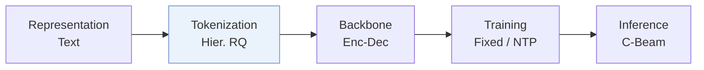
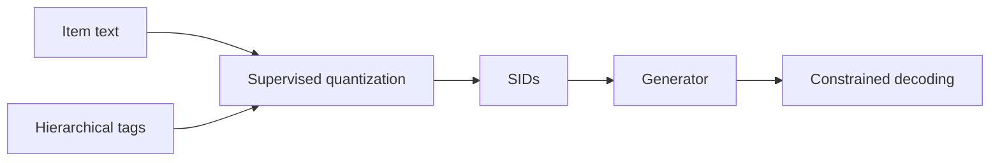
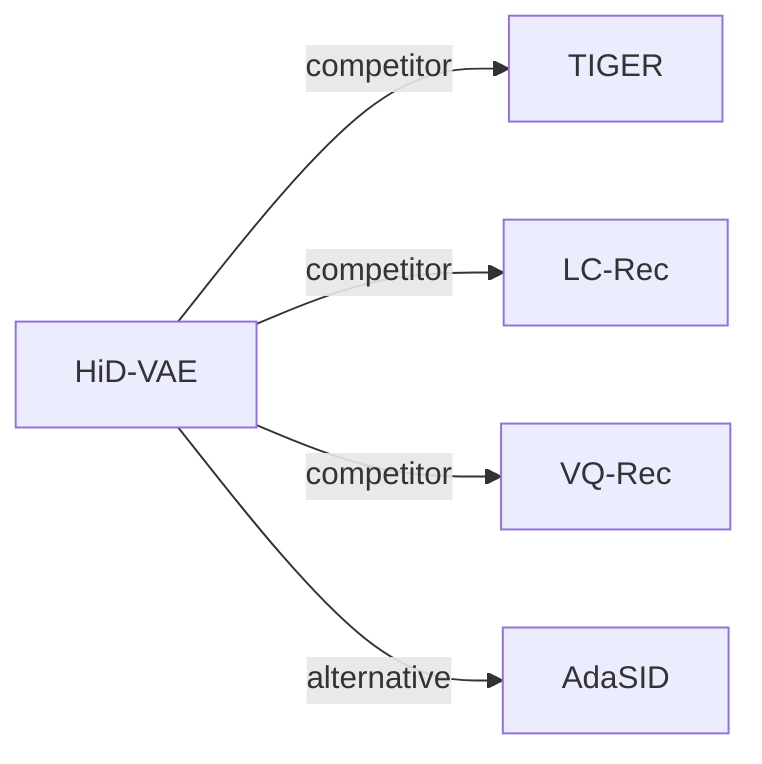

# HiD-VAE

*Interpretable Generative Recommendation via Hierarchical and Disentangled Semantic IDs* — Fang et al. · arXiv’25

`II. Uniqueness and Validity` · `Tokenization` · [Paper](https://arxiv.org/abs/2508.04618) · [Code](https://anonymous.4open.science/r/HiD-VAE-84B2) · [Matrix](../../README.md#ii--tokenization) · [中文](../zh/papers/hid-vae.md)

Reading level: Reading Notes (Level 2) · On this page: [TL;DR](#tldr) · [At a Glance](#at-a-glance) · [1. Why It Matters](#1-why-this-paper-matters) · [2. Method](#2-how-it-works) · [3. Experiments](#3-experimental-findings) · [4. Limitations](#4-limitations--critical-analysis) · [5. Related Work](#5-connections-to-related-work)

- `Enc-Dec`: Encoder-decoder.
- `Fixed`: SIDs are built first and not changed while the generator trains.
- `NTP`: Next-token prediction loss only; continuing from a pretrained LLM (SFT) also counts as NTP.
- `C-Beam`: Constrained beam search.

### TL;DR

> [!NOTE]
> HiD-VAE aligns each Semantic ID level with multi-level item tags through hierarchically supervised quantization and adds a uniqueness loss against ID collisions, instead of flat unsupervised tokenization.

### At a Glance

| Aspect | Summary |
| :-- | :-- |
| Research Problem | II. Uniqueness and Validity: Does every item get its own SID, every generated SID name a real item, and the codebook get used evenly? |
| Key Contribution | HiD-VAE aligns each Semantic ID level with multi-level item tags through hierarchically supervised quantization and adds a uniqueness loss against ID collisions, instead of flat unsupervised tokenization. |
| Modified Stage | Tokenization |
| Limitation | The tokenizer needs multi-level item tags, which an LLM must generate for datasets without them, so ID quality depends on tag quality (Sec. 3.4). |

### 1. Why This Paper Matters

The authors state that unsupervised tokenization gives Semantic IDs (SIDs) two flaws: they are semantically flat, and different items collide on entangled representations (Abstract).

> "Concurrently, to combat representation entanglement and prevent ID collisions at the source, we design a novel uniqueness loss that directly penalizes the latent representation overlap between distinct items." (Sec. 1)

Based on arXiv v2.

### 2. How It Works

#### Hierarchical Tag Generation

For datasets without hierarchical tags, such as KuaiRand, an LLM produces them in a two-stage "retrieval-then-classification" workflow (Sec. 3.4, Sec. 1).

#### Hierarchically Supervised Quantization

The trained codebooks can predict the item tags, which gives each recommendation a traceable semantic path (Abstract).

#### Uniqueness Loss

The uniqueness loss penalizes latent overlap between different items (Sec. 1). The authors state that the loss also raises recommendation diversity (Abstract).

> "This mechanism not only resolves the critical ID collision problem but also promotes recommendation diversity by ensuring a more comprehensive utilization of the item representation space." (Abstract)

#### Generation

A generator predicts the next item's SID from the user history (Sec. 3.3).

> "During inference, constrained decoding ensures that generated IDs correspond to valid items." (Sec. 3.3)

### 3. Experimental Findings

Experimental setup

- **Datasets**: Amazon Beauty, Sports and Outdoors, and KuaiRand-1K, with 5-core filtering of users and items. Sizes (users / items / interactions): Beauty 22,363 / 12,101 / 198,360; Sports 35,598 / 18,357 / 296,175; KuaiRand 983 / 29,983 / 953,166. KuaiRand category hierarchies are generated by an LLM from titles and raw categories.
  - Source: Datasets and 5-core: [S4.SS1.p1](https://arxiv.org/html/2508.04618v2#S4.SS1.p1) and [S4.I2.i2.p1](https://arxiv.org/html/2508.04618v2#S4.I2.i2.p1); LLM-built hierarchies: [S4.SS1.p3](https://arxiv.org/html/2508.04618v2#S4.SS1.p3); statistics: [A4.T4](https://arxiv.org/html/2508.04618v2#A4.T4).
- **Split**: Per-user leave-one-out: last item for test, second-to-last for validation, the rest for training.
  - Source: Leave-one-out allocation: [S4.SS1.p5](https://arxiv.org/html/2508.04618v2#S4.SS1.p5).
- **Candidates**: not reported (full catalog versus sampled evaluation candidates); generation is constrained to valid ID prefixes.
  - Source: Metrics only: [S4.SS1.p5](https://arxiv.org/html/2508.04618v2#S4.SS1.p5).
- **Visibility**: warm; no unseen-item protocol is defined.
  - Source: Standard split with no unseen-item protocol: [S4.SS1.p5](https://arxiv.org/html/2508.04618v2#S4.SS1.p5).
- **SID**: 3-level hierarchically supervised RQ-VAE x 256 codewords (K-means initialized) over 768-dimensional SentenceTransformer embeddings; each level is aligned with a category-tag level, and a uniqueness loss pushes items apart. Measured collision rate 2.1% (Beauty), 2.8% (Sports), 1.9% (KuaiRand) versus 18.7%, 19.5%, and 17.8% for RQ-VAE. How the remaining collisions are resolved in the full model: not reported; the w/o-uniqueness variant uses TIGER's appended integer.
  - Source: L=3 x K=256, K-means initialization, SentenceTransformer input: [S4.SS1.p6](https://arxiv.org/html/2508.04618v2#S4.SS1.p6); uniqueness loss: [S3.SS6.p1](https://arxiv.org/html/2508.04618v2#S3.SS6.p1); collision rates: [S4.T3](https://arxiv.org/html/2508.04618v2#S4.T3); TIGER suffix only in the w/o DUL variant: [S4.I4.i4.p1](https://arxiv.org/html/2508.04618v2#S4.I4.i4.p1).
- **Inference budget**: Autoregressive generation with constrained decoding against a corpus cache; beam width not reported. 6-layer encoder-decoder (8 heads, hidden 512). Training on NVIDIA 4060 GPUs with FP16; inference batch size and latency: not reported.
  - Source: Constrained decoding: [S4.SS1.p6](https://arxiv.org/html/2508.04618v2#S4.SS1.p6); hardware: [S4.SS1.p6](https://arxiv.org/html/2508.04618v2#S4.SS1.p6).
- **Results from**: Table 1 (Beauty, Sports, KuaiRand versus traditional, Transformer, and generative baselines); Table 2 (ablations of tag alignment, tag prediction, uniqueness loss); Table 3 (ID collision rates).
  - Source: Main: [S4.T1](https://arxiv.org/html/2508.04618v2#S4.T1); ablation: [S4.T2](https://arxiv.org/html/2508.04618v2#S4.T2); collisions: [S4.T3](https://arxiv.org/html/2508.04618v2#S4.T3).

- Main comparison: on three public benchmarks, HiD-VAE reports better performance than the compared methods (Abstract).

### 4. Limitations & Critical Analysis

**Our analysis.**

- TIGER uses unsupervised `RQ-VAE` codes with plain `Beam` search; HiD-VAE uses tag-supervised `Hier. RQ` codes with the same `Enc-Dec` generator and constrained decoding.

### 5. Connections to Related Work

- **Competitor** · [TIGER](tiger.md): TIGER resolves collisions by appending an integer after unsupervised RQ-VAE; HiD-VAE supervises each level with category tags and adds a uniqueness loss so that fewer items collide.
  - Source: HiD-VAE v2, baselines and Table 1: https://arxiv.org/html/2508.04618v2#S4.SS1.p4 and https://arxiv.org/html/2508.04618v2#S4.T1; TIGER-style suffix in the ablation: https://arxiv.org/html/2508.04618v2#S4.I4.i4.p1 and https://arxiv.org/html/2508.04618v2#S4.I5.i2.p1.
- **Competitor** · [LC-Rec](lc-rec.md): LC-Rec aligns an LLM to RQ-VAE codes; HiD-VAE changes the tokenizer and keeps a small encoder-decoder; LC-Rec is run with a T5-base backbone for scale parity.
  - Source: HiD-VAE v2, baselines: https://arxiv.org/html/2508.04618v2#S4.SS1.p4 and https://arxiv.org/html/2508.04618v2#S4.SS1.p7; Table 1: https://arxiv.org/html/2508.04618v2#S4.T1.
- **Competitor** · [VQ-Rec](vq-rec.md): VQ-Rec's product-quantized codes are adapted to generation here and collide more often (21.2% on Beauty) than HiD-VAE's hierarchical codes.
  - Source: HiD-VAE v2, baselines and adaptation: https://arxiv.org/html/2508.04618v2#S4.SS1.p4 and https://arxiv.org/html/2508.04618v2#S4.I3.i2.p1; Tables 1 and 3: https://arxiv.org/html/2508.04618v2#S4.T1 and https://arxiv.org/html/2508.04618v2#S4.T3.
- **Alternative** · [AdaSID](adasid.md): AdaSID later argues that HiD-VAE's overlap-aware objective treats collisions under a fixed standard, and makes the repulsion adaptive.
  - Source: Evidence is from the later AdaSID paper, Sections 1 and 2.2: https://arxiv.org/html/2604.23522v1#S1.p3 and https://arxiv.org/html/2604.23522v1#S2.SS2.p1.

[View all papers in this cell](../../README.md#ii--tokenization)
