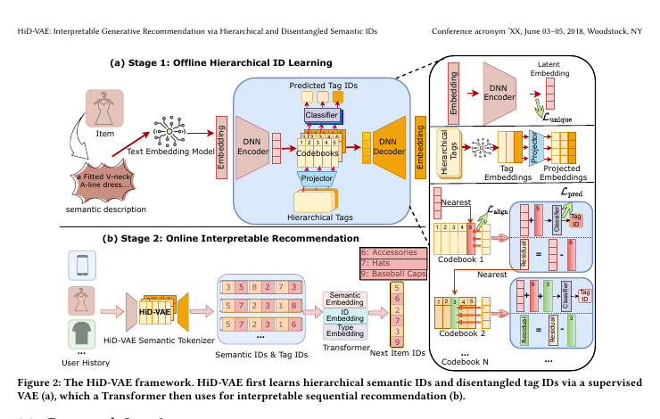

# HiD-VAE

*Interpretable Generative Recommendation via Hierarchical and Disentangled Semantic IDs* — Fang et al. · arXiv’25

`II. Uniqueness and Validity` · `Tokenization`

[Paper](https://arxiv.org/abs/2508.04618) · [Code](https://anonymous.4open.science/r/HiD-VAE-84B2) · [Matrix](../../README.md#ii--tokenization)

Reading level: Overview (Level 1) · On this page: [TL;DR](#tldr) · [At a Glance](#at-a-glance) · [2. How It Works](#2-how-it-works) · [3. Experimental Findings](#3-experimental-findings) · [5. Connections to Related Work](#5-connections-to-related-work)

| Representation | Tokenization | Backbone | Training | Inference |
| :-: | :-: | :-: | :-: | :-: |
| `Text` | **`Hier. RQ`** | `Enc-Dec` | `Fixed / NTP` | `C-Beam` |

- `Enc-Dec`: Encoder-decoder.
- `Fixed`: SIDs are built first and not changed while the generator trains.
- `NTP`: Next-token prediction loss only; continuing from a pretrained LLM (SFT) also counts as NTP.
- `C-Beam`: Constrained beam search.

### TL;DR

HiD-VAE aligns each Semantic ID level with multi-level item tags through hierarchically supervised quantization and adds a uniqueness loss against ID collisions, instead of flat unsupervised tokenization.

### At a Glance

| Aspect | Summary |
| :-- | :-- |
| Research Problem | II. Uniqueness and Validity: Does every item get its own SID, every generated SID name a real item, and the codebook get used evenly? |
| Key Contribution | HiD-VAE aligns each Semantic ID level with multi-level item tags through hierarchically supervised quantization and adds a uniqueness loss against ID collisions, instead of flat unsupervised tokenization. |
| Modified Stage | Tokenization |

### 2. How It Works

### 3. Experimental Findings

**Experimental setup**

- **Datasets**: Amazon Beauty, Sports and Outdoors, and KuaiRand-1K, with 5-core filtering of users and items. Sizes (users / items / interactions): Beauty 22,363 / 12,101 / 198,360; Sports 35,598 / 18,357 / 296,175; KuaiRand 983 / 29,983 / 953,166. KuaiRand category hierarchies are generated by an LLM from titles and raw categories.
  - Source: Datasets and 5-core: https://arxiv.org/html/2508.04618v2#S4.SS1.p1 and https://arxiv.org/html/2508.04618v2#S4.I2.i2.p1; LLM-built hierarchies: https://arxiv.org/html/2508.04618v2#S4.SS1.p3; statistics: https://arxiv.org/html/2508.04618v2#A4.T4.
- **Split**: Per-user leave-one-out: last item for test, second-to-last for validation, the rest for training.
  - Source: Leave-one-out allocation: https://arxiv.org/html/2508.04618v2#S4.SS1.p5.
- **Candidates**: not reported (full catalog versus sampled evaluation candidates); generation is constrained to valid ID prefixes.
  - Source: Metrics only: https://arxiv.org/html/2508.04618v2#S4.SS1.p5.
- **Visibility**: warm; no unseen-item protocol is defined.
  - Source: Standard split with no unseen-item protocol: https://arxiv.org/html/2508.04618v2#S4.SS1.p5.
- **SID**: 3-level hierarchically supervised RQ-VAE x 256 codewords (K-means initialized) over 768-dimensional SentenceTransformer embeddings; each level is aligned with a category-tag level, and a uniqueness loss pushes items apart. Measured collision rate 2.1% (Beauty), 2.8% (Sports), 1.9% (KuaiRand) versus 18.7%, 19.5%, and 17.8% for RQ-VAE. How the remaining collisions are resolved in the full model: not reported; the w/o-uniqueness variant uses TIGER's appended integer.
  - Source: L=3 x K=256, K-means initialization, SentenceTransformer input: https://arxiv.org/html/2508.04618v2#S4.SS1.p6; uniqueness loss: https://arxiv.org/html/2508.04618v2#S3.SS6.p1; collision rates: https://arxiv.org/html/2508.04618v2#S4.T3; TIGER suffix only in the w/o DUL variant: https://arxiv.org/html/2508.04618v2#S4.I4.i4.p1.
- **Inference budget**: Autoregressive generation with constrained decoding against a corpus cache; beam width not reported. 6-layer encoder-decoder (8 heads, hidden 512). Training on NVIDIA 4060 GPUs with FP16; inference batch size and latency: not reported.
  - Source: Constrained decoding: https://arxiv.org/html/2508.04618v2#S4.SS1.p6; hardware: https://arxiv.org/html/2508.04618v2#S4.SS1.p6.
- **Results from**: Table 1 (Beauty, Sports, KuaiRand versus traditional, Transformer, and generative baselines); Table 2 (ablations of tag alignment, tag prediction, uniqueness loss); Table 3 (ID collision rates).
  - Source: Main: https://arxiv.org/html/2508.04618v2#S4.T1; ablation: https://arxiv.org/html/2508.04618v2#S4.T2; collisions: https://arxiv.org/html/2508.04618v2#S4.T3.

## 旧卡片说明

迁自 `d61aa6c:papers/hidvae.md`。保留方法说明、实验叙述与局限；本轮只对照现有记录处理明确冲突，未重新逐句核查原论文。分类和规格以页面上方由记录生成的表格为准。

### HiD-VAE：层次解耦语义标识可解释生成推荐

> HiD-VAE 通过层次标签监督和唯一性约束学习可解释、低碰撞的物品语义标识，并用于直接生成推荐。

### 研究动机与问题定义

现有 SID 往往缺乏可解释层次，且不同物品可能碰撞到相同标识。HiD-VAE 研究如何让标识的不同层级对应可理解类别，同时在潜空间中减少表示重叠。

### TL;DR（核心摘要）

`物品语义与层次标签 → HiD-VAE → 层次SID/标签ID → Transformer → 推荐物品`

离线阶段用文本表示和层次标签训练监督 VAE：标签对齐与标签预测约束各量化层的语义粒度，唯一性损失惩罚不同物品的潜表示重叠。在线阶段冻结 tokenizer，Transformer 根据用户历史自回归生成 SID，并用约束解码映射到物品。

### 输入与使用场景

| 方面 | 说明 |
|---|---|
| 使用信息 | 物品文本、类别层次和用户交互 |
| 信息融入位置 | VAE 监督目标与生成模型输入 |
| 语义标识结构 | 层次化序列，并附带标签 ID |
| 适用场景 | 可解释序列推荐与冷启动 |

### 方法设计

#### 3.3 框架总览
HiD-VAE 分为离线层次 ID 学习和在线可解释推荐两阶段。第一阶段学习冻结的物品 tokenizer，第二阶段用 Transformer 根据用户历史生成语义 ID，同时预测或展示对应的层次标签。

#### 3.4 层次标签生成
对于缺少人工类别的数据，论文先使用 LLM 从物品文本和候选标签中生成层次标签。标签从粗粒度类别逐步细化，为不同 VAE 层提供监督信号。

#### 3.5 层次表示学习
HiD-VAE 在 RQ-VAE 的多级量化基础上加入标签对齐损失和标签预测损失，使每一层承担特定语义粒度。重构和量化损失保证表示可恢复，标签监督保证层次可解释。

#### 3.6 解耦与唯一性损失
唯一性损失直接惩罚不同物品潜表示的重叠，减少 ID collision。训练后在线生成阶段采用约束解码，只保留码本中存在且能对应真实物品的标识。

### 实验结论

- HiD-VAE 在三个公开数据集上提升了推荐效果和标识可解释性。
- 层次监督改善了语义层次，唯一性损失降低了 ID 碰撞。
- 对缺少类别标签的数据，论文使用 LLM 生成层次标签。

### 局限性与研究定位

#### 局限性
- 依赖离线标签生成和 tokenizer 更新。
- 约束自回归解码仍存在延迟。
- 真实动态目录和线上效果未充分验证。

#### 研究定位
HiD-VAE 将“可解释层次”和“低碰撞”作为 SID 的联合目标，适合放在“可解释语义标识学习”章节。

### 相关资源

- [论文原文](https://arxiv.org/abs/2508.04618)

### 标签

`层次监督` · `解耦表示` · `唯一性损失` · `可解释推荐`

### 架构图来源

*图源：原论文，图2。图片使用许可待核实。*

---

### 旧总表补充

来源：`d61aa6c:tables/all-methods.md`。

- 核心贡献：学习可解释且低碰撞的SID。
- 使用场景：可解释推荐。

### 5. Connections to Related Work

- **Competitor** · [TIGER](tiger.md): TIGER resolves collisions by appending an integer after unsupervised RQ-VAE; HiD-VAE supervises each level with category tags and adds a uniqueness loss so that fewer items collide.
  - Source: HiD-VAE v2, baselines and Table 1: https://arxiv.org/html/2508.04618v2#S4.SS1.p4 and https://arxiv.org/html/2508.04618v2#S4.T1; TIGER-style suffix in the ablation: https://arxiv.org/html/2508.04618v2#S4.I4.i4.p1 and https://arxiv.org/html/2508.04618v2#S4.I5.i2.p1.
- **Competitor** · [LC-Rec](lc-rec.md): LC-Rec aligns an LLM to RQ-VAE codes; HiD-VAE changes the tokenizer and keeps a small encoder-decoder; LC-Rec is run with a T5-base backbone for scale parity.
  - Source: HiD-VAE v2, baselines: https://arxiv.org/html/2508.04618v2#S4.SS1.p4 and https://arxiv.org/html/2508.04618v2#S4.SS1.p7; Table 1: https://arxiv.org/html/2508.04618v2#S4.T1.
- **Competitor** · [VQ-Rec](vq-rec.md): VQ-Rec's product-quantized codes are adapted to generation here and collide more often (21.2% on Beauty) than HiD-VAE's hierarchical codes.
  - Source: HiD-VAE v2, baselines and adaptation: https://arxiv.org/html/2508.04618v2#S4.SS1.p4 and https://arxiv.org/html/2508.04618v2#S4.I3.i2.p1; Tables 1 and 3: https://arxiv.org/html/2508.04618v2#S4.T1 and https://arxiv.org/html/2508.04618v2#S4.T3.
- **Alternative** · [AdaSID](adasid.md): AdaSID later argues that HiD-VAE's overlap-aware objective treats collisions under a fixed standard, and makes the repulsion adaptive.
  - Source: Evidence is from the later AdaSID paper, Sections 1 and 2.2: https://arxiv.org/html/2604.23522v1#S1.p3 and https://arxiv.org/html/2604.23522v1#S2.SS2.p1.

[View all papers in this cell](../../README.md#ii--tokenization)
