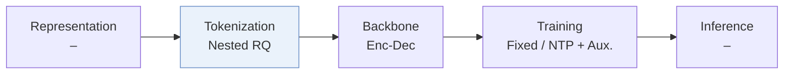
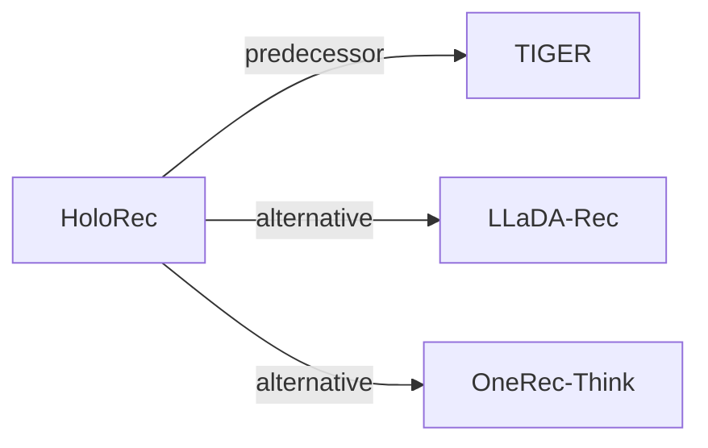

# HoloRec

| **Title** | *Holistic Encoding and Interleaved Reasoning for Generative Recommendation* |
| :-- | :-- |
| **Authors** | Zhao et al. |
| **Venue** | arXiv’26 |
| **Problem × Stage** | `III. SID–Model Alignment` · `Tokenization` |
| **Links** | [Paper](https://arxiv.org/abs/2606.15331) · [Matrix](../../README.md#iii--tokenization) · [中文](../zh/papers/holorec.md) |
| **Reading level** | Overview (Level 1) |

On this page: [TL;DR](#tldr) · [At a Glance](#at-a-glance) · [3. Experiments](#3-experimental-findings) · [5. Related Work](#5-connections-to-related-work)

- `–`: Not reported in the paper.
- `Nested RQ`: Residual quantization across nested representation granularities.
- `Enc-Dec`: Encoder-decoder.
- `Fixed`: SIDs are built first and not changed while the generator trains.
- `NTP + Aux.`: NTP plus another auxiliary loss.

### TL;DR

> [!NOTE]
> HoloRec builds hierarchical Semantic IDs by nested residual quantization with a reconstruction loss over all granularities and generates chain-of-thought steps inside decoding, instead of using external annotated rationales.

---

### At a Glance

| Aspect | Summary |
| :-- | :-- |
| Research Problem | III. SID–Model Alignment: Can the generator read, write, and reason over SIDs, and do the tokenizer and generator work toward the same goal? |
| Key Contribution | HoloRec builds hierarchical Semantic IDs by nested residual quantization with a reconstruction loss over all granularities and generates chain-of-thought steps inside decoding, instead of using external annotated rationales. |
| Modified Stage | Tokenization |

---

### 3. Experimental Findings

Experimental setup

- **Datasets**: Amazon Beauty and Instruments; user/item five-core filtering.
  - Source: Section 4.1.1: [S4.SS1.SSS1.p1](https://arxiv.org/html/2606.15331v1#S4.SS1.SSS1.p1)
- **Split**: Leave-one-out; exact validation/test allocation not reported.
  - Source: Section 4.1.1: [S4.SS1.SSS1.p1](https://arxiv.org/html/2606.15331v1#S4.SS1.SSS1.p1)
- **Candidates**: not reported
  - Source: Section 4.1 gives metrics but no evaluation candidate protocol: [S4.SS1.SSS2.p1](https://arxiv.org/html/2606.15331v1#S4.SS1.SSS2.p1)
- **Visibility**: warm; no unseen-item protocol is defined.
  - Source: Section 4 defines no item holdout: [S4.SS1](https://arxiv.org/html/2606.15331v1#S4.SS1)
- **SID**: Three nested granularities (8/16/32 dimensions), each with 4 residual levels x 256 codes; codebooks shared across granularities. Collision handling not reported.
  - Source: Sections 3.1 and 4.1.4: [S3.SS1.SSS1.p1](https://arxiv.org/html/2606.15331v1#S3.SS1.SSS1.p1) and [S4.SS1.SSS4.p1](https://arxiv.org/html/2606.15331v1#S4.SS1.SSS4.p1)
- **Inference budget**: K=5/10; non-thinking and interleaved-thinking modes. Beam width, inference hardware/batch size, and measured latency not reported; A100 and batch 1024 describe training.
  - Source: Sections 4.1.2/4.1.4 and 4.7: [S4.SS1.SSS2.p1](https://arxiv.org/html/2606.15331v1#S4.SS1.SSS2.p1) and [S4.SS1.SSS4.p1](https://arxiv.org/html/2606.15331v1#S4.SS1.SSS4.p1) and [S4.SS7.p1](https://arxiv.org/html/2606.15331v1#S4.SS7.p1)
- **Results from**: Original Table 2: overall comparisons; Table 3: ablations.
  - Source: Tables 2-3: [S4.T2](https://arxiv.org/html/2606.15331v1#S4.T2) and [S4.T3](https://arxiv.org/html/2606.15331v1#S4.T3)

---

### 5. Connections to Related Work

- **Predecessor** · [TIGER](tiger.md): HoloRec retains TIGER's T5 backbone and adds nested semantic granularities.
  - Source: HoloRec v1, Section 4.1.4 and Table 2: https://arxiv.org/html/2606.15331v1#S4.SS1.SSS4.p1; https://arxiv.org/html/2606.15331v1#S4.T2.
- **Alternative** · [LLaDA-Rec](llada-rec.md): LLaDA-Rec uses parallel diffusion; HoloRec interleaves autoregressive semantic reasoning.
  - Source: HoloRec v1, Sections 2.2 and 3.3: https://arxiv.org/html/2606.15331v1#S2.SS2.p1; https://arxiv.org/html/2606.15331v1#S3.SS3.
- **Alternative** · [OneRec-Think](onerec-think.md): OneRec-Think reasons in natural language; HoloRec uses endogenous semantic codes.
  - Source: HoloRec v1, Section 2.3: https://arxiv.org/html/2606.15331v1#S2.SS3.p1.

[View all papers in this cell](../../README.md#iii--tokenization)
