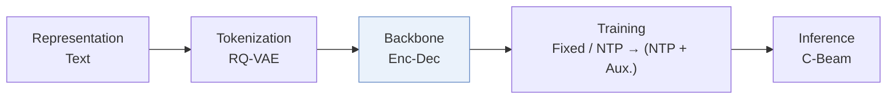
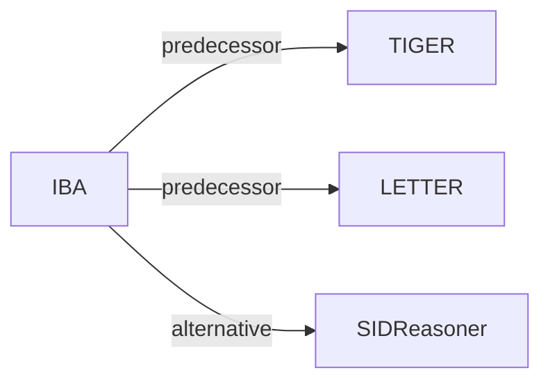

# IBA

*Where Reasoning Matters: Rethinking Latent Reasoning in Semantic ID-based Generative Recommendation* — Yang et al. · arXiv’26

`V. Efficiency` · `Backbone` · [Paper](https://arxiv.org/abs/2607.12425) · [Matrix](../../README.md#v--backbone) · [中文](../zh/papers/iba.md)

Reading level: Overview (Level 1) · On this page: [TL;DR](#tldr) · [At a Glance](#at-a-glance) · [3. Experiments](#3-experimental-findings) · [5. Related Work](#5-connections-to-related-work)

- `Enc-Dec`: Encoder-decoder.
- `Fixed`: SIDs are built first and not changed while the generator trains.
- `NTP → (NTP + Aux.)`: Next-token prediction, followed by joint optimization of next-token prediction and auxiliary objectives.
- `C-Beam`: Constrained beam search.

### TL;DR

> [!NOTE]
> IBA allocates latent reasoning steps across Semantic ID positions by information gain, giving more refinement to the informative early positions, instead of a fixed number of steps per token.

### At a Glance

| Aspect | Summary |
| :-- | :-- |
| Research Problem | V. Efficiency: Can it be trained and served within latency and cost budgets? |
| Key Contribution | IBA allocates latent reasoning steps across Semantic ID positions by information gain, giving more refinement to the informative early positions, instead of a fixed number of steps per token. |
| Modified Stage | Backbone |

### 3. Experimental Findings

Experimental setup

- **Datasets**: Amazon Instruments and Beauty; MicroLens. Users with fewer than 5 interactions removed; training histories capped at 20 items.
  - Source: Section IV-A1: [S4.SS1.SSS1.p1](https://arxiv.org/html/2607.12425v1#S4.SS1.SSS1.p1)
- **Split**: Leave-one-out, one test target per user; exact validation/test allocation not reported.
  - Source: Sections IV-A1/IV-A3: [S4.SS1.SSS1.p1](https://arxiv.org/html/2607.12425v1#S4.SS1.SSS1.p1) and [S4.SS1.SSS3.p1](https://arxiv.org/html/2607.12425v1#S4.SS1.SSS3.p1)
- **Candidates**: not reported
  - Source: Section IV-A describes metrics and catalog-valid trie decoding, not evaluation negatives: [S4.SS1.SSS3.p1](https://arxiv.org/html/2607.12425v1#S4.SS1.SSS3.p1) and [S4.SS1.SSS4.p2](https://arxiv.org/html/2607.12425v1#S4.SS1.SSS4.p2)
- **Visibility**: warm; no unseen-item protocol is defined. Information-gain prior estimated from training interactions only; tokenizer exposure to test items not reported.
  - Source: Sections IV-A1/III-A define no item holdout: [S4.SS1.SSS1.p1](https://arxiv.org/html/2607.12425v1#S4.SS1.SSS1.p1) and [S3.SS1.p1](https://arxiv.org/html/2607.12425v1#S3.SS1.p1)
- **SID**: RQ-VAE on Sentence-T5 text embeddings: 4 tokens; codebook sizes and collision handling not reported.
  - Source: Sections II-A and IV-A: [S2.SS1.p2](https://arxiv.org/html/2607.12425v1#S2.SS1.p2) and [S4.SS1.SSS1.p1](https://arxiv.org/html/2607.12425v1#S4.SS1.SSS1.p1) and [S4.SS1.SSS4.p1](https://arxiv.org/html/2607.12425v1#S4.SS1.SSS4.p1)
- **Inference budget**: Trie-constrained beam 20, maximum 10 generated tokens; 6 latent refinement steps with prior (3,2,1,0). NVIDIA RTX 4090 24GB; Instruments generation time 24.61 ms/user (TIGER 20.99, uniform 8-step refinement 25.78). Inference batch size not reported.
  - Source: Sections IV-A4/IV-F and Table V: [S4.SS1.SSS4.p1](https://arxiv.org/html/2607.12425v1#S4.SS1.SSS4.p1) and [S4.SS1.SSS4.p2](https://arxiv.org/html/2607.12425v1#S4.SS1.SSS4.p2) and [S4.T5](https://arxiv.org/html/2607.12425v1#S4.T5)
- **Results from**: Original Table II: TIGER/LETTER plus IBA and baselines; Tables III/IV: schedules/ablations; Table V: generation efficiency.
  - Source: Tables II-V: [S4.T2](https://arxiv.org/html/2607.12425v1#S4.T2) and [S4.T3](https://arxiv.org/html/2607.12425v1#S4.T3) and [S4.T4](https://arxiv.org/html/2607.12425v1#S4.T4) and [S4.T5](https://arxiv.org/html/2607.12425v1#S4.T5)

### 5. Connections to Related Work

- **Predecessor** · [TIGER](tiger.md): IBA adds learned latent refinement allocation to TIGER.
  - Source: IBA v1, Section IV-A2 and Table II: https://arxiv.org/html/2607.12425v1#S4.SS1.SSS2.p1; https://arxiv.org/html/2607.12425v1#S4.T2.
- **Predecessor** · [LETTER](letter.md): LETTER is the second tested base model for IBA.
  - Source: IBA v1, Sections IV-A2/IV-B and Table II: https://arxiv.org/html/2607.12425v1#S4.SS1.SSS2.p1; https://arxiv.org/html/2607.12425v1#S4.SS2.p2; https://arxiv.org/html/2607.12425v1#S4.T2.
- **Alternative** · [SIDReasoner](sidreasoner.md): SIDReasoner aligns IDs with language; IBA allocates hidden refinement steps.
  - Source: IBA v1, Section V-B2: https://arxiv.org/html/2607.12425v1#S5.SS2.SSS2.p2; https://arxiv.org/html/2607.12425v1#S5.SS2.SSS2.p3.

[View all papers in this cell](../../README.md#v--backbone)
