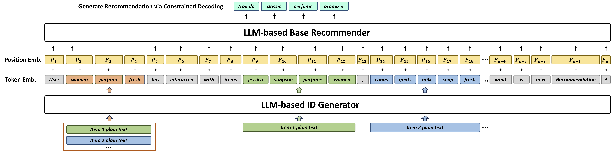

# IDGenRec

*Llm-recsys alignment with textual id learning* — Tan et al. · SIGIR’24

`III. SID–Model Alignment` · `Tokenization`

[Paper](https://arxiv.org/abs/2403.19021) · [Code](https://github.com/agiresearch/IDGenRec) · [Matrix](../../README.md#iii--tokenization)

Reading level: Reading Notes (Level 2) · On this page: [TL;DR](#tldr) · [At a Glance](#at-a-glance) · [1. Why This Paper Matters](#1-why-this-paper-matters) · [2. How It Works](#2-how-it-works) · [3. Experimental Findings](#3-experimental-findings) · [4. Limitations & Critical Analysis](#4-limitations--critical-analysis) · [5. Connections to Related Work](#5-connections-to-related-work)

| Representation | Tokenization | Backbone | Training | Inference |
| :-: | :-: | :-: | :-: | :-: |
| `Text` | **`LLM-Vocab`** | `Enc-Dec` | `Altern. / NTP` | `C-Beam` |

- `Enc-Dec`: Encoder-decoder.
- `Altern.`: Tokenizer and generator are updated in turns.
- `NTP`: Next-token prediction loss only; continuing from a pretrained LLM (SFT) also counts as NTP.
- `C-Beam`: Constrained beam search.

### TL;DR

IDGenRec trains a textual ID generator alongside an LLM recommender, so each item receives a concise ID made of natural-language tokens, and tests zero-shot transfer to unseen platforms.

### At a Glance

| Aspect | Summary |
| :-- | :-- |
| Research Problem | III. SID–Model Alignment: Can the generator read, write, and reason over SIDs, and do the tokenizer and generator work toward the same goal? |
| Key Contribution | IDGenRec trains a textual ID generator alongside an LLM recommender, so each item receives a concise ID made of natural-language tokens, and tests zero-shot transfer to unseen platforms. |
| Modified Stage | Tokenization |
| Limitation | Item IDs change whenever the ID generator is updated, so the prefix tree of valid IDs must be rebuilt during training (Sec. 2.4). |

### 1. Why This Paper Matters

The authors state that generative recommendation struggles to encode items in the text-to-text framework with concise yet meaningful IDs (Abstract). Because IDGenRec's IDs are plain words, user histories become platform-agnostic text, which opens zero-shot transfer (Abstract).

> "We propose an alternate training strategy that trains the LLM-based ID generator and the base recommender asynchronously, ensuring that their learned knowledge is well-aligned." (Sec. 1)

Based on arXiv v2.

### 2. How It Works

*Figure source: Fig. 2, original paper.*

#### ID Generator

The generator reads plain-text item information, such as title, category, price, description, creation time, popularity, and location (Sec. 2.2). T5 is the backbone of both models (Sec. 2.6).

#### Unique ID Generation

The generator keeps generating until each item has a unique ID (Sec. 2.3).

> "If a duplicate is detected, the algorithm increases the diversity penalty in the beam search." (Sec. 2.3)

The penalty grows by 1 per iteration, and if it reaches 10 without a unique ID, the length limit is extended (Sec. 3.2).

#### Base Recommender

The base recommender decodes the target ID under a prefix-tree constraint (Sec. 2.4).

> "To ensure that the decoded ID corresponds to an actual existing item, we adopt a constrained sequence decoding strategy (De Cao et al., 2020). More specifically, a prefix tree is used to store all generated candidate IDs." (Sec. 2.4)

### 3. Experimental Findings

**Experimental setup**

- **Datasets**: Standard: Amazon Sports, Beauty, Toys and Yelp, filtering users and items with fewer than 5 interactions (following P5 and Hua et al. 2023). Zero-shot: a Fusion pre-training corpus from 19 other Amazon categories, each downsampled to at most 30,000 users (183,918 users / 233,323 items), tested on Sports, Beauty, Toys, Music, Instruments, and Yelp.
- **Split**: Leave-one-out for testing (validation allocation not restated). Zero-shot: train once on Fusion and test directly on held-out datasets.
- **Candidates**: full catalog (no negative sampling; ranking over all items).
- **Visibility**: Standard: warm; no unseen-item protocol is defined. Zero-shot: users and items of the test datasets are not seen in training; the ID generator is also trained only on the Fusion corpus, so test items are unseen by tokenizer too and receive IDs generated from their text.
- **SID**: Textual IDs generated from item text by a T5-small ID generator with diverse beam search (k=10 groups, diversity penalty raised from 1 to 10), length initially in [1, 10) tokens and extended to [10, 20) when needed; uniqueness is enforced at generation time by rejecting duplicates. SentencePiece vocabulary of 32,128.
- **Inference budget**: Constrained decoding over a prefix tree of all generated item IDs; beam width, hardware, inference batch size, and latency: not reported. HR and NDCG at 5 and 10.
- **Results from**: Table 4 (standard evaluation versus traditional and P5-variant baselines); Table 5 (training strategies); Table 6 (user and item IDs); Table 7 (zero-shot intra- and inter-platform).

Sources

- **Datasets**: Standard datasets and 5-interaction filter: [S3.SS1.p1](https://arxiv.org/html/2403.19021v2#S3.SS1.p1); zero-shot data rules: [S3.SS1.p3](https://arxiv.org/html/2403.19021v2#S3.SS1.p3) and [S3.SS1.p4](https://arxiv.org/html/2403.19021v2#S3.SS1.p4); statistics: [S3.T3](https://arxiv.org/html/2403.19021v2#S3.T3).
- **Split**: Leave-one-out: [S3.SS3.p1](https://arxiv.org/html/2403.19021v2#S3.SS3.p1); zero-shot setting: [S3.SS5.p1](https://arxiv.org/html/2403.19021v2#S3.SS5.p1).
- **Candidates**: Ranking over all items without negative sampling: [S3.SS3.p1](https://arxiv.org/html/2403.19021v2#S3.SS3.p1).
- **Visibility**: Zero-shot: users and items unseen in training: [S3.SS5.p1](https://arxiv.org/html/2403.19021v2#S3.SS5.p1); the ID generator is trained with the recommender on the training data: [S3.SS2.p3](https://arxiv.org/html/2403.19021v2#S3.SS2.p3).
- **SID**: Diverse beam search for unique textual IDs, length ranges: [S2.SS3.p2](https://arxiv.org/html/2403.19021v2#S2.SS3.p2) and [S3.SS2.p2](https://arxiv.org/html/2403.19021v2#S3.SS2.p2); T5-small ID generator: from Section 2.
- **Inference budget**: Constrained decoding with a prefix tree over generated IDs: Section 2 inference; no beam width or hardware found.
- **Results from**: Standard: [S3.T4](https://arxiv.org/html/2403.19021v2#S3.T4); training strategies: [S3.T5](https://arxiv.org/html/2403.19021v2#S3.T5); user/item IDs: [S3.T6](https://arxiv.org/html/2403.19021v2#S3.T6); zero-shot: [S3.T7](https://arxiv.org/html/2403.19021v2#S3.T7).

- Standard setting: IDGenRec reports better performance than existing models in sequential recommendation (Abstract).
- Zero-shot setting: a model trained on 19 datasets and tested on 6 unseen datasets from other platforms performs comparably to or better than some supervised traditional recommenders (Abstract).

### 4. Limitations & Critical Analysis

**Our analysis.**

- Unique IDs come from raising the diversity penalty and the length limit. This suggests that IDs of similar items can be pushed apart by arbitrary words.
- CID builds `Spectral Clus.` IDs from `CF` signals and keeps them fixed; IDGenRec builds `LLM-Vocab` IDs from text and updates them.

### 5. Connections to Related Work

- **Competitor** · [CID](cid.md): P5-SID, P5-CID, and P5-SemID assign sequential, collaborative, or category IDs; IDGenRec learns a textual ID generator jointly with the recommender.
  - Source: IDGenRec v2, baselines: https://arxiv.org/html/2403.19021v2#S3.I1.i2.p1; Table 4: https://arxiv.org/html/2403.19021v2#S3.T4.
- **Alternative** · [GRAM](gram.md): GRAM later builds hierarchical textual IDs by clustering and reports that IDGenRec's user IDs concatenate validation and test items; it reruns IDGenRec without user IDs.
  - Source: Evidence is from the later GRAM paper: Table 9 and Appendix E: https://arxiv.org/html/2506.01673v1#A4.T9 and https://arxiv.org/html/2506.01673v1#A5.p3; Table 2: https://arxiv.org/html/2506.01673v1#S4.T2.
- **Alternative** · [GRLM](grlm.md): GRLM later replaces free textual IDs with a fixed number of standardized vocabulary terms to reduce synonym ambiguity.
  - Source: Evidence is from the later GRLM paper: baselines and Table 2: https://arxiv.org/html/2601.06798v1#S4.I1.i3.p1 and https://arxiv.org/html/2601.06798v1#S5.T2; case study: https://arxiv.org/html/2601.06798v1#A3.p1.
- **Alternative** · [GMC](gmc.md): GMC later compares against IDGenRec in a multi-domain setting with codebook IDs shared across domains.
  - Source: Evidence is from the later GMC paper: generative baselines and Table 3: https://arxiv.org/html/2507.12871v3#S5.I1.i4.I1.i3.p1 and https://arxiv.org/html/2507.12871v3#S5.T3.

[View all papers in this cell](../../README.md#iii--tokenization)
