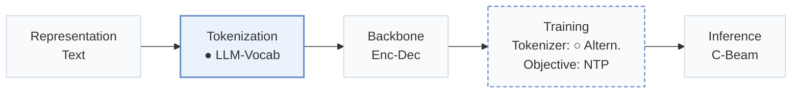
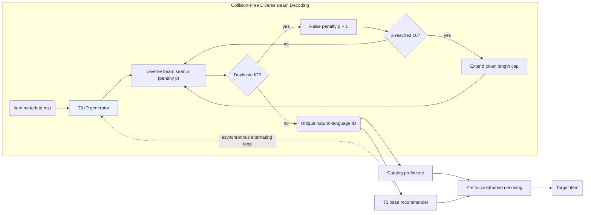
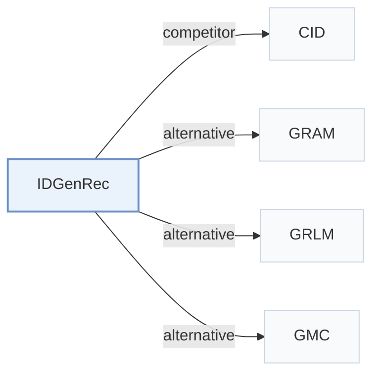

# IDGenRec

[← Problem × Stage Matrix](../../README.md#iii--tokenization) · [Papers by Stage](../index/stages.md) · [Papers by Modality](../index/modality.md) · [Papers by Domain](../index/domain.md) · English | [中文](../zh/papers/idgenrec.md)

| **Title** | *Llm-recsys alignment with textual id learning* |
| :-- | :-- |
| **Authors** | Tan et al. |
| **Venue** | SIGIR’24 |
| **Problem × Stage** | `III. SID–Model Alignment` · `Tokenization` |
| **Changes** | ● Tokenization · ○ Tokenizer |
| **SID inputs** | `Text` |
| **Domain** | `E-commerce` · `POI / Local` |
| **Settings** | `cold-start (item)` · `cold-start (user)` · `cross-domain` |
| **Links** | [Paper](https://arxiv.org/abs/2403.19021) · [Code](https://github.com/agiresearch/IDGenRec) |
| **Reading level** | Reading Notes (Level 2) |

**On this page**: [TL;DR](#tldr) · [At a Glance](#at-a-glance) · [1. Why It Matters](#1-why-this-paper-matters) · [2. Method](#2-how-it-works) · [3. Experiments](#3-experimental-findings) · [4. Limitations](#4-limitations--critical-analysis) · [5. Related Work](#5-connections-to-related-work)

- `Text`: Textual item metadata (titles, descriptions, categories, or prompts).
- `LLM-Vocab`: Item identifiers composed directly from tokens in the language model vocabulary.
- `Enc-Dec`: Encoder-decoder.
- `Altern.`: Tokenizer and generator are updated in turns.
- `NTP`: Next-token prediction loss only; continuing from a pretrained LLM (SFT) also counts as NTP.
- `C-Beam`: Constrained beam search.

### TL;DR

> [!NOTE]
> IDGenRec trains a textual ID generator alongside an LLM recommender, so each item receives a concise ID made of natural-language tokens, and tests zero-shot transfer to unseen platforms.

---

### At a Glance

| Aspect | Summary |
| :-- | :-- |
| Key Findings | Pre-trained on a 19-dataset corpus and evaluated zero-shot on 6 unseen datasets across platforms, IDGenRec matches or surpasses supervised traditional recommenders while outperforming sequential baselines in standard evaluation (Abstract, Tables 4 and 7). |
| Limitation | Updating the textual ID generator changes item IDs across the catalog, requiring periodic prefix-tree reconstruction during alternating training (Sec. 2.4). |

---

### 1. Why This Paper Matters

Out-of-vocabulary numeric codebooks tie a generative recommender to a single catalog, whereas raw item titles are long and noisy (Abstract). IDGenRec trains a T5 ID generator to compress item metadata into short, unique natural-language token sequences (`LLM-Vocab`), turning user histories into platform-agnostic text that transfers zero-shot across domains.

> "We propose an alternate training strategy that trains the LLM-based ID generator and the base recommender asynchronously, ensuring that their learned knowledge is well-aligned." (Sec. 1)

---

### 2. How It Works

#### ID Generator

Both the ID generator and the base recommender use T5 backbones (Sec. 2.6). The ID generator reads plain-text item metadata—title, category, price, description, creation time, popularity, and location—and decodes concise word-piece identifiers from the native vocabulary (Sec. 2.2).

#### Unique ID Generation

Diverse beam search enforces strict catalog uniqueness at generation time: whenever a candidate ID collides with an existing item, the diversity penalty increments by 1 up to 10, after which the maximum token length is extended until a unique ID emerges (Sec. 2.3, Sec. 3.2).

> "If a duplicate is detected, the algorithm increases the diversity penalty in the beam search." (Sec. 2.3)

#### Base Recommender

The base T5 recommender formats user histories as sequences of textual item IDs and decodes the next item's ID over a prefix tree storing all valid catalog identifiers, alternating updates asynchronously with the ID generator (Sec. 1, Sec. 2.4).

> "To ensure that the decoded ID corresponds to an actual existing item, we adopt a constrained sequence decoding strategy (De Cao et al., 2020). More specifically, a prefix tree is used to store all generated candidate IDs." (Sec. 2.4)

---

### 3. Experimental Findings

Experimental setup

- **Datasets**: Standard: Amazon Sports, Beauty, Toys and Yelp, filtering users and items with fewer than 5 interactions (following P5 and Hua et al. 2023). Zero-shot: a Fusion pre-training corpus from 19 other Amazon categories, each downsampled to at most 30,000 users (183,918 users / 233,323 items), tested on Sports, Beauty, Toys, Music, Instruments, and Yelp.
  - Source: Standard datasets and 5-interaction filter: [S3.SS1.p1](https://arxiv.org/html/2403.19021v2#S3.SS1.p1); zero-shot data rules: [S3.SS1.p3](https://arxiv.org/html/2403.19021v2#S3.SS1.p3) and [S3.SS1.p4](https://arxiv.org/html/2403.19021v2#S3.SS1.p4); statistics: [S3.T3](https://arxiv.org/html/2403.19021v2#S3.T3).
- **Split**: Leave-one-out for testing (validation allocation not restated). Zero-shot: train once on Fusion and test directly on held-out datasets.
  - Source: Leave-one-out: [S3.SS3.p1](https://arxiv.org/html/2403.19021v2#S3.SS3.p1); zero-shot setting: [S3.SS5.p1](https://arxiv.org/html/2403.19021v2#S3.SS5.p1).
- **Candidates**: full catalog (no negative sampling; ranking over all items).
  - Source: Ranking over all items without negative sampling: [S3.SS3.p1](https://arxiv.org/html/2403.19021v2#S3.SS3.p1).
- **Visibility**: Standard: warm; no unseen-item protocol is defined. Zero-shot: users and items of the test datasets are not seen in training; the ID generator is also trained only on the Fusion corpus, so test items are unseen by tokenizer too and receive IDs generated from their text.
  - Source: Zero-shot: users and items unseen in training: [S3.SS5.p1](https://arxiv.org/html/2403.19021v2#S3.SS5.p1); the ID generator is trained with the recommender on the training data: [S3.SS2.p3](https://arxiv.org/html/2403.19021v2#S3.SS2.p3).
- **SID**: Textual IDs generated from item text by a T5-small ID generator with diverse beam search (k=10 groups, diversity penalty raised from 1 to 10), length initially in [1, 10) tokens and extended to [10, 20) when needed; uniqueness is enforced at generation time by rejecting duplicates. SentencePiece vocabulary of 32,128.
  - Source: Diverse beam search for unique textual IDs, length ranges: [S2.SS3.p2](https://arxiv.org/html/2403.19021v2#S2.SS3.p2) and [S3.SS2.p2](https://arxiv.org/html/2403.19021v2#S3.SS2.p2); T5-small ID generator: from Section 2.
- **Inference budget**: Constrained decoding over a prefix tree of all generated item IDs; beam width, hardware, inference batch size, and latency: not reported. HR and NDCG at 5 and 10.
  - Source: Constrained decoding with a prefix tree over generated IDs: Section 2 inference; no beam width or hardware found.
- **Results from**: Table 4 (standard evaluation versus traditional and P5-variant baselines); Table 5 (training strategies); Table 6 (user and item IDs); Table 7 (zero-shot intra- and inter-platform).
  - Source: Standard: [S3.T4](https://arxiv.org/html/2403.19021v2#S3.T4); training strategies: [S3.T5](https://arxiv.org/html/2403.19021v2#S3.T5); user/item IDs: [S3.T6](https://arxiv.org/html/2403.19021v2#S3.T6); zero-shot: [S3.T7](https://arxiv.org/html/2403.19021v2#S3.T7).

- Standard sequential setting: IDGenRec outperforms traditional and P5-family sequential baselines on standard benchmarks (Abstract, Table 4).
- Zero-shot cross-platform transfer: trained once on 19 datasets and tested directly on 6 unseen datasets including cross-platform benchmarks, IDGenRec matches or outperforms supervised traditional recommenders trained in-domain (Abstract, Table 7).

---

### 4. Limitations & Critical Analysis

**Our analysis.**

- Enforcing uniqueness by raising beam diversity penalties and extending token length suggests that dense clusters of similar items receive increasingly divergent surface words in later iterations.
- CID constructs fixed `Spectral Clus.` numeric IDs from `CF` graphs; IDGenRec generates `LLM-Vocab` natural-language IDs from item text and updates them in alternation (`Altern.`).

---

### 5. Connections to Related Work

- **Competitor** · [CID](cid.md): P5-SID, P5-CID, and P5-SemID assign sequential, collaborative, or category IDs; IDGenRec learns a textual ID generator jointly with the recommender.
  - Source: IDGenRec v2, baselines: [S3.I1.i2.p1](https://arxiv.org/html/2403.19021v2#S3.I1.i2.p1); Table 4: [S3.T4](https://arxiv.org/html/2403.19021v2#S3.T4).
- **Alternative** · [GRAM](gram.md): GRAM later builds hierarchical textual IDs by clustering and reports that IDGenRec's user IDs concatenate validation and test items; it reruns IDGenRec without user IDs.
  - Source: Evidence is from the later GRAM paper: Table 9 and Appendix E: [A4.T9](https://arxiv.org/html/2506.01673v1#A4.T9) and [A5.p3](https://arxiv.org/html/2506.01673v1#A5.p3); Table 2: [S4.T2](https://arxiv.org/html/2506.01673v1#S4.T2).
- **Alternative** · [GRLM](grlm.md): GRLM later replaces free textual IDs with a fixed number of standardized vocabulary terms to reduce synonym ambiguity.
  - Source: Evidence is from the later GRLM paper: baselines and Table 2: [S4.I1.i3.p1](https://arxiv.org/html/2601.06798v1#S4.I1.i3.p1) and [S5.T2](https://arxiv.org/html/2601.06798v1#S5.T2); case study: [A3.p1](https://arxiv.org/html/2601.06798v1#A3.p1).
- **Alternative** · [GMC](gmc.md): GMC later compares against IDGenRec in a multi-domain setting with codebook IDs shared across domains.
  - Source: Evidence is from the later GMC paper: generative baselines and Table 3: [S5.I1.i4.I1.i3.p1](https://arxiv.org/html/2507.12871v3#S5.I1.i4.I1.i3.p1) and [S5.T3](https://arxiv.org/html/2507.12871v3#S5.T3).

[View all papers in this cell](../../README.md#iii--tokenization)
