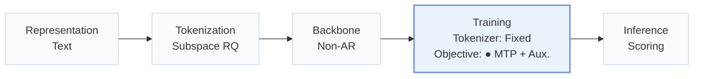
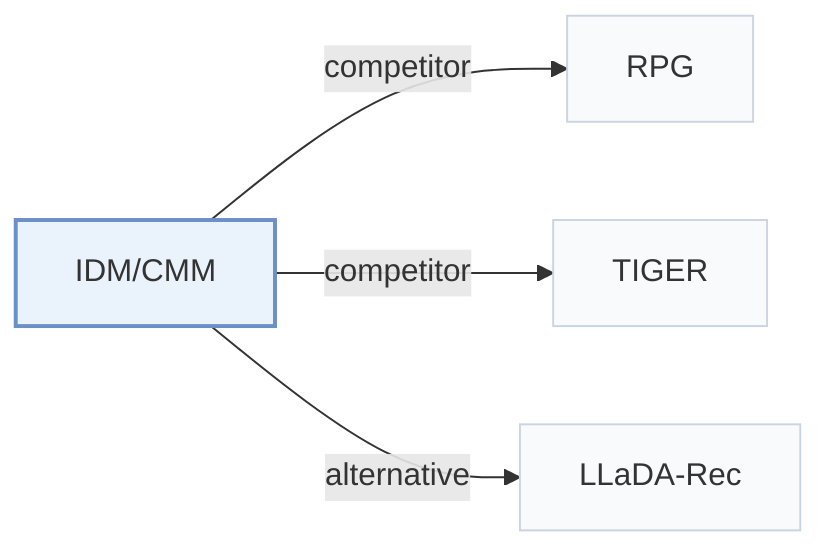

# IDM/CMM

[← Problem × Stage Matrix](../../README.md#iv--training) · [Papers by Stage](../index/stages.md) · [Papers by Modality](../index/modality.md) · [Papers by Domain](../index/domain.md) · English | [中文](../zh/papers/idm-cmm.md)

| **Title** | *Knowledge Distillation across Item and Code Spaces for Parallel Generative Recommendation* |
| :-- | :-- |
| **Authors** | Xu et al. |
| **Venue** | arXiv’26 |
| **Problem × Stage** | `IV. Utility` · `Training` |
| **Changes** | ● Objective |
| **SID inputs** | `Text` |
| **Domain** | `E-commerce` |
| **Links** | [Paper](https://arxiv.org/abs/2610.32943) |
| **Reading level** | Overview (Level 1) |

**On this page**: [TL;DR](#tldr) · [3. Experiments](#3-experimental-findings) · [5. Related Work](#5-connections-to-related-work)

- `Text`: Textual item metadata (titles, descriptions, categories, or prompts).
- `Subspace RQ`: Residual quantization applied separately within embedding subspaces.
- `Non-AR`: Non-autoregressive.
- `Fixed`: SIDs are built first and not changed while the generator trains.
- `MTP + Aux.`: Multi-token prediction jointly optimized with auxiliary objectives.
- `Scoring`: Direct candidate scoring without step-by-step SID generation.

### TL;DR

> [!NOTE]
> IDM/CMM distills a sequential recommender into a parallel Semantic ID generator by matching a reconstructed item distribution or per-position code marginals, instead of training on hard next-item labels alone.

---

### 3. Experimental Findings

Experimental setup

- **Datasets**: Amazon Reviews 2014 Beauty, Toys and Games, Sports and Outdoors; existing 5-core data verified without further filtering or deduplication.
  - Source: Section 4.1 and Appendix A.1: [S4.SS1.SSS0.Px1.p1](https://arxiv.org/html/2610.32943v1#S4.SS1.SSS0.Px1.p1) and [A1.SS1.p1](https://arxiv.org/html/2610.32943v1#A1.SS1.p1)
- **Split**: Per-user chronological last/penultimate interactions are test/validation; earlier events train. Histories capped at 50; test histories include validation interaction.
  - Source: Appendix A.1: [A1.SS1.p1](https://arxiv.org/html/2610.32943v1#A1.SS1.p1) and [A1.SS1.p2](https://arxiv.org/html/2610.32943v1#A1.SS1.p2)
- **Candidates**: full catalog; no historical-item masking
  - Source: Section 4.1: [S4.SS1.SSS0.Px3.p1](https://arxiv.org/html/2610.32943v1#S4.SS1.SSS0.Px3.p1)
- **Visibility**: warm; no unseen-item protocol is defined.
  - Source: Section 4.1 and Appendix A.1 define standard chronological holdouts, without an unseen-item experiment: [S4.SS1.SSS0.Px1.p1](https://arxiv.org/html/2610.32943v1#S4.SS1.SSS0.Px1.p1) and [A1.SS1](https://arxiv.org/html/2610.32943v1#A1.SS1)
- **SID**: 16 subspaces x 3 residual levels x 256 codes; 48 fixed heads. Collisions retained with identical scores; each item remains a distinct catalog entry.
  - Source: Section 4.1 and Appendix A.1: [S4.SS1.SSS0.Px2.p2](https://arxiv.org/html/2610.32943v1#S4.SS1.SSS0.Px2.p2) and [A1.SS1.p3](https://arxiv.org/html/2610.32943v1#A1.SS1.p3)
- **Inference budget**: Single parallel student, no teacher; Recall/NDCG@5/10; evaluation batch 32, FP32. Beam n/a; evaluation hardware and latency not reported. RTX 5880 Ada is specified for training.
  - Source: Figure 1 and Appendix A.2: [S3.F1](https://arxiv.org/html/2610.32943v1#S3.F1) and [A1.SS2.SSS0.Px1.p2](https://arxiv.org/html/2610.32943v1#A1.SS2.SSS0.Px1.p2)
- **Results from**: Table 2: IDM/CMM, AsymRec and RPG reproduced, averaged over three runs; other baseline scores copied from RPG Table 2.
  - Source: Table 2: [S4.T2](https://arxiv.org/html/2610.32943v1#S4.T2)

---

### 5. Connections to Related Work

- **Competitor** · [RPG](rpg.md): Reproduced parallel baseline with graph-guided decoding; IDM/CMM add soft teacher supervision.
  - Source: IDM/CMM v1, Section 4.1 and Table 2: [S4.SS1.SSS0.Px2.p2](https://arxiv.org/html/2610.32943v1#S4.SS1.SSS0.Px2.p2); [S4.T2](https://arxiv.org/html/2610.32943v1#S4.T2).
- **Competitor** · [TIGER](tiger.md): Autoregressive baseline; its comparison scores are taken from RPG.
  - Source: IDM/CMM v1, Sections 2.2/4.1 and Table 2: [S2.SS2.p2](https://arxiv.org/html/2610.32943v1#S2.SS2.p2); [S4.SS1.SSS0.Px2.p1](https://arxiv.org/html/2610.32943v1#S4.SS1.SSS0.Px2.p1); [S4.T2](https://arxiv.org/html/2610.32943v1#S4.T2).
- **Alternative** · [LLaDA-Rec](llada-rec.md): Iterative diffusion contrasts with the single-pass parallel predictor.
  - Source: IDM/CMM v1, Section 2.3: [S2.SS3.p1](https://arxiv.org/html/2610.32943v1#S2.SS3.p1).

[View all papers in this cell](../../README.md#iv--training)
