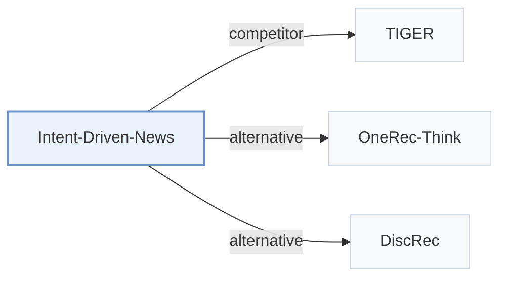

# Intent-Driven-News

[← Problem × Stage Matrix](../../README.md#iii--training) · [Papers by Stage](../index/stages.md) · [Papers by Modality](../index/modality.md) · English | [中文](../zh/papers/intent-driven-news.md)

| **Title** | *Intent-Driven Semantic ID Generation for Grounded Conversational News Recommendation* |
| :-- | :-- |
| **Authors** | Su et al. |
| **Venue** | ACL’26 Industry |
| **Problem × Stage** | `III. SID–Model Alignment` · `Training` |
| **Links** | [Paper](https://arxiv.org/abs/2605.07613) |
| **Reading level** | Overview (Level 1) |

**On this page**: [TL;DR](#tldr) · [At a Glance](#at-a-glance) · [3. Experiments](#3-experimental-findings) · [5. Related Work](#5-connections-to-related-work)

- `Text`: Textual item metadata (titles, descriptions, categories, or prompts).
- `RQ-VAE`: Residual-Quantized Variational AutoEncoder.
- `Dec-Only`: Decoder-only.
- `Fixed`: SIDs are built first and not changed while the generator trains.
- `Multi-task NTP`: The same NTP loss over several tasks.
- `CoT+Fuzzy Match`: Reasoning-guided identifier generation followed by fuzzy matching to available items.

### TL;DR

> [!NOTE]
> Intent-Driven-News trains an LLM to map implicit conversational intents to hierarchical Semantic ID prefixes and fuzzy-matches them to the current news pool, instead of retrieving articles first.

---

### At a Glance

| Aspect | Summary |
| :-- | :-- |
| Research Problem | III. SID–Model Alignment: Can the generator read, write, and reason over SIDs, and do the tokenizer and generator work toward the same goal? |
| Key Contribution | Intent-Driven-News trains an LLM to map implicit conversational intents to hierarchical Semantic ID prefixes and fuzzy-matches them to the current news pool, instead of retrieving articles first. |
| Modified Stage | Training |

---

### 3. Experimental Findings

Experimental setup

- **Datasets**: Industrial Chinese news: 163560 articles, 50000 profiles, 9982 test samples across six tasks. Filtering not reported.
  - Source: Section 4.1 and Table 2: [S4.SS1.SSS0.Px1.p1](https://arxiv.org/html/2605.07613v1#S4.SS1.SSS0.Px1.p1) and [S4.T2](https://arxiv.org/html/2605.07613v1#S4.T2)
- **Split**: Temporal: training articles before cutoff, test articles after; zero item overlap. Matching tolerance selected on 1000 validation samples without test temporal overlap; cutoff date not reported.
  - Source: Section 4.1 and Appendix A.2: [S4.SS1.SSS0.Px1.p1](https://arxiv.org/html/2605.07613v1#S4.SS1.SSS0.Px1.p1) and [A1.SS2.SSS0.Px1.p1](https://arxiv.org/html/2605.07613v1#A1.SS2.SSS0.Px1.p1)
- **Candidates**: Open generation (76%): full 152K SID space, grounded to current news pool. Selection (24%): sampled: 5 including target; Rand has 4 random negatives, Align has 2 same-category + 2 random negatives. Historical-item exclusion not reported.
  - Source: Section 4.1 and Appendix I: [S4.SS1.SSS0.Px1.p1](https://arxiv.org/html/2605.07613v1#S4.SS1.SSS0.Px1.p1) and [S4.SS1.SSS0.Px3.p1](https://arxiv.org/html/2605.07613v1#S4.SS1.SSS0.Px3.p1) and [A9.p1](https://arxiv.org/html/2605.07613v1#A9.p1)
- **Visibility**: Items unseen by generator; whether unseen by tokenizer too: not reported. Cold users have zero recent clicks but may retain pre-cutoff behavioral profile summaries.
  - Source: Section 4.1 and Appendices L/T: [S4.SS1.SSS0.Px1.p1](https://arxiv.org/html/2605.07613v1#S4.SS1.SSS0.Px1.p1) and [A12.SS0.SSS0.Px1.p1](https://arxiv.org/html/2605.07613v1#A12.SS0.SSS0.Px1.p1) and [A20.p2](https://arxiv.org/html/2605.07613v1#A20.p2)
- **SID**: RQ-VAE codebooks [32,64,128,1024]; generate first 3 layers only. Exact L1/L2, L3 tolerance 5; full-SID collision handling not reported.
  - Source: Section 3.2 and Appendix A.1: [S3.SS2.SSS0.Px2.p1](https://arxiv.org/html/2605.07613v1#S3.SS2.SSS0.Px2.p1) and [S3.SS2.SSS0.Px3.p1](https://arxiv.org/html/2605.07613v1#S3.SS2.SSS0.Px3.p1) and [A1.SS1.p3](https://arxiv.org/html/2605.07613v1#A1.SS1.p3)
- **Inference budget**: Caches 10 SID prefixes; beam width, inference hardware and batch size not reported. Warm cached response: mean 85ms, P95 150ms; cold initial delay 3.7s.
  - Source: Section 4.3 and Appendix C.4: [S4.SS3.SSS0.Px1.p1](https://arxiv.org/html/2605.07613v1#S4.SS3.SSS0.Px1.p1) and [A3.SS4.p1](https://arxiv.org/html/2605.07613v1#A3.SS4.p1)
- **Results from**: Original Tables 3/5/6: overall, task/user-cold-start and generative-baseline comparisons; Figure 2: latency.
  - Source: Tables 3/5/6 and Figure 2: [S4.T3](https://arxiv.org/html/2605.07613v1#S4.T3) and [S4.T5](https://arxiv.org/html/2605.07613v1#S4.T5) and [S4.T6](https://arxiv.org/html/2605.07613v1#S4.T6) and [S4.F2](https://arxiv.org/html/2605.07613v1#S4.F2)

---

### 5. Connections to Related Work

- **Competitor** · [TIGER](tiger.md): Compared on cold-start news users; the proposed method generates conversational SID prefixes.
  - Source: Intent-Driven News v1, Section 4.5 and Table 6: [S4.SS5.SSS0.Px2.p1](https://arxiv.org/html/2605.07613v1#S4.SS5.SSS0.Px2.p1); [S4.T6](https://arxiv.org/html/2605.07613v1#S4.T6).
- **Alternative** · [OneRec-Think](onerec-think.md): Cited SID reasoning approach; this work targets six conversational intents.
  - Source: Intent-Driven News v1, Section 2: [S2.SS0.SSS0.Px2.p1](https://arxiv.org/html/2605.07613v1#S2.SS0.SSS0.Px2.p1).
- **Alternative** · [DiscRec](discrec.md): Disentangles semantic and collaborative signals; this work focuses on conversational intent grounding.
  - Source: Intent-Driven News v1, Section 2: [S2.SS0.SSS0.Px2.p1](https://arxiv.org/html/2605.07613v1#S2.SS0.SSS0.Px2.p1).

[View all papers in this cell](../../README.md#iii--training)
