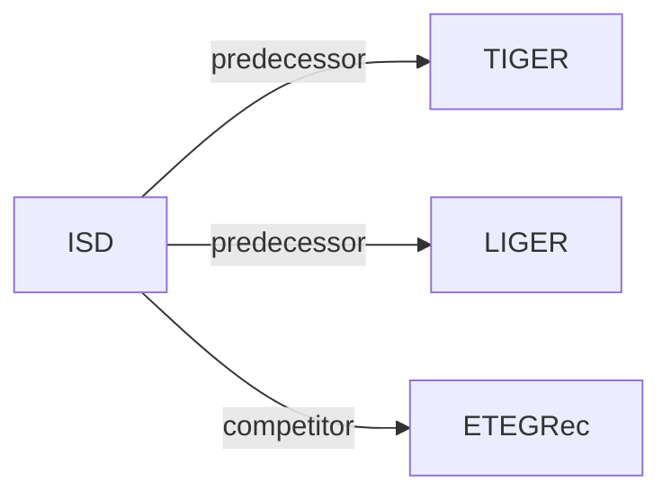

# ISD

*Understanding Semantic IDs: From Item Representation to Item Selection in Generative Recommendation* — Wang et al. · arXiv’26

`IV. Utility` · `Inference` · [Paper](https://arxiv.org/abs/2607.24995) · [Code](https://anonymous.4open.science/r/ISD-CF7C) · [Matrix](../../README.md#iv--inference) · [中文](../zh/papers/isd.md)

Reading level: Overview (Level 1) · On this page: [TL;DR](#tldr) · [At a Glance](#at-a-glance) · [3. Experiments](#3-experimental-findings) · [5. Related Work](#5-connections-to-related-work)

- `Fixed`: SIDs are built first and not changed while the generator trains.
- `ISD Beam`: Item-supported beam search.

### TL;DR

> [!NOTE]
> ISD lets a user-specific item ranking support Semantic ID prefixes before beam search discards them, at inference time and without retraining, after showing that Semantic IDs lose local item structure.

### At a Glance

| Aspect | Summary |
| :-- | :-- |
| Research Problem | IV. Utility: Are training and search aimed at what users and the platform value, rather than at token likelihood? |
| Key Contribution | ISD lets a user-specific item ranking support Semantic ID prefixes before beam search discards them, at inference time and without retraining, after showing that Semantic IDs lose local item structure. |
| Modified Stage | Inference |

### 3. Experimental Findings

Experimental setup

- **Datasets**: Amazon Reviews: Baby, Office, Scientific; filtering rules not reported.
  - Source: [S6.SS1.SSS1.p1](https://arxiv.org/html/2607.24995v1#S6.SS1.SSS1.p1) ; #A1.T6
- **Split**: Per-user chronological leave-one-out: final interaction test, preceding interaction validation, remainder training.
  - Source: [S6.SS1.SSS1.p1](https://arxiv.org/html/2607.24995v1#S6.SS1.SSS1.p1) ; #A1.SS4.SSS1.p1
- **Candidates**: full catalog of eligible items, with the same consumed-item mask for all methods.
  - Source: [S6.SS1.SSS3.p1](https://arxiv.org/html/2607.24995v1#S6.SS1.SSS3.p1) ; #A1.SS4.SSS1.p1 ; #A1.SS4.SSS2.p1
- **Visibility**: warm; no unseen-item protocol is defined. Separate item scorer and transition/co-consumption statistics use training interactions; tokenizer exposure to test items not reported.
  - Source: [S6.SS1](https://arxiv.org/html/2607.24995v1#S6.SS1) ; #A1.SS2.SSS1.p1 ; #S5.SS1.SSS1.p1
- **SID**: TIGER/LIGER assignments remain fixed: three semantic positions plus a collision-resolution suffix. Codebook sizes and suffix-assignment rule not reported; primary filtering diagnostic uses RQ-VAE.
  - Source: [S3.SS3.p1](https://arxiv.org/html/2607.24995v1#S3.SS3.p1) ; #A1.SS2.p1 ; #A1.SS3.SSS1.p1 ; #S6.SS4.p1
- **Inference budget**: Beam 50; one decoder pass; top-50 item-support ranking constructed once per history; reciprocal-rank fusion kappa=60; at most 50 output items, evaluated at K=10/20. Ranker construction is excluded from decoding complexity. Hardware, inference batch size and latency not reported.
  - Source: [A1.SS3.SSS1.p1](https://arxiv.org/html/2607.24995v1#A1.SS3.SSS1.p1) ; #S5.SS2.SSS2.p1 ; #S5.SS3.p1 ; #A1.SS4.SSS2.p1
- **Results from**: Original Table 3: matched recommendation comparisons, means across three seeds; Table 4: SID reassignment; Table 5: filtering/ordering ablations. Tables 1-2: encoder/SID representation diagnostics.
  - Source: [S5.T3](https://arxiv.org/html/2607.24995v1#S5.T3) ; #S6.T4 ; #S6.T5 ; #A1.SS4.SSS2.p1

### 5. Connections to Related Work

- **Predecessor** · [TIGER](tiger.md): ISD augments a frozen TIGER decoder with item-supported prefix selection and final ordering, without changing its SIDs or retraining.
  - Source: ISD v1, Sections 5.2/6.1.2 and Table 3: https://arxiv.org/html/2607.24995v1#S5.SS2; https://arxiv.org/html/2607.24995v1#S6.SS1.SSS2.p1; https://arxiv.org/html/2607.24995v1#S5.T3.
- **Predecessor** · [LIGER](liger.md): ISD also operates inside LIGER before beam reduction; LIGER already combines SID generation with dense retrieval and ranking.
  - Source: ISD v1, Sections 4/6.1.2 and Table 3: https://arxiv.org/html/2607.24995v1#S4.p3; https://arxiv.org/html/2607.24995v1#S6.SS1.SSS2.p1; https://arxiv.org/html/2607.24995v1#S5.T3.
- **Competitor** · [ETEGRec](etegrec.md): ETEGRec jointly trains the tokenizer and recommender; ISD instead changes inference with the SID assignment and decoder fixed.
  - Source: ISD v1, Sections 5.2/6.1.2 and Table 3: https://arxiv.org/html/2607.24995v1#S5.SS2; https://arxiv.org/html/2607.24995v1#S6.SS1.SSS2.p1; https://arxiv.org/html/2607.24995v1#S5.T3.

[View all papers in this cell](../../README.md#iv--inference)
