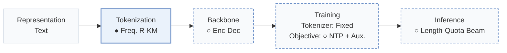
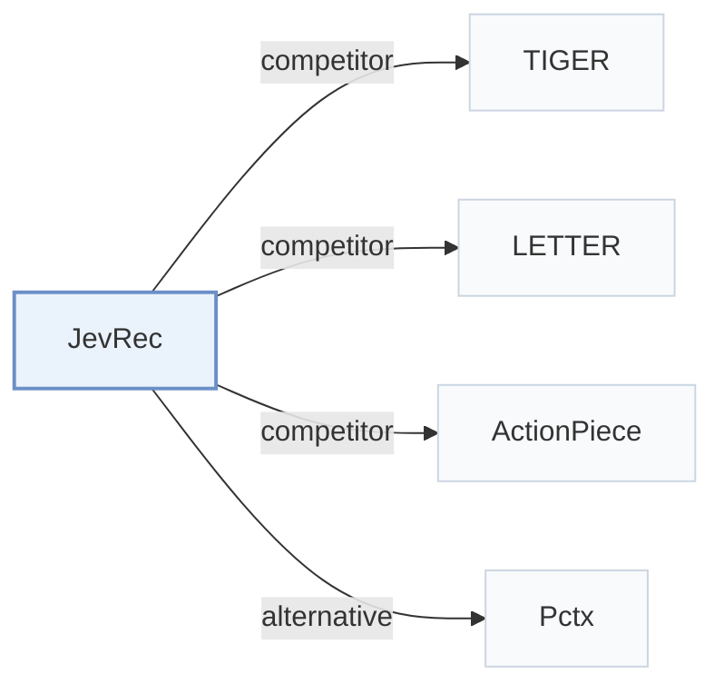

# JevRec

[← Problem × Stage Matrix](../../README.md#v--tokenization) · [Papers by Stage](../index/stages.md) · [Papers by Modality](../index/modality.md) · [Papers by Domain](../index/domain.md) · English | [中文](../zh/papers/jevrec.md)

| **Title** | *Linguistic Encoding with Jev-like Decision Modeling for LLM-based Generative Recommendation* |
| :-- | :-- |
| **Authors** | Zhong et al. |
| **Venue** | arXiv’26 |
| **Problem × Stage** | `V. Efficiency` · `Tokenization` |
| **Changes** | ● Tokenization · ○ Backbone · ○ Objective · ○ Inference |
| **SID inputs** | `Text` |
| **Domain** | `E-commerce` |
| **Links** | [Paper](https://arxiv.org/abs/2610.36937) |
| **Reading level** | Overview (Level 1) |

**On this page**: [TL;DR](#tldr) · [3. Experiments](#3-experimental-findings) · [5. Related Work](#5-connections-to-related-work)

- `Text`: Textual item metadata (titles, descriptions, categories, or prompts).
- `Freq. R-KM`: Frequency-aware residual k-means tokenization.
- `Enc-Dec`: Encoder-decoder.
- `Fixed`: SIDs are built first and not changed while the generator trains.
- `NTP + Aux.`: NTP plus another auxiliary loss.
- `Length-Quota Beam`: Beam search with recommendation quotas allocated across output lengths.

### TL;DR

> [!NOTE]
> JevRec gives frequent items shorter Semantic IDs and long-tail items longer ones, and predicts length and content with separate heads, instead of one ID length for all items.

---

### 3. Experimental Findings

Experimental setup

- **Datasets**: Amazon Reviews 2023: Musical Instruments, Industrial & Scientific, Video Games; exclude users/items with fewer than five interactions; maximum history 20 items.
  - Source: [S4.SS1.p1](https://arxiv.org/html/2610.36937v1#S4.SS1.p1)
- **Split**: Per-user chronological leave-one-out: latest interaction test, penultimate validation, earlier interactions training.
  - Source: [S4.SS1.p2](https://arxiv.org/html/2610.36937v1#S4.SS1.p2)
- **Candidates**: full catalog; no negative sampling.
  - Source: [S4.SS1.p2](https://arxiv.org/html/2610.36937v1#S4.SS1.p2)
- **Visibility**: warm; no unseen-item protocol is defined. Frequency-based length assignment uses training interactions only; tokenizer fitting exposure to test items not reported.
  - Source: [S4.SS1.p1](https://arxiv.org/html/2610.36937v1#S4.SS1.p1) ; #A2.p1 ; #S3.SS3.p2
- **SID**: Shared residual quantizer: 4 x 256; retain 2/3/4 semantic codes by training-frequency group and append one collision token, giving complete SID lengths 3/4/5. Within each group/prefix bucket collision tokens distinguish items; collision vocabulary capacity not reported.
  - Source: [S3.SS3.p2](https://arxiv.org/html/2610.36937v1#S3.SS3.p2) ; #S3.SS3.p3 ; #S3.SS3.p4 ; #A3.SS1.p1
- **Inference budget**: Beam 10 per length branch; total recommendation budget 10, with K=5 from the same ranked list; length-probability quotas and joint-score merging, without a catalog-prefix trie. Baseline beam 50. Figure 4 reports total test-set inference speedups over TIGER of 1.05x/1.16x/1.04x on Instrument/Scientific/Game. Inference hardware, batch size and per-request latency not reported.
  - Source: [S3.SS6](https://arxiv.org/html/2610.36937v1#S3.SS6) ; #A3.SS1.p1 ; #S4.F4 ; #S4.SS5.p1
- **Results from**: Table 2: main three-dataset comparison; most baseline results adopted from Zhong et al. (2025a), as stated in Appendix C. Table 3: JevRec ablations; Figure 4: runtime/convergence.
  - Source: [S4.T2](https://arxiv.org/html/2610.36937v1#S4.T2) ; #S4.T3 ; #S4.F4 ; #A3.p1

---

### 5. Connections to Related Work

- **Competitor** · [TIGER](tiger.md): TIGER uses fixed-length RQ-VAE SIDs; JevRec truncates shared residual-quantizer prefixes by item frequency and explicitly predicts target length.
  - Source: JevRec v1, Sections 3.3/4.1 and Table 2: [S3.SS3](https://arxiv.org/html/2610.36937v1#S3.SS3); [S4.SS1.p4](https://arxiv.org/html/2610.36937v1#S4.SS1.p4); [S4.T2](https://arxiv.org/html/2610.36937v1#S4.T2).
- **Competitor** · [LETTER](letter.md): LETTER adds collaborative information and diversity constraints to learned tokenization; JevRec allocates SID length by interaction frequency.
  - Source: JevRec v1, Sections 3.3/4.1 and Table 2: [S3.SS3](https://arxiv.org/html/2610.36937v1#S3.SS3); [S4.SS1.p4](https://arxiv.org/html/2610.36937v1#S4.SS1.p4); [S4.T2](https://arxiv.org/html/2610.36937v1#S4.T2).
- **Competitor** · [ActionPiece](actionpiece.md): ActionPiece merges contextually co-occurring action features; JevRec uses shared semantic codebooks with frequency-dependent prefix lengths.
  - Source: JevRec v1, Sections 3.3/4.1 and Table 2: [S3.SS3](https://arxiv.org/html/2610.36937v1#S3.SS3); [S4.SS1.p4](https://arxiv.org/html/2610.36937v1#S4.SS1.p4); [S4.T2](https://arxiv.org/html/2610.36937v1#S4.T2).
- **Alternative** · [Pctx](pctx.md): Pctx personalizes tokenization using user history; JevRec assigns context-invariant SID lengths from global training frequencies.
  - Source: JevRec v1, Sections 2/3.2/3.3: [S2.p1](https://arxiv.org/html/2610.36937v1#S2.p1); [S3.SS2.p1](https://arxiv.org/html/2610.36937v1#S3.SS2.p1); [S3.SS3.p1](https://arxiv.org/html/2610.36937v1#S3.SS3.p1).

[View all papers in this cell](../../README.md#v--tokenization)
