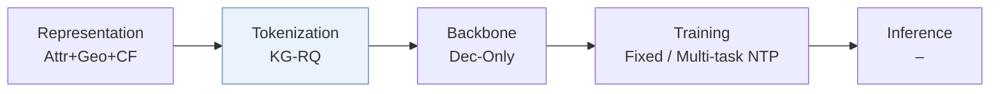
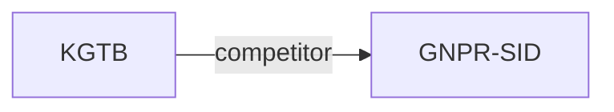

# KGTB

*Knowledge Graph Tokenization for Behavior-Aware Generative Next POI Recommendation* — Sun et al. · arXiv’25

`I. Informativeness` · `Tokenization` · `POI` · [Paper](https://arxiv.org/abs/2509.12350) · [Matrix](../../README.md#i--tokenization) · [中文](../zh/papers/kgtb.md)

Reading level: Overview (Level 1) · On this page: [TL;DR](#tldr) · [At a Glance](#at-a-glance) · [3. Experiments](#3-experimental-findings) · [5. Related Work](#5-connections-to-related-work)

- `Attr+Geo+CF`: Category and other attributes, plus geography, plus CF (POI).
- `KG-RQ`: Residual quantization informed by knowledge-graph structure.
- `Dec-Only`: Decoder-only.
- `Fixed`: SIDs are built first and not changed while the generator trains.
- `Multi-task NTP`: The same NTP loss over several tasks.
- `–`: Not reported in the paper.

### TL;DR

> [!NOTE]
> KGTB organizes POI data as a knowledge graph, quantizes each node into a structural ID under graph supervision, and fine-tunes an LLM on POI, category, and region visit tasks.

### At a Glance

| Aspect | Summary |
| :-- | :-- |
| Research Problem | I. Informativeness: Do the SIDs, or the model reading them, carry the collaborative and multimodal signals recommendation needs? |
| Key Contribution | KGTB organizes POI data as a knowledge graph, quantizes each node into a structural ID under graph supervision, and fine-tunes an LLM on POI, category, and region visit tasks. |
| Modified Stage | Tokenization |

### 3. Experimental Findings

Experimental setup

- **Datasets**: Foursquare Boston/Paris; Gowalla Austin/San Francisco. No filtering strategies applied.
  - Source: Experimental Setup and Main Results: [Sx5.SSx1.SSSx1.p1](https://arxiv.org/html/2509.12350v1#Sx5.SSx1.SSSx1.p1) and [Sx5.SSx2.p3](https://arxiv.org/html/2509.12350v1#Sx5.SSx2.p3)
- **Split**: Per-user chronological 70% training, 10% validation, 20% test.
  - Source: Experimental Setup, Datasets and Metrics: [Sx5.SSx1.SSSx1.p1](https://arxiv.org/html/2509.12350v1#Sx5.SSx1.SSSx1.p1)
- **Candidates**: not reported
  - Source: Experimental Setup reports ranking metrics without a candidate protocol: [Sx5.SSx1](https://arxiv.org/html/2509.12350v1#Sx5.SSx1)
- **Visibility**: warm; no unseen-item protocol is defined. Cold-start means POIs with fewer than five visitors; unseen means unvisited by the user. Cross-city transfer is also tested. Item-level generator/tokenizer holdouts and KG exposure to test interactions: not reported.
  - Source: Standard split, low-visitor/user-unvisited subsets, and cross-city transfer: [Sx5.SSx1.SSSx1.p1](https://arxiv.org/html/2509.12350v1#Sx5.SSx1.SSSx1.p1) and [Sx5.SSx3.SSSx2.p1](https://arxiv.org/html/2509.12350v1#Sx5.SSx3.SSSx2.p1) and [Sx5.SSx3.SSSx3.p1](https://arxiv.org/html/2509.12350v1#Sx5.SSx3.SSSx3.p1) and [Sx7.SSx3.p1](https://arxiv.org/html/2509.12350v1#Sx7.SSx3.p1)
- **SID**: 3-level KG residual quantization. Printed sizes at level l=1/2/3: POI/user 8^{4(l-1)}; region/category 8^{2(l-1)}. Collision handling: not reported.
  - Source: Implementation Details, formula retained as printed: [Sx5.SSx1.SSSx3.p1](https://arxiv.org/html/2509.12350v1#Sx5.SSx1.SSSx3.p1)
- **Inference budget**: HR/NDCG@1/5/10; FB total test time 0.4h. Decoder, beam, inference hardware/batch, per-request latency: not reported; L40 and batch 4 describe fine-tuning.
  - Source: Implementation Details, ranking metrics, Table 5: [Sx5.SSx1.SSSx3.p1](https://arxiv.org/html/2509.12350v1#Sx5.SSx1.SSSx3.p1) and [Sx5.SSx1.SSSx1.p2](https://arxiv.org/html/2509.12350v1#Sx5.SSx1.SSSx1.p2) and [Sx5.T5](https://arxiv.org/html/2509.12350v1#Sx5.T5)
- **Results from**: Original Tables 2/3/4/5/6/7: main, ablation, cross-city, compute, backbone, user-unvisited POIs; Figure 4: low-visitor subset.
  - Source: Tables 2-7 and Figure 4: [Sx5.T2](https://arxiv.org/html/2509.12350v1#Sx5.T2) and [Sx5.T3](https://arxiv.org/html/2509.12350v1#Sx5.T3) and [Sx5.T4](https://arxiv.org/html/2509.12350v1#Sx5.T4) and [Sx5.T5](https://arxiv.org/html/2509.12350v1#Sx5.T5) and [Sx7.T6](https://arxiv.org/html/2509.12350v1#Sx7.T6) and [Sx7.T7](https://arxiv.org/html/2509.12350v1#Sx7.T7) and [Sx5.F4](https://arxiv.org/html/2509.12350v1#Sx5.F4)

### 5. Connections to Related Work

- **Competitor** · [GNPR-SID](gnpr-sid.md): GNPR-SID is the closest baseline across accuracy, cold-start, transfer and compute experiments.
  - Source: KGTB v1, Cold-Start Scenario and Tables 2/4/5: https://arxiv.org/html/2509.12350v1#Sx5.SSx3.SSSx2.p1; https://arxiv.org/html/2509.12350v1#Sx5.T2; https://arxiv.org/html/2509.12350v1#Sx5.T4; https://arxiv.org/html/2509.12350v1#Sx5.T5.

[View all papers in this cell](../../README.md#i--tokenization)
