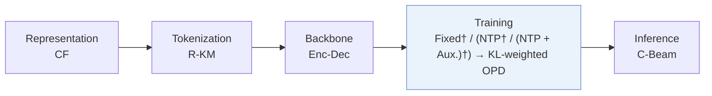
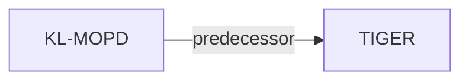

# KL-MOPD

*Discrepancy-Aware Multi-Objective On-Policy Distillation for Generative Recommendation* — Yang et al. · arXiv’26

`IV. Utility` · `Training`

[Paper](https://arxiv.org/abs/2610.36973) · [Code](https://github.com/Yandorn/KL-MOPD) · [Matrix](../../README.md#iv--training)

Reading level: Overview (Level 1) · On this page: [TL;DR](#tldr) · [At a Glance](#at-a-glance) · [3. Experimental Findings](#3-experimental-findings) · [5. Connections to Related Work](#5-connections-to-related-work)

- `CF`: Collaborative filtering signal.
- `R-KM`: Residual k-means.
- `Enc-Dec`: Encoder-decoder.
- `(NTP† / (NTP + Aux.)†) → KL-weighted OPD`: Inferred next-token-based initialization variants followed by KL-weighted on-policy distillation.
- `C-Beam`: Constrained beam search.

### TL;DR

KL-MOPD distills click and conversion teachers into a student generator token by token, weighting each teacher by its initial KL divergence from the student, instead of vanilla on-policy distillation.

### At a Glance

| Aspect | Summary |
| :-- | :-- |
| Research Problem | IV. Utility: Are training and search aimed at what users and the platform value, rather than at token likelihood? |
| Key Contribution | KL-MOPD distills click and conversion teachers into a student generator token by token, weighting each teacher by its initial KL divergence from the student, instead of vanilla on-policy distillation. |
| Modified Stage | Training |

### 3. Experimental Findings

**Experimental setup**

- **Datasets**: TencentGR (CTR/CVR), YooChoose (CTR/GMV), Taobao (CTR/CVR), industrial advertising (CTR/eCPM). Filtering: not reported.
- **Split**: Public: chronological 70% student pretraining, 20% teacher tuning/student distillation, 10% evaluation. Industry: penultimate day tuning, final day evaluation, >11M requests/day; pretraining allocation not reported. Sliding windows; history caps 100 public/128 Industry.
- **Candidates**: not reported
- **Visibility**: warm; no unseen-item protocol is defined. Two-tower CF embedding exposure to test items: not reported.
- **SID**: RQ-KMeans of two-tower CF embeddings: TencentGR 5x64, YooChoose 5x128, Taobao 8x64, Industry 8x310. Collision handling: not reported.
- **Inference budget**: Constrained beam 50, K=10/20 public; beam 200, K=100/200 Industry. Inference hardware, batch size, latency: not reported.
- **Results from**: This study's adapted/tuned baselines: Table 3 public TIGER/REG4Rec, Table 4 ablations, Table 5 industrial TIGER, Table 6 five-day online A/B (10% control, 10% treatment).

Sources

- **Datasets**: Section 4.1: [S4.SS1.p1](https://arxiv.org/html/2610.36973v1#S4.SS1.p1)
- **Split**: Section 4.1: [S4.SS1.p1](https://arxiv.org/html/2610.36973v1#S4.SS1.p1) and [S4.SS1.p4](https://arxiv.org/html/2610.36973v1#S4.SS1.p4)
- **Candidates**: Section 4.1 states decoding and cutoffs without specifying candidate sampling: [S4.SS1.p5](https://arxiv.org/html/2610.36973v1#S4.SS1.p5)
- **Visibility**: Section 4.1 defines no unseen-item evaluation: [S4.SS1.p1](https://arxiv.org/html/2610.36973v1#S4.SS1.p1) and [S4.SS1.p2](https://arxiv.org/html/2610.36973v1#S4.SS1.p2)
- **SID**: Section 4.1: [S4.SS1.p2](https://arxiv.org/html/2610.36973v1#S4.SS1.p2)
- **Inference budget**: Section 4.1: [S4.SS1.p5](https://arxiv.org/html/2610.36973v1#S4.SS1.p5)
- **Results from**: Tables 3-6 and baseline setup: [S2.T3](https://arxiv.org/html/2610.36973v1#S2.T3) and [S4.T4](https://arxiv.org/html/2610.36973v1#S4.T4) and [S4.T5](https://arxiv.org/html/2610.36973v1#S4.T5) and [S4.T6](https://arxiv.org/html/2610.36973v1#S4.T6) and [S4.SS1.p3](https://arxiv.org/html/2610.36973v1#S4.SS1.p3)

### 5. Connections to Related Work

- **Predecessor** · [TIGER](tiger.md): TIGER is a backbone for token-wise multi-teacher distillation, with CF-derived SIDs in this study.
  - Source: KL-MOPD v1, Section 4.1 and Table 3: https://arxiv.org/html/2610.36973v1#S4.SS1.p2; https://arxiv.org/html/2610.36973v1#S2.T3.

[View all papers in this cell](../../README.md#iv--training)
