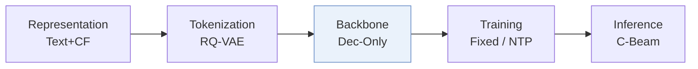
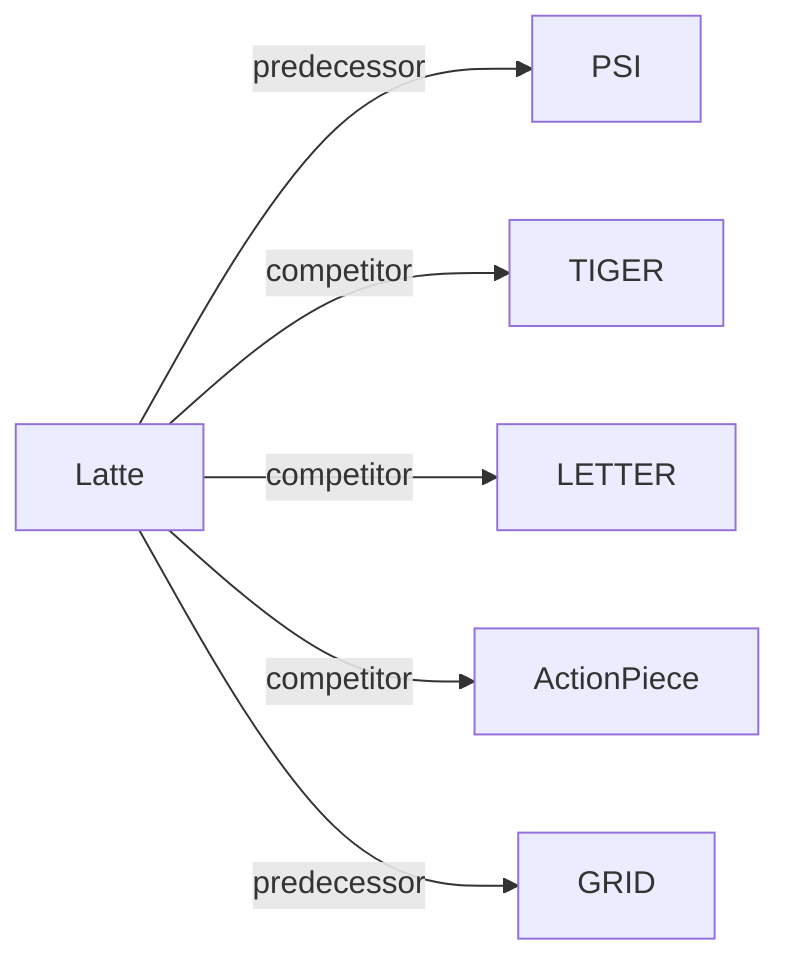

# Latte

| **Title** | *Expressiveness Limits of Autoregressive Semantic ID Generation in Generative Recommendation* |
| :-- | :-- |
| **Authors** | Hou et al. |
| **Venue** | arXiv’26 |
| **Problem × Stage** | `III. SID–Model Alignment` · `Backbone` |
| **Links** | [Paper](https://arxiv.org/abs/2605.06331) · [Code](https://github.com/hyp1231/Latte) · [Matrix](../../README.md#iii--backbone) · [中文](../zh/papers/latte.md) |
| **Reading level** | Overview (Level 1) |

On this page: [TL;DR](#tldr) · [At a Glance](#at-a-glance) · [3. Experiments](#3-experimental-findings) · [5. Related Work](#5-connections-to-related-work)

- `Dec-Only`: Decoder-only.
- `Fixed`: SIDs are built first and not changed while the generator trains.
- `NTP`: Next-token prediction loss only; continuing from a pretrained LLM (SFT) also counts as NTP.
- `C-Beam`: Constrained beam search.

### TL;DR

> [!NOTE]
> Latte inserts a latent token before each Semantic ID, turning one decoding tree into several latent-conditioned trees, to relax the probability coupling between items that are close in the tree.

---

### At a Glance

| Aspect | Summary |
| :-- | :-- |
| Research Problem | III. SID–Model Alignment: Can the generator read, write, and reason over SIDs, and do the tokenizer and generator work toward the same goal? |
| Key Contribution | Latte inserts a latent token before each Semantic ID, turning one decoding tree into several latent-conditioned trees, to relax the probability coupling between items that are close in the tree. |
| Modified Stage | Backbone |

---

### 3. Experimental Findings

Experimental setup

- **Datasets**: Amazon Reviews 2023: Instruments, Scientific, Games (57,439 / 24,587, 50,985 / 25,848, 94,762 / 25,612 users / items; filtering not restated beyond following ETEGRec and Zheng et al. 2025). Separate modality-order study on the Million Playlist Dataset: songs without tags or metadata and playlists with fewer than six songs removed.
  - Source: Amazon 2023 categories and split: [S5.SS1.SSS0.Px1.p1](https://arxiv.org/html/2605.06331v1#S5.SS1.SSS0.Px1.p1); statistics: [A1.T7](https://arxiv.org/html/2605.06331v1#A1.T7); MPD: [S6.SS2.SSS0.Px1.p1](https://arxiv.org/html/2605.06331v1#S6.SS2.SSS0.Px1.p1).
- **Split**: Amazon: chronological leave-one-out, most recent interaction for test, second most recent for validation, the rest for training. MPD: 8:1:1 split.
  - Source: Leave-one-out allocation: [S5.SS1.SSS0.Px1.p1](https://arxiv.org/html/2605.06331v1#S5.SS1.SSS0.Px1.p1); MPD 8:1:1: [S6.SS2.SSS0.Px1.p1](https://arxiv.org/html/2605.06331v1#S6.SS2.SSS0.Px1.p1).
- **Candidates**: not reported (full catalog versus sampled evaluation candidates); top-K lists from beam search with beam size 500.
  - Source: Metrics only: [A4.SS0.SSS0.Px2.p1](https://arxiv.org/html/2605.06331v1#A4.SS0.SSS0.Px2.p1).
- **Visibility**: warm; no unseen-item protocol is defined.
  - Source: Standard split with no unseen-item protocol: [S5.SS1.SSS0.Px1.p1](https://arxiv.org/html/2605.06331v1#S5.SS1.SSS0.Px1.p1).
- **SID**: Base PSID semantic IDs from RQ K-Means: 3 positions x 256 tokens, with PSID's ESM algorithm to prevent SID conflicts; Latte prepends one of M' learned latent tokens (2, 4, or 8; best 4 or 8) chosen freely at inference. RQ-VAE and OPQ tokenizers are also tested (Table 3).
  - Source: RQ K-Means m=3 x 256 with ESM conflict resolution, latent tokens: [A4.SS0.SSS0.Px2.p2](https://arxiv.org/html/2605.06331v1#A4.SS0.SSS0.Px2.p2); tokenizer variants: [S5.T3](https://arxiv.org/html/2605.06331v1#S5.T3).
- **Inference budget**: Beam size 500 for PSID and Latte; generation starts with an unconstrained latent token followed by SID tokens, and item scores are aggregated over latent tokens with max. Hardware, inference batch size, and latency: not reported.
  - Source: Beam size 500: [A3.T8](https://arxiv.org/html/2605.06331v1#A3.T8) and [A3.T9](https://arxiv.org/html/2605.06331v1#A3.T9); aggregation over latent tokens: [S4.SS2.p1](https://arxiv.org/html/2605.06331v1#S4.SS2.p1) and [A4.SS0.SSS0.Px2.p2](https://arxiv.org/html/2605.06331v1#A4.SS0.SSS0.Px2.p2).
- **Results from**: Table 1 (Instruments, Scientific, Games; most baseline numbers copied from prior work, PSID rerun from its released code); Table 2 (tree-distance correlations); Tables 3-4 and Figure 4 (tokenizers, aggregation, number of latent tokens); Table 5 (MPD modality order).
  - Source: Main: [S5.T1](https://arxiv.org/html/2605.06331v1#S5.T1); constraint analysis: [S5.T2](https://arxiv.org/html/2605.06331v1#S5.T2); tokenizers: [S5.T3](https://arxiv.org/html/2605.06331v1#S5.T3); aggregation: [S5.T4](https://arxiv.org/html/2605.06331v1#S5.T4); latent count: [S5.F4](https://arxiv.org/html/2605.06331v1#S5.F4); MPD: [S6.T5](https://arxiv.org/html/2605.06331v1#S6.T5); copied baselines: [A4.SS0.SSS0.Px1.p2](https://arxiv.org/html/2605.06331v1#A4.SS0.SSS0.Px1.p2).

---

### 5. Connections to Related Work

- **Predecessor** · [PSI](psi.md): PSID is the base model and supplies the ESM conflict resolution; Latte only adds a freely chosen latent token before the semantic ID.
  - Source: Latte v1, base model and implementation: https://arxiv.org/html/2605.06331v1#S5.SS1.SSS0.Px2.p1 and https://arxiv.org/html/2605.06331v1#A4.SS0.SSS0.Px2.p2; Table 1: https://arxiv.org/html/2605.06331v1#S5.T1.
- **Competitor** · [TIGER](tiger.md): TIGER decodes items along one fixed SID tree; Latte relaxes the tree constraint with latent tokens so that close tree nodes need not share preference.
  - Source: Latte v1, motivation study: https://arxiv.org/html/2605.06331v1#S3.SS2.SSS0.Px2.p1; baselines and Table 1: https://arxiv.org/html/2605.06331v1#A4.SS0.SSS0.Px1.p1 and https://arxiv.org/html/2605.06331v1#S5.T1; Table 2: https://arxiv.org/html/2605.06331v1#S5.T2.
- **Competitor** · [LETTER](letter.md): LETTER improves the tokenizer itself; Latte keeps the tokenizer and changes the decoding path.
  - Source: Latte v1, baselines: https://arxiv.org/html/2605.06331v1#A4.SS0.SSS0.Px1.p1; Table 1: https://arxiv.org/html/2605.06331v1#S5.T1.
- **Competitor** · [ActionPiece](actionpiece.md): ActionPiece makes tokens context-dependent through merges; Latte adds latent prefix tokens on top of fixed SIDs.
  - Source: Latte v1, baselines: https://arxiv.org/html/2605.06331v1#A4.SS0.SSS0.Px1.p1; Table 1: https://arxiv.org/html/2605.06331v1#S5.T1.
- **Predecessor** · [GRID](grid.md): Latte follows GRID's recommendation to use RQ K-Means as the tokenizer.
  - Source: Latte v1, Section 5.1 and Appendix D cite Ju et al. (2025): https://arxiv.org/html/2605.06331v1#S5.SS1.SSS0.Px2.p1 and https://arxiv.org/html/2605.06331v1#A4.SS0.SSS0.Px2.p2.

[View all papers in this cell](../../README.md#iii--backbone)
