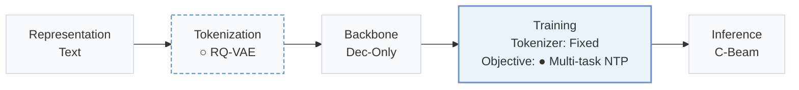
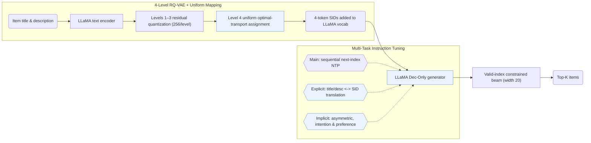
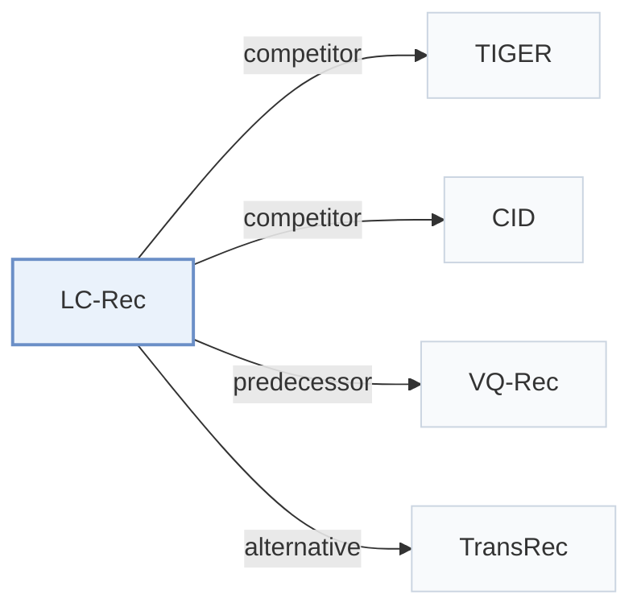

# LC-Rec

[← Problem × Stage Matrix](../../README.md#iii--training) · [Papers by Stage](../index/stages.md) · [Papers by Modality](../index/modality.md) · [Papers by Domain](../index/domain.md) · English | [中文](../zh/papers/lc-rec.md)

| **Title** | *Adapting large language models by integrating collaborative semantics for recommendation* |
| :-- | :-- |
| **Authors** | Zheng et al. |
| **Venue** | ICDE’24 |
| **Problem × Stage** | `III. SID–Model Alignment` · `Training` |
| **Changes** | ○ Tokenization · ● Objective |
| **SID inputs** | `Text` |
| **Domain** | `E-commerce` |
| **Scenario** | `General Item Recommendation`; `Public Benchmarks` |
| **Links** | [Paper](https://arxiv.org/abs/2311.09049) · [Code](https://github.com/RUCAIBox/LC-Rec/) |
| **Reading level** | Reading Notes (Level 2) |

**On this page**: [TL;DR](#tldr) · [At a Glance](#at-a-glance) · [1. Why It Matters](#1-why-this-paper-matters) · [2. Method](#2-how-it-works) · [3. Experiments](#3-experimental-findings) · [4. Limitations](#4-limitations--critical-analysis) · [5. Related Work](#5-connections-to-related-work)

- `Text`: Textual item metadata (titles, descriptions, categories, or prompts).
- `RQ-VAE`: Residual-Quantized Variational AutoEncoder.
- `Dec-Only`: Decoder-only.
- `Fixed`: SIDs are built first and not changed while the generator trains.
- `Multi-task NTP`: The same NTP loss over several tasks.
- `C-Beam`: Constrained beam search.

### TL;DR

> [!NOTE]
> LC-Rec assigns non-conflicting item indices by vector quantization with uniform semantic mapping and tunes an LLM with alignment tasks, so it generates items from the whole catalog without candidate lists.

---

### At a Glance

| Aspect | Summary |
| :-- | :-- |
| Key Findings | Across Amazon Instruments, Arts, and Games under full-catalog evaluation, LC-Rec outperforms traditional sequential recommenders, TIGER, and prior LLM-based recommenders (Abstract, Table 3). |
| Limitation | Item indices are quantized solely from LLaMA text embeddings, so collaborative signals enter only indirectly during instruction tuning (Sec. III-B). |

---

### 1. Why This Paper Matters

Indexing catalog items with out-of-vocabulary code tokens leaves a semantic gap between natural-language pretraining and collaborative user histories in large language models (LLMs) (Abstract). LC-Rec bridges this gap by resolving final-level RQ-VAE collisions via uniform semantic mapping and co-training explicit index-text translation alongside implicit collaborative alignment tasks.

> "In essence, LLMs capture language semantics while recommender systems imply collaborative semantics, making it difficult to sufficiently leverage the model capacity of LLMs for recommendation." (Abstract)

---

### 2. How It Works

#### Item Indexing

LC-Rec encodes item titles and descriptions with LLaMA and quantizes the pooled embeddings through a 4-level × 256 RQ-VAE (Sec. III-B). Rather than appending an arbitrary fifth integer to separate colliding items, uniform semantic mapping solves a uniform-distribution assignment over the final codebook level so colliding items receive distinct residual-nearest codewords (Sec. III-B2).

#### Alignment Tuning

Instruction tuning combines three task families: sequential next-item index prediction as the primary task (Sec. III-C1), two explicit bidirectional alignment tasks mapping item titles or descriptions to their discrete indices and back (Sec. III-C2), and implicit alignment tasks covering asymmetric item prediction, intention-based prediction, and preference inference (Sec. III-C3).

> "On the one hand, the LLM should be capable of accurately identifying the item indices based on the associated title or description. On the other hand, it is expected that LLM can naturally capture relevant item information from its indices." (Sec. III-C2)

#### Training

All alignment and recommendation tasks are formatted as conditional natural-language instructions sharing one LLaMA decoder-only model and decoded with constrained beam search that masks invalid index prefixes (Sec. III-D).

> "To this end, we employ LLaMA [25] as our backbone model and then optimize it via instruction tuning." (Sec. III-D)

---

### 3. Experimental Findings

Experimental setup

- **Datasets**: Amazon Reviews (May 1996-October 2018): Musical Instruments, Arts Crafts and Sewing, Video Games; users and items with fewer than 5 interactions are filtered; sequences capped at 20 items. Sizes (users / items / interactions): Instruments 24,773 / 9,923 / 206,153; Arts 45,142 / 20,957 / 390,832; Games 50,547 / 16,860 / 452,989.
  - Source: Amazon 2018 subsets, 5-interaction filter, length 20: [S4.SS1.SSS1.p1](https://arxiv.org/html/2311.09049v4#S4.SS1.SSS1.p1); statistics: [S4.T2](https://arxiv.org/html/2311.09049v4#S4.T2).
- **Split**: Per-user leave-one-out: most recent item for test, second most recent for validation, the rest for training.
  - Source: Leave-one-out allocation: [S4.SS1.SSS3.p1](https://arxiv.org/html/2311.09049v4#S4.SS1.SSS3.p1).
- **Candidates**: full catalog (full ranking over the entire item set instead of sampled evaluation). Separate analysis (Table 5): choose between the target and one negative that is language-similar, collaborative-similar (by SASRec embeddings), or random; history exclusion for these negatives not reported.
  - Source: Full ranking over the entire item set: [S4.SS1.SSS3.p1](https://arxiv.org/html/2311.09049v4#S4.SS1.SSS3.p1); separate pairwise test with one negative: [S4.SS4.SSS0.Px3.p1](https://arxiv.org/html/2311.09049v4#S4.SS4.SSS0.Px3.p1).
- **Visibility**: warm; no unseen-item protocol is defined.
  - Source: Standard split with no unseen-item protocol: [S4.SS1.SSS3.p1](https://arxiv.org/html/2311.09049v4#S4.SS1.SSS3.p1).
- **SID**: 4-level RQ-VAE x 256 codewords (dimension 32) over mean-pooled LLaMA embeddings of title and description, added to the LLaMA tokenizer as new tokens. Conflicts are resolved without an extra suffix level: the last-level codewords of each conflicting group are redistributed under a uniform-distribution constraint.
  - Source: 4 levels x 256 x 32 over LLaMA text embeddings: [S4.SS1.SSS4.p1](https://arxiv.org/html/2311.09049v4#S4.SS1.SSS4.p1); uniform last-level redistribution for conflicts: [S3.SS2.SSS2.p2](https://arxiv.org/html/2311.09049v4#S3.SS2.SSS2.p2) and [S3.SS2.SSS2.p3](https://arxiv.org/html/2311.09049v4#S3.SS2.SSS2.p3).
- **Inference budget**: Beam search with beam size 20 for all generative methods; tokens leading to invalid item indices get zero probability. LLaMA backbone with DeepSpeed; hardware, inference batch size, and latency: not reported. HR and NDCG at 1, 5, 10.
  - Source: Beam size 20 and invalid-token masking: [S4.SS1.SSS3.p1](https://arxiv.org/html/2311.09049v4#S4.SS1.SSS3.p1) and [S3.SS4.SSS2.p1](https://arxiv.org/html/2311.09049v4#S3.SS4.SSS2.p1).
- **Results from**: Table 3 (Instruments, Arts, Games; LC-Rec averaged over instruction templates); Table 4 (alignment-task ablation); Table 5 (similar-negative ranking accuracy).
  - Source: Main: [S4.T3](https://arxiv.org/html/2311.09049v4#S4.T3); ablation: [S4.T4](https://arxiv.org/html/2311.09049v4#S4.T4); negative-item analysis: [S4.T5](https://arxiv.org/html/2311.09049v4#S4.T5).

- Main comparison: under full-catalog ranking on Amazon Instruments, Arts, and Games, LC-Rec outperforms traditional sequential models, TIGER, and prior LLM recommenders, while ablations confirm consistent gains from both uniform semantic mapping and each alignment task family (Abstract, Tables 3 and 4).

---

### 4. Limitations & Critical Analysis

**Our analysis.**

- TIGER pairs `RQ-VAE` codes with a lightweight from-scratch `Enc-Dec` Transformer under single-task `NTP`; LC-Rec appends `RQ-VAE` tokens to a pretrained `Dec-Only` LLaMA vocabulary and grounds them through `Multi-task NTP` instruction tuning.

---

### 5. Connections to Related Work

- **Competitor** · [TIGER](tiger.md): TIGER resolves leaf conflicts with an extra index level and uses a small seq2seq model; LC-Rec redistributes conflicting last-level codes uniformly and tunes LLaMA with language-collaborative alignment tasks.
  - Source: LC-Rec v4, conflict discussion: [S3.SS2.SSS2.p1](https://arxiv.org/html/2311.09049v4#S3.SS2.SSS2.p1); baselines and Table 3: [S4.I1.i10.p1](https://arxiv.org/html/2311.09049v4#S4.I1.i10.p1) and [S4.T3](https://arxiv.org/html/2311.09049v4#S4.T3).
- **Competitor** · [CID](cid.md): P5-CID builds collaborative indices and also adds a supplementary index for conflicts; LC-Rec learns semantic RQ indices from LLM text embeddings.
  - Source: LC-Rec v4, conflict discussion: [S3.SS2.SSS2.p1](https://arxiv.org/html/2311.09049v4#S3.SS2.SSS2.p1); baselines and Table 3: [S4.I1.i9.p1](https://arxiv.org/html/2311.09049v4#S4.I1.i9.p1) and [S4.T3](https://arxiv.org/html/2311.09049v4#S4.T3).
- **Predecessor** · [VQ-Rec](vq-rec.md): LC-Rec borrows the idea of learned semantic indices from VQ-Rec and TIGER, then adapts it for LLM tuning.
  - Source: LC-Rec v4, Section 3.2.1: [S3.SS2.SSS1.p1](https://arxiv.org/html/2311.09049v4#S3.SS2.SSS1.p1) and [S3.SS2.SSS1.p4](https://arxiv.org/html/2311.09049v4#S3.SS2.SSS1.p4).
- **Alternative** · [TransRec](transrec.md): TransRec also builds LLM-based generative recommendation with multi-facet identifiers; LC-Rec uses learned VQ indices with alignment tuning.
  - Source: LC-Rec v4, Section 2.2 and Section 3.5 related work: [S2.SS2.p3](https://arxiv.org/html/2311.09049v4#S2.SS2.p3) and [S3.SS5.p3](https://arxiv.org/html/2311.09049v4#S3.SS5.p3).

[View all papers in this cell](../../README.md#iii--training)
