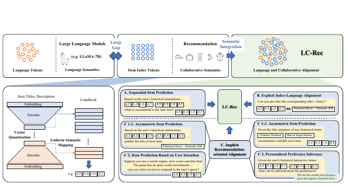

# LC-Rec

*Adapting large language models by integrating collaborative semantics for recommendation* — Zheng et al., ICDE’24

[arXiv](https://arxiv.org/abs/2311.09049) · [Record](../../data/papers/lc-rec.yaml) · [← Catalog](../../README.md#iii--training)

> Abstract: "there exists a large semantic gap between LLMs and recommender systems".

| Problem it fixes | Stage it changes |
| :-- | :-- |
| **III. SID–Model Alignment**: Can the generator read, write, and reason over SIDs, and do the tokenizer and generator work toward the same goal? | **Training** |

## Pipeline

| Representation | Tokenization | Backbone | Training | Inference |
| :-: | :-: | :-: | :-: | :-: |
| `Text` | `RQ-VAE` | `Dec-Only` | **`Fixed / Multi-task NTP`** | `Beam` |

- `Dec-Only`: Decoder-only.
- `Fixed`: SIDs are built first and not changed while the generator trains.
- `Multi-task NTP`: The same NTP loss over several tasks.

## Architecture

## Evidence

- **`problem`** (arXiv abstract): Abstract: "there exists a large semantic gap between LLMs and recommender systems".

## 旧卡片说明

迁自 `d61aa6c:papers/lcrec.md`。保留方法说明、实验叙述与局限；本轮只对照现有记录处理明确冲突，未重新逐句核查原论文。分类和规格以页面上方由记录生成的表格为准。

### LC-Rec：协同语义融合的语言模型推荐

> LC-Rec 将语言语义与协同语义共同编码为物品索引，并通过多任务对齐使语言模型直接生成推荐物品标识。

### 研究动机与问题定义

纯文本 LLM 推荐难以表达用户-物品协同关系，纯 ID 建模又缺乏语义。LC-Rec 试图在有限增加词表的前提下，把两类信息纳入统一的生成式推荐模型。

### TL;DR（核心摘要）

`物品文本与交互 → 向量量化/统一映射 → LLM 对齐 → 生成物品索引 → 推荐物品`

模型利用文本编码器构造层次化物品索引，将索引 token 接入 LLM，再通过对齐任务引入协同信号。训练包含序列物品预测、显式索引-语言映射以及推荐对齐任务；在线生成的索引直接对应物品。

### 输入与使用场景

| 方面 | 说明 |
|---|---|
| 使用信息 | 物品标题/描述、用户交互和协同表示 |
| 信息融入位置 | 索引构建、词表扩展和对齐目标 |
| 语义标识结构 | 层次化序列索引 |
| 适用场景 | 序列推荐、意图预测和物品索引 |

### 方法设计

#### III-A 方法概览（Overview of the Approach）
LC-Rec 的目标是缩小语言语义与协同语义之间的差距。系统由物品索引学习和 LLM 对齐两部分组成：前者建立可生成的离散索引，后者让语言模型理解索引的推荐含义。

#### III-B 物品索引学习（Learning Item Indices）
论文使用物品文本编码器获得语义向量，再通过向量量化得到层次化 item index，并设计统一语义映射减少索引冲突。索引 token 被加入语言模型词表，作为文本语义和协同语义的共同接口。

#### III-C 语言-协同语义对齐
模型训练序列物品预测、显式索引生成、物品意图预测和协同/语言语义对齐等任务。不同任务分别从物品、用户历史和推荐目标施加约束，使 LLM 能在生成索引的同时利用协同结构。

#### III-D 训练与推理
论文采用分阶段对齐与推荐训练。推理时模型生成目标 item index，标识直接对应物品；索引构建和模型输入中的信息来源被明确区分。

### 实验结论

- 语言-协同联合对齐提升了物品预测和索引相关任务表现。
- 推荐对齐任务有助于缩小语言语义与协同语义之间的差距。

### 局限性与研究定位

#### 局限性
- 依赖离线物品索引构建，动态物品更新成本未充分讨论。
- 多任务对齐增加了训练和词表管理复杂度。

#### 研究定位
LC-Rec 的核心价值是把协同语义显式注入 LLM 的物品索引体系。它适合放在“LLM 推荐的协同语义对齐”章节。

### 相关资源

- [论文原文](https://arxiv.org/abs/2311.09049)

### 标签

`协同语义` · `多任务对齐` · `层次化量化` · `LLM推荐`

### 架构图来源

*图源：原论文，图1。图片使用许可待核实。*

---

### 旧总表补充

来源：`d61aa6c:tables/all-methods.md`。

- 核心贡献：把协同语义注入LLM物品索引。
- 使用场景：LLM推荐。

## Same cell: III × Training (8 more)

| Paper | Venue | Pipeline |
| :-- | :-- | :-- |
| [ETEGRec](etegrec.md) | SIGIR’25 | `CF` → `Learn. RQ` → `Enc-Dec` → **`Altern. / NTP + Ctr.`** → `Beam` |
| [GREAM](gream.md) | arXiv’25 | `Text+CF` → `RQ-KM` → `Dec-Only` → **`Fixed / NTP → RL`** → `Beam` |
| [OneRec-Think](onerec-think.md) | arXiv’25 | `Text+Img+CF†` → `R-KM†` → `Dec-Only` → **`Fixed / NTP → RL`** → `CoT` |
| [Evo-Rec](evo-rec.md) | arXiv’26 | `Text` → `RQ-VAE` → `Dec-Only` → **`Fixed / NTP → RL`** → `CoT+C-Beam` |
| [GTI](gti.md) | arXiv’26 | `Text+CF / Text` → `RQ-VAE` → `Dec-Only` → **`Fixed / Multi-task NTP`** → `–` |
| [Intent-Driven-News](intent-driven-news.md) | ACL’26 Industry | `Text` → `RQ-VAE` → `Dec-Only` → **`Fixed / Multi-task NTP`** → `CoT+Fuzzy Match` |
| [SIDReasoner](sidreasoner.md) | KDD’26 | `Text` → `RQ-VAE` → `Dec-Only` → **`Fixed / NTP → RL`** → `C-Beam` |
| [Think2Go](think2go.md) | KDD’26 | `Attr+Geo+CF†` → `RQ-VAE` → `Dec-Only` → **`Fixed / NTP → RL`** → `CoT+Beam` |
