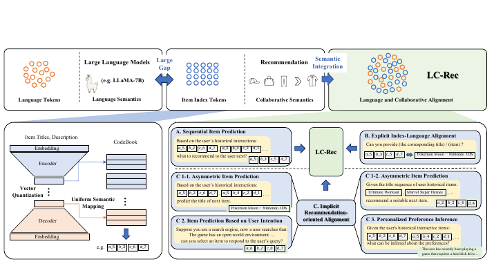
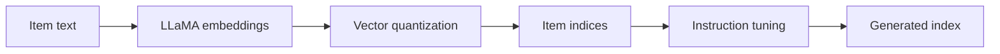

# LC-Rec

*Adapting large language models by integrating collaborative semantics for recommendation* — Zheng et al. · ICDE’24

`III. SID–Model Alignment` · `Training`

[Paper](https://arxiv.org/abs/2311.09049) · [Code](https://github.com/RUCAIBox/LC-Rec/) · [Matrix](../../README.md#iii--training)

Reading level: Reading Notes (Level 2) · On this page: [TL;DR](#tldr) · [At a Glance](#at-a-glance) · [1. Why This Paper Matters](#1-why-this-paper-matters) · [2. How It Works](#2-how-it-works) · [3. Experimental Findings](#3-experimental-findings) · [4. Limitations & Critical Analysis](#4-limitations--critical-analysis) · [5. Connections to Related Work](#5-connections-to-related-work)

| Representation | Tokenization | Backbone | Training | Inference |
| :-: | :-: | :-: | :-: | :-: |
| `Text` | `RQ-VAE` | `Dec-Only` | **`Fixed / Multi-task NTP`** | `Beam` |

- `Dec-Only`: Decoder-only.
- `Fixed`: SIDs are built first and not changed while the generator trains.
- `Multi-task NTP`: The same NTP loss over several tasks.

### TL;DR

LC-Rec assigns non-conflicting item indices by vector quantization with uniform semantic mapping and tunes an LLM with alignment tasks, so it generates items from the whole catalog without candidate lists.

### At a Glance

| Aspect | Summary |
| :-- | :-- |
| Research Problem | III. SID–Model Alignment: Can the generator read, write, and reason over SIDs, and do the tokenizer and generator work toward the same goal? |
| Key Contribution | LC-Rec assigns non-conflicting item indices by vector quantization with uniform semantic mapping and tunes an LLM with alignment tasks, so it generates items from the whole catalog without candidate lists. |
| Modified Stage | Training |
| Limitation | The item indices come from text embeddings only, so collaborative semantics enter only through the tuning tasks (Sec. III-B). |

### 1. Why This Paper Matters

Items in recommender systems are often indexed by IDs outside the vocabulary of a large language model (LLM), which leaves a semantic gap between the two (Abstract).

> "In essence, LLMs capture language semantics while recommender systems imply collaborative semantics, making it difficult to sufficiently leverage the model capacity of LLMs for recommendation." (Abstract)

Based on arXiv v4.

### 2. How It Works

*Figure source: Fig. 1, original paper.*

#### Item Indexing

LC-Rec encodes item text with LLaMA and quantizes the embeddings (Sec. III-B). Uniform semantic mapping redistributes the last-level codewords of items that would otherwise share an index (Sec. III-B2).

#### Alignment Tuning

Sequential item prediction is the main objective (Sec. III-C1). Two explicit tasks map titles or descriptions to indices and back (Sec. III-C2). Implicit tasks add asymmetric item prediction, intention-based prediction, and preference inference (Sec. III-C3).

> "On the one hand, the LLM should be capable of accurately identifying the item indices based on the associated title or description. On the other hand, it is expected that LLM can naturally capture relevant item information from its indices." (Sec. III-C2)

#### Training

All tasks are formatted as conditional language generation for one instruction-tuned model (Sec. III-D).

> "To this end, we employ LLaMA [25] as our backbone model and then optimize it via instruction tuning." (Sec. III-D)

### 3. Experimental Findings

**Experimental setup**

- **Datasets**: Amazon Reviews (May 1996-October 2018): Musical Instruments, Arts Crafts and Sewing, Video Games; users and items with fewer than 5 interactions are filtered; sequences capped at 20 items. Sizes (users / items / interactions): Instruments 24,773 / 9,923 / 206,153; Arts 45,142 / 20,957 / 390,832; Games 50,547 / 16,860 / 452,989.
  - Source: Amazon 2018 subsets, 5-interaction filter, length 20: https://arxiv.org/html/2311.09049v4#S4.SS1.SSS1.p1; statistics: https://arxiv.org/html/2311.09049v4#S4.T2.
- **Split**: Per-user leave-one-out: most recent item for test, second most recent for validation, the rest for training.
  - Source: Leave-one-out allocation: https://arxiv.org/html/2311.09049v4#S4.SS1.SSS3.p1.
- **Candidates**: full catalog (full ranking over the entire item set instead of sampled evaluation). Separate analysis (Table 5): choose between the target and one negative that is language-similar, collaborative-similar (by SASRec embeddings), or random; history exclusion for these negatives not reported.
  - Source: Full ranking over the entire item set: https://arxiv.org/html/2311.09049v4#S4.SS1.SSS3.p1; separate pairwise test with one negative: https://arxiv.org/html/2311.09049v4#S4.SS4.SSS0.Px3.p1.
- **Visibility**: warm; no unseen-item protocol is defined.
  - Source: Standard split with no unseen-item protocol: https://arxiv.org/html/2311.09049v4#S4.SS1.SSS3.p1.
- **SID**: 4-level RQ-VAE x 256 codewords (dimension 32) over mean-pooled LLaMA embeddings of title and description, added to the LLaMA tokenizer as new tokens. Conflicts are resolved without an extra suffix level: the last-level codewords of each conflicting group are redistributed under a uniform-distribution constraint.
  - Source: 4 levels x 256 x 32 over LLaMA text embeddings: https://arxiv.org/html/2311.09049v4#S4.SS1.SSS4.p1; uniform last-level redistribution for conflicts: https://arxiv.org/html/2311.09049v4#S3.SS2.SSS2.p2 and https://arxiv.org/html/2311.09049v4#S3.SS2.SSS2.p3.
- **Inference budget**: Beam search with beam size 20 for all generative methods; tokens leading to invalid item indices get zero probability. LLaMA backbone with DeepSpeed; hardware, inference batch size, and latency: not reported. HR and NDCG at 1, 5, 10.
  - Source: Beam size 20 and invalid-token masking: https://arxiv.org/html/2311.09049v4#S4.SS1.SSS3.p1 and https://arxiv.org/html/2311.09049v4#S3.SS4.SSS2.p1.
- **Results from**: Table 3 (Instruments, Arts, Games; LC-Rec averaged over instruction templates); Table 4 (alignment-task ablation); Table 5 (similar-negative ranking accuracy).
  - Source: Main: https://arxiv.org/html/2311.09049v4#S4.T3; ablation: https://arxiv.org/html/2311.09049v4#S4.T4; negative-item analysis: https://arxiv.org/html/2311.09049v4#S4.T5.

- Main comparison: LC-Rec outperforms traditional recommenders and existing LLM-based recommenders (Abstract).

### 4. Limitations & Critical Analysis

**Our analysis.**

- TIGER uses the same `RQ-VAE` codes with an `Enc-Dec` generator; LC-Rec uses a `Dec-Only` LLM trained with `Multi-task NTP`.

### 5. Connections to Related Work

- **Competitor** · [TIGER](tiger.md): TIGER resolves leaf conflicts with an extra index level and uses a small seq2seq model; LC-Rec redistributes conflicting last-level codes uniformly and tunes LLaMA with language-collaborative alignment tasks.
  - Source: LC-Rec v4, conflict discussion: https://arxiv.org/html/2311.09049v4#S3.SS2.SSS2.p1; baselines and Table 3: https://arxiv.org/html/2311.09049v4#S4.I1.i10.p1 and https://arxiv.org/html/2311.09049v4#S4.T3.
- **Competitor** · [CID](cid.md): P5-CID builds collaborative indices and also adds a supplementary index for conflicts; LC-Rec learns semantic RQ indices from LLM text embeddings.
  - Source: LC-Rec v4, conflict discussion: https://arxiv.org/html/2311.09049v4#S3.SS2.SSS2.p1; baselines and Table 3: https://arxiv.org/html/2311.09049v4#S4.I1.i9.p1 and https://arxiv.org/html/2311.09049v4#S4.T3.
- **Predecessor** · [VQ-Rec](vq-rec.md): LC-Rec borrows the idea of learned semantic indices from VQ-Rec and TIGER, then adapts it for LLM tuning.
  - Source: LC-Rec v4, Section 3.2.1: https://arxiv.org/html/2311.09049v4#S3.SS2.SSS1.p1 and https://arxiv.org/html/2311.09049v4#S3.SS2.SSS1.p4.
- **Alternative** · [TransRec](transrec.md): TransRec also builds LLM-based generative recommendation with multi-facet identifiers; LC-Rec uses learned VQ indices with alignment tuning.
  - Source: LC-Rec v4, Section 2.2 and Section 3.5 related work: https://arxiv.org/html/2311.09049v4#S2.SS2.p3 and https://arxiv.org/html/2311.09049v4#S3.SS5.p3.

[View all papers in this cell](../../README.md#iii--training)
