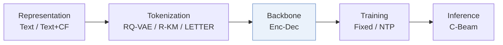
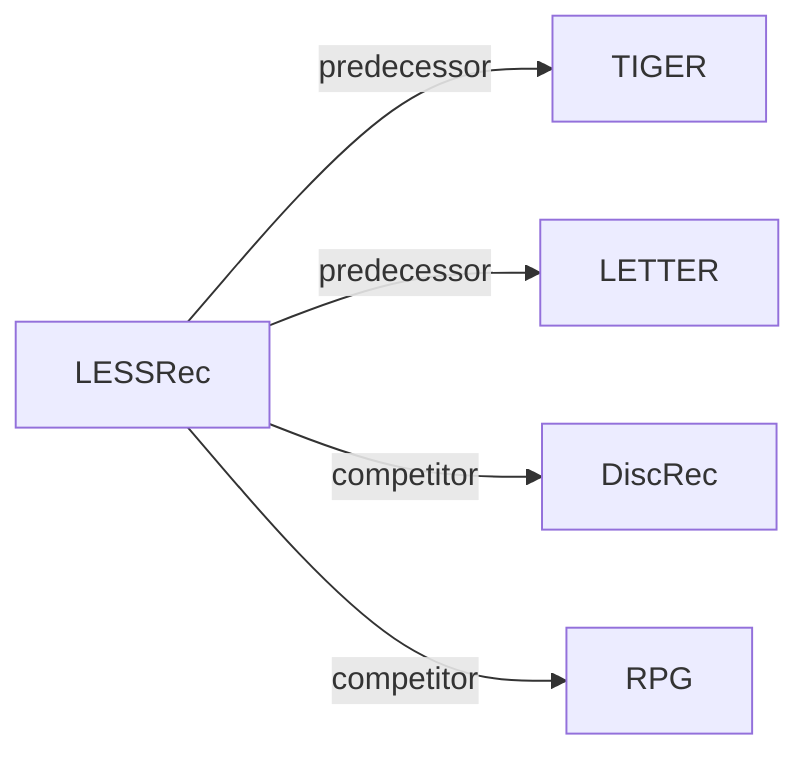

# LESSRec

*Level-Specific History Modeling for Semantic ID-Based Recommendation* — Yang et al. · arXiv’26

`III. SID–Model Alignment` · `Backbone` · [Paper](https://arxiv.org/abs/2610.37286) · [Matrix](../../README.md#iii--backbone) · [中文](../zh/papers/lessrec.md)

Reading level: Overview (Level 1) · On this page: [TL;DR](#tldr) · [At a Glance](#at-a-glance) · [3. Experiments](#3-experimental-findings) · [5. Related Work](#5-connections-to-related-work)

- `Text / Text+CF`: Text-only representations or text representations combined with collaborative signals.
- `RQ-VAE / R-KM / LETTER`: RQ-VAE, residual k-means, or LETTER tokenization in different configurations.
- `Enc-Dec`: Encoder-decoder.
- `Fixed`: SIDs are built first and not changed while the generator trains.
- `NTP`: Next-token prediction loss only; continuing from a pretrained LLM (SFT) also counts as NTP.
- `C-Beam`: Constrained beam search.

### TL;DR

> [!NOTE]

> LESSRec encodes the history separately at each Semantic ID level and restricts attention to the target token's level, adding an item-level semantic sequence, instead of attending to all levels.

### At a Glance

| Aspect | Summary |
| :-- | :-- |
| Research Problem | III. SID–Model Alignment: Can the generator read, write, and reason over SIDs, and do the tokenizer and generator work toward the same goal? |
| Key Contribution | LESSRec encodes the history separately at each Semantic ID level and restricts attention to the target token's level, adding an item-level semantic sequence, instead of attending to all levels. |
| Modified Stage | Backbone |

### 3. Experimental Findings

Experimental setup

- **Datasets**: Amazon Reviews 2023 Games/Software and earlier Amazon Beauty; iterative user/item 5-core filtering; histories capped at 20 items.
  - Source: Section 4.1.1: [S4.SS1.SSS1.p1](https://arxiv.org/html/2610.37286v1#S4.SS1.SSS1.p1)
- **Split**: Leave-one-out; exact validation/test allocation not reported.
  - Source: Section 4.1.3: [S4.SS1.SSS3.p1](https://arxiv.org/html/2610.37286v1#S4.SS1.SSS3.p1)
- **Candidates**: not reported
  - Source: Section 4.1.3 specifies a shared candidate index but not full-catalog versus sampled evaluation: [S4.SS1.SSS3.p1](https://arxiv.org/html/2610.37286v1#S4.SS1.SSS3.p1)
- **Visibility**: warm; no unseen-item protocol is defined. LETTER uses SASRec collaborative embeddings; its exposure to test items is not reported.
  - Source: Sections 4.1.3/4.1.4 define no item holdout: [S4.SS1.SSS3.p1](https://arxiv.org/html/2610.37286v1#S4.SS1.SSS3.p1) and [S4.SS1.SSS4.p1](https://arxiv.org/html/2610.37286v1#S4.SS1.SSS4.p1)
- **SID**: RQ-VAE, RQ-Kmeans, or LETTER: 4 levels x 256 codes, fixed offline; Sentence-T5 text embeddings. RQ-Kmeans uses trainable conditional subcodebooks. Collision handling not reported.
  - Source: Section 4.1.4 and Appendix B.2: [S4.SS1.SSS4.p1](https://arxiv.org/html/2610.37286v1#S4.SS1.SSS4.p1) and [A2.SS2.p2](https://arxiv.org/html/2610.37286v1#A2.SS2.p2)
- **Inference budget**: Trie-constrained beam 10; batch 32; single RTX 4090 24GB; K=5/10. End-to-end latency not reported; Figure 6 measures encoder CUDA time per sample.
  - Source: Sections 4.1.5/4.6 and Figure 6: [S4.SS1.SSS5.p1](https://arxiv.org/html/2610.37286v1#S4.SS1.SSS5.p1) and [S4.F6](https://arxiv.org/html/2610.37286v1#S4.F6)
- **Results from**: Original Table 2: three-seed comparisons across tokenizers; baselines implemented using official code or RecBole. Table 6 reports training costs, not inference latency.
  - Source: Section 4.1.5 and Tables 2/6: [S4.SS1.SSS5.p1](https://arxiv.org/html/2610.37286v1#S4.SS1.SSS5.p1) and [S4.T2](https://arxiv.org/html/2610.37286v1#S4.T2) and [S4.T6](https://arxiv.org/html/2610.37286v1#S4.T6)

### 5. Connections to Related Work

- **前序工作** · [TIGER](tiger.md): LESSRec reorganizes TIGER's history encoding by semantic level.
  - Source: LESSRec v1, Section 4.1.2 and Table 2: https://arxiv.org/html/2610.37286v1#S4.SS1.SSS2.p1; https://arxiv.org/html/2610.37286v1#S4.T2.
- **前序工作** · [LETTER](letter.md): LETTER supplies one of the three fixed tokenizers tested with LESSRec.
  - Source: LESSRec v1, Section 4.1.4 and Table 2: https://arxiv.org/html/2610.37286v1#S4.SS1.SSS4.p1; https://arxiv.org/html/2610.37286v1#S4.T2.
- **同期对比** · [DiscRec](discrec.md): DiscRec models intra-item structure; LESSRec separates same-level histories across items.
  - Source: LESSRec v1, Section 5.3 and Table 2: https://arxiv.org/html/2610.37286v1#S5.SS3.p1; https://arxiv.org/html/2610.37286v1#S4.T2.
- **同期对比** · [RPG](rpg.md): RPG predicts long unordered codes in parallel; LESSRec models hierarchical level-specific histories.
  - Source: LESSRec v1, Section 4.1.2 and Table 2: https://arxiv.org/html/2610.37286v1#S4.SS1.SSS2.p1; https://arxiv.org/html/2610.37286v1#S4.T2.

[查看同格全部论文](../../README.md#iii--backbone)
