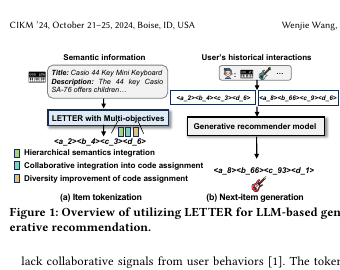

# LETTER: Learnable item tokenization for generative recommendation

[Back to Catalog](../../README.md) · [Paper (`https://arxiv.org/abs/2405.07314`)](https://arxiv.org/abs/2405.07314) · [Source Record (`data/papers/letter.yaml`)](../../data/papers/letter.yaml)

> **Summary**: Abstract: "shortcomings in encoding semantic information, incorporating collaborative signals, or handling code assignment bias".

## Taxonomy & Table 1 Specification

| Field | Value | Vocabulary Definition |
| :--- | :--- | :--- |
| **Authors & Year** | Wang et al. (2024) | Published / posted in `CIKM’24` |
| **Problem Band** | `I. Informativeness` | Do the SIDs, or the model reading them, carry the collaborative and multimodal signals recommendation needs? |
| **Primary Stage** | `Tokenization` | The primary design change sits in the Tokenization stage. |
| **Representation** | `Text+CF` |  |
| **Tokenization** | `Learn. RQ` |  |
| **Backbone** | `Enc-Dec` | Encoder-decoder. |
| **Tokenizer Training** | `Fixed` | SIDs are built first and not changed while the generator trains. |
| **Training Objective** | `NTP + Rank` | NTP plus a ranking loss. |
| **Inference Decoding** | `C-Beam` | Constrained beam search. |
| **POI / Local-Life** | `false` | Point-of-interest / geographic recommendation indicator |
| **Code Repository** | [`https://github.com/Honghuibao2000/LETTER`](https://github.com/Honghuibao2000/LETTER) | Official or public implementation link |

## Architecture

## Verbatim Evidence & Rationale

- **`problem`** (arXiv abstract): Abstract: "shortcomings in encoding semantic information, incorporating collaborative signals, or handling code assignment bias".

## 旧卡片说明

迁自 `d61aa6c:papers/letter.md`。保留方法说明、实验叙述与局限；本轮只对照现有记录处理明确冲突，未重新逐句核查原论文。分类和规格以页面上方由记录生成的表格为准。

### LETTER：生成式推荐的可学习物品分词

> LETTER 通过层次语义、协同信号和码分配多样性三个目标学习更适合生成推荐的物品标识。

### 研究动机与问题定义

普通文本或码本 ID 可能缺乏层次语义、协同关系，且容易产生码分配偏置。LETTER 设计可学习 tokenizer，使 token 序列同时服务于语义表达和生成可辨识性。

### TL;DR（核心摘要）

`物品语义与协同表示 → RQ-VAE/LETTER → 生成模型 → 物品标识 → 推荐物品`

LETTER 在 RQ-VAE 基础上加入语义正则、协同正则和多样性正则：前两者约束码的内容与行为信息，后一项缓解高频码偏置。标识被用于生成模型的 next-item 预测，生成结果直接映射物品。

### 输入与使用场景

| 方面 | 说明 |
|---|---|
| 使用信息 | 物品语义、用户交互和协同表示 |
| 信息融入位置 | tokenizer 学习目标与生成输入 |
| 语义标识结构 | 层次化离散序列 |
| 适用场景 | 常规生成式推荐 |

### 方法设计

#### 3.1 LETTER tokenizer
LETTER 基于 RQ-VAE 学习层次化物品 token，并在码本训练中加入三类正则。语义正则使 token 保留内容层次，协同正则把交互结构引入 code assignment，多样性正则缓解高频码和生成偏置。

#### 3.2 生成推荐实例化
训练时，用户历史物品被替换为 LETTER 标识，生成器自回归预测下一物品标识。tokenizer 与生成推荐模型可以分别训练，再把学习到的标识用于不同生成骨干。

#### 3.3 标识偏置分析
论文从层次语义、协同信号、码分配和生成分布分析 LETTER。实验还研究正则权重、码本规模、标识长度和不同生成模型，以验证标识质量不是单一性能数字造成的。

#### 3.4 相关扩展
论文通过协同表示对齐、码使用率和误差案例分析 LETTER 相比普通文本/码本标识的差异。

### 实验结论

- LETTER 在多个数据集上优于既有物品 tokenization 方法。
- 三类正则分别改善语义、协同和码分配特性。

### 局限性与研究定位

#### 局限性
- tokenizer 需要离线更新，动态目录支持有限。
- 正则权重与码本规模会影响稳定性和生成效率。

#### 研究定位
LETTER 的贡献是明确提出面向生成推荐的三目标物品分词器，适合放在“可学习语义标识构建”章节。

### 相关资源

- [开源代码](https://github.com/Honghuibao2000/LETTER)

### 标签

`可学习分词` · `层次化语义` · `协同信号` · `生成式推荐`

### 架构图来源

*图源：原论文，图1。图片使用许可待核实。*

---

### 旧总表补充

来源：`d61aa6c:tables/all-methods.md`。

- 核心贡献：联合语义、协同和码多样性。
- 使用场景：生成式推荐。

## Peer Methods in `I. Informativeness` × `Tokenization` (33 peers)

| Method | Venue | Representation | Tokenization | Backbone | Tokenizer | Objective | Inference |
| :--- | :--- | :--- | :--- | :--- | :--- | :--- | :--- |
| [CoST](cost.md) | RecSys’24 | `Text` | `C-RQ` | `Enc-Dec` | `Fixed` | `NTP` | `Beam` |
| [LMIndexer](lmindexer.md) | ICML’24 | `Text` | `Self-Sup. ID` | `Enc-Dec` | `Fixed` | `NTP` | `C-Beam` |
| [ActionPiece](actionpiece.md) | ICML’25 | `Text` | `OPQ` | `Enc-Dec` | `Fixed` | `NTP` | `Ensemble` |
| [ADC-SID](adc-sid.md) | arXiv’25 | `Text+Img+CF` | `MoE-VQ` | `Enc-Dec` | `Fixed†` | `NTP` | `–` |
| [DAS](das.md) | CIKM’25 | `Text+CF` | `Dual RQ` | `Enc-Dec` | `Fixed` | `NTP` | `Beam` |
| [EAGER-LLM](eager-llm.md) | WWW’25 | `Text+CF` | `Dual H-KM` | `Dec-Only` | `Fixed` | `Multi-task NTP` | `Beam` |
| [FlexCode](flexcode.md) | arXiv’25 | `Text+CF` | `Dual RQ-VAE` | `–` | `Joint` | `NTP` | `–` |
| [GenSAR](gensar.md) | RecSys’25 | `Text+CF` | `Shared/Spec. RQ` | `Enc-Dec` | `Fixed` | `Multi-task NTP` | `C-Beam` |
| [GNPR-SID](gnpr-sid.md) | KDD’25 | `Attr+Geo+CF` | `RQ-VAE` | `Dec-Only` | `Fixed` | `NTP` | `–` |
| [GRAM](gram.md) | ACL’25 | `Text+CF` | `H-KM` | `Enc-Dec` | `Fixed` | `NTP` | `C-Beam` |
| [KGTB](kgtb.md) | arXiv’25 | `Attr+Geo+CF` | `KG-RQ` | `Dec-Only` | `Fixed` | `Multi-task NTP` | `–` |
| [MME-SID](mme-sid.md) | CIKM’25 | `Text+Img+CF` | `MM-RQ` | `Dec-Only` | `Fixed` | `NTP` | `Scoring` |
| [MQL4GRec](mql4grec.md) | ICLR’25 | `Text+Img` | `Dual RQ` | `Enc-Dec` | `Fixed` | `Multi-task NTP` | `Beam` |
| [PSRQ](psrq.md) | CIKM’25 | `Text+Img` | `Prog. RQ` | `Encoder` | `Fixed` | `Discrim.` | `Scoring` |
| [QT-Mob](qt-mob.md) | KDD’25 | `Text+Geo` | `RQ-VAE` | `Dec-Only` | `Fixed` | `Multi-task NTP` | `C-Beam` |
| [TokenRec](tokenrec.md) | TKDE’25 | `CF` | `Masked VQ` | `Encoder` | `Fixed` | `Discrim.` | `Scoring` |
| [CapsID](capsid.md) | arXiv’26 | `Text+CF` | `Soft-RQ` | `Dec-Only` | `Fixed` | `NTP` | `C-Beam` |
| [ChronoID](chronoid.md) | arXiv’26 | `Text+Time` | `RQ-VAE / Par. VQ` | `Dec-Only†` | `Fixed` | `NTP` | `Beam†` |
| [GrIS (RecDMoN / RQ-GAE)](gris-recdmon-rq-gae.md) | CIKM’26 | `Text+CF` | `RecDMoN / RQ-VAE` | `Enc-Dec` | `Fixed` | `–` | `–` |
| [MACRec](macrec.md) | AAAI’26 | `Text+Img` | `Cross RQ` | `Enc-Dec` | `Fixed` | `NTP + Ctr.` | `C-Beam` |
| [MMGRec](mmgrec.md) | TOMM’26 | `Text+Img+CF` | `Graph RQ-VAE` | `Enc-Dec` | `Fixed` | `NTP` | `C-Beam` |
| [MMQ](mmq.md) | WSDM’26 | `Text+Img` | `MoE-VQ` | `HeterRec` | `Joint` | `MTP` | `–` |
| [MSCGRec](mscgrec.md) | arXiv’26 | `Text+Img+CF` | `RQ-VAE+DINO` | `Enc-Dec` | `Fixed†` | `NTP` | `Trie/C-Beam` |
| [PCR-CA](pcr-ca.md) | KDD’26 | `Text+CF` | `PC-AE` | `Disc.` | `Joint` | `Discrim.` | `Scoring` |
| [Pctx](pctx.md) | CIKM’26 | `Text+CF` | `RQ` | `Enc-Dec` | `Fixed` | `NTP` | `Beam+Agg.` |
| [ProGEO](progeo.md) | arXiv’26 | `Text+Geo` | `R-KM+Geo-CB` | `Dec-Only` | `Fixed` | `NTP` | `Beam+Geo-Filter` |
| [RoFiGR](rofigr.md) | arXiv’26 | `Text+Img+CF` | `CF-Aligned MM RQ` | `Enc-Dec` | `Fixed` | `NTP + Aux.` | `C-Beam` |
| [ROS](ros.md) | ACL’26 | `Text+Geo` | `Geo-Prefix+RQ-VAE` | `Dec-Only` | `Fixed` | `NTP → RL` | `CoT+C-Beam` |
| [SPRIG](sprig.md) | CIKM’26 Short | `Text / Audio` | `R-KM` | `Dec-Only` | `Fixed` | `NTP` | `Div. Beam` |
| [Tlow](tlow.md) | CIKM’26 Applied | `Text` | `Flow+PQ` | `Non-AR` | `Fixed` | `MTP + Rel.MSE` | `Scoring` |
| [UniRec](unirec.md) | arXiv’26 | `Text+CF` | `RQ` | `Dec-Only` | `Fixed` | `NTP → DPO` | `C-Beam` |
| [UniSID](unisid.md) | arXiv’26 | `Text+Img+Attr` | `Direct SID Heads` | `–` | `–` | `–` | `–` |
| [VarLenRec (TIGER)](varlenrec-tiger.md) | arXiv’26 | `Text` | `HARQ` | `Enc-Dec` | `Fixed` | `NTP + Aux.` | `C-Beam` |
