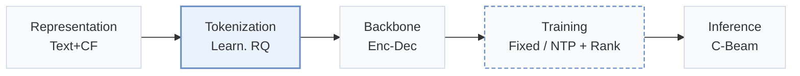
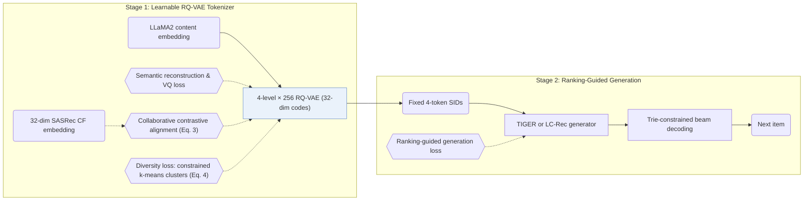
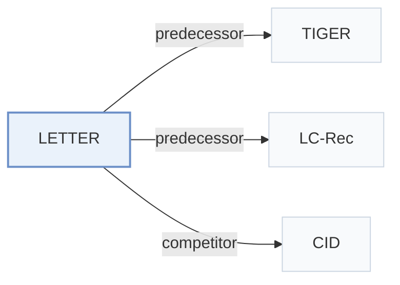

# LETTER

[← Problem × Stage Matrix](../../README.md#i--tokenization) · [Papers by Stage](../index/stages.md) · [Papers by Modality](../index/modality.md) · English | [中文](../zh/papers/letter.md)

| **Title** | *Learnable item tokenization for generative recommendation* |
| :-- | :-- |
| **Authors** | Wang et al. |
| **Venue** | CIKM’24 |
| **Problem × Stage** | `I. Informativeness` · `Tokenization` — Also: `II. Uniqueness and Validity` × `Tokenization`; `Training` |
| **Links** | [Paper](https://arxiv.org/abs/2405.07314) · [Code](https://github.com/HonghuiBao2000/LETTER) |
| **Reading level** | Reading Notes (Level 2) |

**On this page**: [TL;DR](#tldr) · [At a Glance](#at-a-glance) · [1. Why It Matters](#1-why-this-paper-matters) · [2. Method](#2-how-it-works) · [3. Experiments](#3-experimental-findings) · [4. Limitations](#4-limitations--critical-analysis) · [5. Related Work](#5-connections-to-related-work)

- `Text+CF`: Text representations combined with collaborative signals.
- `Learn. RQ`: End-to-end or alternatingly updated learnable residual quantization.
- `Enc-Dec`: Encoder-decoder.
- `Fixed`: SIDs are built first and not changed while the generator trains.
- `NTP + Rank`: NTP plus a ranking loss.
- `C-Beam`: Constrained beam search.

### TL;DR

> [!NOTE]
> LETTER regularizes an RQ-VAE tokenizer with a collaborative alignment loss and a diversity loss, so that item Semantic IDs carry collaborative signals and reduce code assignment bias found in earlier identifiers.

---

### At a Glance

| Aspect | Summary |
| :-- | :-- |
| Research Problem | I. Informativeness: Do the SIDs, or the model reading them, carry the collaborative and multimodal signals recommendation needs? |
| Key Contribution | LETTER regularizes an RQ-VAE tokenizer with a collaborative alignment loss and a diversity loss, so that item Semantic IDs carry collaborative signals and reduce code assignment bias found in earlier identifiers. |
| Modified Stage | Tokenization |
| Key Findings | On Instruments, LETTER-TIGER reports Recall@10 of 0.1122 against 0.1058 for TIGER, and adding either regularization alone also improves TIGER (Table 2). |
| Limitation | The collaborative regularization needs embeddings from a separately trained CF model (Sec. 3.1). |

---

### 1. Why This Paper Matters

Earlier item identifiers—plain IDs, raw text, or unregularized codebook codes—fall short in encoding semantics, carrying collaborative signals, or mitigating code assignment bias. LETTER regularizes an RQ-VAE tokenizer along all three axes and plugs the resulting 4-level Semantic IDs (SIDs) into two generative backbones, TIGER and LC-Rec (Sec. 4.1.3).

> "LETTER incorporates Residual Quantized VAE for semantic regularization, a contrastive alignment loss for collaborative regularization, and a diversity loss to mitigate code assignment bias." (Abstract)

---

### 2. How It Works

#### Semantic Regularization

An RQ-VAE quantizes each item's content embedding across 4 residual levels with 256 codewords of dimension 32 per level, preserving a coarse-to-fine semantic hierarchy (Sec. 3.1, Sec. 4.1.4).

#### Collaborative Regularization

A contrastive alignment loss pulls each item's quantized residual embedding toward its embedding from a pre-trained collaborative filtering (CF) model (Sec. 3.1, Eq. 3). The paper names SASRec and LightGCN as candidate CF teachers and uses 32-dimensional SASRec embeddings in the experiments (Sec. 3.1, Sec. 4.1.3).

> "Intuitively, collaborative regularization encourages items with similar collaborative interactions to exhibit similar code sequences." (Sec. 3.1)

#### Diversity Regularization

A diversity loss clusters codebook embeddings via constrained k-means, pulling embeddings within the same cluster together while pushing distinct clusters apart (Sec. 3.1, Eq. 4). This regularizer counteracts code assignment bias—where popular codes absorb disproportionately many items—and downstream item generation bias (Sec. 1).

> "As illustrated in Figure 5(a), a biased code embedding distribution is more likely to cause biased code assignment in the latent space, where some codes are assigned to more items." (Sec. 3.1)

#### Training and Generation

LETTER trains the RQ-VAE tokenizer with the combined semantic, collaborative, and diversity loss (Eq. 5), then freezes the resulting item SIDs for generator training and inference (Sec. 3.2). During generator training, a ranking-guided generation loss sharpens relative scores among hard negative SIDs (Abstract, Sec. 1). At inference, a prefix trie restricts beam search to valid catalog identifiers.

> "To ensure generating valid identifiers, we follow (Hua et al., 2023) to employ constrained generation (De Cao et al., 2020) via Trie" (Sec. 3.2.2)

---

### 3. Experimental Findings

Experimental setup

- **Datasets**: Amazon Instruments, Amazon Beauty, and Yelp; users and items with fewer than 5 interactions are discarded. Dataset release/date windows and retained corpus sizes are not reported.
  - Source: Dataset names and explicit filtering of both users and items: [S4.SS1.SSS1.p1](https://arxiv.org/html/2405.07314v1#S4.SS1.SSS1.p1).
- **Split**: Chronological interaction histories with leave-one-out evaluation; training histories contain at most 20 items. The exact validation/test position allocation is not reported beyond the leave-one-out label.
  - Source: Leave-one-out and the 20-item training-history cap: [S4.SS1.SSS1.p1](https://arxiv.org/html/2405.07314v1#S4.SS1.SSS1.p1); chronological histories: [S3.SS2.SSS1.p1](https://arxiv.org/html/2405.07314v1#S3.SS2.SSS1.p1). Methods/Experiments and Appendix 7 do not spell out the exact validation-versus-test position allocation beyond naming leave-one-out.
- **Candidates**: not reported (full catalog versus sampled evaluation candidates); generation is constrained to valid identifier continuations with a trie.
  - Source: Inference defines trie-constrained generation, but not full-catalog versus sampled-negative evaluation: [S3.SS2.SSS2.p1](https://arxiv.org/html/2405.07314v1#S3.SS2.SSS2.p1); evaluation states only metrics: [S4.SS1.SSS3.p1](https://arxiv.org/html/2405.07314v1#S4.SS1.SSS3.p1); Methods/Experiments and Appendix 7 were checked.
- **Visibility**: Standard leave-one-out evaluation; per-target generator/tokenizer training visibility is not reported. The tokenizer uses item content and SASRec collaborative embeddings before generator training, but inclusion of held-out-only items in tokenizer/CF training is not reported. A dedicated cold-start evaluation is not reported.
  - Source: Tokenizer training precedes generator training: [S3.SS2.p1](https://arxiv.org/html/2405.07314v1#S3.SS2.p1); LLaMA2 content embeddings and SASRec collaborative embeddings: [S4.SS1.SSS4.p1](https://arxiv.org/html/2405.07314v1#S4.SS1.SSS4.p1); leave-one-out: [S4.SS1.SSS1.p1](https://arxiv.org/html/2405.07314v1#S4.SS1.SSS1.p1). Methods/Experiments and Appendix 7 give no item-disjoint cold-start experiment or explicit tokenizer/CF visibility for held-out-only items.
- **SID**: Main configuration: 4 residual-quantization levels x 256 codewords, with 32-dimensional code embeddings; the identifier contains 4 learned codes. Collision handling or an additional collision suffix: not reported.
  - Source: Four levels, 256 entries each, and 32-dimensional embeddings: [S4.SS1.SSS4.p2](https://arxiv.org/html/2405.07314v1#S4.SS1.SSS4.p2); L is the identifier length: [S3.SS1.p4](https://arxiv.org/html/2405.07314v1#S3.SS1.p4). Methods/Experiments and Appendix 7 do not specify collision resolution or an additional disambiguation suffix; the four learned levels must not be replaced by TIGER's three levels plus suffix.
- **Inference budget**: Trie-constrained autoregressive generation; numerical beam width not reported. Recall and NDCG at K=5 and 10. All experiments use 4 NVIDIA RTX A5000 GPUs; allocation specifically for inference is not reported. Inference batch size and measured latency: not reported.
  - Source: Trie-constrained autoregressive generation: [S3.SS2.SSS2.p1](https://arxiv.org/html/2405.07314v1#S3.SS2.SSS2.p1); metric cutoffs: [S4.SS1.SSS3.p1](https://arxiv.org/html/2405.07314v1#S4.SS1.SSS3.p1); experiment hardware: [S4.SS1.SSS4.p1](https://arxiv.org/html/2405.07314v1#S4.SS1.SSS4.p1). Methods/Experiments and Appendix 7 specify no beam width, inference batch, or measured latency; the 1,024 batch in [S4.SS1.SSS4.p2](https://arxiv.org/html/2405.07314v1#S4.SS1.SSS4.p2) is tokenizer training, not inference.
- **Results from**: Original paper Table 1, with separate LETTER-TIGER and LETTER-LC-Rec rows on Instruments, Beauty, and Yelp. The authors reimplement TIGER and instantiate LC-Rec with LoRA-tuned LLaMA2-7B; these are this paper's experimental configurations, not the original TIGER paper's results.
  - Source: Original main table and model instantiations: [S4.T1](https://arxiv.org/html/2405.07314v1#S4.T1) and [S4.SS2.p1](https://arxiv.org/html/2405.07314v1#S4.SS2.p1); TIGER reimplementation and LC-Rec/LoRA setup: [S4.SS1.SSS4.p1](https://arxiv.org/html/2405.07314v1#S4.SS1.SSS4.p1).

- Main results: plugging LETTER into TIGER (LETTER-TIGER) and LoRA-tuned LLaMA2-7B LC-Rec (LETTER-LC-Rec) improves Recall and NDCG@5/10 over both backend models across Amazon Instruments, Amazon Beauty, and Yelp (Sec. 4.2, Table 1).
- Regularization ablation: adding either collaborative regularization or diversity regularization alone improves over TIGER, and combining both with the ranking-guided loss yields the highest scores (Sec. 4.3.1, Table 2).
- Code usage trade-off: collaborative alignment compresses items into fewer active codes (dropping from 148 to 76), whereas diversity regularization restores codebook coverage (Sec. 4.3.2, Fig. 6).

  > "Although adding collaborative regularization decreases the code utilization of TIGER (from 148 to 76), integrating diversity regularization inversely compensates for the drop in code utilization." (Sec. 4.3.2)

- Collaborative similarity preservation: code-sequence similarity under LETTER correlates more closely with CF similarity than unregularized RQ-VAE codes (Sec. 4.3.4, Tables 3 and 4).
- Hyperparameter sensitivity: varying identifier length $`L`$, codebook size $`N`$, loss weights $`\alpha`$ and $`\beta`$, cluster count $`K`$, and temperature $`\tau`$ shows that extending $`L`$ from 4 to 8 degrades accuracy due to autoregressive error accumulation (Sec. 4.3.5).

  > "Continuously increasing the identifier length from 4 to 8 will inversely degrade the performance. This is reasonable because autoregressive generation suffers from error accumulation (Ren et al., 2024b)." (Sec. 4.3.5)

  Enlarging the codebook size $`N`$ excessively also lowers accuracy by fitting noise in item content embeddings.

  > "However, 2) blindly expanding N might inversely hurt the performance, where larger codebook size might be more susceptible to noise in the item's semantic information, potentially leading to the over-fitting of some meaningless semantics." (Sec. 4.3.5)

---

### 4. Limitations & Critical Analysis

**Stated by the authors.** The conclusion outlines three directions for future work: incorporating richer multi-behavior signals into tokenization, extending learnable tokenization to cross-domain recommendation, and combining natural-language user instructions with tokenized interaction histories (Sec. 6).

**Our analysis.**

- The tokenizer is trained once and held fixed (`Fixed`), so catalog updates require re-running CF training and RQ-VAE optimization. ETEGRec instead alternates tokenizer and generator updates (`Altern.`), and DIGER backpropagates generator gradients directly into the tokenizer (`Joint`).
- Collaborative regularization requires a pre-trained CF embedding for every item, which suggests that cold-start items without prior interactions receive no collaborative signal in their SIDs.
- Because collaborative alignment shrinks active codebook usage from 148 to 76 while diversity regularization expands it (Sec. 4.3.2), the loss weights $`\alpha`$ and $`\beta`$ must balance collaborative grouping against uniform code allocation.

---

### 5. Connections to Related Work

- **Predecessor** · [TIGER](tiger.md): LETTER builds on TIGER's RQ-VAE semantic tokenization by adding collaborative and diversity regularization plus a ranking-guided generation loss.
  - Source: LETTER, Section 3.1: [S3.SS1.p6](https://arxiv.org/html/2405.07314v1#S3.SS1.p6); Section 4.3.1 defines the progression from TIGER to LETTER-TIGER: [S4.SS3.SSS1.p1](https://arxiv.org/html/2405.07314v1#S4.SS3.SSS1.p1).
- **Predecessor** · [LC-Rec](lc-rec.md): LC-Rec supplies an existing code-ID recommender with auxiliary language-alignment tasks; LETTER reuses it as a backend for its learnable tokenizer.
  - Source: LETTER, Section 4.1.2 describes LC-Rec: [S4.SS1.SSS2.p1](https://arxiv.org/html/2405.07314v1#S4.SS1.SSS2.p1); Section 4.1.4 explicitly instantiates LETTER on LC-Rec: [S4.SS1.SSS4.p1](https://arxiv.org/html/2405.07314v1#S4.SS1.SSS4.p1); Table 1 includes LC-Rec and LETTER-LC-Rec: [S4.T1](https://arxiv.org/html/2405.07314v1#S4.T1).
- **Competitor** · [CID](cid.md): LETTER compares against P5-CID, which builds identifiers by spectral clustering of an item co-appearance graph instead of LETTER's regularized RQ-VAE tokenization.
  - Source: LETTER, Section 4.1.2 identifies the P5-CID baseline from Hua et al.: [S4.SS1.SSS2.p1](https://arxiv.org/html/2405.07314v1#S4.SS1.SSS2.p1); Table 1 compares P5-CID with LETTER: [S4.T1](https://arxiv.org/html/2405.07314v1#S4.T1); Section 3.1 defines LETTER's RQ-VAE tokenizer: [S3.SS1.p2](https://arxiv.org/html/2405.07314v1#S3.SS1.p2).

[View all papers in this cell](../../README.md#i--tokenization)
