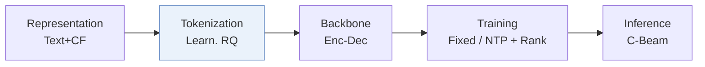
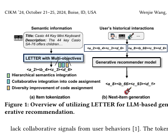
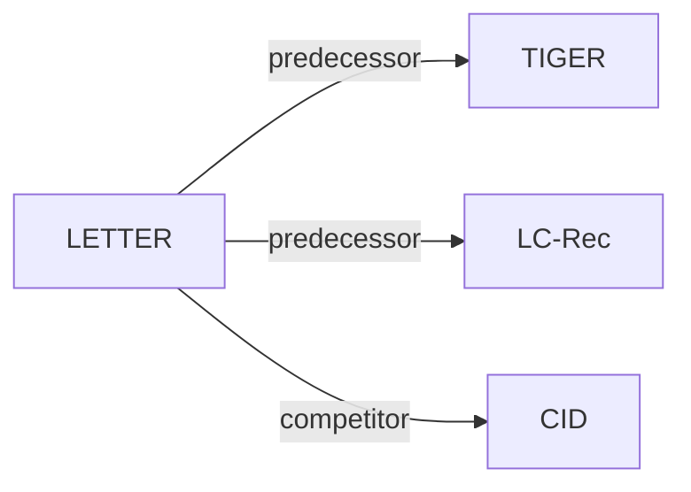

# LETTER

*Learnable item tokenization for generative recommendation* — Wang et al. · CIKM’24

`I. Informativeness` · `Tokenization` · [Paper](https://arxiv.org/abs/2405.07314) · [Code](https://github.com/HonghuiBao2000/LETTER) · [Matrix](../../README.md#i--tokenization) · [中文](../zh/papers/letter.md)

Reading level: Reading Notes (Level 2) · On this page: [TL;DR](#tldr) · [At a Glance](#at-a-glance) · [1. Why It Matters](#1-why-this-paper-matters) · [2. Method](#2-how-it-works) · [3. Experiments](#3-experimental-findings) · [4. Limitations](#4-limitations--critical-analysis) · [5. Related Work](#5-connections-to-related-work)

- `Enc-Dec`: Encoder-decoder.
- `Fixed`: SIDs are built first and not changed while the generator trains.
- `NTP + Rank`: NTP plus a ranking loss.
- `C-Beam`: Constrained beam search.

### TL;DR

> [!NOTE]

> LETTER regularizes an RQ-VAE tokenizer with a collaborative alignment loss and a diversity loss, so that item Semantic IDs carry collaborative signals and reduce code assignment bias found in earlier identifiers.

### At a Glance

| Aspect | Summary |
| :-- | :-- |
| Research Problem | I. Informativeness: Do the SIDs, or the model reading them, carry the collaborative and multimodal signals recommendation needs? |
| Key Contribution | LETTER regularizes an RQ-VAE tokenizer with a collaborative alignment loss and a diversity loss, so that item Semantic IDs carry collaborative signals and reduce code assignment bias found in earlier identifiers. |
| Modified Stage | Tokenization |
| Key Findings | On Instruments, LETTER-TIGER reports Recall@10 of 0.1122 against 0.1058 for TIGER, and adding either regularization alone also improves TIGER (Table 2). |
| Limitation | The collaborative regularization needs embeddings from a separately trained CF model (Sec. 3.1). |

### 1. Why This Paper Matters

Earlier item identifiers, whether plain IDs, text, or codebook codes, fall short in encoding semantics, carrying collaborative signals, or handling code assignment bias (Abstract). LETTER's Semantic IDs (SIDs) serve two generators, TIGER and LC-Rec (Sec. 4.1.3).

> "LETTER incorporates Residual Quantized VAE for semantic regularization, a contrastive alignment loss for collaborative regularization, and a diversity loss to mitigate code assignment bias." (Abstract)

Based on arXiv v3.

### 2. How It Works

#### Semantic Regularization

An RQ-VAE quantizes the item's semantic embedding level by level, so the identifier keeps a coarse-to-fine semantic hierarchy (Sec. 3.1).

#### Collaborative Regularization

A contrastive alignment loss pulls each item's quantized embedding toward its embedding from a trained collaborative filtering (CF) model (Sec. 3.1, Eq. 3). The paper names SASRec and LightGCN as example CF models, and the experiments use 32-dimensional SASRec embeddings (Sec. 3.1, Sec. 4.1.3).

> "Intuitively, collaborative regularization encourages items with similar collaborative interactions to exhibit similar code sequences." (Sec. 3.1)

#### Diversity Regularization

A diversity loss groups the code embeddings by constrained k-means, pulls embeddings in the same cluster together, and pushes different clusters apart (Sec. 3.1, Eq. 4). It targets code assignment bias, where some codes receive more items than others, and item generation bias (Sec. 1).

> "As illustrated in Figure 5(a), a biased code embedding distribution is more likely to cause biased code assignment in the latent space, where some codes are assigned to more items." (Sec. 3.1)

#### Training and Generation

LETTER first trains the tokenizer with the combined loss (Eq. 5), then uses it to tokenize items for training and inference of the generator (Sec. 3.2). LETTER also adds a ranking-guided generation loss to the generator's training to improve its ranking ability (Abstract, Sec. 1). At inference, a trie restricts generation to valid identifiers.

> "To ensure generating valid identifiers, we follow (Hua et al., 2023) to employ constrained generation (De Cao et al., 2020) via Trie" (Sec. 3.2.2)

### 3. Experimental Findings

Experimental setup

- **Datasets**: Amazon Instruments, Amazon Beauty, and Yelp; users and items with fewer than 5 interactions are discarded. Dataset release/date windows and retained corpus sizes are not reported.
  - Source: Dataset names and explicit filtering of both users and items: [S4.SS1.SSS1.p1](https://arxiv.org/html/2405.07314v1#S4.SS1.SSS1.p1).
- **Split**: Chronological interaction histories with leave-one-out evaluation; training histories contain at most 20 items. The exact validation/test position allocation is not reported beyond the leave-one-out label.
  - Source: Leave-one-out and the 20-item training-history cap: [S4.SS1.SSS1.p1](https://arxiv.org/html/2405.07314v1#S4.SS1.SSS1.p1); chronological histories: [S3.SS2.SSS1.p1](https://arxiv.org/html/2405.07314v1#S3.SS2.SSS1.p1). Methods/Experiments and Appendix 7 do not spell out the exact validation-versus-test position allocation beyond naming leave-one-out.
- **Candidates**: not reported (full catalog versus sampled evaluation candidates); generation is constrained to valid identifier continuations with a trie.
  - Source: Inference defines trie-constrained generation, but not full-catalog versus sampled-negative evaluation: [S3.SS2.SSS2.p1](https://arxiv.org/html/2405.07314v1#S3.SS2.SSS2.p1); evaluation states only metrics: [S4.SS1.SSS3.p1](https://arxiv.org/html/2405.07314v1#S4.SS1.SSS3.p1); Methods/Experiments and Appendix 7 were checked.
- **Visibility**: Standard leave-one-out evaluation; per-target generator/tokenizer training visibility is not reported. The tokenizer uses item content and SASRec collaborative embeddings before generator training, but inclusion of held-out-only items in tokenizer/CF training is not reported. A dedicated cold-start evaluation is not reported.
  - Source: Tokenizer training precedes generator training: [S3.SS2.p1](https://arxiv.org/html/2405.07314v1#S3.SS2.p1); LLaMA2 content embeddings and SASRec collaborative embeddings: [S4.SS1.SSS4.p1](https://arxiv.org/html/2405.07314v1#S4.SS1.SSS4.p1); leave-one-out: [S4.SS1.SSS1.p1](https://arxiv.org/html/2405.07314v1#S4.SS1.SSS1.p1). Methods/Experiments and Appendix 7 give no item-disjoint cold-start experiment or explicit tokenizer/CF visibility for held-out-only items.
- **SID**: Main configuration: 4 residual-quantization levels x 256 codewords, with 32-dimensional code embeddings; the identifier contains 4 learned codes. Collision handling or an additional collision suffix: not reported.
  - Source: Four levels, 256 entries each, and 32-dimensional embeddings: [S4.SS1.SSS4.p2](https://arxiv.org/html/2405.07314v1#S4.SS1.SSS4.p2); L is the identifier length: [S3.SS1.p4](https://arxiv.org/html/2405.07314v1#S3.SS1.p4). Methods/Experiments and Appendix 7 do not specify collision resolution or an additional disambiguation suffix; the four learned levels must not be replaced by TIGER's three levels plus suffix.
- **Inference budget**: Trie-constrained autoregressive generation; numerical beam width not reported. Recall and NDCG at K=5 and 10. All experiments use 4 NVIDIA RTX A5000 GPUs; allocation specifically for inference is not reported. Inference batch size and measured latency: not reported.
  - Source: Trie-constrained autoregressive generation: [S3.SS2.SSS2.p1](https://arxiv.org/html/2405.07314v1#S3.SS2.SSS2.p1); metric cutoffs: [S4.SS1.SSS3.p1](https://arxiv.org/html/2405.07314v1#S4.SS1.SSS3.p1); experiment hardware: [S4.SS1.SSS4.p1](https://arxiv.org/html/2405.07314v1#S4.SS1.SSS4.p1). Methods/Experiments and Appendix 7 specify no beam width, inference batch, or measured latency; the 1,024 batch in [S4.SS1.SSS4.p2](https://arxiv.org/html/2405.07314v1#S4.SS1.SSS4.p2) is tokenizer training, not inference.
- **Results from**: Original paper Table 1, with separate LETTER-TIGER and LETTER-LC-Rec rows on Instruments, Beauty, and Yelp. The authors reimplement TIGER and instantiate LC-Rec with LoRA-tuned LLaMA2-7B; these are this paper's experimental configurations, not the original TIGER paper's results.
  - Source: Original main table and model instantiations: [S4.T1](https://arxiv.org/html/2405.07314v1#S4.T1) and [S4.SS2.p1](https://arxiv.org/html/2405.07314v1#S4.SS2.p1); TIGER reimplementation and LC-Rec/LoRA setup: [S4.SS1.SSS4.p1](https://arxiv.org/html/2405.07314v1#S4.SS1.SSS4.p1).

- Main results: LETTER-TIGER and LETTER-LC-Rec outperform their backend models on Instruments, Beauty, and Yelp (Sec. 4.2, Table 1).
- Ablation: adding either the collaborative or the diversity regularization to TIGER improves its performance (Sec. 4.3.1, Table 2).
- Code usage: the collaborative regularization lowers the number of codes that TIGER uses, and the diversity regularization raises it again (Sec. 4.3.2, Fig. 6).

  > "Although adding collaborative regularization decreases the code utilization of TIGER (from 148 to 76), integrating diversity regularization inversely compensates for the drop in code utilization." (Sec. 4.3.2)

- Collaborative signals: Tables 3 and 4 analyze how well the identifiers carry collaborative information (Sec. 4.3.4).
- Hyperparameters: the paper varies the identifier length $`L`$, the codebook size $`N`$, the loss weights $`\alpha`$ and $`\beta`$, the cluster number $`K`$, and the temperature $`\tau`$ (Sec. 4.3.5).

  Longer identifiers lower performance beyond 4 tokens, which the authors attribute to error accumulation in autoregressive generation.

  > "Continuously increasing the identifier length from 4 to 8 will inversely degrade the performance. This is reasonable because autoregressive generation suffers from error accumulation (Ren et al., 2024b)." (Sec. 4.3.5)

  A codebook that is too large can also hurt.

  > "However, 2) blindly expanding N might inversely hurt the performance, where larger codebook size might be more susceptible to noise in the item's semantic information, potentially leading to the over-fitting of some meaningless semantics." (Sec. 4.3.5)

### 4. Limitations & Critical Analysis

**Stated by the authors.** The conclusion names three directions for future work: tokenization with rich user behaviors, cross-domain item tokenization, and combining natural-language user instructions with tokenized interaction histories (Sec. 6).

**Our analysis.**

- The tokenizer is trained once and then fixed (`Fixed`), so a change in the catalog requires retraining the tokenizer and re-tokenizing items. ETEGRec updates the tokenizer and the generator in turns (`Altern.`), and DIGER lets the generator loss update the tokenizer directly (`Joint`).
- The collaborative regularization needs a CF embedding for every item. This suggests that items without interactions receive no collaborative signal in their identifiers.
- The opposite effects of the two terms on code usage (Sec. 4.3.2) suggest that their weights trade one property against the other.

### 5. Connections to Related Work

- **前序工作** · [TIGER](tiger.md): LETTER builds on TIGER's RQ-VAE semantic tokenization by adding collaborative and diversity regularization plus a ranking-guided generation loss.
  - Source: LETTER, Section 3.1: https://arxiv.org/html/2405.07314v1#S3.SS1.p6; Section 4.3.1 defines the progression from TIGER to LETTER-TIGER: https://arxiv.org/html/2405.07314v1#S4.SS3.SSS1.p1.
- **前序工作** · [LC-Rec](lc-rec.md): LC-Rec supplies an existing code-ID recommender with auxiliary language-alignment tasks; LETTER reuses it as a backend for its learnable tokenizer.
  - Source: LETTER, Section 4.1.2 describes LC-Rec: https://arxiv.org/html/2405.07314v1#S4.SS1.SSS2.p1; Section 4.1.4 explicitly instantiates LETTER on LC-Rec: https://arxiv.org/html/2405.07314v1#S4.SS1.SSS4.p1; Table 1 includes LC-Rec and LETTER-LC-Rec: https://arxiv.org/html/2405.07314v1#S4.T1.
- **同期对比** · [CID](cid.md): LETTER compares against P5-CID, which builds identifiers by spectral clustering of an item co-appearance graph instead of LETTER's regularized RQ-VAE tokenization.
  - Source: LETTER, Section 4.1.2 identifies the P5-CID baseline from Hua et al.: https://arxiv.org/html/2405.07314v1#S4.SS1.SSS2.p1; Table 1 compares P5-CID with LETTER: https://arxiv.org/html/2405.07314v1#S4.T1; Section 3.1 defines LETTER's RQ-VAE tokenizer: https://arxiv.org/html/2405.07314v1#S3.SS1.p2.

[查看同格全部论文](../../README.md#i--tokenization)
