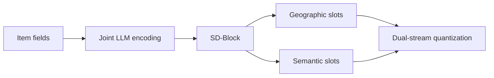
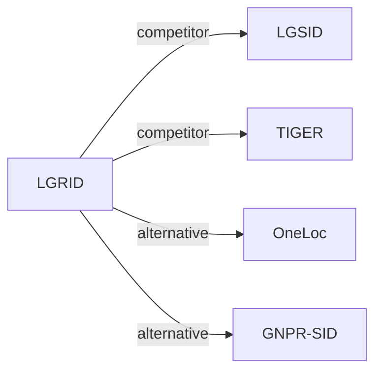

# LGRID

*Interpretable Representation via LLM-Driven Generative Disentanglement for Local-Life Service Recommendation* — Zhang et al. · arXiv’26

`I. Informativeness` · `Representation` · `POI` · [Paper](https://arxiv.org/abs/2607.27944) · [Matrix](../../README.md#i--representation) · [中文](../zh/papers/lgrid.md)

Reading level: Reading Notes (Level 2) · On this page: [TL;DR](#tldr) · [At a Glance](#at-a-glance) · [1. Why It Matters](#1-why-this-paper-matters) · [2. Method](#2-how-it-works) · [3. Experiments](#3-experimental-findings) · [4. Limitations](#4-limitations--critical-analysis) · [5. Related Work](#5-connections-to-related-work)

- `DSRQ`: Dual-stream residual quantization.
- `Disc.`: A discriminative recommendation model that scores candidates.
- `Fixed`: SIDs are built first and not changed while the generator trains.
- `Discrim.`: Scores items; does not generate SIDs.

### TL;DR

> [!NOTE]

> LGRID encodes item fields jointly with an LLM, routes hidden states into geographic and semantic slots, and quantizes the two streams separately, instead of quantizing one entangled representation.

### At a Glance

| Aspect | Summary |
| :-- | :-- |
| Research Problem | I. Informativeness: Do the SIDs, or the model reading them, carry the collaborative and multimodal signals recommendation needs? |
| Key Contribution | LGRID encodes item fields jointly with an LLM, routes hidden states into geographic and semantic slots, and quantizes the two streams separately, instead of quantizing one entangled representation. |
| Modified Stage | Representation |
| Key Findings | On Kuaishou and Foursquare, LGRID reports up to a 5.44% relative AUC gain over SID baselines, and reduces the full-SID collision rate to 39.9% against 97.0% for LGSID (Abstract). |
| Limitation | The geographic slots mirror a fixed administrative hierarchy of province, city, district, and town (Sec. 3.4.1). |

### 1. Why This Paper Matters

Existing Semantic ID (SID) frameworks build one representation and then quantize it (Abstract). The authors state that this mixes geography, brand, and category, causes information loss and collisions, and gives SID positions no clear meaning (Abstract). LGRID gives each SID position an explicit attribute.

Based on arXiv v1.

### 2. How It Works

#### Structured Disentangled Block

The Structured Disentangled Block (SD-Block) splits the hidden states into $`N`$ slot tokens with Semantic Anchor Injection, Anchor-Guided Perception, and Structured Causal Routing (Sec. 3.4). There are $`k`$ geographic slots and $`N-k`$ semantic slots such as brand and category (Sec. 3.4.1).

#### Synergistic Alignment Learning

Alignment learning makes the slots both decodable and discriminative (Abstract). Contrastive learning uses hierarchical hard negatives (Sec. 3.5.2).

> "To prevent inter-slot redundancy, we impose Latent Diversity Regularization (LDR), which encourages subspace orthogonality so that each slot captures non-overlapping features." (Sec. 3.5.3)

#### Dual-Stream Residual Quantization

The two streams are quantized separately, so SID positions correspond to item attributes (Abstract).

### 3. Experimental Findings

Experimental setup

- **Datasets**: Kuaishou local-life industrial data (10,000,000 interactions, 6,673,350 users, 2,251,418 items, 1,000 categories) and public Foursquare (244,896 interactions, 1,084 users, 38,334 POIs, 401 categories; coarse location text derived from coordinates). SID-construction fine-tuning uses a curated, category-balanced subset of 120,000 training and 5,000 validation POIs with incomplete descriptions excluded. Interaction filtering rules: not reported.
  - Source: Datasets: [S4.SS1.p1](https://arxiv.org/html/2607.27944v1#S4.SS1.p1) and [A1.SS1.p1](https://arxiv.org/html/2607.27944v1#A1.SS1.p1); statistics: [A1.T8](https://arxiv.org/html/2607.27944v1#A1.T8); curated SID-construction subset: [A1.SS2.p1](https://arxiv.org/html/2607.27944v1#A1.SS2.p1).
- **Split**: All methods share the same train/validation/test split, but the split rule is not reported.
  - Source: Shared split statement without allocation: [A1.SS3.p1](https://arxiv.org/html/2607.27944v1#A1.SS3.p1).
- **Candidates**: Kuaishou: a spatially constrained candidate set within a fixed 15 km offline distance threshold (following LGSID), shared by all methods. Foursquare: full catalog (standard full-ranking protocol).
  - Source: Kuaishou distance-thresholded candidates and Foursquare full ranking: [A1.SS3.p2](https://arxiv.org/html/2607.27944v1#A1.SS3.p2) and [A1.SS3.p3](https://arxiv.org/html/2607.27944v1#A1.SS3.p3).
- **Visibility**: warm; no unseen-item protocol is defined. SID construction uses item text only and no interaction labels.
  - Source: No unseen-item protocol; SID construction uses no interaction labels: [A1.SS3.p1](https://arxiv.org/html/2607.27944v1#A1.SS3.p1).
- **SID**: 4-token SID from dual-stream residual quantization of Qwen3-8B slot representations: 2 geographic codes + 2 semantic codes; per-level codebook size: not reported. For non-SID backbones, the SID embedding is concatenated with the original item-ID embedding; a collision-resolution rule is not reported. Full-SID collision rate is 39.9% on Kuaishou (RQ-VAE 98.0%, LGSID 97.0%).
  - Source: Dual-stream RQ with D=2 per stream, 4-token SID: [S3.SS6.SSS2.p1](https://arxiv.org/html/2607.27944v1#S3.SS6.SSS2.p1); collision rate: [S4.T5](https://arxiv.org/html/2607.27944v1#S4.T5); SIDs as features beside item IDs: [S3.SS6.SSS3.p1](https://arxiv.org/html/2607.27944v1#S3.SS6.SSS3.p1).
- **Inference budget**: n/a for generation (SIDs feed discriminative and sequential rankers that are scored by AUC). Offline SID construction 21.80 ms per item versus 13.97 ms for RQ-VAE; online input preparation 0.50 versus 0.48 ms per request (Table 10); hardware for timing not stated in the main text. SID-construction fine-tuning uses 4 GPUs (effective batch 192); recommender batch 10,240.
  - Source: Offline SID construction and online lookup cost: [S4.SS5.p1](https://arxiv.org/html/2607.27944v1#S4.SS5.p1) and [A1.SS4.p1](https://arxiv.org/html/2607.27944v1#A1.SS4.p1); training batches: [A1.SS2.p2](https://arxiv.org/html/2607.27944v1#A1.SS2.p2) and [A1.SS2.p3](https://arxiv.org/html/2607.27944v1#A1.SS2.p3).
- **Results from**: Table 1 (AUC across ten recommendation backbones with SID baselines on Kuaishou and Foursquare); Tables 2-4 (full-corpus POI self-retrieval, attribute decoding, joint versus field-wise encoding); Table 5 (utilization and collision rate); Tables 6-7 (ablations); Section 4.5 and Table 10 (efficiency).
  - Source: Main: [S3.T1](https://arxiv.org/html/2607.27944v1#S3.T1); retrieval and decoding: [S4.T2](https://arxiv.org/html/2607.27944v1#S4.T2), [S4.T3](https://arxiv.org/html/2607.27944v1#S4.T3), [S4.T4](https://arxiv.org/html/2607.27944v1#S4.T4); collisions: [S4.T5](https://arxiv.org/html/2607.27944v1#S4.T5); ablations: [S4.T6](https://arxiv.org/html/2607.27944v1#S4.T6), [S4.T7](https://arxiv.org/html/2607.27944v1#S4.T7).

- Attribute decoding: accuracy is over 99% for coarse-grained geographic fields (Abstract).
- Hard negatives: they raise town-level discrimination from 37.17% to 83.51% (Sec. 4.4).

  > "In the SACL group, vanilla sampling yields limited fine-grained discrimination (Town: 37.17%), whereas hierarchical hard negatives raise it to 83.51%." (Sec. 4.4)

### 4. Limitations & Critical Analysis

**Our analysis.**

- A full-SID collision rate of 39.9% still leaves many items sharing an SID. Discriminative ranking tolerates shared SIDs better than generation would.
- TIGER quantizes one representation with `RQ-VAE`; LGRID quantizes two streams (`DSRQ`) and feeds a discriminative ranker.

### 5. Connections to Related Work

- **同期对比** · [LGSID](lgsid.md): LGSID injects geography into one fused representation before quantization; LGRID disentangles geographic and semantic slots and quantizes them in two streams, cutting full-SID collisions from 97.0% to 39.9%.
  - Source: LGRID v1, baselines and Table 1: https://arxiv.org/html/2607.27944v1#S4.SS1.p2 and https://arxiv.org/html/2607.27944v1#S3.T1; collisions in Table 5: https://arxiv.org/html/2607.27944v1#S4.SS3.p4 and https://arxiv.org/html/2607.27944v1#S4.T5; candidate protocol follows LGSID: https://arxiv.org/html/2607.27944v1#A1.SS3.p2.
- **同期对比** · [TIGER](tiger.md): TIGER's RQ-VAE on a single representation is the base SID baseline; LGRID keeps residual quantization but applies it per disentangled stream.
  - Source: LGRID v1, RQVAE baseline attributed to Rajput et al. (2023): https://arxiv.org/html/2607.27944v1#S4.SS1.p2; Table 1 and Table 5: https://arxiv.org/html/2607.27944v1#S3.T1 and https://arxiv.org/html/2607.27944v1#S4.T5.
- **替代方案** · [OneLoc](oneloc.md): OneLoc adds geographic signals to SID generation through a shared representation; LGRID argues such geo-aware variants still entangle attributes.
  - Source: LGRID v1, Section 1 and Section 2.1: https://arxiv.org/html/2607.27944v1#S1.p3 and https://arxiv.org/html/2607.27944v1#S2.SS1.p1; not a baseline in Table 1.
- **替代方案** · [GNPR-SID](gnpr-sid.md): GNPR-SID builds POI SIDs from one fused embedding for next-POI generation; LGRID targets ranking features with disentangled geographic codes.
  - Source: LGRID v1, Section 1 and Section 2.1: https://arxiv.org/html/2607.27944v1#S1.p3 and https://arxiv.org/html/2607.27944v1#S2.SS1.p1; not a baseline in Table 1.

[查看同格全部论文](../../README.md#i--representation)
