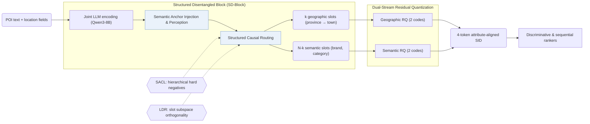
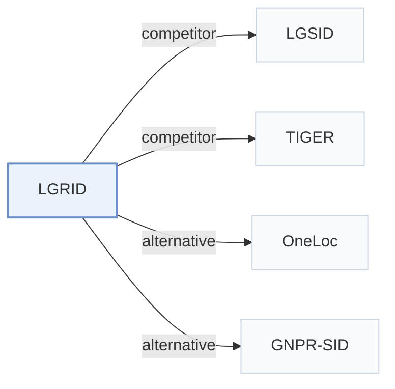

# LGRID

[← Problem × Stage Matrix](../../README.md#i--representation) · [Papers by Stage](../index/stages.md) · [Papers by Modality](../index/modality.md) · [Papers by Domain](../index/domain.md) · English | [中文](../zh/papers/lgrid.md)

| **Title** | *Interpretable Representation via LLM-Driven Generative Disentanglement for Local-Life Service Recommendation* |
| :-- | :-- |
| **Authors** | Zhang et al. |
| **Venue** | arXiv’26 |
| **Problem × Stage** | `I. Informativeness` · `Representation` · `POI` |
| **Changes** | ● Representation · ○ Tokenization |
| **SID inputs** | `Text` + `Geo` |
| **Domain** | `POI / Local` |
| **Scenario** | `POI and Local Services` · `Ranking and Reranking`; `Industrial Data, Offline` |
| **Links** | [Paper](https://arxiv.org/abs/2607.27944) |
| **Reading level** | Reading Notes (Level 2) |

**On this page**: [TL;DR](#tldr) · [At a Glance](#at-a-glance) · [1. Why It Matters](#1-why-this-paper-matters) · [2. Method](#2-how-it-works) · [3. Experiments](#3-experimental-findings) · [4. Limitations](#4-limitations--critical-analysis) · [5. Related Work](#5-connections-to-related-work)

- `Text+Geo`: Text representations combined with geographic or spatial features.
- `DSRQ`: Dual-stream residual quantization.
- `Disc.`: A discriminative recommendation model that scores candidates.
- `Fixed`: SIDs are built first and not changed while the generator trains.
- `Discrim.`: Scores items; does not generate SIDs.
- `Scoring`: Direct candidate scoring without step-by-step SID generation.

### TL;DR

> [!NOTE]
> LGRID encodes item fields jointly with an LLM, routes hidden states into geographic and semantic slots, and quantizes the two streams separately, instead of quantizing one entangled representation.

---

### At a Glance

| Aspect | Summary |
| :-- | :-- |
| Key Findings | On Kuaishou and Foursquare, LGRID reports up to a 5.44% relative AUC gain over SID baselines, and reduces the full-SID collision rate to 39.9% against 97.0% for LGSID (Abstract). |
| Limitation | The geographic slots mirror a fixed administrative hierarchy of province, city, district, and town (Sec. 3.4.1). |

---

### 1. Why This Paper Matters

Standard Semantic ID (SID) pipelines compress all item attributes into one vector before quantization, entangling geography, brand, and category while leaving individual SID positions uninterpretable and prone to collisions (Abstract). LGRID routes LLM hidden states into dedicated geographic and semantic slots and quantizes each stream separately so that every SID position corresponds to an explicit attribute.

---

### 2. How It Works

#### Structured Disentangled Block

The Structured Disentangled Block (SD-Block) encodes all POI fields jointly with Qwen3-8B and partitions the hidden states into $`N`$ slot tokens through Semantic Anchor Injection, Anchor-Guided Perception, and Structured Causal Routing (Sec. 3.4). The $`N`$ slots split into $`k`$ hierarchical geographic slots (province, city, district, town) and $`N-k`$ semantic slots such as brand and category (Sec. 3.4.1).

#### Synergistic Alignment Learning

Synergistic Alignment Learning trains each slot to be both decodable into its ground-truth attribute and discriminative across items (Abstract, Sec. 3.5). Its contrastive objective (SACL) samples hierarchical hard negatives that share coarse administrative prefixes but differ at finer levels (Sec. 3.5.2), while Latent Diversity Regularization (LDR) enforces orthogonality across slot subspaces (Sec. 3.5.3).

> "To prevent inter-slot redundancy, we impose Latent Diversity Regularization (LDR), which encourages subspace orthogonality so that each slot captures non-overlapping features." (Sec. 3.5.3)

#### Dual-Stream Residual Quantization

Dual-Stream Residual Quantization (DSRQ) quantizes the geographic slot representation and the semantic slot representation in two separate residual streams (2 geographic codes + 2 semantic codes), producing a 4-token SID whose positions map directly to geographic and semantic attributes (Abstract, Sec. 3.6.2).

---

### 3. Experimental Findings

Experimental setup

- **Datasets**: Kuaishou local-life industrial data (10,000,000 interactions, 6,673,350 users, 2,251,418 items, 1,000 categories) and public Foursquare (244,896 interactions, 1,084 users, 38,334 POIs, 401 categories; coarse location text derived from coordinates). SID-construction fine-tuning uses a curated, category-balanced subset of 120,000 training and 5,000 validation POIs with incomplete descriptions excluded. Interaction filtering rules: not reported.
  - Source: Datasets: [S4.SS1.p1](https://arxiv.org/html/2607.27944v1#S4.SS1.p1) and [A1.SS1.p1](https://arxiv.org/html/2607.27944v1#A1.SS1.p1); statistics: [A1.T8](https://arxiv.org/html/2607.27944v1#A1.T8); curated SID-construction subset: [A1.SS2.p1](https://arxiv.org/html/2607.27944v1#A1.SS2.p1).
- **Split**: All methods share the same train/validation/test split, but the split rule is not reported.
  - Source: Shared split statement without allocation: [A1.SS3.p1](https://arxiv.org/html/2607.27944v1#A1.SS3.p1).
- **Candidates**: Kuaishou: a spatially constrained candidate set within a fixed 15 km offline distance threshold (following LGSID), shared by all methods. Foursquare: full catalog (standard full-ranking protocol).
  - Source: Kuaishou distance-thresholded candidates and Foursquare full ranking: [A1.SS3.p2](https://arxiv.org/html/2607.27944v1#A1.SS3.p2) and [A1.SS3.p3](https://arxiv.org/html/2607.27944v1#A1.SS3.p3).
- **Visibility**: warm; no unseen-item protocol is defined. SID construction uses item text only and no interaction labels.
  - Source: No unseen-item protocol; SID construction uses no interaction labels: [A1.SS3.p1](https://arxiv.org/html/2607.27944v1#A1.SS3.p1).
- **SID**: 4-token SID from dual-stream residual quantization of Qwen3-8B slot representations: 2 geographic codes + 2 semantic codes; per-level codebook size: not reported. For non-SID backbones, the SID embedding is concatenated with the original item-ID embedding; a collision-resolution rule is not reported. Full-SID collision rate is 39.9% on Kuaishou (RQ-VAE 98.0%, LGSID 97.0%).
  - Source: Dual-stream RQ with D=2 per stream, 4-token SID: [S3.SS6.SSS2.p1](https://arxiv.org/html/2607.27944v1#S3.SS6.SSS2.p1); collision rate: [S4.T5](https://arxiv.org/html/2607.27944v1#S4.T5); SIDs as features beside item IDs: [S3.SS6.SSS3.p1](https://arxiv.org/html/2607.27944v1#S3.SS6.SSS3.p1).
- **Inference budget**: n/a for generation (SIDs feed discriminative and sequential rankers that are scored by AUC). Offline SID construction 21.80 ms per item versus 13.97 ms for RQ-VAE; online input preparation 0.50 versus 0.48 ms per request (Table 10); hardware for timing not stated in the main text. SID-construction fine-tuning uses 4 GPUs (effective batch 192); recommender batch 10,240.
  - Source: Offline SID construction and online lookup cost: [S4.SS5.p1](https://arxiv.org/html/2607.27944v1#S4.SS5.p1) and [A1.SS4.p1](https://arxiv.org/html/2607.27944v1#A1.SS4.p1); training batches: [A1.SS2.p2](https://arxiv.org/html/2607.27944v1#A1.SS2.p2) and [A1.SS2.p3](https://arxiv.org/html/2607.27944v1#A1.SS2.p3).
- **Results from**: Table 1 (AUC across ten recommendation backbones with SID baselines on Kuaishou and Foursquare); Tables 2-4 (full-corpus POI self-retrieval, attribute decoding, joint versus field-wise encoding); Table 5 (utilization and collision rate); Tables 6-7 (ablations); Section 4.5 and Table 10 (efficiency).
  - Source: Main: [S3.T1](https://arxiv.org/html/2607.27944v1#S3.T1); retrieval and decoding: [S4.T2](https://arxiv.org/html/2607.27944v1#S4.T2), [S4.T3](https://arxiv.org/html/2607.27944v1#S4.T3), [S4.T4](https://arxiv.org/html/2607.27944v1#S4.T4); collisions: [S4.T5](https://arxiv.org/html/2607.27944v1#S4.T5); ablations: [S4.T6](https://arxiv.org/html/2607.27944v1#S4.T6), [S4.T7](https://arxiv.org/html/2607.27944v1#S4.T7).

- Ranking and collision reduction: across ten discriminative and sequential rankers (including DIN, DIEN, SIM, and HSTU) on Kuaishou and Foursquare, LGRID achieves up to a 5.44% relative AUC gain over SID baselines and cuts the full-SID collision rate on Kuaishou to 39.9%, compared with 98.0% for RQ-VAE and 97.0% for LGSID (Abstract, Tables 1 and 5).
- Attribute decoding: probing the learned slots recovers coarse-grained geographic fields with over 99% accuracy and outperforms field-wise encoding on POI self-retrieval (Abstract, Tables 2–4).
- Hierarchical hard negatives: in the SACL ablation, replacing vanilla negative sampling with hierarchical hard negatives raises fine-grained town-level discrimination from 37.17% to 83.51% (Sec. 4.4, Table 6).

  > "In the SACL group, vanilla sampling yields limited fine-grained discrimination (Town: 37.17%), whereas hierarchical hard negatives raise it to 83.51%." (Sec. 4.4)

---

### 4. Limitations & Critical Analysis

**Our analysis.**

- A 39.9% full-SID collision rate on Kuaishou still leaves many POIs sharing identical 4-token SIDs, which suggests that LGRID fits discriminative ranking—where the SID embedding is concatenated alongside the original item-ID embedding (Sec. 3.6.3)—better than standalone autoregressive item generation.
- TIGER quantizes a single fused representation with `RQ-VAE`; LGRID disentangles geographic and semantic slots before two-stream quantization (`DSRQ`) and feeds discriminative rankers (`Disc.`).

---

### 5. Connections to Related Work

- **Competitor** · [LGSID](lgsid.md): LGSID injects geography into one fused representation before quantization; LGRID disentangles geographic and semantic slots and quantizes them in two streams, cutting full-SID collisions from 97.0% to 39.9%.
  - Source: LGRID v1, baselines and Table 1: [S4.SS1.p2](https://arxiv.org/html/2607.27944v1#S4.SS1.p2) and [S3.T1](https://arxiv.org/html/2607.27944v1#S3.T1); collisions in Table 5: [S4.SS3.p4](https://arxiv.org/html/2607.27944v1#S4.SS3.p4) and [S4.T5](https://arxiv.org/html/2607.27944v1#S4.T5); candidate protocol follows LGSID: [A1.SS3.p2](https://arxiv.org/html/2607.27944v1#A1.SS3.p2).
- **Competitor** · [TIGER](tiger.md): TIGER's RQ-VAE on a single representation is the base SID baseline; LGRID keeps residual quantization but applies it per disentangled stream.
  - Source: LGRID v1, RQVAE baseline attributed to Rajput et al. (2023): [S4.SS1.p2](https://arxiv.org/html/2607.27944v1#S4.SS1.p2); Table 1 and Table 5: [S3.T1](https://arxiv.org/html/2607.27944v1#S3.T1) and [S4.T5](https://arxiv.org/html/2607.27944v1#S4.T5).
- **Alternative** · [OneLoc](oneloc.md): OneLoc adds geographic signals to SID generation through a shared representation; LGRID argues such geo-aware variants still entangle attributes.
  - Source: LGRID v1, Section 1 and Section 2.1: [S1.p3](https://arxiv.org/html/2607.27944v1#S1.p3) and [S2.SS1.p1](https://arxiv.org/html/2607.27944v1#S2.SS1.p1); not a baseline in Table 1.
- **Alternative** · [GNPR-SID](gnpr-sid.md): GNPR-SID builds POI SIDs from one fused embedding for next-POI generation; LGRID targets ranking features with disentangled geographic codes.
  - Source: LGRID v1, Section 1 and Section 2.1: [S1.p3](https://arxiv.org/html/2607.27944v1#S1.p3) and [S2.SS1.p1](https://arxiv.org/html/2607.27944v1#S2.SS1.p1); not a baseline in Table 1.

[View all papers in this cell](../../README.md#i--representation)
