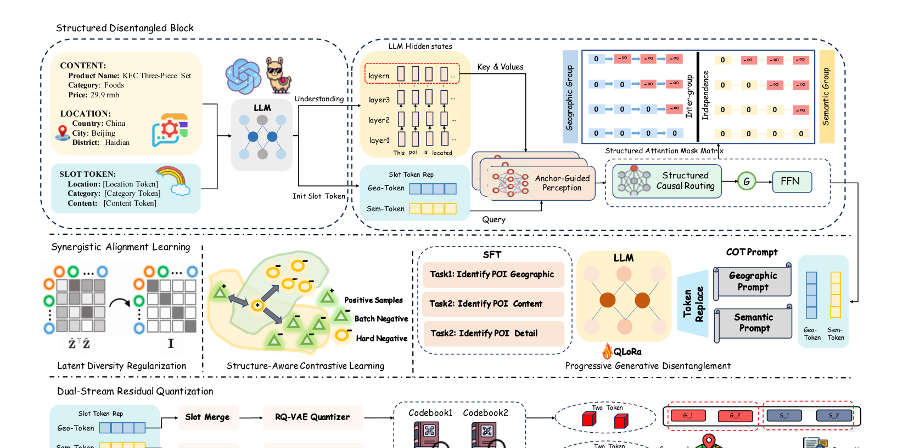

# LGRID

*Interpretable Representation via LLM-Driven Generative Disentanglement for Local-Life Service Recommendation* — Zhang et al. · arXiv’26

`I. Informativeness` · `Representation` · `POI`

[Paper](https://arxiv.org/abs/2607.27944) · [Matrix](../../README.md#i--representation)

Reading level: Overview (Level 1) · On this page: [TL;DR](#tldr) · [At a Glance](#at-a-glance) · [2. How It Works](#2-how-it-works) · [3. Experimental Findings](#3-experimental-findings) · [5. Connections to Related Work](#5-connections-to-related-work)

| Representation | Tokenization | Backbone | Training | Inference |
| :-: | :-: | :-: | :-: | :-: |
| **`Text+Geo`** | `DSRQ` | `Disc.` | `Fixed / Discrim.` | `Scoring` |

- `DSRQ`: Dual-stream residual quantization.
- `Disc.`: A discriminative recommendation model that scores candidates.
- `Fixed`: SIDs are built first and not changed while the generator trains.
- `Discrim.`: Scores items; does not generate SIDs.

### TL;DR

LGRID encodes item fields jointly with an LLM, routes hidden states into geographic and semantic slots, and quantizes the two streams separately, instead of quantizing one entangled representation.

### At a Glance

| Aspect | Summary |
| :-- | :-- |
| Research Problem | I. Informativeness: Do the SIDs, or the model reading them, carry the collaborative and multimodal signals recommendation needs? |
| Key Contribution | LGRID encodes item fields jointly with an LLM, routes hidden states into geographic and semantic slots, and quantizes the two streams separately, instead of quantizing one entangled representation. |
| Modified Stage | Representation |

### 2. How It Works

### 3. Experimental Findings

**Experimental setup**

- **Datasets**: Kuaishou local-life industrial data (10,000,000 interactions, 6,673,350 users, 2,251,418 items, 1,000 categories) and public Foursquare (244,896 interactions, 1,084 users, 38,334 POIs, 401 categories; coarse location text derived from coordinates). SID-construction fine-tuning uses a curated, category-balanced subset of 120,000 training and 5,000 validation POIs with incomplete descriptions excluded. Interaction filtering rules: not reported.
  - Source: Datasets: https://arxiv.org/html/2607.27944v1#S4.SS1.p1 and https://arxiv.org/html/2607.27944v1#A1.SS1.p1; statistics: https://arxiv.org/html/2607.27944v1#A1.T8; curated SID-construction subset: https://arxiv.org/html/2607.27944v1#A1.SS2.p1.
- **Split**: All methods share the same train/validation/test split, but the split rule is not reported.
  - Source: Shared split statement without allocation: https://arxiv.org/html/2607.27944v1#A1.SS3.p1.
- **Candidates**: Kuaishou: a spatially constrained candidate set within a fixed 15 km offline distance threshold (following LGSID), shared by all methods. Foursquare: full catalog (standard full-ranking protocol).
  - Source: Kuaishou distance-thresholded candidates and Foursquare full ranking: https://arxiv.org/html/2607.27944v1#A1.SS3.p2 and https://arxiv.org/html/2607.27944v1#A1.SS3.p3.
- **Visibility**: warm; no unseen-item protocol is defined. SID construction uses item text only and no interaction labels.
  - Source: No unseen-item protocol; SID construction uses no interaction labels: https://arxiv.org/html/2607.27944v1#A1.SS3.p1.
- **SID**: 4-token SID from dual-stream residual quantization of Qwen3-8B slot representations: 2 geographic codes + 2 semantic codes; per-level codebook size: not reported. For non-SID backbones, the SID embedding is concatenated with the original item-ID embedding; a collision-resolution rule is not reported. Full-SID collision rate is 39.9% on Kuaishou (RQ-VAE 98.0%, LGSID 97.0%).
  - Source: Dual-stream RQ with D=2 per stream, 4-token SID: https://arxiv.org/html/2607.27944v1#S3.SS6.SSS2.p1; collision rate: https://arxiv.org/html/2607.27944v1#S4.T5; SIDs as features beside item IDs: https://arxiv.org/html/2607.27944v1#S3.SS6.SSS3.p1.
- **Inference budget**: n/a for generation (SIDs feed discriminative and sequential rankers that are scored by AUC). Offline SID construction 21.80 ms per item versus 13.97 ms for RQ-VAE; online input preparation 0.50 versus 0.48 ms per request (Table 10); hardware for timing not stated in the main text. SID-construction fine-tuning uses 4 GPUs (effective batch 192); recommender batch 10,240.
  - Source: Offline SID construction and online lookup cost: https://arxiv.org/html/2607.27944v1#S4.SS5.p1 and https://arxiv.org/html/2607.27944v1#A1.SS4.p1; training batches: https://arxiv.org/html/2607.27944v1#A1.SS2.p2 and https://arxiv.org/html/2607.27944v1#A1.SS2.p3.
- **Results from**: Table 1 (AUC across ten recommendation backbones with SID baselines on Kuaishou and Foursquare); Tables 2-4 (full-corpus POI self-retrieval, attribute decoding, joint versus field-wise encoding); Table 5 (utilization and collision rate); Tables 6-7 (ablations); Section 4.5 and Table 10 (efficiency).
  - Source: Main: https://arxiv.org/html/2607.27944v1#S3.T1; retrieval and decoding: https://arxiv.org/html/2607.27944v1#S4.T2, https://arxiv.org/html/2607.27944v1#S4.T3, https://arxiv.org/html/2607.27944v1#S4.T4; collisions: https://arxiv.org/html/2607.27944v1#S4.T5; ablations: https://arxiv.org/html/2607.27944v1#S4.T6, https://arxiv.org/html/2607.27944v1#S4.T7.

## 旧卡片说明

迁自 `d61aa6c:papers/lgrid.md`。保留方法说明、实验叙述与局限；本轮只对照现有记录处理明确冲突，未重新逐句核查原论文。分类和规格以页面上方由记录生成的表格为准。

### LGRID：基于大语言模型生成解耦的可解释表示

> LGRID 通过“编码-解耦-对齐-量化”流程，将地理和语义属性分配到可解释槽位，并分别量化为双流 SID。

### 研究动机与问题定义

单一表示量化会把城市、区域、品牌和类别等异质属性纠缠在一起，导致关键属性丢失、SID 碰撞严重且难以解释。LGRID 面向本地生活推荐，目标是得到可解码的属性槽位和具有层次语义的低碰撞 SID。

### TL;DR（核心摘要）

`POI内容/位置 → LLM编码 → 结构化解耦槽位 → 对齐学习 → 双流RQ-VAE → 地理/语义SID`

LGRID 用 LLM 编码 POI 文本，在 Structured Disentangled Block 中通过锚点引导感知和结构化因果路由，将隐藏状态分配到地理槽和语义槽。渐进式生成解耦与结构感知对比学习使槽位可解码、可区分，最后分别量化两类槽位得到双流 SID。

### 输入与使用场景

| 方面 | 说明 |
|---|---|
| 使用信息 | POI 内容、行政地理、品牌、类别和用户交互 |
| 信息融入位置 | LLM 隐状态、解耦槽位、对齐目标和量化器 |
| 语义标识结构 | 地理流与语义流组成的层次序列 |
| 适用场景 | 本地生活、可解释推荐和属性分析 |

### 方法设计

#### 3.2 总体流程
LGRID 的核心顺序是 Encode → Disentangle → Align → Quantize。先由 LLM 建模 POI 内容和地理之间的依赖，再显式切分属性槽位，之后用多种任务让槽位具备可解释含义，最后分别进行残差量化。

#### 3.3 联合 LLM 编码
输入包含内容描述和位置字段，LLM 产生上下文隐藏状态。与字段独立编码不同，联合编码保留了“某类商户位于某区域”的依赖，但也会带来表示纠缠，因此后续需要结构化路由。

#### 3.4 结构化解耦模块
模块先注入地理、语义和内容锚点 token，再用 Anchor-Guided Perception 从隐藏状态提取对应信息。结构化因果路由通过注意力掩码限制不同槽位之间的依赖，使地理槽更多关注位置信息、语义槽更多关注品牌和类别信息。

#### 3.5 协同对齐学习
渐进式生成解耦要求 LLM 逐步恢复 POI 的地理、内容和细节属性；结构感知对比学习拉近同属性 POI、分离难负样本；潜空间多样性正则减少不同槽位学习重复信息。多个目标共同提高可解码性和区分度。

#### 3.6 双流残差量化
地理槽和语义槽分别经过槽位合并与 RQ-VAE 量化器，形成两个 code stream。双流结构使 SID 的部分位置具有明确属性含义，也降低单一 codebook 同时承载所有属性造成的碰撞。

### 实验结论

- 在 Kuaishou 和 Foursquare 数据上，LGRID 相比 SID 基线取得更好的推荐效果，论文报告最高 5.44% 的相对 AUC 提升。
- 粗粒度地理属性解码准确率超过 99%，说明槽位具有较强的属性可解释性。
- 完整 SID 碰撞率报告为 39.9%，低于对比方法 LGSID 的 97.0%；效率和规模分析支持其可部署性。

### 局限性与研究定位

#### 局限性

- 槽位、锚点和结构化掩码引入较多设计选择，跨领域迁移的稳定性仍需验证。
- 属性缺失、动态新增 POI 和在线 SID 更新机制未被充分讨论。

#### 研究定位

LGRID 适合放在“可解释与解耦语义标识”章节，代表通过生成式解耦显式赋予 SID 位置以地理或语义含义的路线。

### 相关资源

- [论文原文](https://arxiv.org/abs/2607.27944)

### 标签

`生成解耦` · `双流量化` · `可解释SID` · `本地生活`

### 架构图来源

*图源：原论文，图2（[论文原文](https://arxiv.org/abs/2607.27944)）。图片使用许可待核实。*

---

### 旧总表补充

来源：`d61aa6c:tables/all-methods.md`。

- 核心贡献：将地理与语义属性解耦为可解释的双流 SID。
- 使用场景：本地生活与可解释推荐。

### 5. Connections to Related Work

- **Competitor** · [LGSID](lgsid.md): LGSID injects geography into one fused representation before quantization; LGRID disentangles geographic and semantic slots and quantizes them in two streams, cutting full-SID collisions from 97.0% to 39.9%.
  - Source: LGRID v1, baselines and Table 1: https://arxiv.org/html/2607.27944v1#S4.SS1.p2 and https://arxiv.org/html/2607.27944v1#S3.T1; collisions in Table 5: https://arxiv.org/html/2607.27944v1#S4.SS3.p4 and https://arxiv.org/html/2607.27944v1#S4.T5; candidate protocol follows LGSID: https://arxiv.org/html/2607.27944v1#A1.SS3.p2.
- **Competitor** · [TIGER](tiger.md): TIGER's RQ-VAE on a single representation is the base SID baseline; LGRID keeps residual quantization but applies it per disentangled stream.
  - Source: LGRID v1, RQVAE baseline attributed to Rajput et al. (2023): https://arxiv.org/html/2607.27944v1#S4.SS1.p2; Table 1 and Table 5: https://arxiv.org/html/2607.27944v1#S3.T1 and https://arxiv.org/html/2607.27944v1#S4.T5.
- **Alternative** · [OneLoc](oneloc.md): OneLoc adds geographic signals to SID generation through a shared representation; LGRID argues such geo-aware variants still entangle attributes.
  - Source: LGRID v1, Section 1 and Section 2.1: https://arxiv.org/html/2607.27944v1#S1.p3 and https://arxiv.org/html/2607.27944v1#S2.SS1.p1; not a baseline in Table 1.
- **Alternative** · [GNPR-SID](gnpr-sid.md): GNPR-SID builds POI SIDs from one fused embedding for next-POI generation; LGRID targets ranking features with disentangled geographic codes.
  - Source: LGRID v1, Section 1 and Section 2.1: https://arxiv.org/html/2607.27944v1#S1.p3 and https://arxiv.org/html/2607.27944v1#S2.SS1.p1; not a baseline in Table 1.

[View all papers in this cell](../../README.md#i--representation)
