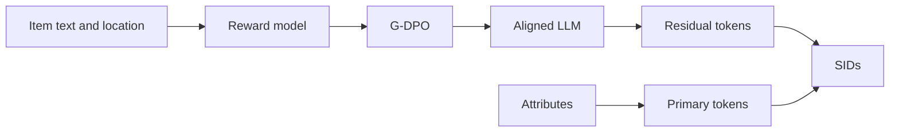

# LGSID

*LLM-Aligned Geographic Item Tokenization for Local-Life Recommendation* — Jiang et al. · AAAI’26

`I. Informativeness` · `Representation` · `POI`

[Paper](https://arxiv.org/abs/2511.14221) · [Code](https://github.com/JiangHaoPG11/LGSID) · [Matrix](../../README.md#i--representation)

Reading level: Reading Notes (Level 2) · On this page: [TL;DR](#tldr) · [At a Glance](#at-a-glance) · [1. Why This Paper Matters](#1-why-this-paper-matters) · [2. How It Works](#2-how-it-works) · [3. Experimental Findings](#3-experimental-findings) · [4. Limitations & Critical Analysis](#4-limitations--critical-analysis) · [5. Connections to Related Work](#5-connections-to-related-work)

| Representation | Tokenization | Backbone | Training | Inference |
| :-: | :-: | :-: | :-: | :-: |
| **`Text+Geo+CF`** | `Geo-Idx+RQ` | `Disc. / Enc-Dec` | `Fixed / Discrim. / NTP` | `Scoring / Beam†` |

- `Geo-Idx+RQ`: Geographic indexing combined with residual quantization.
- `Disc. / Enc-Dec`: Discriminative scoring and encoder–decoder generation variants.
- `Fixed`: SIDs are built first and not changed while the generator trains.
- `Discrim. / NTP`: Discriminative scoring or next-token prediction in different configurations.
- `Scoring / Beam†`: Discriminative candidate scoring vs. generative beam search.

### TL;DR

LGSID aligns an LLM to spatial relationships with a reward model and G-DPO, then builds Semantic IDs from spatial and content attributes plus residual tokens from the aligned LLM representation.

### At a Glance

| Aspect | Summary |
| :-- | :-- |
| Research Problem | I. Informativeness: Do the SIDs, or the model reading them, carry the collaborative and multimodal signals recommendation needs? |
| Key Contribution | LGSID aligns an LLM to spatial relationships with a reward model and G-DPO, then builds Semantic IDs from spatial and content attributes plus residual tokens from the aligned LLM representation. |
| Modified Stage | Representation |
| Limitation | LLM alignment needs a separately trained list-wise reward model before G-DPO, and the residual tokens change whenever that alignment is redone (Abstract). |

### 1. Why This Paper Matters

Text-based recommenders encode item text with prompts and tokenize items into discrete Semantic IDs (SIDs) (Abstract). In local-life services, the authors state that putting location into the prompt misses fine-grained spatial characteristics and real distances between items (Abstract).

> "However, in domain-specific tasks such as local-life services, simply injecting location information into prompts fails to capture fine-grained spatial characteristics and real-world distance awareness among items." (Abstract)

Based on arXiv v1.

### 2. How It Works

*Figure source: Fig. 2, original paper.*

#### Reward Model

A list-wise reward model learns spatial relationships among items (Introduction).

> "The RL-based alignment module first trains reward models using distance-aware list-wise sampling to capture and compress real-world spatial relationships." (Introduction)

#### G-DPO Alignment

G-DPO uses the reward model to inject spatial knowledge and collaborative signals into the LLM (Abstract). An in-batch contrastive loss keeps each item's embedding close to the reference model's output (G-DPO, Eq. 7-8).

> "To preserve LLMs' semantic representations during G-DPO updates, we introduce an in-batch contrastive loss as a similarity regularizer, as shown in Eq. 7." (G-DPO)

#### Hierarchical Geographic Item Tokenization

Primary tokens come from discrete spatial and content attributes, and residual tokens come from the aligned LLM's geographic vectors (Abstract).

### 3. Experimental Findings

**Experimental setup**

- **Datasets**: Kuaishou local-life feed data only: 50,000,000 samples, 19,080,888 users, 2,325,266 items, 19,408 brands, 818 categories, with item text and geographic location. For discriminative models, all positives are kept and negatives down-sampled 1:4. Further filtering: not reported.
- **Split**: Generative models: leave-one-out on the down-sampled data (last item for test, second-last for validation, the rest for training). Discriminative models: split rule not reported; settings selected on validation data.
- **Candidates**: Discriminative AUC: evaluation samples with negatives down-sampled at 1:4 to positives; how negatives are drawn and whether user history is excluded: not reported. Generative Hit and NDCG at 5 and 10: full catalog versus sampled not reported.
- **Visibility**: warm; no unseen-item protocol is defined.
- **SID**: Hierarchical residual quantizer over G-DPO-aligned BGE embeddings (1,024-dimensional) with a KL regularizer toward uniform cluster usage; number of levels and per-level codebook sizes K_l: not reported. Collision handling: not reported.
- **Inference budget**: SIDs are used as features in DIN, DIEN, SIM, TWIN, ETA and as targets in TIGER and OneRec generators; decoding method and beam width: not reported. All experiments on two 48GB GPUs; inference batch size and latency: not reported.
- **Results from**: Table 1 (AUC of five discriminative rankers with different tokenizers); Table 2 (TIGER and OneRec generators with different tokenizers); Table 3 (semantic and geographic coverage after alignment); Table 5 (robustness over runs); Table 6 (similarity weight).

Sources

- **Datasets**: Industrial-only dataset and preprocessing: [A2.SS0.SSSx1.p1](https://arxiv.org/html/2511.14221v1#A2.SS0.SSSx1.p1); statistics: [A2.T4](https://arxiv.org/html/2511.14221v1#A2.T4).
- **Split**: Leave-one-out for generative models on the down-sampled data: [A2.SS0.SSSx1.p1](https://arxiv.org/html/2511.14221v1#A2.SS0.SSSx1.p1); split for discriminative AUC not stated.
- **Candidates**: Negative down-sampling and metrics: [A2.SS0.SSSx1.p1](https://arxiv.org/html/2511.14221v1#A2.SS0.SSSx1.p1).
- **Visibility**: Standard split with no unseen-item protocol: [A2.SS0.SSSx1.p1](https://arxiv.org/html/2511.14221v1#A2.SS0.SSSx1.p1).
- **SID**: Hierarchical quantizer with uniform-usage regularization: [Sx4.SSx3.p4](https://arxiv.org/html/2511.14221v1#Sx4.SSx3.p4) and [Sx4.SSx3.p5](https://arxiv.org/html/2511.14221v1#Sx4.SSx3.p5); BGE embeddings: [A2.SSx1.p1](https://arxiv.org/html/2511.14221v1#A2.SSx1.p1); no codebook sizes or collision rule found.
- **Inference budget**: Hardware: [A2.SSx2.p1](https://arxiv.org/html/2511.14221v1#A2.SSx2.p1); generative backbones: [A2.SSx3.p1](https://arxiv.org/html/2511.14221v1#A2.SSx3.p1).
- **Results from**: Discriminative: [Sx5.T1](https://arxiv.org/html/2511.14221v1#Sx5.T1); generative: [Sx5.T2](https://arxiv.org/html/2511.14221v1#Sx5.T2); alignment: [Sx5.T3](https://arxiv.org/html/2511.14221v1#Sx5.T3); robustness: [A4.T5](https://arxiv.org/html/2511.14221v1#A4.T5); lambda: [A4.T6](https://arxiv.org/html/2511.14221v1#A4.T6).

- Main comparison: on Kuaishou industry datasets, LGSID outperforms discriminative and generative recommendation models (Abstract).
- Downstream models: Table 1 uses the SIDs in DIN, DIEN, SIM, TWIN, and ETA, and Table 2 in TIGER and OneRec (Tables 1-2).
- Other analyses: the paper reports ablations, visualizations, and case studies (Abstract).

### 4. Limitations & Critical Analysis

**Our analysis.**

- Primary tokens need discrete attributes. This suggests that items with missing attributes need a fallback.
- LGRID uses `DSRQ` codes for discriminative ranking only; LGSID uses `Geo-Idx+RQ` codes for both ranking and generation.

### 5. Connections to Related Work

- **Competitor** · [TIGER](tiger.md): TIGER's RQ-VAE is a tokenizer baseline and TIGER is one of two generative backbones; LGSID aligns the LLM embedding with geographic rewards before a hierarchical quantizer.
  - Source: LGSID v1, baselines: https://arxiv.org/html/2511.14221v1#A2.SSx3.p1; Tables 1 and 2: https://arxiv.org/html/2511.14221v1#Sx5.T1 and https://arxiv.org/html/2511.14221v1#Sx5.T2.
- **Predecessor** · [OneRec](onerec.md): OneRec serves as the second generative backbone into which LGSID's SIDs are plugged.
  - Source: LGSID v1, baselines: https://arxiv.org/html/2511.14221v1#A2.SSx3.p1; Table 2: https://arxiv.org/html/2511.14221v1#Sx5.T2.
- **Alternative** · [GNPR-SID](gnpr-sid.md): GNPR-SID builds POI SIDs for next-POI generation; LGSID targets local-life ranking features and aligns embeddings with geographic distance rewards.
  - Source: LGSID v1, related work: https://arxiv.org/html/2511.14221v1#Sx2.SSx2.p1 and https://arxiv.org/html/2511.14221v1#Sx4.SSx2.p1.
- **Successor** · [LGRID](lgrid.md): LGRID later follows LGSID's candidate protocol and replaces its single fused representation with disentangled geographic and semantic streams.
  - Source: Evidence is from the later LGRID paper: protocol https://arxiv.org/html/2607.27944v1#A1.SS3.p2; baseline and collision comparison https://arxiv.org/html/2607.27944v1#S4.SS1.p2 and https://arxiv.org/html/2607.27944v1#S4.T5.

[View all papers in this cell](../../README.md#i--representation)
