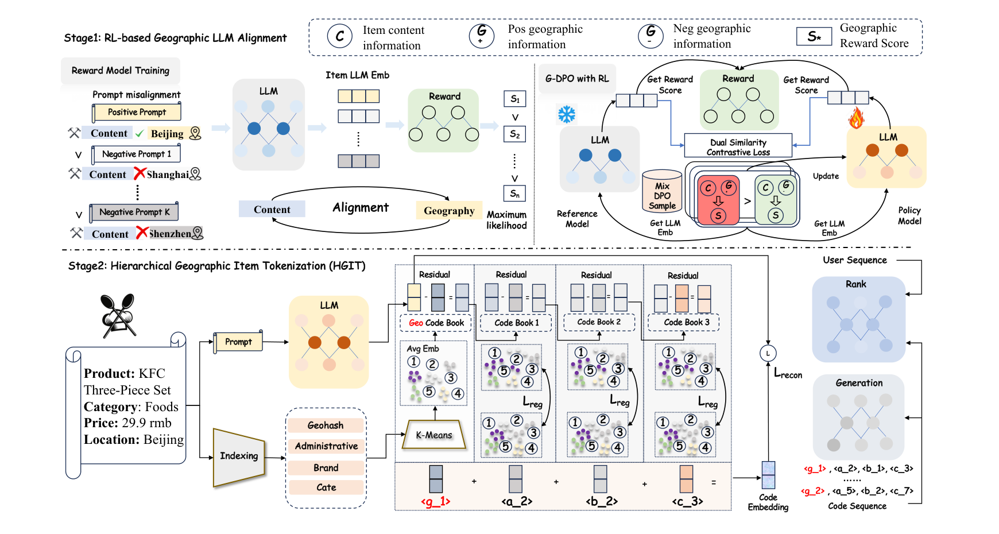

# LGSID

*LLM-Aligned Geographic Item Tokenization for Local-Life Recommendation* — Jiang et al., AAAI’26 · `POI`

[arXiv](https://arxiv.org/abs/2511.14221) · [Record](../../data/papers/lgsid.yaml) · [← Catalog](../../README.md#i--representation)

> Abstract: "simply injecting location information into prompts fails to capture fine-grained spatial characteristics and real-world distance awareness among items".

| Problem it fixes | Stage it changes |
| :-- | :-- |
| **I. Informativeness**: Do the SIDs, or the model reading them, carry the collaborative and multimodal signals recommendation needs? | **Representation** |

## Pipeline

| Representation | Tokenization | Backbone | Training | Inference |
| :-: | :-: | :-: | :-: | :-: |
| **`Text+Geo+CF`** | `Geo-Idx+RQ` | `Disc. / Enc-Dec` | `Fixed / Discrim. / NTP` | `Scoring / Beam†` |

- `Geo-Idx+RQ`: Geographic attribute index plus residual quantization (LGSID).
- `Disc. / Enc-Dec`: Evaluated on both discriminative rankers (DIN, etc.) and Encoder-Decoder generative models (LGSID).
- `Fixed`: SIDs are built first and not changed while the generator trains.
- `Discrim. / NTP`: Discriminative scoring objective vs. generative next-token prediction objective (LGSID).
- `Scoring / Beam†`: Discriminative candidate scoring vs. generative beam search.

## Architecture

## Evidence

- **`problem`** (abstract, p1): Abstract: "simply injecting location information into prompts fails to capture fine-grained spatial characteristics and real-world distance awareness among items".
- **`stage`** (contribution list, p2; p4): Both designs (RL-based geographic alignment, hierarchical geographic tokenization) fix the same problem; the first contribution, aligning the item-encoding LLM (G-DPO), decides.
- **`backbone`** (Table 1, Table 2, p5–6): Discriminative models DIN, TWIN, ETA etc. (Table 1 of the paper); generative experiments on TIGER and OneRec (Table 2 of the paper), both Enc-Dec in Table 1.

## 旧卡片说明

迁自 `d61aa6c:papers/lgsid.md`。保留方法说明、实验叙述与局限；本轮只对照现有记录处理明确冲突，未重新逐句核查原论文。分类和规格以页面上方由记录生成的表格为准。

### LGSID：大语言模型对齐的地理物品分词

> LGSID 先用地理偏好对齐大语言模型，再将地理属性和内容表示分别量化为层次化 SID，以增强本地生活推荐的空间一致性。

### 研究动机与问题定义

本地生活物品的语义相似并不等于地理可行。仅把地点写进提示词，可能无法让 LLM 学到细粒度的城市、区域和街道关系。LGSID 试图让 LLM 的表示具有真实空间知识，并把这种表示用于生成可解释的地理物品 SID。

### TL;DR（核心摘要）

`内容/地理信息 → 地理奖励模型与G-DPO → 地理/语义表示 → 层次化量化 → 判别式或生成式推荐`

方法首先利用正负地理提示训练 list-wise reward model，再通过 G-DPO 将空间关系和协同信号注入 LLM。随后从对齐后的 LLM 表示和离散地理属性中构造主 token，并用残差量化补充细节 token；SID 分别用于判别式与生成式推荐模型。

### 输入与使用场景

| 方面 | 说明 |
|---|---|
| 使用信息 | POI 文本内容、行政区、地理位置和用户行为 |
| 信息融入位置 | LLM 对齐、主 token 构建、残差量化和生成输入 |
| 语义标识结构 | 层次化主 token 加残差 token |
| 适用场景 | 本地生活和地理约束推荐 |

### 方法设计

#### 3.1 地理奖励模型训练
作者构造内容相同或相近但地理位置不同的提示对，并用实际地理关系生成排序偏好。奖励模型输出内容-地理匹配分数，作为后续 LLM 对齐的监督信号。

#### 3.2 基于 G-DPO 的地理 LLM 对齐
G-DPO 使用正、负地理信息和奖励模型分数构造偏好优化目标。模型需要提高符合真实位置关系的响应概率，同时保留原有语义能力；双相似度对比损失进一步约束内容和地理表示。

#### 3.3 层次化地理物品分词
HGIT 从 POI 的行政区、品牌、类别等离散属性得到地理 code，再使用对齐 LLM 表示进行多级残差量化。最终 SID 的前缀具有较粗粒度地理含义，后续 token 表达更细的内容与位置差异。

#### 3.4 下游推荐
论文分别评估判别式模型（DIN、TWIN、ETA 等，Table 1）和生成式模型（TIGER、OneRec，Table 2）。前者使用 SID 特征对候选评分，后者生成 SID；当前记录以 A / B 写法保留两个分支。

### 实验结论

- 在 Kuaishou 本地生活数据上，LGSID 相比比较方法取得更好的离线 AUC 和推荐效果。
- 可视化和属性解码实验表明，层次化 SID 前缀能保留城市、区域等地理结构，并提高属性可解释性。
- 论文报告不同 token 化策略的分布差异，但动态物品和线上延迟结果未报告。

### 局限性与研究定位

#### 局限性

- G-DPO 需要构造地理偏好对和奖励模型，训练流程较复杂。
- 地理主 token 依赖行政与属性索引，对跨区域、属性缺失和新增 POI 的适应性仍需验证。

#### 研究定位

LGSID 位于“LLM 对齐驱动的地理 SID 构建”方向，突出先获得空间感知表示、再进行层次化量化的设计。

### 相关资源

- [论文原文](https://arxiv.org/abs/2511.14221)

### 标签

`地理物品分词` · `G-DPO` · `层次化SID` · `本地生活`

### 架构图来源

*图源：原论文，图2（[论文原文](https://arxiv.org/abs/2511.14221)）。图片使用许可待核实。*

---

### 旧总表补充

来源：`d61aa6c:tables/all-methods.md`。

- 核心贡献：用地理对齐和层次化分词增强空间一致性。
- 使用场景：本地生活推荐。

## Same cell: I × Representation (11 more)

| Paper | Venue | Pipeline |
| :-- | :-- | :-- |
| [Molar](molar.md) | arXiv’24 | **`Text+Img+CF`** → `–` → `Dec-Only` → `– / Discrim.` → `Scoring` |
| [OneLoc](oneloc.md) | arXiv’25 | **`Text+Img+Geo†`** → `R-KM` → `Enc-Dec` → `Fixed / NTP → DPO` → `Beam` |
| [Q-BERT4Rec](q-bert4rec.md) | arXiv’25 | **`Text+Img+CF`** → `RQ-VAE` → `Encoder (Non-AR)` → `Fixed / Masked` → `Non-AR` |
| [UNGER](unger.md) | TOIS’25 | **`Text+CF`** → `R-KM` → `Enc-Dec` → `Fixed / NTP + Ctr.` → `Beam` |
| [GeoGR](geogr.md) | arXiv’26 | **`Text+Geo+CF`** → `R-KM+EM` → `Dec-Only` → `Altern.† / Multi-task NTP` → `Beam` |
| [HF-SID](hf-sid.md) | arXiv’26 | **`Text+Attr+Geo`** → `R-KM` → `Dec-Only` → `Fixed / NTP` → `C-Beam` |
| [LGRID](lgrid.md) | arXiv’26 | **`Text+Geo`** → `DSRQ` → `Disc.` → `Fixed / Discrim.` → `Scoring` |
| [ReSID](resid.md) | arXiv’26 | **`Attr+CF`** → `GAOQ` → `Enc-Dec` → `Fixed / NTP` → `Beam` |
| [SCRec](screc.md) | RecSys’26 | **`Text+CF`** → `RQ-VAE` → `Non-AR / Enc-Dec` → `Fixed / MTP + Ctr.` → `Scoring / Beam†` |
| [SPAR](spar.md) | arXiv’26 | **`Text+Geo`** → `R-KM` → `Dec-Only` → `Fixed / Multi-task NTP` → `–` |
| [TriAlignGR](trialigngr.md) | arXiv’26 | **`Text+Img`** → `RQ-VAE` → `Dec-Only` → `Fixed / Multi-task NTP` → `C-Beam` |
