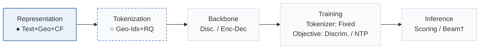
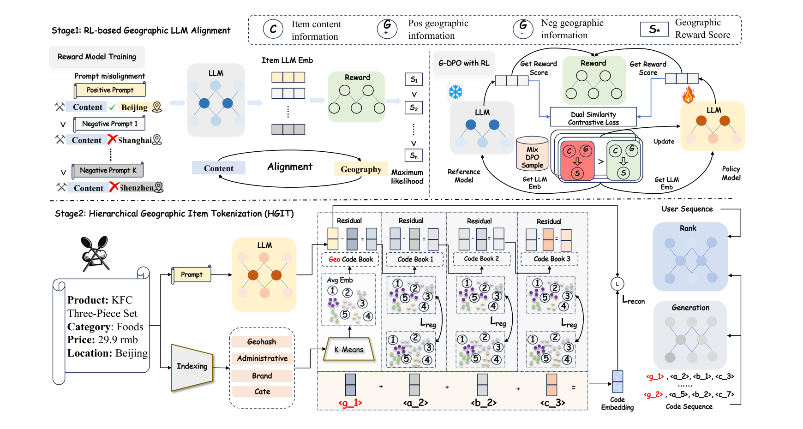
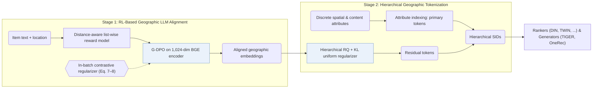
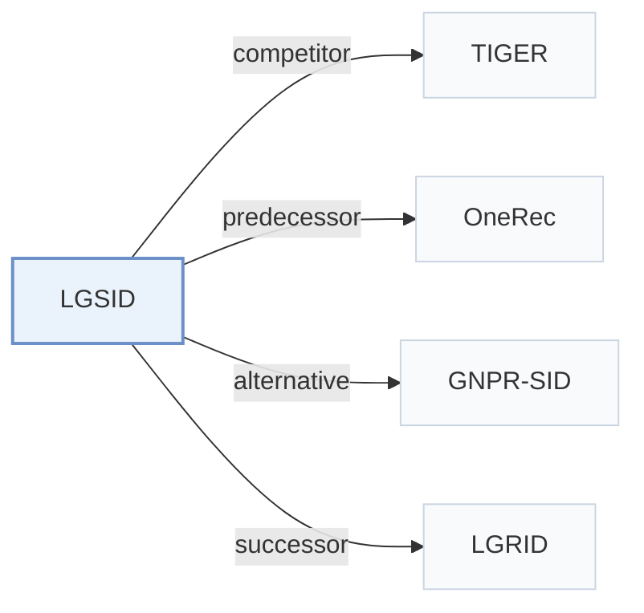

# LGSID

[← Problem × Stage Matrix](../../README.md#i--representation) · [Papers by Stage](../index/stages.md) · [Papers by Modality](../index/modality.md) · [Papers by Domain](../index/domain.md) · English | [中文](../zh/papers/lgsid.md)

| **Title** | *LLM-Aligned Geographic Item Tokenization for Local-Life Recommendation* |
| :-- | :-- |
| **Authors** | Jiang et al. |
| **Venue** | AAAI’26 |
| **Problem × Stage** | `I. Informativeness` · `Representation` · `POI` |
| **Changes** | ● Representation · ○ Tokenization |
| **SID inputs** | `Text` + `Geo` + `Attr` + `CF` |
| **Domain** | `POI / Local` |
| **Scenario** | `POI and Local Services` · `Ranking and Reranking`; `Industrial Data, Offline` |
| **Links** | [Paper](https://arxiv.org/abs/2511.14221) · [Code](https://github.com/JiangHaoPG11/LGSID) |
| **Reading level** | Reading Notes (Level 2) |

**On this page**: [TL;DR](#tldr) · [At a Glance](#at-a-glance) · [1. Why It Matters](#1-why-this-paper-matters) · [2. Method](#2-how-it-works) · [3. Experiments](#3-experimental-findings) · [4. Limitations](#4-limitations--critical-analysis) · [5. Related Work](#5-connections-to-related-work)

- `Text+Geo+CF`: Text representations combined with geographic features and collaborative signals.
- `Geo-Idx+RQ`: Geographic indexing combined with residual quantization.
- `Disc. / Enc-Dec`: Discriminative scoring and encoder–decoder generation variants.
- `Fixed`: SIDs are built first and not changed while the generator trains.
- `Discrim. / NTP`: Discriminative scoring or next-token prediction in different configurations.
- `Scoring / Beam†`: Discriminative candidate scoring vs. generative beam search.

### TL;DR

> [!NOTE]
> LGSID aligns an LLM to spatial relationships with a reward model and G-DPO, then builds Semantic IDs from spatial and content attributes plus residual tokens from the aligned LLM representation.

---

### At a Glance

| Aspect | Summary |
| :-- | :-- |
| Key Findings | On Kuaishou local-life recommendation data, LGSID improves five discriminative rankers (DIN, DIEN, SIM, TWIN, ETA) and two generative backbones (TIGER and OneRec) over existing item tokenizers (Tables 1–2). |
| Limitation | LLM alignment needs a separately trained list-wise reward model before G-DPO, and the residual tokens change whenever that alignment is redone (Abstract). |

---

### 1. Why This Paper Matters

Text-based recommenders encode item descriptions through prompts and quantize the resulting embeddings into discrete Semantic IDs (SIDs). In local-life services, placing location text into a prompt misses fine-grained spatial structure and real-world physical distances among stores. LGSID aligns the item-encoding LLM to physical distance relationships via reinforcement learning before hierarchical tokenization.

> "However, in domain-specific tasks such as local-life services, simply injecting location information into prompts fails to capture fine-grained spatial characteristics and real-world distance awareness among items." (Abstract)

---

### 2. How It Works

#### Reward Model

A list-wise reward model is trained on distance-aware item lists to score spatial proximity among local-life items (Introduction).

> "The RL-based alignment module first trains reward models using distance-aware list-wise sampling to capture and compress real-world spatial relationships." (Introduction)

#### G-DPO Alignment

Geographic Direct Preference Optimization (G-DPO) uses the trained reward model to align a 1,024-dimensional BGE encoder toward spatial distance relationships and collaborative signals. An in-batch contrastive regularizer keeps each updated item embedding close to the reference model's semantic representation (G-DPO, Eq. 7–8).

> "To preserve LLMs' semantic representations during G-DPO updates, we introduce an in-batch contrastive loss as a similarity regularizer, as shown in Eq. 7." (G-DPO)

#### Hierarchical Geographic Item Tokenization

Each item's SID combines two parts: primary tokens indexed directly from discrete spatial and content attributes, followed by residual tokens produced by a hierarchical residual quantizer with a KL uniform-usage regularizer over the G-DPO-aligned geographic vectors (Abstract, Hierarchical Geographic Item Tokenization).

---

### 3. Experimental Findings

Experimental setup

- **Datasets**: Kuaishou local-life feed data only: 50,000,000 samples, 19,080,888 users, 2,325,266 items, 19,408 brands, 818 categories, with item text and geographic location. For discriminative models, all positives are kept and negatives down-sampled 1:4. Further filtering: not reported.
  - Source: Industrial-only dataset and preprocessing: [A2.SS0.SSSx1.p1](https://arxiv.org/html/2511.14221v1#A2.SS0.SSSx1.p1); statistics: [A2.T4](https://arxiv.org/html/2511.14221v1#A2.T4).
- **Split**: Generative models: leave-one-out on the down-sampled data (last item for test, second-last for validation, the rest for training). Discriminative models: split rule not reported; settings selected on validation data.
  - Source: Leave-one-out for generative models on the down-sampled data: [A2.SS0.SSSx1.p1](https://arxiv.org/html/2511.14221v1#A2.SS0.SSSx1.p1); split for discriminative AUC not stated.
- **Candidates**: Discriminative AUC: evaluation samples with negatives down-sampled at 1:4 to positives; how negatives are drawn and whether user history is excluded: not reported. Generative Hit and NDCG at 5 and 10: full catalog versus sampled not reported.
  - Source: Negative down-sampling and metrics: [A2.SS0.SSSx1.p1](https://arxiv.org/html/2511.14221v1#A2.SS0.SSSx1.p1).
- **Visibility**: warm; no unseen-item protocol is defined.
  - Source: Standard split with no unseen-item protocol: [A2.SS0.SSSx1.p1](https://arxiv.org/html/2511.14221v1#A2.SS0.SSSx1.p1).
- **SID**: Hierarchical residual quantizer over G-DPO-aligned BGE embeddings (1,024-dimensional) with a KL regularizer toward uniform cluster usage; number of levels and per-level codebook sizes K_l: not reported. Collision handling: not reported.
  - Source: Hierarchical quantizer with uniform-usage regularization: [Sx4.SSx3.p4](https://arxiv.org/html/2511.14221v1#Sx4.SSx3.p4) and [Sx4.SSx3.p5](https://arxiv.org/html/2511.14221v1#Sx4.SSx3.p5); BGE embeddings: [A2.SSx1.p1](https://arxiv.org/html/2511.14221v1#A2.SSx1.p1); no codebook sizes or collision rule found.
- **Inference budget**: SIDs are used as features in DIN, DIEN, SIM, TWIN, ETA and as targets in TIGER and OneRec generators; decoding method and beam width: not reported. All experiments on two 48GB GPUs; inference batch size and latency: not reported.
  - Source: Hardware: [A2.SSx2.p1](https://arxiv.org/html/2511.14221v1#A2.SSx2.p1); generative backbones: [A2.SSx3.p1](https://arxiv.org/html/2511.14221v1#A2.SSx3.p1).
- **Results from**: Table 1 (AUC of five discriminative rankers with different tokenizers); Table 2 (TIGER and OneRec generators with different tokenizers); Table 3 (semantic and geographic coverage after alignment); Table 5 (robustness over runs); Table 6 (similarity weight).
  - Source: Discriminative: [Sx5.T1](https://arxiv.org/html/2511.14221v1#Sx5.T1); generative: [Sx5.T2](https://arxiv.org/html/2511.14221v1#Sx5.T2); alignment: [Sx5.T3](https://arxiv.org/html/2511.14221v1#Sx5.T3); robustness: [A4.T5](https://arxiv.org/html/2511.14221v1#A4.T5); lambda: [A4.T6](https://arxiv.org/html/2511.14221v1#A4.T6).

- Discriminative and generative backbones: on Kuaishou local-life feed data (50,000,000 samples across 2,325,266 items), plugging LGSID tokens into five discriminative rankers (DIN, DIEN, SIM, TWIN, ETA) in Table 1 and two generative backbones (TIGER and OneRec) in Table 2 outperforms existing item tokenizers (Tables 1–2).
- Alignment coverage and stability: Table 3 shows higher semantic and geographic coverage after G-DPO alignment, while Tables 5 and 6 evaluate multi-run stability and sensitivity to the contrastive similarity weight (Tables 3, 5, and 6).

---

### 4. Limitations & Critical Analysis

**Our analysis.**

- Primary tokens depend on discrete spatial and category attributes, which suggests that POIs with missing metadata require a fallback path.
- All experiments run on a proprietary Kuaishou dataset without a public POI benchmark, and codebook sizes and collision rates are not reported; the later LGRID paper reports a 97.0% full-SID collision rate for LGSID on Kuaishou.
- LGRID uses `DSRQ` codes for discriminative ranking only (`Disc.`); LGSID uses `Geo-Idx+RQ` codes as features for discriminative rankers and as targets for `Enc-Dec` generators (`Disc. / Enc-Dec`).

---

### 5. Connections to Related Work

- **Competitor** · [TIGER](tiger.md): TIGER's RQ-VAE is a tokenizer baseline and TIGER is one of two generative backbones; LGSID aligns the LLM embedding with geographic rewards before a hierarchical quantizer.
  - Source: LGSID v1, baselines: [A2.SSx3.p1](https://arxiv.org/html/2511.14221v1#A2.SSx3.p1); Tables 1 and 2: [Sx5.T1](https://arxiv.org/html/2511.14221v1#Sx5.T1) and [Sx5.T2](https://arxiv.org/html/2511.14221v1#Sx5.T2).
- **Predecessor** · [OneRec](onerec.md): OneRec serves as the second generative backbone into which LGSID's SIDs are plugged.
  - Source: LGSID v1, baselines: [A2.SSx3.p1](https://arxiv.org/html/2511.14221v1#A2.SSx3.p1); Table 2: [Sx5.T2](https://arxiv.org/html/2511.14221v1#Sx5.T2).
- **Alternative** · [GNPR-SID](gnpr-sid.md): GNPR-SID builds POI SIDs for next-POI generation; LGSID targets local-life ranking features and aligns embeddings with geographic distance rewards.
  - Source: LGSID v1, related work: [Sx2.SSx2.p1](https://arxiv.org/html/2511.14221v1#Sx2.SSx2.p1) and [Sx4.SSx2.p1](https://arxiv.org/html/2511.14221v1#Sx4.SSx2.p1).
- **Successor** · [LGRID](lgrid.md): LGRID later follows LGSID's candidate protocol and replaces its single fused representation with disentangled geographic and semantic streams.
  - Source: Evidence is from the later LGRID paper: protocol [A1.SS3.p2](https://arxiv.org/html/2607.27944v1#A1.SS3.p2); baseline and collision comparison [S4.SS1.p2](https://arxiv.org/html/2607.27944v1#S4.SS1.p2) and [S4.T5](https://arxiv.org/html/2607.27944v1#S4.T5).

[View all papers in this cell](../../README.md#i--representation)
