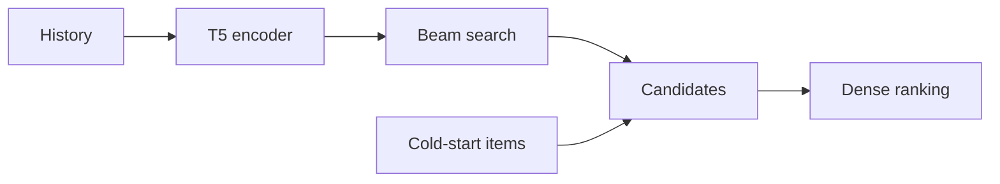

# LIGER

*Unifying generative and dense retrieval for sequential recommendation* — Yang et al. · arXiv’24

`VI. Generalization` · `Inference`

[Paper](https://arxiv.org/abs/2411.18814) · [Matrix](../../README.md#vi--inference)

Reading level: Reading Notes (Level 2) · On this page: [TL;DR](#tldr) · [At a Glance](#at-a-glance) · [1. Why This Paper Matters](#1-why-this-paper-matters) · [2. How It Works](#2-how-it-works) · [3. Experimental Findings](#3-experimental-findings) · [4. Limitations & Critical Analysis](#4-limitations--critical-analysis) · [5. Connections to Related Work](#5-connections-to-related-work)

| Representation | Tokenization | Backbone | Training | Inference |
| :-: | :-: | :-: | :-: | :-: |
| `Text+SID` | `RQ-VAE` | `Enc-Dec` | `Fixed / NTP + Dense` | **`Hybrid`** |

- `Text+SID`: Text representation plus semantic IDs (hybrid dense and generative retrieval).
- `Enc-Dec`: Encoder-decoder.
- `Fixed`: SIDs are built first and not changed while the generator trains.
- `NTP + Dense`: NTP plus dense-vector prediction.

### TL;DR

LIGER integrates sequential dense retrieval into a Semantic ID generative retriever, after a controlled comparison of both approaches, to narrow their performance gap and improve cold-start recommendation.

### At a Glance

| Aspect | Summary |
| :-- | :-- |
| Research Problem | VI. Generalization: Does it still work for new items, new domains, and shifting interests? |
| Key Contribution | LIGER integrates sequential dense retrieval into a Semantic ID generative retriever, after a controlled comparison of both approaches, to narrow their performance gap and improve cold-start recommendation. |
| Modified Stage | Inference |
| Limitation | Every cold-start item joins the candidate set, and the design assumes that cold-start items are few (Sec. 3). |

### 1. Why This Paper Matters

Sequential dense retrieval stores one representation per item, so memory grows with the catalog (Abstract). Generative retrieval predicts Semantic IDs (SIDs) instead, but a fair comparison of the two was missing (Abstract).

> "Our findings indicate that the model's learned conditional probabilities tends to overfit to items seen during training, leading to a significantly reduced capability to generate cold-start items." (Sec. 2.4)

Based on arXiv v2.

### 2. How It Works

*Figure source: Fig. 2, original paper.*

#### Input and Training

Each SID token embedding adds the item's text representation and two position embeddings (Sec. 3). Training combines a cosine-similarity loss toward the next item's text representation with next-token prediction on its SID (Sec. 3).

#### Hybrid Inference

The decoder proposes candidates, and the encoder output ranks them together with the cold-start items (Sec. 3, Algorithm 1).

> "During inference, the decoder retrieves K items by beam search, then supplemented with cold-start items and ranked with the encoder's output embeddings." (Sec. 3)

The authors base this design on an assumption about cold-start items (Sec. 3).

> "This design choice is based on the hypothesis that cold-start items are relatively sparse compared to in-set items, as recommendation systems periodically update themselves to incorporate newly introduced items." (Sec. 3)

### 3. Experimental Findings

**Experimental setup**

- **Datasets**: Amazon Beauty, Sports and Outdoors, Toys and Games, and Steam with 5-core filtering of users and items; sequences truncated to the 20 most recent items. Sizes (users / items / cold-start items): Beauty 22,363 / 12,101 / 43; Toys 19,412 / 11,924 / 56; Sports 35,598 / 18,357 / 81; Steam 47,761 / 12,012 / 400.
- **Split**: Per-user leave-one-out: last item for test, preceding item for validation, the rest for training; early stopping on in-set NDCG@10; mean and standard deviation over three seeds. Test targets are reported separately for in-set and cold-start items.
- **Candidates**: Hybrid: generative retrieval returns K=20 candidates by beam search, which are ranked together with the cold-start items by dense retrieval (K swept from 20 to 100 and K=N in Table 4). Dense baselines score the full catalog.
- **Visibility**: In-set targets: warm. Cold-start targets: unseen by tokenizer too; cold-start items are excluded from RQ-VAE training (the paper says to avoid contamination), and the generators fail to produce them. Exact criterion for selecting cold-start items beyond the counts in Table 3: not reported.
- **SID**: 3-level RQ-VAE x 256 codewords (dimension 128) over sentence-T5-XXL text embeddings; following TIGER, an extra token is appended to make IDs unique.
- **Inference budget**: Beam search retrieves K candidates (K=20 for the main result) from a T5 encoder-decoder (6 layers each), then a dense head ranks them with cold-start items. Complexity is stated as O(tK) versus O(N) for dense retrieval (Table 1); hardware, inference batch size, and latency: not reported.
- **Results from**: Table 2 (Beauty, Sports, Toys, Steam; in-set and cold-start Recall@10 and NDCG@10; three seeds); Table 4 (number of retrieved candidates K); Figures 1, 3, 4 (dense versus generative retrieval and cold-start generation probabilities); Appendix D (ablations).

Sources

- **Datasets**: Datasets, 5-core, truncation: [S4.SS1.p1](https://arxiv.org/html/2411.18814v2#S4.SS1.p1); statistics and cold-start counts: [A2.T3](https://arxiv.org/html/2411.18814v2#A2.T3).
- **Split**: Leave-one-out allocation: [S4.SS1.p4](https://arxiv.org/html/2411.18814v2#S4.SS1.p4); three seeds: [S4.SS2.p1](https://arxiv.org/html/2411.18814v2#S4.SS2.p1).
- **Candidates**: Hybrid candidates (K from beam, ranked with cold-start items by dense scores): [S4.SS2.p2](https://arxiv.org/html/2411.18814v2#S4.SS2.p2); K sweep: [A3.T4](https://arxiv.org/html/2411.18814v2#A3.T4).
- **Visibility**: Cold-start items excluded from RQ-VAE training: [S4.SS1.p4](https://arxiv.org/html/2411.18814v2#S4.SS1.p4); cold-start definition beyond counts not stated.
- **SID**: 3 levels x 256 with dimension 128 and an extra uniqueness token: [S4.SS1.p2](https://arxiv.org/html/2411.18814v2#S4.SS1.p2).
- **Inference budget**: Beam retrieval of K candidates and complexity: [S2.SS1.p3](https://arxiv.org/html/2411.18814v2#S2.SS1.p3) and [S3.T1](https://arxiv.org/html/2411.18814v2#S3.T1); model: [S4.SS1.p3](https://arxiv.org/html/2411.18814v2#S4.SS1.p3).
- **Results from**: Main: [S4.T2](https://arxiv.org/html/2411.18814v2#S4.T2); K sweep: [A3.T4](https://arxiv.org/html/2411.18814v2#A3.T4); motivation figures: [S1.F1](https://arxiv.org/html/2411.18814v2#S1.F1), [S2.F3](https://arxiv.org/html/2411.18814v2#S2.F3), [S2.F4](https://arxiv.org/html/2411.18814v2#S2.F4).

- Reporting setup: generative retrieval returns 20 items, which are ranked with the cold-start items (Sec. 4.2).
- Main result: LIGER narrows the gap to dense retrieval and improves cold-start recommendation on the evaluated datasets (Abstract).

### 4. Limitations & Critical Analysis

**Our analysis.**

- The final order comes from the dense embedding. The generated SID selects candidates but does not decide their order.
- TIGER retrieves by `Beam` search only; LIGER adds a dense loss (`NTP + Dense`) and `Hybrid` ranking.

### 5. Connections to Related Work

- **Competitor** · [TIGER](tiger.md): TIGER retrieves only by beam search over semantic IDs and almost never generates cold-start items; LIGER reranks TIGER-style beam candidates plus cold-start items with a dense head trained jointly.
  - Source: LIGER v2, faithful TIGER implementation: https://arxiv.org/html/2411.18814v2#S1.p5; Table 2: https://arxiv.org/html/2411.18814v2#S4.T2; cold-start analysis of TIGER's epsilon quota: https://arxiv.org/html/2411.18814v2#S2.SS4.p3; LIGER builds on TIGER: https://arxiv.org/html/2411.18814v2#S4.SS2.p2.
- **Alternative** · [VQ-Rec](vq-rec.md): VQ-Rec uses vector-quantized codes inside a dense retriever; LIGER keeps generative beam search and adds dense ranking only over a small candidate set.
  - Source: LIGER v2, Appendix A related work: https://arxiv.org/html/2411.18814v2#A1.p2.
- **Alternative** · [COBRA](cobra.md): COBRA later cascades sparse-ID generation with a generated dense vector inside one decoder and cites LIGER for the fine-grained similarity gap of generative methods.
  - Source: Evidence is from the later COBRA paper, Section 1: https://arxiv.org/html/2503.02453v1#S1.p3.
- **Successor** · [GEM-Rec](gem-rec.md): GEM-Rec later builds on LIGER's reproduction of the TIGER architecture and its 5-core preprocessing.
  - Source: Evidence is from the later GEM-Rec paper, Section 5.4 and Appendix B.1: https://arxiv.org/html/2603.22231v1#S5.SS4.p1 and https://arxiv.org/html/2603.22231v1#A2.SS1.p1.

[View all papers in this cell](../../README.md#vi--inference)
