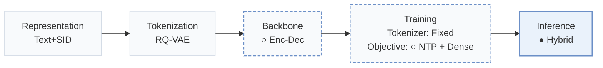
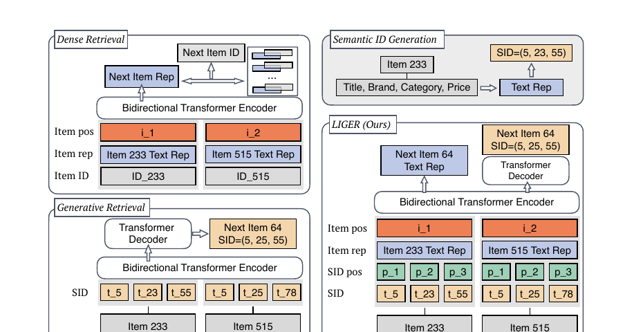
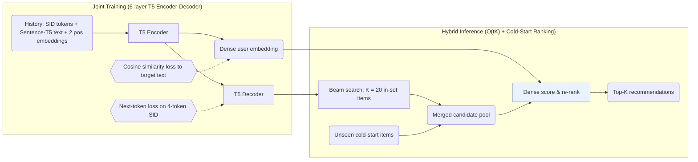
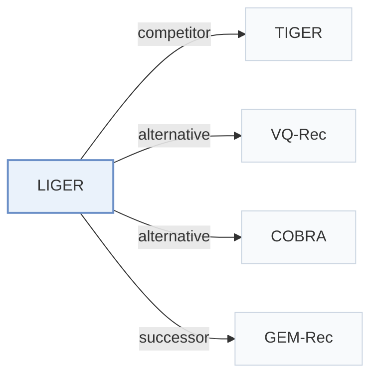

# LIGER

[← Problem × Stage Matrix](../../README.md#vi--inference) · [Papers by Stage](../index/stages.md) · [Papers by Modality](../index/modality.md) · [Papers by Domain](../index/domain.md) · English | [中文](../zh/papers/liger.md)

| **Title** | *Unifying generative and dense retrieval for sequential recommendation* |
| :-- | :-- |
| **Authors** | Yang et al. |
| **Venue** | arXiv’24 |
| **Problem × Stage** | `VI. Generalization` · `Inference` |
| **Changes** | ○ Backbone · ○ Objective · ● Inference |
| **SID inputs** | `Text` |
| **Domain** | `E-commerce` · `Games` |
| **Settings** | `cold-start (item)` |
| **Links** | [Paper](https://arxiv.org/abs/2411.18814) |
| **Reading level** | Reading Notes (Level 2) |

**On this page**: [TL;DR](#tldr) · [At a Glance](#at-a-glance) · [1. Why It Matters](#1-why-this-paper-matters) · [2. Method](#2-how-it-works) · [3. Experiments](#3-experimental-findings) · [4. Limitations](#4-limitations--critical-analysis) · [5. Related Work](#5-connections-to-related-work)

- `Text+SID`: Text representation plus semantic IDs (hybrid dense and generative retrieval).
- `RQ-VAE`: Residual-Quantized Variational AutoEncoder.
- `Enc-Dec`: Encoder-decoder.
- `Fixed`: SIDs are built first and not changed while the generator trains.
- `NTP + Dense`: NTP plus dense-vector prediction.
- `Hybrid`: Hybrid retrieval combining generative SID decoding with dense or co-occurrence retrieval.

### TL;DR

> [!NOTE]
> LIGER integrates sequential dense retrieval into a Semantic ID generative retriever, after a controlled comparison of both approaches, to narrow their performance gap and improve cold-start recommendation.

---

### At a Glance

| Aspect | Summary |
| :-- | :-- |
| Key Findings | By combining K = 20 beam-searched SID candidates with cold-start items for dense re-ranking, LIGER narrows the performance gap to full-catalog dense retrieval and improves cold-start recommendation across Amazon Beauty, Sports, Toys, and Steam (Abstract, Sec. 4.2, Table 2). |
| Limitation | Every cold-start item joins the candidate set, and the design assumes that cold-start items are few (Sec. 3). |

---

### 1. Why This Paper Matters

Sequential dense retrieval stores a continuous vector per item so memory and inference cost scale linearly with catalog size, whereas generative retrieval decodes compact Semantic IDs (SIDs) via beam search (Abstract, Table 1). Through a controlled comparison, the paper shows that generative retrieval lags behind dense retrieval on warm items and almost never generates unseen cold-start items because its token probabilities overfit to training items (Sec. 2.4). LIGER bridges both regimes by training one encoder-decoder with joint generative and dense objectives and ranking beam candidates together with cold-start items.

> "Our findings indicate that the model's learned conditional probabilities tends to overfit to items seen during training, leading to a significantly reduced capability to generate cold-start items." (Sec. 2.4)

---

### 2. How It Works

#### Input and Training

Each item in the user history is represented by summing its SID token embeddings, its frozen Sentence-T5-XXL text embedding, and two position embeddings (item position and token position; Sec. 3, Sec. 4.1). A 6-layer T5 encoder-decoder is trained jointly with next-token prediction over the target item's 4-token SID (3 RQ-VAE levels of 256 codewords plus a uniqueness token) and a cosine-similarity loss aligning the encoder output with the target item's text embedding (Sec. 3, Sec. 4.1).

#### Hybrid Inference

At inference, the decoder runs beam search to propose $`K`$ in-set candidates ($`K = 20`$ in the main experiments), appends all cold-start items to form a compact candidate pool, and ranks the combined pool by dot-product similarity against the encoder's dense output embedding (Sec. 3, Algorithm 1).

> "During inference, the decoder retrieves K items by beam search, then supplemented with cold-start items and ranked with the encoder's output embeddings." (Sec. 3)

Appending the entire cold-start set avoids full-catalog scoring as long as cold-start items remain a small fraction of the catalog between periodic system updates (Sec. 3).

> "This design choice is based on the hypothesis that cold-start items are relatively sparse compared to in-set items, as recommendation systems periodically update themselves to incorporate newly introduced items." (Sec. 3)

---

### 3. Experimental Findings

Experimental setup

- **Datasets**: Amazon Beauty, Sports and Outdoors, Toys and Games, and Steam with 5-core filtering of users and items; sequences truncated to the 20 most recent items. Sizes (users / items / cold-start items): Beauty 22,363 / 12,101 / 43; Toys 19,412 / 11,924 / 56; Sports 35,598 / 18,357 / 81; Steam 47,761 / 12,012 / 400.
  - Source: Datasets, 5-core, truncation: [S4.SS1.p1](https://arxiv.org/html/2411.18814v2#S4.SS1.p1); statistics and cold-start counts: [A2.T3](https://arxiv.org/html/2411.18814v2#A2.T3).
- **Split**: Per-user leave-one-out: last item for test, preceding item for validation, the rest for training; early stopping on in-set NDCG@10; mean and standard deviation over three seeds. Test targets are reported separately for in-set and cold-start items.
  - Source: Leave-one-out allocation: [S4.SS1.p4](https://arxiv.org/html/2411.18814v2#S4.SS1.p4); three seeds: [S4.SS2.p1](https://arxiv.org/html/2411.18814v2#S4.SS2.p1).
- **Candidates**: Hybrid: generative retrieval returns K=20 candidates by beam search, which are ranked together with the cold-start items by dense retrieval (K swept from 20 to 100 and K=N in Table 4). Dense baselines score the full catalog.
  - Source: Hybrid candidates (K from beam, ranked with cold-start items by dense scores): [S4.SS2.p2](https://arxiv.org/html/2411.18814v2#S4.SS2.p2); K sweep: [A3.T4](https://arxiv.org/html/2411.18814v2#A3.T4).
- **Visibility**: In-set targets: warm. Cold-start targets: unseen by tokenizer too; cold-start items are excluded from RQ-VAE training (the paper says to avoid contamination), and the generators fail to produce them. Exact criterion for selecting cold-start items beyond the counts in Table 3: not reported.
  - Source: Cold-start items excluded from RQ-VAE training: [S4.SS1.p4](https://arxiv.org/html/2411.18814v2#S4.SS1.p4); cold-start definition beyond counts not stated.
- **SID**: 3-level RQ-VAE x 256 codewords (dimension 128) over sentence-T5-XXL text embeddings; following TIGER, an extra token is appended to make IDs unique.
  - Source: 3 levels x 256 with dimension 128 and an extra uniqueness token: [S4.SS1.p2](https://arxiv.org/html/2411.18814v2#S4.SS1.p2).
- **Inference budget**: Beam search retrieves K candidates (K=20 for the main result) from a T5 encoder-decoder (6 layers each), then a dense head ranks them with cold-start items. Complexity is stated as O(tK) versus O(N) for dense retrieval (Table 1); hardware, inference batch size, and latency: not reported.
  - Source: Beam retrieval of K candidates and complexity: [S2.SS1.p3](https://arxiv.org/html/2411.18814v2#S2.SS1.p3) and [S3.T1](https://arxiv.org/html/2411.18814v2#S3.T1); model: [S4.SS1.p3](https://arxiv.org/html/2411.18814v2#S4.SS1.p3).
- **Results from**: Table 2 (Beauty, Sports, Toys, Steam; in-set and cold-start Recall@10 and NDCG@10; three seeds); Table 4 (number of retrieved candidates K); Figures 1, 3, 4 (dense versus generative retrieval and cold-start generation probabilities); Appendix D (ablations).
  - Source: Main: [S4.T2](https://arxiv.org/html/2411.18814v2#S4.T2); K sweep: [A3.T4](https://arxiv.org/html/2411.18814v2#A3.T4); motivation figures: [S1.F1](https://arxiv.org/html/2411.18814v2#S1.F1), [S2.F3](https://arxiv.org/html/2411.18814v2#S2.F3), [S2.F4](https://arxiv.org/html/2411.18814v2#S2.F4).

- Controlled gap and cold-start failure: when cold-start items are held out from RQ-VAE training (43 items on Beauty, 56 on Toys, 81 on Sports, and 400 on Steam; Table 3), TIGER-style generative retrieval assigns them near-zero generation probability, whereas LIGER recovers cold-start Recall@10 and NDCG@10 across all four datasets over 3 random seeds (Sec. 2.4, Sec. 4.2, Table 2, Figs. 3–4).
- Hybrid candidate sweep: retrieving $`K = 20`$ candidates via beam search and ranking them with cold-start items matches or approaches full-catalog ($`K = N`$) dense ranking at a fraction of the scoring cost, with further gains as $`K`$ increases from 20 to 100 (Sec. 4.2, Table 4, Fig. 1).

---

### 4. Limitations & Critical Analysis

**Our analysis.**

- In LIGER's hybrid stage, the generated SID acts only as a coarse candidate filter ($`K = 20`$), while the dense dot product determines the final ranking order and all cold-start placements.
- If a streaming platform ingests thousands of new items between tokenizer rebuilds, scoring every cold-start item on each request erodes the $`O(tK)`$ complexity advantage over $`O(N)`$ dense retrieval (Table 1).
- TIGER retrieves by `Beam` search with `NTP` alone; LIGER trains with `NTP + Dense` and performs `Hybrid` generative-plus-dense inference.

---

### 5. Connections to Related Work

- **Competitor** · [TIGER](tiger.md): TIGER retrieves only by beam search over semantic IDs and almost never generates cold-start items; LIGER reranks TIGER-style beam candidates plus cold-start items with a dense head trained jointly.
  - Source: LIGER v2, faithful TIGER implementation: [S1.p5](https://arxiv.org/html/2411.18814v2#S1.p5); Table 2: [S4.T2](https://arxiv.org/html/2411.18814v2#S4.T2); cold-start analysis of TIGER's epsilon quota: [S2.SS4.p3](https://arxiv.org/html/2411.18814v2#S2.SS4.p3); LIGER builds on TIGER: [S4.SS2.p2](https://arxiv.org/html/2411.18814v2#S4.SS2.p2).
- **Alternative** · [VQ-Rec](vq-rec.md): VQ-Rec uses vector-quantized codes inside a dense retriever; LIGER keeps generative beam search and adds dense ranking only over a small candidate set.
  - Source: LIGER v2, Appendix A related work: [A1.p2](https://arxiv.org/html/2411.18814v2#A1.p2).
- **Alternative** · [COBRA](cobra.md): COBRA later cascades sparse-ID generation with a generated dense vector inside one decoder and cites LIGER for the fine-grained similarity gap of generative methods.
  - Source: Evidence is from the later COBRA paper, Section 1: [S1.p3](https://arxiv.org/html/2503.02453v1#S1.p3).
- **Successor** · [GEM-Rec](gem-rec.md): GEM-Rec later builds on LIGER's reproduction of the TIGER architecture and its 5-core preprocessing.
  - Source: Evidence is from the later GEM-Rec paper, Section 5.4 and Appendix B.1: [S5.SS4.p1](https://arxiv.org/html/2603.22231v1#S5.SS4.p1) and [A2.SS1.p1](https://arxiv.org/html/2603.22231v1#A2.SS1.p1).

[View all papers in this cell](../../README.md#vi--inference)
