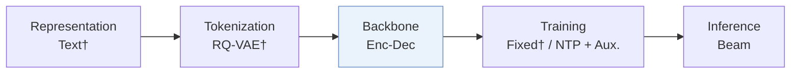

# LION

*Self-Evolving Memory for Generative Recommendation* — Lin et al. · CIKM’26

`VI. Generalization` · `Backbone`

[Paper](https://arxiv.org/abs/2609.15598) · [Code](https://github.com/JazyJiang/Self-Evolving-Memory-for-Generative-Recommendation) · [Matrix](../../README.md#vi--backbone)

Reading level: Overview (Level 1) · On this page: [TL;DR](#tldr) · [At a Glance](#at-a-glance) · [3. Experimental Findings](#3-experimental-findings) · [5. Connections to Related Work](#5-connections-to-related-work)

- `Enc-Dec`: Encoder-decoder.
- `NTP + Aux.`: NTP plus another auxiliary loss.

### TL;DR

LION adds a sparse key-value memory layer that isolates the evolution of different behavior patterns, with a consolidation loss, instead of updating all shared parameters on streaming interactions.

### At a Glance

| Aspect | Summary |
| :-- | :-- |
| Research Problem | VI. Generalization: Does it still work for new items, new domains, and shifting interests? |
| Key Contribution | LION adds a sparse key-value memory layer that isolates the evolution of different behavior patterns, with a consolidation loss, instead of updating all shared parameters on streaming interactions. |
| Modified Stage | Backbone |

### 3. Experimental Findings

**Experimental setup**

- **Datasets**: Amazon Games, CDs, and Toys; next-item samples with at most 10 previous interactions. Filtering rules not reported.
- **Split**: Target timestamps define five equal-count chronological periods P0-P4; adapt through each period and evaluate the next (P1-P4). Current-period validation file used; validation fraction not reported.
- **Candidates**: not reported
- **Visibility**: warm; no unseen-item protocol is defined. Item/tokenizer exposure across periods not reported.
- **SID**: TIGER instantiation; tokenizer construction, SID length, codebook sizes, and collision handling not reported.
- **Inference budget**: Beam 20; K=10/20. Sparse memory defaults: 64 keys per dimension, top-32 activation, decoder layer 5, routing history length 2. Hardware, inference batch size, and latency not reported.
- **Results from**: Original Table 1: sample-weighted micro-average over four periods x five user groups; Table 2: period/group results; Table 3: ablations. Baselines adapted to TIGER in this paper.

Sources

- **Datasets**: Section 5.1.1: [S5.SS1.SSS1.p1](https://arxiv.org/html/2609.15598v1#S5.SS1.SSS1.p1)
- **Split**: Sections 2/5.1.1/5.1.4: [S2.p3](https://arxiv.org/html/2609.15598v1#S2.p3) and [S5.SS1.SSS1.p2](https://arxiv.org/html/2609.15598v1#S5.SS1.SSS1.p2) and [S5.SS1.SSS4.p1](https://arxiv.org/html/2609.15598v1#S5.SS1.SSS4.p1)
- **Candidates**: Section 5.1.2 defines generated-list metrics but no evaluation candidate pool: [S5.SS1.SSS2.p1](https://arxiv.org/html/2609.15598v1#S5.SS1.SSS2.p1)
- **Visibility**: Section 5.1 defines streaming periods without an unseen-item holdout: [S5.SS1](https://arxiv.org/html/2609.15598v1#S5.SS1)
- **SID**: Sections 2/5.1.4 give generic token identifiers and the TIGER implementation: [S2.p1](https://arxiv.org/html/2609.15598v1#S2.p1) and [S5.SS1.SSS4.p1](https://arxiv.org/html/2609.15598v1#S5.SS1.SSS4.p1)
- **Inference budget**: Section 5.1.2 and Appendix A.1: [S5.SS1.SSS2.p1](https://arxiv.org/html/2609.15598v1#S5.SS1.SSS2.p1) and [A1.SS1.p1](https://arxiv.org/html/2609.15598v1#A1.SS1.p1)
- **Results from**: Section 5.1.3 and Tables 1-3: [S5.SS1.SSS3.p1](https://arxiv.org/html/2609.15598v1#S5.SS1.SSS3.p1) and [S5.T1](https://arxiv.org/html/2609.15598v1#S5.T1) and [S5.T2](https://arxiv.org/html/2609.15598v1#S5.T2) and [S5.T3](https://arxiv.org/html/2609.15598v1#S5.T3)

### 5. Connections to Related Work

- **Predecessor** · [TIGER](tiger.md): LION adds sparse evolving memory to TIGER's continual fine-tuning baseline.
  - Source: LION v1, Sections 5.1.3/5.1.4 and Table 1: https://arxiv.org/html/2609.15598v1#S5.SS1.SSS3.p1; https://arxiv.org/html/2609.15598v1#S5.SS1.SSS4.p1; https://arxiv.org/html/2609.15598v1#S5.T1.

[View all papers in this cell](../../README.md#vi--backbone)
