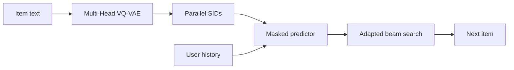

# LLaDA-Rec

*Discrete Diffusion for Parallel Semantic ID Generation in Generative Recommendation* — Shi et al. · arXiv’25

`III. SID–Model Alignment` · `Backbone`

[Paper](https://arxiv.org/abs/2511.06254) · [Code](https://github.com/TengShi-RUC/LLaDA-Rec) · [Matrix](../../README.md#iii--backbone)

Reading level: Reading Notes (Level 2) · On this page: [TL;DR](#tldr) · [At a Glance](#at-a-glance) · [1. Why This Paper Matters](#1-why-this-paper-matters) · [2. How It Works](#2-how-it-works) · [3. Experimental Findings](#3-experimental-findings) · [4. Limitations & Critical Analysis](#4-limitations--critical-analysis) · [5. Connections to Related Work](#5-connections-to-related-work)

| Representation | Tokenization | Backbone | Training | Inference |
| :-: | :-: | :-: | :-: | :-: |
| `Text` | `Par. VQ` | **`Non-AR`** | `Fixed / Masked` | `Diff.` |

- `Non-AR`: Non-autoregressive.
- `Fixed`: SIDs are built first and not changed while the generator trains.
- `Masked`: Masks part of the codes and reconstructs them (includes masked diffusion).
- `Diff.`: Diffusion decoding.

### TL;DR

LLaDA-Rec generates parallel Semantic IDs by discrete diffusion with bidirectional attention, history-level and item-level masking, and an adapted beam search, instead of left-to-right autoregressive decoding.

### At a Glance

| Aspect | Summary |
| :-- | :-- |
| Research Problem | III. SID–Model Alignment: Can the generator read, write, and reason over SIDs, and do the tokenizer and generator work toward the same goal? |
| Key Contribution | LLaDA-Rec generates parallel Semantic IDs by discrete diffusion with bidirectional attention, history-level and item-level masking, and an adapted beam search, instead of left-to-right autoregressive decoding. |
| Modified Stage | Backbone |
| Limitation | Fewer diffusion steps improve generation efficiency but lower recommendation performance, and the authors leave a better trade-off as an open question (Sec. 5.4.3, Fig. 5). |

### 1. Why This Paper Matters

Autoregressive generative recommenders decode a Semantic ID (SID) one token at a time with causal attention. The authors name two limitations of this setup: each token attends only to its predecessors, and errors in early tokens propagate through the fixed left-to-right order (Abstract). LLaDA-Rec replaces left-to-right decoding with discrete diffusion over all SID positions.

> "To address these issues, we propose LLaDA-Rec, a discrete diffusion framework that reformulates recommendation as parallel semantic ID generation." (Abstract)

Based on arXiv v1.

### 2. How It Works

*Figure source: Fig. 2, original paper.*

#### Parallel Tokenization

A Multi-Head VQ-VAE splits the item's text embedding into sub-vectors and quantizes each sub-vector independently, one head per SID position (Sec. 4.1). The authors use this scheme because residual quantization does not match a bidirectional architecture (Abstract).

#### Masked Training

Training uses two masking mechanisms (Abstract). User-history masking captures sequential dependencies between items. Next-item masking masks tokens of the target item's SID while the user history stays visible, so the predictor learns relationships between tokens of the same item (Sec. 4.2.3).

#### Adaptive-Order Decoding

Inference starts from a fully masked SID and fills it over several steps (Sec. 4.3.4). At each step the model selects positions to keep and remasks the rest.

> "All unselected positions are remasked so that the MASK predictor can re-evaluate them in the context of the partially generated sequence." (Sec. 4.3.4)

The number of steps is controllable, and each step can predict several tokens (Sec. 4.4.2). An adapted beam search keeps several candidates during this process, because standard beam search does not fit diffusion-based generation (Abstract).

### 3. Experimental Findings

**Experimental setup**

- **Datasets**: Amazon Reviews 2023: Industrial Scientific (50,985 users / 25,848 items), Musical Instruments (57,439 / 24,587), Video Games (94,762 / 25,612). Filtering rules: not reported.
  - Source: Amazon 2023 categories and ordering: https://arxiv.org/html/2511.06254v1#S5.SS1.SSS1.p1; statistics: https://arxiv.org/html/2511.06254v1#S4.T2.
- **Split**: Chronological leave-one-out: last item for test, second-to-last for validation, the rest for training.
  - Source: Leave-one-out allocation: https://arxiv.org/html/2511.06254v1#S5.SS1.SSS1.p1.
- **Candidates**: not reported (full catalog versus sampled evaluation candidates); top-k lists from the adapted beam search.
  - Source: Metrics only: https://arxiv.org/html/2511.06254v1#S5.SS1.SSS3.p1.
- **Visibility**: warm; no unseen-item protocol is defined.
  - Source: Standard split with no unseen-item protocol: https://arxiv.org/html/2511.06254v1#S5.SS1.SSS1.p1.
- **SID**: Parallel semantic IDs from a Multi-Head VQ-VAE over Sentence-T5 embeddings: the embedding is split into 4 sub-vectors, each quantized by its own codebook of 256 codes (dimension 32). Collision handling: not reported.
  - Source: M=4 codebooks x 256 x 32 with Multi-Head VQ-VAE: https://arxiv.org/html/2511.06254v1#S5.SS1.SSS4.p1 and https://arxiv.org/html/2511.06254v1#S4.SS1.p3; no collision rule found.
- **Inference budget**: Discrete-diffusion decoding with beam search over iteratively selected positions and remasking; beam size B: not reported numerically. Bidirectional Transformer encoder (4 layers; 6 for Game). Hardware, inference batch size, and latency: not reported. Recall at 1, 5, 10 and NDCG at 5, 10.
  - Source: Beam search adapted to diffusion decoding: https://arxiv.org/html/2511.06254v1#S4.SS3.SSS3.p1 and https://arxiv.org/html/2511.06254v1#S4.SS3.SSS4.p1; no numerical beam size or hardware found.
- **Results from**: Table 3 (Scientific, Instrument, Game versus item-ID, diffusion, and semantic-ID baselines; paired t-tests); Table 4 (ablations including RQ-VAE tokenizer and greedy decoding); Figure 3 (attention mechanisms); Section 5.4 (hyperparameters).
  - Source: Main: https://arxiv.org/html/2511.06254v1#S4.T3; ablation: https://arxiv.org/html/2511.06254v1#S5.T4; attention study: https://arxiv.org/html/2511.06254v1#S5.F3.

- Main comparison: LLaDA-Rec outperforms ID-based and generative recommenders on three real-world datasets (Abstract).
- Generation order: the adaptive order performs best, and left-to-right sometimes performs worst (Sec. 5.4.2, Fig. 4).

  > "The adaptive approach consistently delivers superior performance, with left2right occasionally producing the poorest results, highlighting the shortcomings of the commonly used left2right scheme." (Sec. 5.4.2)

### 4. Limitations & Critical Analysis

**Our analysis.**

- The tokenizer is trained once and kept fixed (`Fixed`), and it encodes item text only (`Text`). This suggests that collaborative signals enter only through the generator.
- RPG also generates parallel codes with a `Non-AR` generator; RPG uses `Par. OPQ` codes and `Graph` decoding, while LLaDA-Rec uses `Par. VQ` codes and `Diff.` decoding.

### 5. Connections to Related Work

- **Competitor** · [RPG](rpg.md): RPG predicts long unordered OPQ codes in parallel with multi-token prediction; LLaDA-Rec generates parallel VQ codes by discrete diffusion with an adapted beam search.
  - Source: LLaDA-Rec v1, Table 1 comparison and semantic-ID baselines: https://arxiv.org/html/2511.06254v1#S4.T1 and https://arxiv.org/html/2511.06254v1#S5.SS1.SSS2.p2; Table 3: https://arxiv.org/html/2511.06254v1#S4.T3.
- **Competitor** · [TIGER](tiger.md): TIGER generates hierarchical RQ-VAE codes left to right with causal attention; LLaDA-Rec uses bidirectional attention and fills code positions in any order.
  - Source: LLaDA-Rec v1, Table 1 and baselines (TIGER and TIGER-SAS): https://arxiv.org/html/2511.06254v1#S4.T1 and https://arxiv.org/html/2511.06254v1#S5.SS1.SSS2.p2; Table 3: https://arxiv.org/html/2511.06254v1#S4.T3.
- **Competitor** · [LETTER](letter.md): LETTER improves a hierarchical tokenizer for left-to-right generation; LLaDA-Rec replaces the hierarchy with parallel codes suited to diffusion.
  - Source: LLaDA-Rec v1, baselines: https://arxiv.org/html/2511.06254v1#S5.SS1.SSS2.p2; Tables 1 and 3: https://arxiv.org/html/2511.06254v1#S4.T1 and https://arxiv.org/html/2511.06254v1#S4.T3.
- **Competitor** · [LC-Rec](lc-rec.md): LC-Rec aligns an LLM to semantic IDs with auxiliary tasks and causal decoding; LLaDA-Rec trains a bidirectional masked predictor with history-level and item-level masking.
  - Source: LLaDA-Rec v1, baselines: https://arxiv.org/html/2511.06254v1#S5.SS1.SSS2.p2; Tables 1 and 3: https://arxiv.org/html/2511.06254v1#S4.T1 and https://arxiv.org/html/2511.06254v1#S4.T3.
- **Competitor** · [VQ-Rec](vq-rec.md): VQ-Rec pools product-quantized codes into an item representation for discriminative ranking; LLaDA-Rec generates parallel codes directly.
  - Source: LLaDA-Rec v1, baselines: https://arxiv.org/html/2511.06254v1#S5.SS1.SSS2.p2; Table 3: https://arxiv.org/html/2511.06254v1#S4.T3.

[View all papers in this cell](../../README.md#iii--backbone)
